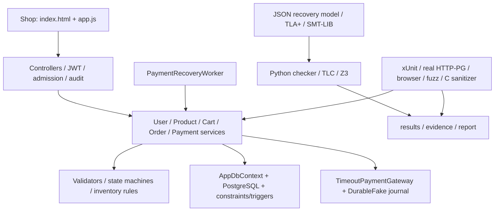

# Giải thích dự án và kiểm chứng an toàn theo 4 chương

Ngày đối chiếu: **22/10/2026**, múi giờ Asia/Bangkok. Tài liệu giải thích source, model, script và evidence hiện có **ngoài thư mục `ATPM/`**. Các file sinh tự động, ảnh và font được giải thích theo nhóm; các file source nghiệp vụ và kiểm chứng được liệt kê theo tên.

Đề tài Group 14: **Xây dựng và kiểm chứng an toàn hệ thống xử lý đơn hàng và thanh toán trực tuyến**. Hệ thống thực tế là một host ASP.NET Core, các module User/Product/Cart/Order/Payment dùng chung PostgreSQL. Gateway thanh toán là mô phỏng local; chưa tích hợp nhà cung cấp thu tiền thật.

Các số dưới đây lấy từ **evidence đã lưu**, không phải kết quả chạy lại khi viết tài liệu:

| Hạng mục | Kết quả và phạm vi |
| --- | --- |
| Unit/regression | 149/149 PASS, 0 fail, 0 skip; lượt chạy ngày 22/10/2026 |
| Integration | 35/35 PASS, 0 fail, 0 skip; lượt chạy ngày 22/10/2026 |
| Recovery model | 14 state, 35 event/transition có metadata, 7 contract, 15 property; 6/6 mutation âm được phát hiện |
| Excel specification | 10 sheet, 27 yêu cầu chức năng, 50 testcase đặc tả; checker độc lập PASS, 1 vi phạm cố ý |
| C memory demos | 5 module BUGGY/FIXED, 22/22 ca dynamic PASS theo diagnostic kỳ vọng |
| Payment SMT / inventory SMT | 7/7 và 3/3 ca SAT/UNSAT đúng kỳ vọng |
| Unit coverage của InputValidator | Line 85,71%; branch 97,22%; helper MoneyAmounts branch 100% |
| Fuzz coverage của 5 target | Line 91,05% = 112/123; branch 97,50% = 117/120 |
| TLC | Evidence lịch sử: 35 state sinh, 20 state phân biệt, độ sâu graph 9 |

**50 testcase trong Excel không bằng 50 test xUnit**: một testcase đặc tả có thể ứng với nhiều unit/integration test hoặc một nhóm kiểm chứng model.

Mục lục:

- [Bản đồ file và luồng xử lý](#ban-do-file)
- [Chương 1 — Mô hình, verification, validation, static/dynamic](#chuong-1)
- [Chương 2 — Stack, heap, lỗi bộ nhớ, vulnerabilities và công cụ](#chuong-2)
- [Chương 3 — Static analysis, SAT, SMT, BMC và Z3](#chuong-3)
- [Chương 4 — Fuzzing, seed, oracle, coverage, edge, execution và taint](#chuong-4)
- [Các lệnh chạy đầy đủ](#lenh-chay)

<a id="ban-do-file"></a>

## A. Bản đồ file và luồng xử lý

### A.1. Nhìn toàn bộ hệ thống



Ví dụ tạo đơn và thanh toán:

1. Shop gửi JWT và `POST /api/orders`; có thể gửi `Idempotency-Key` để chống tạo đơn lặp.
2. Middleware kiểm rate/body/audit; controller lấy customer từ JWT.
3. `OrderService` đọc giá server, cộng quantity cùng ProductId, kiểm kho rồi reserve và lưu order/receipt trong transaction.
4. `PaymentService` lưu trạng thái PROCESSING và key trước khi gọi gateway; ghi kết quả charge trong transaction finalize riêng.
5. Nếu kết quả chưa rõ, giữ UNKNOWN và reservation. Worker hỏi lại outcome cũ bằng cùng key; không mặc định timeout là decline.
6. Nếu refund, giữ charge reference; chỉ release kho khi hoàn tất refund, không release hai lần.

### A.2. File tại gốc và cấu hình dự án

| File/nhóm | Tác dụng |
| --- | --- |
| `README.md` | Điểm bắt đầu: mục tiêu, build/run, demo, kết quả và giới hạn. |
| `OrderPaymentMicroservice.slnx` | Solution chứa API, unit tests, integration tests và CrashProbe. |
| `OrderPaymentMicroservice_Security_Spec.xlsx` | Đặc tả 10 sheet: thông tin, yêu cầu, ràng buộc, graph, CTL, mutex, sinh mã C, số học, testcase. |
| `test-api.ps1` | Script PowerShell E2E: register/login/cart/order/payment/replay; chạy với một API đang hoạt động, có tạo dữ liệu nghiệp vụ. |
| `.gitignore` | Loại build/cache, secrets, ledger local, TRX local và output tạm khỏi Git. |
| `.vscode/tasks.json` | Task IDE dùng GCC build file C đang mở; không thay thế Makefile có sanitizer. |
| `HUONG_DAN_DU_AN_VA_KIEM_CHUNG_4_CHUONG.md` | Tài liệu đang đọc: vai trò file, ánh xạ kiến thức 4 chương và lệnh tái lập. |
| `.git/` | Metadata/version history của Git; không phải source ứng dụng. |

Các bảng tiếp theo ghi đường dẫn **tương đối với thư mục nêu ở tiêu đề**.

### A.3. API — thư mục `OrderPaymentMicroservice/`

| File | Tác dụng |
| --- | --- |
| `OrderPaymentMicroservice.csproj` | Target .NET 10 và dependencies ASP.NET OpenAPI/JWT, EF Core, Npgsql. Version cụ thể nằm trong file này; không suy EF Core có cùng version với .NET. |
| `Program.cs` | Entry point, DI, cấu hình DB/JWT/gateway, migration/seed, middleware, static files và health endpoints. `BuildApplication` cho phép test dùng cùng ứng dụng với cấu hình riêng. |
| `appsettings.json` | Cấu hình mặc định không chứa secret thực: gateway/recovery/admission/operations và các cấu hình ứng dụng. |
| `appsettings.Development.json` | Cấu hình dành cho Development, chủ yếu điều chỉnh hành vi/log khi phát triển. |
| `Properties/launchSettings.json` | Profile `http`/`https`; HTTP mặc định `http://localhost:5246`, môi trường Development. |
| `OrderPaymentMicroservice.http` | Request mẫu cho REST client IDE; cần điều chỉnh token/body theo API hiện tại. |
| `test-quick.sh` | Curl thử sản phẩm và đăng ký; đang hard-code cổng 5245 trong khi profile HTTP là 5246. Không dùng như bằng chứng toàn flow. |

**Controllers/** là lớp HTTP, xác thực/phân quyền và ánh xạ lỗi ra response:

| File | Tác dụng |
| --- | --- |
| `Controllers/UsersController.cs` | Register/login, đọc/sửa hồ sơ; phân biệt anonymous, chủ tài khoản và quyền được phép. |
| `Controllers/ProductsController.cs` | Đọc catalog; create/update/delete sản phẩm có guard Admin. |
| `Controllers/CartController.cs` | Thêm/sửa/xóa giỏ; so khớp ownership trước khi thao tác tài nguyên. |
| `Controllers/OrdersController.cs` | Tạo/đọc/cancel/confirm/complete order; xử lý order key và JSON conflict `{code,retryable,message}`. |
| `Controllers/PaymentsController.cs` | Tạo/retry/reconcile/refund payment; kiểm quyền theo order và endpoint. |
| `Controllers/OperationsController.cs` | `GET /api/operations/status`, chỉ Admin; `Cache-Control: no-store`, response có giới hạn thông tin. |

**DTOs/** là hợp đồng request/response qua HTTP, khác entity lưu DB:

| File | Tác dụng |
| --- | --- |
| `DTOs/Users/UserRequest.cs` | Chứa các class register/login/update và user/login response; validation các trường user. |
| `DTOs/Products/ProductRequest.cs` | Create/update product và product response, kiểm price/stock/chuỗi đầu vào. |
| `DTOs/Cart/CartRequest.cs` | Add/update cart item, cart/cart-item response. |
| `DTOs/Orders/CreateOrderRequest.cs` | Request tạo đơn: customer, total, địa chỉ và items; controller bind customer từ JWT. |
| `DTOs/Orders/CreateOrderItemRequest.cs` | ProductId, quantity và unit price do client gửi; giá có thẩm quyền vẫn lấy từ server. |
| `DTOs/Orders/OrderResponse.cs` | Receipt/trạng thái order trả cho client. Receipt idempotent là snapshot gốc, không nhất thiết là trạng thái hiện tại. |
| `DTOs/Orders/OrderItemResponse.cs` | Chi tiết từng dòng sản phẩm trong đơn. |
| `DTOs/Payments/CreatePaymentRequest.cs` | OrderId, Amount, IdempotencyKey của charge request. |
| `DTOs/Payments/PaymentResponse.cs` | Outcome, references charge/refund, attempt count và các trường phục vụ đối soát. |

**Models/** là entity/enum nghiệp vụ:

| File | Tác dụng |
| --- | --- |
| `Models/User.cs` | Tài khoản, password hash, role và hồ sơ. |
| `Models/Product.cs` | Catalog price, stock, active và version phục vụ concurrency. |
| `Models/ShoppingCart.cs` | Khai báo giỏ hàng và cart item, quan hệ user/product và tổng giỏ. |
| `Models/Order.cs` | Order, trạng thái, reservation và hash/key/receipt tạo đơn idempotent. |
| `Models/OrderItem.cs` | Quantity, unit price server và subtotal đã chốt của một dòng order. |
| `Models/Payment.cs` | Amount, state, charge/refund references, keys, AttemptCount và PendingSince. |
| `Models/AuditEvent.cs` | Record audit allowlist: actor, correlation, resource, phase/outcome, thời điểm. |
| `Models/OrderStatus.cs` | Enum lifecycle của Order, bao gồm REFUND_PENDING/REFUNDED. |
| `Models/PaymentStatus.cs` | Enum riêng của Payment; có PROCESSING/UNKNOWN và refund states. |
| `Models/InventoryReservationStatus.cs` | UNRESERVED/RESERVED/RELEASED/CONSUMED. |

**Services/** thực hiện nghiệp vụ:

| File | Tác dụng |
| --- | --- |
| `Services/UserService.cs` | PasswordHasher, login/JWT, nâng cấp hash SHA-256 legacy sau login đúng. |
| `Services/ProductService.cs` | Quản lý catalog, validation và cập nhật sản phẩm. |
| `Services/CartService.cs` | Quản lý giỏ, quantity/tổng tiền và kiểm sản phẩm active. |
| `Services/OrderService.cs` | Giá server, aggregate quantity, reserve stock, transaction, receipt idempotent và chuyển lifecycle. |
| `Services/PaymentService.cs` | Lưu intent trước gateway, charge/finalize, bounded retry, lookup/reconcile và refund. |
| `Services/InventoryReservation.cs` | Quy tắc release/consume reservation, tránh hoàn kho lặp. |
| `Services/OrderCreationConflictException.cs` | Lỗi tạo đơn có mã nghiệp vụ và contract retry rõ ràng. |
| `Services/Interfaces/IUserService.cs` | Hợp đồng các thao tác user cho DI/controller/test. |
| `Services/Interfaces/IProductService.cs` | Hợp đồng các thao tác catalog. |
| `Services/Interfaces/ICartService.cs` | Hợp đồng các thao tác giỏ. |
| `Services/Interfaces/IOrderService.cs` | Hợp đồng tạo/đọc/chuyển trạng thái order. |
| `Services/Interfaces/IPaymentService.cs` | Hợp đồng payment/retry/reconciliation/refund. |
| `Services/Payments/IPaymentGateway.cs` | Abstraction charge/refund/status và kiểu request/result cho provider. |
| `Services/Payments/FakePaymentGateway.cs` | Gateway trong memory cho test/demo đơn giản; không bền qua process restart. |
| `Services/Payments/DurableFakePaymentGateway.cs` | Journal local theo operation/key, bind payload/reference; kết quả tồn tại khi API restart. Không phải provider thật. |
| `Services/Payments/TimeoutPaymentGateway.cs` | Deadline wrapper cho cả bốn operation charge/refund/status; giới hạn thời gian caller chờ. |
| `Services/Payments/PaymentRecoveryOptions.cs` | Cấu hình worker scan/recovery. |
| `Services/Payments/PaymentRecoveryWorker.cs` | Background worker lookup các operation unresolved, tiếp tục sau lỗi DB/gateway; không charge mù. |

**Security/** chứa runtime guards và các file đặc tả hình thức:

| File | Tác dụng |
| --- | --- |
| `Security/ClaimsPrincipalExtensions.cs` | Lấy/kiểm user ID trong principal; hỗ trợ ràng buộc ownership. |
| `Security/InputValidator.cs` | Kiểm order: null, IDs, amount, cents, item count, quantity, price, tổng và tolerance 0,01. Target unit/coverage/fuzz chính. |
| `Security/PaymentValidator.cs` | Kiểm OrderId, amount/cents và key bắt buộc, không trắng, tối đa 128 ký tự. |
| `Security/RequestValidation.cs` | Chạy DataAnnotations ở service boundary cho lời gọi ngoài MVC. |
| `Security/MoneyAmountAttribute.cs` | Chứa cả attribute và helper `MoneyAmounts.RequireCents`; từ chối fractional cents, không round âm thầm. |
| `Security/OrderStateMachine.cs` | Allowlist chuyển trạng thái Order; cấm hồi sinh terminal. |
| `Security/PaymentStateMachine.cs` | Allowlist Payment, cập nhật Version/UpdatedAt/PendingSince theo chuyển trạng thái. |
| `Security/ApiAdmissionOptions.cs` | Body/item/rate quota và validation cấu hình. |
| `Security/RequestBodyLimitMiddleware.cs` | Giới hạn body trước JSON binding, kể cả streaming/không Content-Length; trả 413. |
| `Security/PaymentVerification.z3` | SMT-LIB QF_NIA: tổng tiền, điều kiện paid, tồn tại subtotal vượt Int32 và guard tổng. Không chạy trong request API. |
| `Security/InventoryVerification.z3` | SMT-LIB QF_LIA: duplicate product lines, guard tổng quantity và stock không âm. |
| `Security/OrderPayment.tla` | TLA+ với tuple Order/Payment/Inventory/attemptCount; invariant và Termination. |
| `Security/OrderPayment.cfg` | Chọn `Spec`, 5 invariant, temporal property; đặt MaxAttempts=2 cho TLC. |

**Data/**, **Auditing/**, **Operations/** và helper:

| File | Tác dụng |
| --- | --- |
| `Data/AppDbContext.cs` | Entity mapping, index/constraint/concurrency, DB sets và transaction-local actor/correlation phục vụ audit. |
| `Data/PersistenceConflicts.cs` | Phân loại exception chain/SQLSTATE; tránh retry nhầm lỗi constraint hoặc audit thành concurrency. |
| `Data/DbInitializer.cs` | Helper **đang được Program gọi**: `Database.Migrate()` và seed catalog khi cần. |
| `Utilities/DbInitializer.cs` | Helper khởi tạo khác, có `EnsureCreatedAsync`/migration; **không phải đường startup hiện được Program sử dụng**. Không nhầm hai file cùng tên. |
| `Auditing/AuditWriter.cs` | Ghi audit bằng scope/DbContext riêng, budget ghi và telemetry failure. |
| `Auditing/AuditTrailMiddleware.cs` | BEGIN/RESULT cho mutation, correlation server; xử lý tình huống audit không ghi được. |
| `Auditing/BufferedAuditResponse.cs` | Buffer response để chưa phát success trước khi RESULT audit được lưu. |
| `Operations/OperationsOptions.cs` | Cấu hình threshold, polling và quan sát pending/health. |
| `Operations/OperationalTelemetry.cs` | Bộ đếm theo process: audit failure, recovery scan failure/attempt/resolved và lần scan. |
| `Operations/OperationsSnapshot.cs` | Query tổng pending/stuck/oldest age và trạng thái vận hành. |
| `Operations/OperationsAlertWorker.cs` | Poll snapshot và ghi cảnh báo theo contract hiện có; không là hệ thống notification/exporter bên ngoài. |

### A.4. Schema — `OrderPaymentMicroservice/Migrations/`

| Migration `.cs` | Thay đổi schema |
| --- | --- |
| `20260912044133_InitialCreate.cs` | Schema ban đầu Order/Payment và các quan hệ nền. |
| `20260912131635_AddProductUserCart.cs` | Thêm User/Product/ShoppingCart/CartItem và quan hệ. |
| `20260913120000_AddRoleColumnToUsers.cs` | Thêm role cho phân quyền. |
| `20260915044440_AddAddressCityToOrder.cs` | Bổ sung thông tin giao hàng trên Order. |
| `20260921072143_AddPaymentIdempotency.cs` | Lưu key/index phục vụ chống thanh toán lặp. |
| `20261007031314_AddDurableOrderPaymentLifecycle.cs` | Các trường lifecycle/recovery/reservation và refund. |
| `20261007031951_AddLifecycleConcurrencyTokens.cs` | Concurrency version cho lifecycle, chống update với snapshot cũ. |
| `20261012130000_EnforceInventoryAndQuantityBounds.cs` | CHECK Stock không âm, price hợp lệ và Quantity dương. Upper bound quantity 10000 thuộc guard ứng dụng. |
| `20261013120000_AddDurableAuditTrail.cs` | Bảng AuditEvents và append-only protection. |
| `20261013140000_AddAtomicAuditAndOrderIdempotency.cs` | COMMIT audit triggers cùng transaction; customer/key hash/payload hash/receipt tạo đơn. |
| `20261013170000_AddPaymentPendingSince.cs` | PendingSince/backfill/trigger giữ tuổi unresolved, không reset theo UpdatedAt lookup. |
| Các file cùng tên kết thúc `.Designer.cs` | Metadata model tại thời điểm migration tương ứng; EF sinh tự động, không phải migration chạy lần hai. Một số migration viết tay không có file này. |
| `AppDbContextModelSnapshot.cs` | Snapshot model mới nhất để EF so sánh khi sinh migration kế tiếp. |

### A.5. Giao diện — `OrderPaymentMicroservice/wwwroot/`

| File/nhóm | Tác dụng |
| --- | --- |
| `index.html` | Trang shop, form account/cart/checkout/payment/history. |
| `js/app.js` | Gọi API cùng origin, token/session, giỏ hàng, order/payment, giữ attempt/key, retry conflict và xử lý lỗi UI. |
| `js/jquery-2.1.1.min.js`, `js/bootstrap.min.js` | Thư viện giao diện có sẵn. Tên version không phải bằng chứng đã audit dependency. |
| `js/ekko-lightbox.js`, `js/ziehharmonika.js` | Lightbox và thành phần accordion của template giao diện. |
| `css/style.css` | Style riêng của shop. |
| `css/bootstrap.min.css`, `css/font-awesome.min.css` | Framework CSS và icon của template. |
| `img/*.jpg` | Các ảnh asset của giao diện/catalog; được giải thích theo nhóm, không có logic kiểm chứng. |
| `fonts/**` | Font và glyph icon (`.ttf/.woff/.woff2/.eot/.svg`), gồm FontAwesome, glyphicon, feathericons, ecoicons. |

### A.6. Unit/regression — `OrderPaymentMicroservice.Tests/`

| File | Kiểm điều gì? |
| --- | --- |
| `OrderPaymentMicroservice.Tests.csproj` | xUnit/Test SDK, EF InMemory, Coverlet MSBuild và copy corpus vào output. |
| `InputValidatorTests.cs` | Null/rỗng/biên/amount mismatch, quantity/price và tolerance. |
| `MoneyPrecisionTests.cs` | Fractional cent bị từ chối; cent và trailing zeroes được chấp nhận. |
| `RequestBoundaryRegressionTests.cs` | Tổng quantity trùng product, cart validation và không persist khi user/product input sai. |
| `OrderServiceTests.cs` | Giá server, tồn kho, cancel release một lần, paid/confirm/complete và stale write. |
| `PaymentServiceTests.cs` | Amount equality, idempotency, UNKNOWN, bounded charge, decline, refund và reconciliation. |
| `OrderStateMachineTests.cs` | Cạnh hợp lệ/cạnh cấm/terminal của Order. |
| `PaymentStateMachineTests.cs` | Cạnh hợp lệ/cạnh cấm/terminal của Payment. |
| `DurableGatewayTests.cs` | Persist/restart journal, bind payload và cạnh tranh nhiều gateway instance. |
| `GatewayTimeoutTests.cs` | Adapter treo, late result, timeout charge/refund/status, worker progress/shutdown. |
| `PendingAgeTests.cs` | UNKNOWN giữ PendingSince; refund mở cửa sổ unresolved mới. |
| `AdmissionBoundaryTests.cs` | Biên số item trước processing. |
| `BodyLimitTests.cs` | Body đúng cap/vượt cap, có/không Content-Length, rewind stream và 413. |
| `AuditMiddlewareTests.cs` | Allowlist/correlation; BEGIN fail và RESULT fail sau action. |
| `PersistenceConflictTests.cs` | Phát hiện wrapped SQLSTATE 40001/40P01, không nhận nhầm constraint khác. |
| `OrderRetryContractTests.cs` | Allowlist retry tạo order, đúng unique index, key absent và contract không lộ lỗi DB. |
| `UserServiceTests.cs` | PasswordHasher, JWT và nâng cấp SHA-256 legacy. |
| `SecurityFuzzingTests.cs` | Harness 3 campaign: corpus, random validator, random transition với oracle. |
| `FuzzCorpus/order_requests.json` | 8 request seed có nhãn `expectedValid`; regression corpus, không là PRNG seed. |

EF InMemory hỗ trợ unit test nhanh, không tái hiện toàn bộ transaction/locking/constraint PostgreSQL. Các kết luận DB thật dựa vào integration riêng.

### A.7. Integration — `OrderPaymentMicroservice.IntegrationTests/`

| File | Tác dụng |
| --- | --- |
| `OrderPaymentMicroservice.IntegrationTests.csproj` | xUnit, WebApplicationFactory, Testcontainers PostgreSQL; tham chiếu API/CrashProbe. |
| `PostgresApiFixture.cs` | Tạo host HTTP + PostgreSQL tạm qua Docker hoặc local fallback; cấu hình fixture riêng. |
| `LocalPostgresServer.cs` | initdb/pg_ctl/createdb trên thư mục/port tạm; hỗ trợ stop/restart và cleanup cluster test. |
| `DockerFactAttribute.cs` | Điều kiện chạy/skip theo khả năng backend test; phải đọc skip count, không mặc định mọi lần đều chạy PostgreSQL. |
| `OrderPaymentApiTests.cs` | E2E HTTP, ownership/Admin, concurrent payment/cancel, amount/cents, migration và CHECK DB. |
| `AdmissionAuditTests.cs` | Rate/body limits, audit persistence/redaction/append-only và fault BEGIN/RESULT. |
| `AtomicAuditIdempotencyTests.cs` | COMMIT audit rollback, raw SQL audit, replay/key scope, same-key race và nhiều host không oversell. |
| `ProcessRestartTests.cs` | Kill process sau charge journal; process mới worker recovery không charge/release lại. |
| `RefundRestartTests.cs` | Kill process sau refund journal; giữ charge reference, refund và release một lần. |
| `PostgresReconnectTests.cs` | Stop/start PostgreSQL, giữ cùng API process/pool; kiểm charge/refund recovery và health. |
| `OperationsTests.cs` | Quyền status/Admin, no-store/redaction, pending age và audit failure counters. |
| `OperationalProbe.cs` | Helper tạo process API/CrashProbe, HTTP requests, đọc dữ liệu và source hashes cho drills. |
| `OperationalDrillTests.cs` | Backup/restore DB+ledger và bounded load qua hai process API. |
| `OrderRetryLoadTests.cs` | So sánh one-shot với retry policy ở 8 users/4 products, giữ raw attempt samples. |
| `ApplicationSmokeTests.cs` | Normal executable + Chrome + HTTP/PG thật, thêm assertions DB sau browser flow. |

### A.8. CrashProbe — `OrderPaymentMicroservice.CrashProbe/`

| File | Tác dụng |
| --- | --- |
| `OrderPaymentMicroservice.CrashProbe.csproj` | Project executable cho kiểm thử process/fault, dùng chung API implementation. |
| `CrashProbeHost.cs` | Test decorator/barrier sau journal publish, trước finalize; marker/counter giúp điều khiển crash/DB outage. API sản phẩm không có client endpoint để kích crash này. |

### A.9. Source kiểm chứng — `security-analysis/`

| File | Tác dụng |
| --- | --- |
| `README.md` | Index source/model/evidence, cách chạy độc lập với thư mục học phần. |
| `threat_model.json` | Asset/CIA, 4 trust boundary, 9 threat phủ 6 STRIDE, risk/control/property/evidence refs. |
| `verify_threat_model.py` | Kiểm schema/ID/risk score/CIA/STRIDE và tham chiếu bằng chứng; không tự pentest API. |
| `vulnerabilities.json` | 5 finding nghiệp vụ/bảo mật lịch sử, CWE, giả định và remediation; một số trường verified_by là metadata cũ. |
| `order_state_model.json` | Kripke Order cơ sở 8 state, không có mọi sự cố recovery; evidence lịch sử. |
| `order_state_model_buggy.json` | Bản có cạnh CANCELLED→PAID_AFTER_CANCELLED để checker phải trả counterexample. |
| `order_payment_recovery_model.json` | Recovery graph chi tiết: state labels, incident/detection/action/next, contracts/properties và negative scenarios. |
| `verify_recovery_model.py` | Duyệt graph, reachable/witness, contracts, 15 property, 6 mutation; sinh state-response CSV. |
| `audit_liveness.py` | Đối chiếu raw AG AF terminal với graph progress-only; ghi lasso và các cạnh bị lọc. |
| `order_payment_pipeline_spec.json` | Bản JSON đồng nghĩa với phần được xuất từ workbook cho pipeline đặc tả. |
| `create_order_payment_spec.py` | Sinh/cập nhật workbook và pipeline JSON, giữ schema 10 sheet; đọc recovery model. |
| `verify_teacher_spec.py` | Checker độc lập schema Excel/JSON, graph total/reachable, CTL/mutex và input số học/sinh mã. Không chạy công cụ Windows của giảng viên. |
| `verify_payment_smt.py` | Gọi Z3 CLI cho PaymentVerification.z3, so 7 verdict với kỳ vọng và lưu JSON. |
| `verify_inventory_smt.py` | Gọi Z3 CLI cho InventoryVerification.z3, kiểm 3 verdict và lưu version/hash/time. |
| `run_tlc.py` | Chạy TLC từ `tla2tools.jar`; lưu log, hashes/spec/config, verdict và số state. |
| `run_fuzzing.py` | Chạy 3 fuzz tests với timeout 120s và Coverlet; lưu seed, target, coverage, source hashes và outcome. |
| `collect_validator_coverage.py` | Đọc XML Coverlet có sẵn, lấy coverage InputValidator/MoneyAmounts và gate branch≥90%; không tự chạy test. |
| `run_recovery_demo.py` | Chạy riêng 2 reconnect tests, bắt thiếu/stale evidence và source hash không khớp; không ghi TRX subset vào thư mục full-suite. |
| `verify_checkout.py` | Dùng Chrome/Chromium chạy checkout functions thật với mocked fetch/sessionStorage, kiểm retry/key/abort. |
| `run_all_checks.py` | Chuỗi end-to-end mặc định: workbook/recovery/liveness/SMT/threat/C static/sanitizer/CBMC/Valgrind + package/report; ghi `end_to_end.results.json`. Không đọc ATPM, không chạy GUI Windows. |
| `package_evidence.py` | Đọc TRX mới nhất mỗi suite, tạo summary/matrix/manifest hashes và kiểm projection hai graph. Không tự chạy lại các tool được đóng gói. |
| `build_report.py` | Sinh báo cáo/phụ lục từ evidence và chapter templates, yêu cầu full-suite summary PASS. |
| `run_analysis.py` | Orchestrator **legacy**, import module trong `ATPM/`; không nằm trong chuỗi lệnh độc lập của tài liệu này. |
| `create_datasets.py` | Generator **legacy** cho model cơ sở và vulnerability dataset; import helper từ run_analysis. Có thể ghi đè dữ liệu đã bổ sung, không chạy chỉ để đọc/demo project. |

Các tài liệu `IMPLEMENTATION_CONTRACTS.md`, `OPERATIONS.md`, `PHAM_VI_KIEM_CHUNG.md`, `GIAI_THICH_KIEM_THU_INPUT_VALIDATOR.md`, `KICH_BAN_THUYET_TRINH_VA_DEMO.md` đã có trong working tree và là link chính thức của bộ hồ sơ. Nếu một bản clone chỉ có source, dùng source/evidence hiện còn và bổ sung tài liệu từ bản đóng gói đầy đủ.

### A.10. Mô phỏng bộ nhớ — `security-analysis/c-memory/`

| File/nhóm | Tác dụng |
| --- | --- |
| `README.md` | Ownership/lifetime, BUGGY/FIXED, sanitizer oracle và false negatives của static tools. |
| `.gitignore` | Quy tắc bỏ qua output riêng của bộ C. |
| `Makefile` | Build 10 executable bằng GCC+ASan+UBSan; targets `all`, `test`, `static-check`, `bmc-check`, `valgrind-check`, `deep-check`. |
| `modules/demo.h` | Include/common helper `allocate`: lỗi malloc phải exit riêng, không được tính là tái hiện lỗi thành công. |
| `modules/user.c` | Email stack buffer overflow; bản FIXED kiểm strlen. |
| `modules/product.c` | Product name heap buffer overflow; FIXED kiểm độ dài và free cả nhánh reject. |
| `modules/cart.c` | Linked-list node use-after-free khi audit/log; FIXED lấy product_id trước free. |
| `modules/order.c` | Leak child OrderItem array khi chỉ free Order; FIXED free child trước parent. |
| `modules/payment.c` | Double-free transaction_code; FIXED đặt con trỏ owner NULL sau free. |
| `modules/cart` | ELF executable local nằm cạnh source, có thể do task IDE build; không là source hoặc bằng chứng mặc định của Makefile. |
| `tests/check_static.py` | Scanner quy tắc nhỏ, GCC diagnostics, Cppcheck và layout probe; tách BUGGY/FIXED. |
| `tests/layout_probe.c` | Đo sizeof/_Alignof/offsetof từ type thật trong 5 module C. |
| `tests/check_memory.py` | Chạy 22 ca, khớp đúng sanitizer diagnostic và stdout biên; sinh log/summary/dynamic evidence. |
| `tests/check_bmc.py` | Chạy CBMC 10 case trên harness include module thật; bound unwind=64, input 48 byte; sinh log và `bmc-analysis.json`. |
| `tests/check_valgrind.py` | Build lại không sanitizer, chạy Memcheck 10 case; sinh log và `valgrind-analysis.json`. |
| `tests/bmc_harnesses/*.c` | Harness gọi entry point/module thật với input tượng trưng; không sao chép logic sang bản khác. |
| `evidence/static-analysis.json` | Version GCC/Cppcheck, command, findings theo mode, struct layout và assertions. |
| `evidence/dynamic-analysis.json` | 22 testcase, expected diagnostic, exit code, sanitizer/platform và scope limit. |
| `evidence/bmc-analysis.json` | Tool/version/bound, 10 case BUGGY/FIXED, failure text và scope limit. |
| `evidence/valgrind-analysis.json` | Tool/version/build flags, 10 case Memcheck, diagnostic và scope limit. |
| `build/*_buggy`, `build/*_fixed` | Binary do Makefile sinh, mỗi source có hai mode. |
| `results/*.log`, `results/summary.json` | Raw sanitizer log từng ca và bảng kết quả; có thể tái tạo bằng `make test`. |

### A.11. Browser — `security-analysis/browser/`

| File | Tác dụng |
| --- | --- |
| `checkout_retry.template.html` | Browser harness cho mocked HTTP; nhúng checkout block của app.js và assertion retry/state storage. |
| `live_smoke.py` | Điều khiển Chrome qua CDP/WebSocket bằng Python stdlib, chạy với API thật do integration test khởi tạo. |
| `live_smoke.js` | Các thao tác/assertions UI live: account/cart/checkout/payment/history/reload/logout. |

### A.12. Bằng chứng — `security-analysis/results/`

| File/nhóm | Chứng minh/ghi nhận điều gì? |
| --- | --- |
| `application_tests.results.json` | Kết quả toàn unit/integration, từng case, total/pass/fail/skip, thời gian và hash TRX. |
| `application_fuzzing.results.json` | 3 campaign fuzz, seed, target, budget/timeout, coverage và source hashes. |
| `coverage_summary.json` | Coverage riêng InputValidator/MoneyAmounts, methods và threshold 90%. |
| `input-validator.cobertura.xml` | Coverage XML của lượt unit validator/helper. |
| `application-fuzzing-coverage.cobertura.xml` | Coverage XML của 5 target trong lượt fuzz; khác lượt unit ở dòng trên. |
| `order_state_model.results.json` | Verdict các property model cơ sở. |
| `order_state_model_buggy.results.json` | Verdict FAIL kỳ vọng và witness model lỗi. |
| `order_payment_recovery_model.results.json` | 15 property/7 contract, reachable và kết quả 6 mutation. |
| `order_payment_state_response_matrix.csv` | Mỗi state/event: sự cố, phát hiện, cách xử lý, next state. |
| `liveness_audit.results.json` | Raw false/progress-only true, lasso, filtering semantics và limitations. |
| `model_projection.results.json` | 35 event chiếu xuống 22 cặp vòng đời (+6 cặp khóa = 28); workbook khớp recovery sau progress projection. |
| `teacher_spec_verification.json` | Schema workbook/JSON; 10 CTL (9 đúng, `AG(!violation)` false cố ý tại conflict); không thay 15 recovery properties. |
| `end_to_end.results.json` | Chuỗi `run_all_checks.py`: từng bước, exit code, artifact check, phần opt-in bị skip và GUI Windows BLOCKED. |
| `payment_verification.results.json` | 7 ca SMT payment, sat/unsat/models và giới hạn. |
| `inventory_verification.results.json` | 3 ca SMT duplicate lines/stock, command/version/hash/time. |
| `threat_model_results.json` | Kiểm consistency threat model và các tham chiếu. |
| `risk_assessment_results.json` | Điểm đánh giá finding lịch sử theo giả định của dataset; không tự là residual risk sau sửa. |
| `process_restart.results.json` | Kill/restart charge: process cũ/mới, một journal charge, attempt và inventory. |
| `refund_restart.results.json` | Kill/restart refund: reference/hash journal/release-once/PendingSince. |
| `postgres_reconnect_charge.results.json` | Charge recovery cùng process khi DB stop/start; health/counters/stock và hashes. |
| `postgres_reconnect_refund.results.json` | Refund recovery cùng process, một refund/release và giữ charge reference. |
| `backup_restore.results.json` | Hash dữ liệu DB/ledger, triggers/sequence/receipt/recovery sau restore trên môi trường tạm. |
| `load_probe.results.json` | Workload hai API process, raw samples/status counts/latency và inventory. |
| `order_retry_load.results.json` | So sánh logical requests/HTTP attempts/backoff giữa one-shot và bounded retry. |
| `checkout_retry.results.json` | Browser mocked-fetch giữ key/body, retry budget/jitter/cancellation. |
| `application_smoke.results.json` | Browser+API+PG thật, UI errors, flow và DB assertions. |
| `chapter4_run.results.json` | Metadata lịch sử lượt **C static/dynamic**; tên file cũ không có nghĩa đây là fuzzing chương 4 của tài liệu này. |
| `traceability_matrix.csv` | Liên kết requirement/property → source/model → test → evidence → giới hạn. |
| `evidence_manifest.json` | Base commit, dirty tree, packaging time, hash/bytes artifacts; hash packaging không chứng minh thời điểm lịch sử đã chạy source đó. |
| `tlc/OrderPayment.tlc.results.json` | Kết quả TLC, 5 invariant/Termination, hashes/version và graph counts. |
| `tlc/OrderPayment.tlc.log` | Raw stdout/stderr của TLC. |
| `dotnet/*.trx` | Raw full-suite logs local; package chọn lượt mới nhất mỗi suite. Không đặt filtered-test TRX vào đây. |

### A.13. Báo cáo, templates và file sinh

Trong `security-analysis/report/`:

| File | Tác dụng |
| --- | --- |
| `BAO_CAO.md` | Báo cáo kỹ thuật sinh từ evidence và templates. |
| `PHU_LUC_A_G.md` | Phụ lục contract/state/witness/static/SMT/testcase chi tiết. |
| `chapters/01_muc_tieu.md` | Template mục tiêu, phương pháp, threat model. |
| `chapters/02_he_thong.md` | Template kiến trúc/hệ thống. |
| `chapters/03_mo_hinh.md` | Template state/contract/model checking và giới hạn semantics. |
| `chapters/04_bo_nho.md` | Template ownership/lifetime, C static/dynamic. |
| `chapters/05_so_hoc_bo_sung.md` | Template SMT/số học. |
| `chapters/06_kiem_thu_bo_sung.md` | Template unit/integration/fuzz/coverage/recovery/load/browser. |
| `chapters/07_evidence_bo_sung.md` | Template provenance, traceability và evidence. |
| `chapters/08_han_che_bo_sung.md` | Template hạn chế. |
| `chapters/09_ket_luan_bo_sung.md` | Template kết luận. |

Số thứ tự template/report cũ không phải cấu trúc 4 chương của tài liệu đang đọc. Token `@@...@@` trong template được build_report thay bằng số liệu; không xóa template chỉ vì nội dung gần giống output.

Các nhóm output dùng chung: `**/bin/` là assembly/executable; `**/obj/` là intermediate build/NuGet metadata; `**/TestResults/` là kết quả test tạm; `**/__pycache__/` là Python bytecode; `.pytest_cache/` là cache pytest; `Security/states/` và `*_TTrace_*` là output TLC; `App_Data/payment-gateway/` là journal local **có trạng thái cần giữ để recovery**. File config/secrets local nếu có không phải dữ liệu để chép vào báo cáo. Các thư mục tạm/cache khác được giải thích như output sinh tự động, không phải module mới của hệ thống.

<a id="chuong-1"></a>

## B. Chương 1 — Mô hình hóa, verification, validation và cách đánh giá

### B.1. Phân biệt các khái niệm bằng việc đã làm

| Khái niệm | Ý nghĩa | Dự án áp dụng ở đâu? |
| --- | --- | --- |
| Specification | Viết hệ thống phải bảo đảm điều gì, điều kiện nào được phép chuyển trạng thái. | Workbook, JSON contracts/properties, state machines, SMT-LIB và TLA+. |
| Verification | Kiểm một artifact có thỏa specification/property đã xác định không. | Checker Kripke/recovery, Z3, TLC; unit/integration cũng kiểm contract implementation. |
| Validation của hệ thống | Đánh giá hành vi có đáp ứng mục tiêu sử dụng và kịch bản nghiệp vụ không. | Register→cart→order→payment→history trên browser/HTTP thật; recovery sau outage, refund và restore. Mới là bằng chứng kịch bản test, chưa có nghiên cứu người dùng/production acceptance. |
| Input validation | Kiểm dữ liệu đầu vào trước khi dùng/persist. | InputValidator, PaymentValidator, DataAnnotations, cents/quantity/body guards. Đây là cơ chế runtime, không đồng nghĩa toàn bộ hoạt động validation của hệ thống. |
| Static analysis/review | Xem source/model mà không chạy chương trình nghiệp vụ cần phân tích. | Review ownership/JWT/prices; GCC syntax/warnings, Cppcheck, scanner C. |
| Dynamic analysis/testing | Chạy target và quan sát hành vi thực tế. | xUnit, PostgreSQL/HTTP, browser, process kill, DB stop/start, sanitizer, fuzz và coverage. |

Hai cặp khái niệm ở hai trục khác nhau: một unit test chạy động vẫn có thể làm verification đối với một contract. Chạy một Python checker là thực thi **công cụ kiểm chứng**; nó không vì vậy trở thành dynamic testing của API.

### B.2. Threat model đã xây dựng thế nào?

`threat_model.json` tổ chức chuỗi **asset → threat → vulnerability → attack → risk → control → evidence**:

- Asset: credentials, dữ liệu order/cart, payment/idempotency, giá/tồn kho, secrets và audit trail.
- CIA: confidentiality bảo vệ dữ liệu riêng; integrity bảo vệ giá/payment/stock; availability bảo vệ phục vụ và đối soát.
- Bốn trust boundary: Client→API, Process→PostgreSQL, Service→Gateway, Host config→Process.
- Chín threat phủ sáu loại STRIDE: Spoofing, Tampering, Repudiation, Information Disclosure, Denial of Service, Elevation of Privilege.
- Risk trong threat model dùng likelihood×impact, mỗi thang 1–5. Đây là cách chấm giáo dục theo giả định, không phải residual risk đã đo hoặc cùng một phép tính với dataset risk assessment.

Ví dụ cụ thể: client gửi hai dòng cùng product với stock=10, quantity=6 mỗi dòng. Nếu chỉ kiểm từng dòng, cả hai đều qua nhưng kết quả stock=-2. Control là cộng quantity theo ProductId trước guard; evidence gồm SMT witness, unit regression, HTTP PostgreSQL và CHECK không cho stock âm.

`verify_threat_model.py` kiểm tính nhất quán dữ liệu, độ phủ STRIDE/CIA và tham chiếu property/evidence. **Đủ STRIDE không chứng minh mọi cuộc tấn công đều đã được thử.**

### B.3. Kripke structure trong dự án

Mô hình dùng dạng `K = (S, S0, R, L)`:

| Thành phần | Nghĩa | Trong file model |
| --- | --- | --- |
| `S` | Tập trạng thái hữu hạn. | `states[].id`, ví dụ CREATED, PAYMENT_PENDING, PAID, REFUNDED. |
| `S0` | Trạng thái khởi đầu. | Model cơ sở `initial_states=[CREATED]`; recovery checker bắt đầu CREATED. |
| `R` | Quan hệ chuyển trạng thái. | Cạnh normal/incident có event, action, next state; JSON pipeline chiếu xuống cặp nguồn–đích. |
| `L(s)` | Mệnh đề đúng tại state s. | `paid`, `payment_success`, `inventory_reserved`, `terminal`… |

Ví dụ PAID có nhãn `payment_success`; CANCELLED có nhãn `terminal` và `inventory_released`. Cạnh terminal tự nối lại mình làm quan hệ Kripke **total**: mỗi state có ít nhất một successor. Self-loop này biểu diễn no-op/reject late event, không cho phép mutation hồi sinh Order trong source.

Có ba artifact cần phân biệt:

1. **Model Order cơ sở**: 8 state trong `order_state_model.json`, không có nonterminal waiting self-loop. Kết quả P1–P4 thuộc phạm vi mô hình đơn giản ban đầu, không thay recovery model hiện tại.
2. **Recovery model**: 14 state, 35 event, 7 function contracts trong `order_payment_recovery_model.json`. Một state có thể là kết hợp Order/Payment; `PAYMENT_RETRY` biểu diễn UNKNOWN, không phải enum OrderStatus cùng tên.
3. **Graph workbook/pipeline**: 18 state (14 nghiệp vụ + 4 khóa minh họa) với **28 cặp nguồn–đích**: 22 cặp vòng đời và 6 cặp lock cluster. 35 event không mâu thuẫn với 22 cặp vòng đời; một cặp state có thể có nhiều event.

Recovery model **không còn** `CONFIRMATION_RETRY`: runtime chỉ có Admin confirm hoặc refund, không có scheduler/counter tự động. Trạng thái `conflict` trong workbook là bài tập CWE-667 cố ý, không thuộc recovery model.

### B.4. Kiểm property, tìm witness và kiểm chính checker

`verify_recovery_model.py` đọc model, dựng adjacency, tìm reachable states và đường đi ngắn từ CREATED; sau đó kiểm các nhóm property:

| Nhóm property | Ví dụ điều đã kiểm |
| --- | --- |
| Safety trạng thái | Không unsafe; paid phải có payment evidence; completed phải paid; cancelled không có successful charge. |
| Mutual exclusion | Payment/cancel không đồng thời chiếm critical resource. |
| Contract/event | Mỗi event đúng contract/outcome, deterministic trong cùng state, mọi incident có detection/solution/next. |
| Terminal | Terminal chỉ no-op/reject, không hồi sinh sang payable/paid. |
| Compensation | Failure sau paid giữ evidence hoặc đi refund; không đổi thẳng sang FAILED/CANCELLED. |
| UNKNOWN safety | Chưa có definitive outcome thì không kết thúc sai hoặc release stock. |
| Liveness có điều kiện | P10 kiểm graph progress-only theo policy lọc cạnh, phải đọc cùng audit liveness. |

Sáu **mutation âm** cố ý sửa model để kiểm tra checker có bắt sai phạm không:

| Mutation | Sai phạm được đưa vào |
| --- | --- |
| `BUG-CANCELLED-PAID` | Thanh toán lại Order đã CANCELLED. |
| `BUG-WRONG-AMOUNT` | Paid dù amount không khớp. |
| `BUG-DUPLICATE-SUCCESS` | Hai successful payments. |
| `BUG-RESOURCE-CONFLICT` | Payment và cancel cùng sở hữu tài nguyên. |
| `BUG-PAID-FAILED-WITHOUT-REFUND` | Đã thu tiền nhưng đổi FAILED mà không compensation. |
| `BUG-UNKNOWN-RELEASED` | UNKNOWN nhưng trả kho/kết thúc quá sớm. |

Ví dụ witness: `CREATED → CANCELLED → PAID_AFTER_CANCELLED`. Verdict FAIL trên bản mutation là **kết quả mong đợi**; mutation checker tổng thể PASS khi phát hiện đúng lỗi và có witness.

Workbook kiểm 10 CTL formula, gồm `AG(!violation)`, `EF(main_locked)`, các công thức lồng `AG(payment_pending -> AF(paid | cancelled | failed))` và `AG(paid -> AF(completed | refunded))`. `AG p` nghĩa p đúng ở mọi state reachable trên mọi nhánh; `AF p` nghĩa mọi nhánh cuối cùng đạt p. `EF(refunded)` chỉ chứng minh **có thể** tới refund, không chứng minh mọi order sẽ refund/kết thúc.

Cụm khóa `free/main_holds/log_holds/conflict` được thêm đúng checklist ATPM. `conflict` mang nhãn `violation` và cố ý reachable, nên `AG(!violation)` false và cặp mutex chính bị vi phạm; pipeline sẽ báo CWE-667/CWE-693. Đây là hành vi đúng thiết kế của bài tập, không phải lỗi runtime của service. Vì vậy vẫn cần checker contracts/mutations và implementation tests bổ sung; 10 CTL workbook không tương đương 15 recovery properties.

### B.5. Liveness: kết quả phải diễn giải chính xác

`audit_liveness.py` dùng fixed point cho AF terminal và so hai graph:

| Graph | Kết quả đã lưu | Cách đọc |
| --- | --- | --- |
| Graph đầy đủ | Raw `AG AF terminal = false` | Có đường chờ/retry mãi không tới terminal. |
| Graph bỏ cạnh metadata `stutter` | Progress-only `AG AF terminal = true` | Đúng theo policy lọc cạnh của checker. |

Metadata `stutter` ở dự án có vài cạnh đổi state; tên metadata không bảo đảm đó là stutter theo đầy đủ biến hình thức. Việc xóa cạnh không phải một thuật toán fair-CTL tổng quát. UNKNOWN có thể tồn tại nếu provider không trả definitive result; source ưu tiên giữ reservation để tránh sai về tiền, không hứa luôn kết thúc.

TLC kiểm một TLA+ model riêng với `MaxAttempts=2`, fairness đã khai báo trong `Spec` và property `Termination`. Evidence 20 distinct states thuộc **TLA+ abstraction**, không phải 15 recovery states hoặc mọi execution của C#.

### B.6. Validation động đã làm được gì?

Đã có HTTP/PostgreSQL tests cho ownership/Admin, amount, migration/constraints, concurrent payment/cancel, replay/receipt và audit rollback. Browser thật chạy normal executable qua register/login/cart/order/fake payment/history, reload và logout.

Hai ca DB reconnect giữ **cùng API process/pool**: ready `200→503→200`, worker ghi scan failure rồi resolved; charge chỉ một lần, refund chỉ một lần, release kho đúng một lần. Các ca kill/restart khác dùng process mới với cùng DB/ledger. Backup/restore dùng database/ledger tạm và kiểm receipt/sequence/audit/recovery.

Các phép thử này tăng độ tin cậy cho kịch bản đã chọn. Chưa chứng minh mọi interleaving, failover, network partition, mất điện, provider thật hoặc tiêu chí UX/production đầy đủ. Lệnh tái lập nằm ở [phần F](#lenh-chay).

<a id="chuong-2"></a>

## C. Chương 2 — Stack, heap, lỗi bộ nhớ và vulnerabilities

### C.1. Stack/heap đã được mô phỏng thế nào?

Trong các executable C với GCC/Linux:

| Vùng/khái niệm | Ví dụ trong source | Quy tắc lifetime/ownership |
| --- | --- | --- |
| Stack/automatic storage | `char email[32]` trong register_user. | Hết lifetime khi hàm trả về; không gọi free cho buffer này. |
| Heap/dynamic allocation | `allocate(32)` cho product.name/transaction_code, `allocate(sizeof(...))` cho node/order. | Vùng cấp phát sống tới free; cần owner giải phóng đúng một lần. |
| Pointer | Biến `Product product` có field `char *name`. | Struct/pointer và vùng heap nó trỏ tới là hai thứ khác nhau; free struct không tự free child. |
| Dangling alias | `removed` sau `free(removed)`. | Không được dereference dù địa chỉ vẫn còn trong biến pointer. |
| NUL terminator | Chuỗi trong buffer 32 byte. | Tối đa 31 byte nội dung + 1 byte `\0`; byte length khác số ký tự Unicode. |

Khi nói stack/heap của C# không được suy “mọi value type ở stack, mọi reference ở heap”: placement còn tùy context/runtime. Bằng chứng malloc/free ở đây thuộc **mô phỏng C**, không chứng minh C# managed có cùng memory corruption.

Layout probe đo ABI thực tế trong evidence x86-64: CartItem=16, OrderItem=16, Order=24, Payment=16, Product=16 byte; alignment của các type này là 8. `Order.items` offset 16, `Payment.transaction_code` và `Product.name` offset 8. Size field cộng lại có thể nhỏ hơn sizeof do padding/alignment; số này không phổ quát cho mọi platform.

### C.2. Năm lỗi C cố ý và cách sửa

| Module/CWE | Lỗi BUGGY và cách kích hoạt | Bản FIXED làm gì? | Diagnostic oracle |
| --- | --- | --- | --- |
| User / CWE-121 | strcpy chuỗi ≥32 byte vào email stack buffer 32 byte. | strlen guard, reject từ 32 byte, dành chỗ NUL. | `AddressSanitizer: stack-buffer-overflow` |
| Product / CWE-122 | strcpy tên dài vào heap allocation 32 byte. | Kiểm độ dài; nhánh reject vẫn free product.name. | `AddressSanitizer: heap-buffer-overflow` |
| Cart / CWE-416 | free node rồi đọc removed->product_id để log. | Copy ID trước free, không dereference sau free. | `AddressSanitizer: heap-use-after-free` |
| Order / CWE-401 | free Order nhưng bỏ child items; lặp hủy 5 order, mỗi order 3 items. | free items trước parent. | `LeakSanitizer: detected memory leaks` |
| Payment / CWE-415 | Nhánh lỗi và common cleanup cùng free transaction_code. | Sau free đặt owner pointer NULL; free(NULL) hợp lệ. | `AddressSanitizer: attempting double-free` |

`p=NULL` chỉ bảo vệ **biến pointer đó**, không tự xóa mọi alias. Và có leak không có nghĩa chắc chắn khai thác được RCE; tác động phải xét riêng. Đây là mô phỏng nhận diện/sửa lỗi, chưa là khai thác trên API C#.

### C.3. Công cụ nào đã dùng, kết quả thực sự ra sao?

| Công cụ | Cách dùng trong project | Evidence/kết quả |
| --- | --- | --- |
| GCC 13.3.0 | Build C11, debug, warnings; static syntax check dùng `-Wall -Wextra -Wpedantic -fsyntax-only`. | Trong static evidence: cả hai mode compile thành công và **diagnostics rỗng**. Không nói compiler warnings phát hiện đủ 5 lỗi. |
| Cppcheck 2.13.0 | `--enable=all --inconclusive`, tách `-UFIXED`/`-DFIXED=1`, `--max-configs=1`. | Bắt `bufferAccessOutOfBounds` ở User BUGGY; bỏ sót 4 mẫu còn lại trong cấu hình đã chạy. `unusedStructMember` ở Payment là style, có ở cả hai mode. |
| Scanner riêng Python | Theo dõi mẫu allocate/free, repeated free, dereference-after-free, strcpy thiếu length guard. | Phát hiện đúng mẫu ở cả 5 BUGGY; 5 FIXED sạch theo rule. Không phải C parser/sound analyzer tổng quát. |
| ASan | GCC `-fsanitize=address`, redzone/lifetime checks trên code đã instrument. | Phát hiện stack/heap overflow, UAF và double-free đúng diagnostic trong các ca chạy. |
| UBSan | `-fsanitize=undefined -fno-sanitize-recover=all`. | Được bật; không có nghĩa 5 lỗi đều là báo cáo UBSan hoặc đã bao phủ mọi UB. |
| LSan | `ASAN_OPTIONS=detect_leaks=1:halt_on_error=1`. | Phát hiện child allocation leak của Order. |
| Valgrind/Memcheck | `make -C security-analysis/c-memory valgrind-check`; build riêng **không sanitizer** (`-fno-stack-protector`), `--leak-check=full --errors-for-leak-kinds=definite`. | **Đã chạy 10/10 case PASS**: 5 BUGGY có lỗi đúng loại (`Invalid write/read`, `definitely lost`, `Invalid free`, invalid jump do stack corruption ở User), 5 FIXED sạch. Evidence: [valgrind-analysis.json](c-memory/evidence/valgrind-analysis.json). |
| CBMC | `make -C security-analysis/c-memory bmc-check`; harness include 5 module thật, `--bounds-check --pointer-check --memory-leak-check --unwind 64 --unwinding-assertions`, input tượng trưng 48 byte cho User/Product. | **Đã chạy 10/10 case PASS**: 5 BUGGY `VERIFICATION FAILED` đúng lỗi, 5 FIXED `VERIFICATION SUCCESSFUL` trong bound. Evidence: [bmc-analysis.json](c-memory/evidence/bmc-analysis.json). Đây là BMC có bound trên harness C, không phải proof cho C#. |
| clang-tidy / Clang Static Analyzer | **Chưa có evidence đã chạy**; clang-tidy không có trên PATH lúc đối chiếu. | F.8 có lệnh tham khảo sau khi cài; không đồng nhất với Cppcheck/scanner riêng. |

ASan là kiểm tra truy cập bộ nhớ khi target chạy; không phải taint tracking hoặc memory-initialization checker đầy đủ. Memcheck là công cụ dynamic có thể báo invalid accesses, frees, leaks và một số sử dụng dữ liệu chưa khởi tạo; tài liệu chính thức mô tả các loại báo cáo trong [Valgrind Memcheck manual](https://valgrind.org/docs/manual/mc-manual.html).

### C.4. Oracle 22 ca C hoạt động thế nào?

`check_memory.py` tạo process riêng cho mỗi lần chạy:

1. 5 BUGGY mặc định phải exit khác 0 **và chứa đúng diagnostic** tương ứng.
2. 5 FIXED trên input mặc định phải exit 0, không có sanitizer/runtime error.
3. User/Product FIXED thử các độ dài 0, 1, 31, 32, 128: 10 ca; 0/1/31 được nhận, 32/128 in `REJECTED:`.
4. User/Product BUGGY nhận input ngắn `demo` sạch: 2 ca để tránh kết luận cứ chạy BUGGY là luôn crash.

Tổng `5+5+10+2=22`. Rejection có kiểm soát ở FIXED trả 0 vẫn đúng oracle. Chỉ nhìn exit khác 0 là chưa đủ: allocation failure, timeout hoặc lỗi môi trường không được nhận là “đã bắt memory bug”. Metadata lịch sử từng ghi lượt sandbox không khớp oracle rồi lượt ngoài sandbox PASS; evidence đó không được diễn giải mọi lần chạy môi trường nào cũng giống nhau.

CBMC và Valgrind có oracle riêng, **không cộng vào 22 ca sanitizer**: CBMC kiểm 10 case (5 BUGGY/5 FIXED) trong bound, Valgrind kiểm 10 case trên build không sanitizer. Khi trình bày, nói rõ ba lớp kiểm chứng độc lập này thay vì gộp thành “32 ca sanitizer”.

### C.5. Vulnerabilities nghiệp vụ thật khác lỗi C mô phỏng

`vulnerabilities.json` lưu các finding từ review/characterization lịch sử của ứng dụng:

| ID / CWE | Vấn đề được ghi nhận | Biện pháp hiện tại / phép kiểm |
| --- | --- | --- |
| VULN-001 / CWE-306 | Truy cập Order không xác thực. | JWT middleware, Authorize, ownership; HTTP integration kiểm anonymous/cross-user/Admin. |
| VULN-002 / CWE-602 | Tin giá/tổng tiền client. | Đọc giá Product server, tính lại TotalAmount, stock transaction; OrderServiceTests và HTTP. |
| VULN-003 / CWE-841 | Order CANCELLED bị payment hồi sinh PAID. | State guards, exact amount, idempotency; unit, model counterexample và PostgreSQL tests. Gateway thật vẫn ngoài phạm vi. |
| VULN-004 / CWE-20 | Total mismatch từng đi qua nhánh không reject. | InputValidator từ chối lệch >0,01; boundary/regression/fuzz oracle. |
| VULN-005 / CWE-639 | Sửa/đọc giỏ người khác bằng userId/cartId/itemId. | Bind principal/ownership trong CartController; HTTP quyền truy cập và regression. |

Các mô tả lỗ hổng là **tình trạng trước remediation**, không là lời khẳng định code hiện tại vẫn khai thác được theo cách cũ. Một vài `verified_by` trong dataset còn nói integration “recommended”; khi đọc hiện trạng phải đối chiếu `application_tests.results.json` và source integration mới hơn. Risk score trong dataset mô tả giả định baseline; không tự giảm về 0 sau khi file ghi FIXED.

Các lỗi bổ sung được regression bảo vệ gồm cộng thiếu quantity trùng product, fractional cents bị round ở DB, audit RESULT thất bại sau business commit, reset sai tuổi pending và retry nhầm business conflict. Mỗi lỗi phải gắn đúng test/evidence, không cộng vào “5 lỗi C” hay tự gọi là CVE.

<a id="chuong-3"></a>

## D. Chương 3 — Static analysis, SAT, SMT, BMC và Z3

### D.1. Static analysis được áp dụng ở mức nào?

Review C# theo đường **request → identity/validation → service → DB/gateway** tìm chỗ tin dữ liệu không tin cậy hoặc sai contract. Ví dụ phải thay CustomerId theo JWT, kiểm tổng quantity trước mọi mutation, và chỉ retry SQLSTATE trong allowlist.

Trong C, scanner `check_static.py` là phân tích cú pháp/data-flow đơn giản của các mẫu đã biết. Nó tách nhánh `#ifdef FIXED`, nhìn owner/child allocation, free và dereference. Không có CFG tổng quát, alias analysis xuyên hàm, symbolic execution hay abstract interpretation đầy đủ. Cppcheck là analyzer ngoài; kết quả thực tế khác scanner và đã được ghi tách biệt.

Compile thành công hoặc static tool không có warning không chứng minh an toàn. Cần dynamic sanitizer/HTTP regressions bổ sung; false negative của Cppcheck trong bộ C là ví dụ trực tiếp.

### D.2. SAT và SMT: dự án thực sự dùng gì?

| Kỹ thuật | Câu hỏi giải | Trạng thái trong dự án |
| --- | --- | --- |
| SAT | Có gán true/false cho biến Boolean để formula đúng không? | Có dùng **khái niệm satisfiability** khi đọc kết quả solver; chưa có pipeline SAT/CNF/DIMACS độc lập hoặc evidence MiniSat. |
| SMT | Formula có nghiệm theo theory như integer arithmetic không? | Đã dùng Z3 CLI và SMT-LIB cho payment/inventory. |
| Explicit-state model checking | Các state reachable/cạnh/paths của graph hữu hạn có thỏa property không? | Python recovery checker và TLC. |
| BMC | Có counterexample dài tối đa k sau khi unroll transition/program không? | Chưa có thí nghiệm BMC với bound k, harness và solver trace riêng. |

`sat` không tự là “an toàn”; nó nghĩa **tồn tại nghiệm của câu hỏi đang hỏi**. Hỏi `constraints ∧ bad_state`: SAT là counterexample. Hỏi một giao dịch hợp lệ: SAT là có trường hợp hợp lệ. UNSAT chỉ loại khả năng trong tập constraint đang xét. Nếu solver trả UNKNOWN thì không được gán thành UNSAT/PASS. Z3 là solver SMT và xử lý nhiều theory, xem [Z3 Guide](https://microsoft.github.io/z3guide/docs/logic/intro/).

### D.3. Các bước đã áp dụng Z3 cho payment

1. Chọn abstraction số tiền **integer cents**, ví dụ 25,01 → 2501; runtime C# vẫn dùng decimal, không chuyển toàn app thành Int32.
2. Khai báo symbolic quantities, prices, total, payment amounts và trạng thái.
3. Định nghĩa ValidItem, AmountInvariant, PaymentInvariant.
4. Dùng `push/pop` tách từng truy vấn, `assert` constraints, `check-sat`; `get-value` lấy witness khi SAT.
5. Script Python đối chiếu từng marker/verdict với expected; ghi JSON evidence, không chỉ in stdout.

`PaymentVerification.z3` dùng **QF_NIA** vì `quantity × unit_price_cents` là tích hai integer symbolic; đây là nonlinear arithmetic.

| Ca | Truy vấn | Verdict mong đợi |
| --- | --- | --- |
| TEST1_VALID_PAID | Có order/payment hợp lệ với total=140000 cents. | SAT |
| TEST2_TOTAL_MISMATCH | Tổng khai báo khác tổng hai dòng nhưng vẫn ép AmountInvariant. | UNSAT |
| TEST3_PAID_UNDERPAYMENT | PAID dù tổng payment thấp hơn total. | UNSAT |
| TEST4_NEGATIVE_PAYMENT | Payment âm nhưng ép PaymentInvariant. | UNSAT |
| TEST5_PAYMENT_EXCEEDS_TOTAL | Tổng payment vượt total. | UNSAT |
| TEST6_INT32_SUBTOTAL_OVERFLOW_EXISTS | Có quantity/price hợp lệ mà product vượt 2147483647. | SAT, ví dụ 10000×99999999=999999990000 |
| TEST7_TOTAL_BOUND_BLOCKS_OVERSIZED_SUBTOTAL | AmountInvariant giữ total≤99999999 cents nhưng một subtotal dương vượt bound đó. | UNSAT |

TEST6 không mô phỏng wraparound của bit-vector 32-bit: nó dùng **integer toán học không giới hạn**, rồi hỏi giá trị vượt ngưỡng Int32. Production dùng checked decimal và guard; SAT ở đây không chứng minh đang có Int32 overflow trong service.

Model có hai payment amounts để biểu diễn tổng số học; API hiện tại không vì vậy hỗ trợ split payment. AmountInvariant trong SMT ép tổng bằng chính xác, còn request boundary runtime chấp nhận tolerance tối đa 0,01 rồi lưu tổng giá server. Payment.Amount đối chiếu chính xác với tổng đã lưu. Đây là các abstraction/contract cần nêu, không nhận là proof refinement tự động.

### D.4. Z3 cho tồn kho và duplicate lines

`InventoryVerification.z3` dùng **QF_LIA** vì chỉ có cộng/trừ/so sánh linear integer:

```text
Guard cũ: stock ≥ q1 và stock ≥ q2
Witness:  stock=10, q1=6, q2=6 → stock−q1−q2=−2     SAT

Guard mới: stock ≥ q1+q2
Bad:       stock−q1−q2 < 0                            UNSAT

Biên đúng: stock=10, q1=q2=5 → stock sau reserve=0      SAT
```

Ánh xạ xuống `OrderService`: GroupBy ProductId, sum bằng `long`, so stock với tổng yêu cầu trước decrement. PostgreSQL CHECK bổ sung chặn Stock âm và Quantity không dương. Unit/HTTP tests kiểm input trùng product bị reject mà DB không thay đổi.

SMT chỉ xét hai dòng một sản phẩm và toán học integer. Nó không tự chứng minh transaction EF Core, race nhiều API, serializable retry hoặc correctness của migration. Các bằng chứng này lấy từ tests PostgreSQL riêng.

### D.5. BMC và finite model checking: tránh gọi nhầm

BMC tìm trace phản ví dụ trong độ dài k, thường tạo formula dạng:

```text
I(s0) ∧ T(s0,s1) ∧ ... ∧ T(s[k−1],sk)
      ∧ (Bad(s0) ∨ Bad(s1) ∨ ... ∨ Bad(sk))
```

SAT cho một counterexample trong bound; UNSAT chỉ loại bad traces trong bound đó, trừ khi có thêm lập luận về completeness. CBMC là công cụ BMC cho C/C++ và có kiểm pointer/array theo cơ chế riêng, xem [CBMC](https://www.cprover.org/cbmc/).

Project **đã có CBMC harness/k-unrolling experiment cho 5 module C** (không phải C#): `make -C security-analysis/c-memory bmc-check`, bound unwind=64 và input tượng trưng 48 byte. Kết quả 10/10 case PASS: BUGGY bị bác đúng lỗi, FIXED được chứng minh trong bound. Không lấy `MaxAttempts=2` làm k và không lấy graph depth 9 của TLC làm bound BMC. Python checker duyệt graph hữu hạn; TLC khám phá model TLA+ hữu hạn theo config. Chúng là model checking, không phải BMC; BMC C nằm ở `c-memory/evidence/bmc-analysis.json`.

### D.6. Kết quả chương 3 có thể trình bày

Đã nối một lỗi stock cụ thể với witness SMT, sửa guard source và regression PostgreSQL; đã biểu diễn constraint payment bằng Z3 và kiểm đủ 10 verdict đúng kỳ vọng. Đã dùng static review/scanner/Cppcheck, sanitizer/Valgrind và model check để kiểm contract/lifecycle; đã chạy CBMC có bound cho 5 module C. SAT độc lập, symbolic/concolic execution và automatic refinement từ C# sang model chưa được triển khai; tài liệu giải thích chúng để xác định đúng giới hạn.

<a id="chuong-4"></a>

## E. Chương 4 — Fuzzing, seed, oracle, coverage và taint

### E.1. Fuzz target và harness hiện tại

Fuzzing thực thi target nhiều lần với input được tạo/thay đổi để tìm crash hoặc vi phạm contract. Bộ hiện tại là **fuzzing có cấu trúc, in-process, PRNG seed cố định, có oracle và đo coverage**, nằm trong xUnit; không phải gửi byte ngẫu nhiên qua mạng.

| Thành phần | File/cách dùng |
| --- | --- |
| Target | InputValidator, PaymentValidator, MoneyAmounts, OrderStateMachine, PaymentStateMachine. |
| Harness | `SecurityFuzzingTests.cs`: chuyển DTO/input thành lời gọi target, kiểm kết quả và state sau call. |
| Corpus | `FuzzCorpus/order_requests.json`, 8 input có expectedValid. |
| Generator | NextOrderRequest, NextMoney, NextIdempotencyKey và chọn enum state pairs. |
| Seed PRNG | Hằng `20261009` trong C#; script ghi lại seed này. |
| Budget | 25000 vòng mỗi random campaign; timeout toàn subprocess fuzz 120 giây. |
| Coverage collector | Coverlet MSBuild, chỉ include 5 target đã chọn. |
| Orchestrator | `run_fuzzing.py`: chạy filtered tests, parse outcome, đọc XML, gate branch≥90%, lưu evidence. |

### E.2. Quy trình từ chuẩn bị tới đọc kết quả

**Bước 1 — Viết contract và chọn target.** Bắt đầu từ các đầu vào có biên dễ sai: amount, quantity, IDs, list/null và key; thêm state transitions cần bảo vệ terminal. Target validators không cần DB để chạy hàng chục nghìn lần nhanh và tái lập.

**Bước 2 — Chuẩn bị corpus hợp lệ và không hợp lệ.** Tám seed JSON gồm:

| Seed corpus | Mục đích |
| --- | --- |
| valid-minimum | Amount/price=0,01, quantity=1. |
| valid-maximum-single-item | Amount/price=999999,99, IDs lớn. |
| invalid-zero-customer | CustomerId=0. |
| invalid-empty-items | Items rỗng. |
| invalid-quantity-over-limit | Quantity=10001. |
| invalid-price-below-minimum | UnitPrice=0,001. |
| invalid-total-mismatch | Total không bằng tổng dòng. |
| invalid-subtotal-over-order-limit | Quantity/price riêng lẻ trong bound nhưng tích quá lớn so với total cho phép. |

Đây là **corpus seed**. Seed số `20261009` là trạng thái khởi tạo PRNG, phục vụ tái lập chuỗi random; hai nghĩa của seed không được trộn.

**Bước 3 — Sinh input có cấu trúc.** Generator tạo DTO C# trực tiếp:

- Order có 0–4 items; IDs có âm/0/dương, quantity từ -2 tới 10004.
- Money lấy từ bộ giá trị -0,01; 0; 0,001; 0,01; 999999,99; 1000000; 25,005 hoặc giá trị cents random.
- Một phần total được lấy từ tổng quantity×price; phần khác lấy random để tạo mismatch.
- Payment key có rỗng, whitespace, 129 ký tự hoặc chuỗi hợp lệ.
- Bổ sung call null request, items=null, item=null có chủ đích trước vòng random.

Generator random **không đọc rồi mutate 8 JSON seed**. Corpus là campaign riêng; random campaign dùng hàm xây DTO và seed PRNG riêng. Việc gọi đây là generation-based/structured fuzz chính xác hơn nói đã có mutation engine trên corpus.

**Bước 4 — Xây oracle.** Input validator trả về thành công thì harness kiểm IDs/bounds/cents/tổng; reject bằng ArgumentException là kết quả hợp lệ cho input sai. Null gây ArgumentNullException cũng thuộc họ ArgumentException. Random state pairs so với bảng chuyển tham chiếu viết riêng và kiểm cả state sau transition hoặc sau reject.

**Bước 5 — Chạy bốn campaign.**

| Test method | Công việc |
| --- | --- |
| SeedCorpusMatchesExpectedValidatorOutcome | 8 seed phải khớp expectedValid, kể cả exception class đúng. |
| SeededOrderAndPaymentValidatorCampaignHasNoUnexpectedCrash | 25000 vòng, mỗi vòng tạo **một Order request và một Payment request**. |
| SeededStateMachineCampaignMatchesIndependentTransitionTables | 25000 vòng, mỗi vòng kiểm **một cặp Order states và một cặp Payment states**, CanTransition/IsTerminal/Transition. |

25000 iteration không phải 25000 input tổng cộng hay số path khác nhau. Mỗi vòng có nhiều lời gọi; state campaign chọn cặp state độc lập, không xây 25000 workflow dài từ CREATED tới terminal.

**Bước 6 — Phân loại failure.** Campaign fail khi có exception bất ngờ, assertion invariant sai, test failure hoặc timeout. InvalidOperationException khi thử **cạnh state bị cấm** được Assert.Throws mong đợi, không là crash bất ngờ. Không có “HTTP 400=crash” vì target hiện được gọi trực tiếp, không qua HTTP.

**Bước 7 — Đo coverage và lưu bằng chứng.** Script nhận 4/4 test PASS, không timeout, branch target≥90% thì kết quả tổng mới PASS. Campaign thứ tư chạy 2.000 chuỗi stateful, tối đa 20 thao tác mỗi chuỗi, rồi kiểm invariant Order–Payment–Inventory sau từng thao tác. Nếu fail, test in seed, sequence, trace và trạng thái aggregate để tái lập. Evidence ghi source hashes/seed/budget/command/time, XML giữ line/branch counts. Không gọi đây là fuzz HTTP, PostgreSQL concurrency hay gateway thật.

**Bước 8 — Regression sau khi phát hiện lỗi.** Quy trình nên dùng khi có failure: lưu request hoặc state pair gây lỗi, thu nhỏ bằng tay tới input tối thiểu, thêm corpus/xUnit case, sửa source, chạy lại test cụ thể rồi fuzz. **Chưa có auto minimizer/shrinker, tự lưu mọi input theo iteration hay tự deduplicate crash** trong harness hiện tại. Muốn tái lập thì cần cùng source/runtime và seed; seed cố định một mình không khóa mọi khác biệt giữa các môi trường.

### E.3. Black-box, white-box và grey-box: dự án thuộc loại nào?

| Loại | Phân biệt | Đối chiếu project |
| --- | --- | --- |
| Black-box fuzzing | Chọn input theo interface/output mà không dùng nội bộ hoặc coverage để dẫn đường. | Chưa có chiến dịch fuzz HTTP random độc lập. HTTP/browser tests là black-box theo giao diện ở một mức quan sát, nhưng tập kịch bản viết sẵn không tự thành black-box fuzzing. |
| White-box theo nghĩa test biết source | Xây dữ liệu/oracle từ guard và code bên trong. | Harness hiện tại biết DTO, bounds và state machine nên là source-aware, có thể mô tả là white-box testing. |
| White-box fuzzing theo nghĩa symbolic/concolic | Dùng path constraints/solver để chủ động tìm input qua nhánh. | Chưa hiện thực. Z3 kiểm số học riêng không được nối vào generator fuzz. |
| Grey-box coverage-guided | Dùng runtime feedback như edge map để giữ/chọn/mutate input mở đường mới. | Chưa hiện thực feedback loop. Coverlet hiện chỉ đo sau khi chạy. |

Cách giới thiệu ngắn, chính xác: **“Fuzz có cấu trúc, seed cố định, gọi trực tiếp validators/state machines, có oracle và đo line/branch coverage; chưa coverage-guided hoặc symbolic fuzzing.”**

### E.4. Statement, line, branch, path và edge coverage

| Chỉ số | Đo gì? | Có số liệu trong project? |
| --- | --- | --- |
| Statement coverage | Tỷ lệ câu lệnh executable đã chạy. | Chưa có phép đo statement riêng. Coverlet/XML đang báo line/sequence-point mapping, không đổi tên số line thành statement coverage. |
| Line coverage | Tỷ lệ dòng source được instrument có hit. | Có XML Coverlet, theo target/lượt đo cụ thể. |
| Branch coverage | Tỷ lệ nhánh control-flow được instrument đã đi qua. | Có XML và gate≥90%; không tự là MC/DC hoặc mọi tổ hợp điều kiện Boolean. |
| Path coverage | Tỷ lệ chuỗi nhánh/path hoàn chỉnh. | Chưa đo; vòng lặp làm số path tăng rất lớn, có thể vô hạn nếu không bound. |
| Edge coverage | Cạnh giữa basic blocks của CFG đã chạy. | Chưa có native edge map/corpus feedback. Số branch Coverlet không được tự đổi thành edge count của AFL/libFuzzer. |
| Business transition coverage | Bao nhiêu cạnh state machine nghiệp vụ đã được thử. | Có test chuyển trạng thái và model reachable, nhưng chưa xuất một tỷ lệ riêng cho toàn lifecycle trong fuzz. |

Ví dụ: hai `if` độc lập có 4 tổ hợp path. Chạy một input true/true và một input false/false có thể đạt cả hai outcome của từng `if`, nhưng chưa chạy true/false và false/true. Vì vậy **100% branch không bảo đảm 100% path**, cũng không chứng minh không còn bug.

Đừng trộn business edge `PAID→CONFIRMED` với CFG edge của các lệnh `if/switch` trong implementation. Và model reachable 14/14 state không đồng nghĩa C# source line coverage 100%.

### E.5. Đọc số coverage đang lưu

Hai lượt đo khác nhau:

| Lượt đo | Line | Branch | Phạm vi |
| --- | --- | --- | --- |
| Unit validator | InputValidator 85,71% | InputValidator 97,22% | `coverage_summary.json`, file input-validator.cobertura.xml. |
| Unit helper | MoneyAmounts 100% | MoneyAmounts 100% | Helper cùng lượt unit validator. |
| Fuzz | 91,05% (112/123) | 97,50% (117/120) | Tổng 5 target trong application-fuzzing-coverage.cobertura.xml. |

Trong **lượt fuzz**, từng class có số riêng: InputValidator line 83,92%/branch 91,66%; MoneyAmounts 100%/100%; OrderStateMachine 100%/100%; PaymentStateMachine 100%/96,87%; PaymentValidator 89,47%/100%. Coverage InputValidator 97,22% là **lượt unit**, không là số riêng của class trong fuzz.

XML aggregate của lượt unit còn có helper nên branch aggregate khác 97,22%. Khi báo cáo InputValidator phải lấy đúng class node, không lấy toàn root. Trường `uncovered_branches=[]` của summary không được diễn giải thành không còn nhánh chưa chạy khi class branch<100%; cần xem class/method rate và khả năng reporter liệt kê chi tiết condition.

Coverage giúp tìm vùng chưa được thực thi; nó không xác nhận oracle đúng, properties đủ hoặc các đường chưa đo đều không khả thi. Những guard unreachable theo giới hạn decimal/type cần giải thích bằng constraint thay vì tạo dữ liệu giả ngoài kiểu.

### E.6. Coverage-guided fuzzing sẽ khác chỗ nào?

Vòng hiện tại:

```text
fixed PRNG seed → generator → target → oracle
                              ↓
                      coverage báo sau lượt chạy
```

Vòng coverage-guided cần có:

```text
corpus queue → chọn seed/mutate → target + instrumentation → edge/feature mới?
     ↑                                                        │
     └──────────────────── giữ input mở coverage mới ──────────┘
```

LibFuzzer là ví dụ engine coverage-guided in-process; instrumentation của LLVM có thể theo dõi basic block/edge để cung cấp feedback. Đây là cơ chế khác với chỉ xuất báo cáo coverage sau test. Xem [LibFuzzer](https://llvm.org/docs/LibFuzzer.html) và [SanitizerCoverage](https://clang.llvm.org/docs/SanitizerCoverage.html).

Muốn mở rộng project cần thêm adapter/harness thích hợp cho target/runtime, input encoding, queue mutation, persistence/replay/minimization và metric new edges/execs/crashes. Không chỉ thêm `CollectCoverage=true` là hoàn thành coverage-guided fuzzing. Tài liệu không đưa một lệnh AFL/libFuzzer giả định chạy được trực tiếp trên assembly C# hiện tại.

### E.7. Execution, tốc độ và khả năng tái lập

Một **execution** là một lần chạy target với input; còn một iteration có thể gọi OrderValidator, PaymentValidator rồi nhiều assertion, hoặc cả hai state machines. Snapshot fuzz ghi duration khoảng 8,103s cho subprocess dotnet gồm startup/test/coverage overhead; không lấy 25000 chia thời gian đó rồi gọi là throughput của API hay exec/s chính xác của fuzzer engine.

Harness không chạy task fuzz song song trong cùng campaign. Cũng không chạy `dotnet test`, unit coverage và fuzz coverage đồng thời trên chung output assemblies vì Coverlet có instrument/rewrite assembly. Khi tái lập cần giữ corpus, PRNG seed, source commit/hash, runtime/tool version, command và budget.

### E.8. Taint analysis: “tain” thường là “taint”

Taint analysis theo dõi dữ liệu không tin cậy từ **source**, qua propagation/validation, tới **sink** nhạy cảm:

| Ví dụ | Source | Guard/điều chỉnh trong project | Sink |
| --- | --- | --- | --- |
| Sửa giá | Client UnitPrice/TotalAmount. | Bounds/cents, đọc Product.Price và tính tổng server. | Order lưu DB, payment amount gửi gateway. |
| IDOR | userId/cartId/orderId trong route/body. | JWT subject, owner lookup, Admin policy; không coi route ID là quyền truy cập. | Đọc/sửa dữ liệu người khác. |
| Buffer C | argv email/product name. | FIXED kiểm byte length trước strcpy. | Copy vào buffer 32 byte. |
| Journal path | IdempotencyKey client gửi. | Journal dùng SHA-256 tên file và bind payload; không lấy raw key làm path. | Filesystem write. |

Đây là **giải thích luồng dữ liệu bằng review**, chưa phải kết quả automatic taint analyzer. Input validation không tự “làm sạch” mọi thuộc tính nguy hiểm: kiểm amount hợp lệ vẫn phải kiểm ownership và nguồn giá. ASan kiểm memory access/lifetime, không gắn taint label. Coverage cho biết dòng đã chạy, không cho biết dữ liệu nào đã đi tới sink.

DFSan là framework dynamic data-flow gắn/lan truyền nhãn và để client kiểm nhãn; không tự phát hiện mọi bug. Project chưa instrument bằng DFSan, chưa có taint labels/sink policy/reports hoặc taint-guided fuzzing. Cơ chế nhãn được mô tả trong [DataFlowSanitizer](https://clang.llvm.org/docs/DataFlowSanitizer.html).

### E.9. Những khoảng trống cụ thể của fuzz hiện tại

- Chưa fuzz malformed JSON byte stream, headers/auth tokens, parser/middleware, network protocol hoặc toàn bộ API/database/gateway.
- Generator có nhiều input bị reject sớm; coverage tổng không chứng minh đã đi sâu mọi tổ hợp guard.
- Corpus/generator hiện không phủ mọi service-boundary rule; item-count 100/101 được kiểm riêng bởi admission/unit tests, không xuất hiện trong generator 0–4 items.
- Bảng transition tham chiếu là oracle viết tay, vẫn có thể sai cùng specification; cần model/negative tests và review bổ sung.
- Chưa feedback-guided mutation, symbolic path solving, automatic crash saving/minimization hoặc path/edge/taint coverage report.
- Ba campaign PASS là không có failure theo oracle trong budget đã chạy; không là chứng minh mọi input đều an toàn.

<a id="lenh-chay"></a>

## F. Các lệnh chạy đầy đủ

### F.1. Môi trường và quy tắc chạy

Các lệnh dưới dùng **Bash, từ gốc repository**, không cần đọc/chạy file trong `ATPM/`. Phần này là hướng dẫn tái lập; lúc tạo Markdown chỉ đọc/đối chiếu evidence, không chạy lại toàn pipeline.

Cần .NET 10 SDK, Python 3, GCC/Make, Cppcheck, CBMC, Valgrind, Z3 CLI. Integration thông thường dùng Docker hoặc local PostgreSQL; **process/reconnect/restore drills cần PostgreSQL binaries local**, gồm postgres/initdb/pg_ctl/createdb/pg_dump/pg_restore; browser cần Google Chrome hoặc Chromium. TLC cần Java và `tla2tools.jar` riêng. Không có bước `pip install` bắt buộc cho các script Python được liệt kê.

```bash
cd /home/phamhoang/OrderPaymentMicroservice
dotnet --list-sdks
python3 --version
gcc --version
make --version
cppcheck --version
cbmc --version
valgrind --version
z3 -version
java -version
pg_dump --version
pg_restore --version
command -v google-chrome || command -v chromium
```

Trên Ubuntu, nếu thiếu tool hệ thống, có thể cài phần cần dùng; không cài tool optional rồi ghi thành kết quả đã kiểm:

```bash
sudo apt-get update
sudo apt-get install -y build-essential python3 cppcheck cbmc valgrind z3 postgresql postgresql-client default-jre curl
```

.NET SDK và browser cần được cài sẵn phù hợp môi trường. `LocalPostgresServer` tìm trong `/usr/lib/postgresql/` hoặc biến `POSTGRES_BIN`. Khi cần chỉ rõ version đã cài, thay đường dẫn bằng thư mục thật:

```bash
export POSTGRES_BIN=/usr/lib/postgresql/17/bin
test -x "$POSTGRES_BIN/postgres"
test -x "$POSTGRES_BIN/initdb"
test -x "$POSTGRES_BIN/pg_ctl"
```

Không chạy initdb test dưới root; fixture tạo cluster theo user hiện tại. `POSTGRES_BIN` ở trên là ví dụ, không khẳng định máy nào cũng cài version 17. Fixture temporary cluster không dùng DB phát triển; manual API/test-api.ps1 thì dùng database bạn cấu hình.

### F.2. Restore, build và chạy unit/regression

```bash
cd /home/phamhoang/OrderPaymentMicroservice
dotnet restore OrderPaymentMicroservice.slnx
dotnet build OrderPaymentMicroservice.slnx --no-restore --nologo
dotnet test OrderPaymentMicroservice.Tests/OrderPaymentMicroservice.Tests.csproj \
  --no-restore --nologo
```

Chạy một nhóm để xem rõ oracle, không ghi TRX subset vào thư mục full-suite:

```bash
dotnet test OrderPaymentMicroservice.Tests/OrderPaymentMicroservice.Tests.csproj \
  --no-restore --nologo \
  --filter 'FullyQualifiedName~RequestBoundaryRegressionTests|FullyQualifiedName~MoneyPrecisionTests' \
  --logger 'console;verbosity=detailed'
```

### F.3. Chương 1 — Threat, recovery graph, liveness và spec

```bash
python3 security-analysis/verify_recovery_model.py
python3 security-analysis/audit_liveness.py
python3 security-analysis/verify_threat_model.py
python3 security-analysis/verify_teacher_spec.py
```

Model đúng/property PASS và 6 mutations detected là kỳ vọng; audit phải báo raw false/progress-only true. Verifier độc lập không khởi chạy công cụ Windows của giảng viên.

Chỉ khi **muốn sinh lại đặc tả** sau thay đổi generator/model mới chạy hai lệnh sau; lệnh đầu ghi đè workbook/pipeline JSON tại chỗ:

```bash
python3 security-analysis/create_order_payment_spec.py
python3 security-analysis/verify_teacher_spec.py
```

Không dùng `run_analysis.py` hoặc `create_datasets.py` cho quy trình này vì là legacy, có phụ thuộc/nguồn gốc trong thư mục bị loại và có thể ghi lại dataset cũ.

### F.4. Chương 2 — Static C và sanitizer

```bash
make -C security-analysis/c-memory all
make -C security-analysis/c-memory static-check
make -C security-analysis/c-memory test
make -C security-analysis/c-memory bmc-check
make -C security-analysis/c-memory valgrind-check
```

`static-check` cập nhật `evidence/static-analysis.json`; `test` cập nhật `results/*.log`, `summary.json` và `evidence/dynamic-analysis.json` (kỳ vọng 22 PASS). `bmc-check` và `valgrind-check` cập nhật `evidence/bmc-analysis.json` và `evidence/valgrind-analysis.json` (mỗi file 10 case). `make deep-check` chạy cả hai lớp chuyên sâu. Flags sanitizer trong Makefile:

```text
-std=c11 -g -O0 -Wall -Wextra -fno-omit-frame-pointer
-fsanitize=address,undefined -fno-sanitize-recover=all -fno-pie -no-pie
```

Tái hiện riêng các BUGGY, **chạy từng lệnh riêng** vì mỗi lỗi thường exit khác 0:

```bash
ASAN_OPTIONS=detect_leaks=1:halt_on_error=1 security-analysis/c-memory/build/order_buggy
security-analysis/c-memory/build/payment_buggy
security-analysis/c-memory/build/cart_buggy
security-analysis/c-memory/build/product_buggy
security-analysis/c-memory/build/user_buggy
```

So bản sửa:

```bash
ASAN_OPTIONS=detect_leaks=1:halt_on_error=1 security-analysis/c-memory/build/order_fixed
security-analysis/c-memory/build/payment_fixed
security-analysis/c-memory/build/cart_fixed
security-analysis/c-memory/build/product_fixed
security-analysis/c-memory/build/user_fixed
security-analysis/c-memory/build/user_fixed 'demo@example.test'
security-analysis/c-memory/build/product_fixed 'Product-name-that-is-much-longer-than-the-allocated-buffer'
```

Xem raw log/counterexample theo module:

```bash
cat security-analysis/c-memory/results/user_buggy.log
cat security-analysis/c-memory/results/order_buggy.log
python3 -m json.tool security-analysis/c-memory/evidence/static-analysis.json
python3 -m json.tool security-analysis/c-memory/evidence/dynamic-analysis.json
```

### F.5. Chương 3 — Z3 và TLC

Chạy specification trực tiếp để xem từng SAT/UNSAT/witness:

```bash
z3 OrderPaymentMicroservice/Security/PaymentVerification.z3
z3 OrderPaymentMicroservice/Security/InventoryVerification.z3
```

Chạy qua wrappers để kiểm expected verdict và lưu evidence:

```bash
python3 security-analysis/verify_payment_smt.py
python3 security-analysis/verify_inventory_smt.py
```

Kỳ vọng payment 7/7, inventory 3/3. Không xem mọi SAT là lỗi hoặc mọi UNSAT là thành công mà bỏ qua câu hỏi của từng case.

TLC là bước riêng. Đã tải JAR từ [release chính thức v1.7.4](https://github.com/tlaplus/tlaplus/releases/tag/v1.7.4) vào `tmp/tools/tla2tools.jar` và chạy lại PASS ngày 15/10/2026: 35 state sinh, 20 phân biệt, độ sâu 9. Từ gốc repository, chạy:

```bash
python3 security-analysis/run_tlc.py --jar tmp/tools/tla2tools.jar --timeout 120
```

Trên máy mới cần tải JAR trước vì `tmp/` bị Git ignore:

```bash
mkdir -p tmp/tools
curl --fail --location --retry 2 \
  https://github.com/tlaplus/tlaplus/releases/download/v1.7.4/tla2tools.jar \
  --output tmp/tools/tla2tools.jar
```

Cần Java (`java -version`) và tải thành công trước khi chạy Python. Các đường dẫn `/duong/dan/...` trong hướng dẫn cũ là placeholder; `/tmp/tla2tools.jar` của lượt lịch sử không còn trên máy. Nếu Java RMI báo `Operation not permitted`, chạy từ terminal thường được phép mở cổng local. Evidence mới ở `security-analysis/results/tlc/`; report/manifest lịch sử không tự cập nhật theo lượt này.

Đây không phải lệnh CBMC. BMC cho 5 module C nằm ở F.4 (`make ... bmc-check`), có bound unwind=64 và input tượng trưng 48 byte; không lấy TLC làm BMC.

### F.6. Chương 4 — Unit coverage rồi fuzz coverage

Chạy unit validator/helper với đúng filter target, output XML cố định:

```bash
dotnet test OrderPaymentMicroservice.Tests/OrderPaymentMicroservice.Tests.csproj \
  --no-restore --nologo \
  --filter 'FullyQualifiedName~InputValidatorTests|FullyQualifiedName~MoneyPrecisionTests' \
  /p:CollectCoverage=true \
  /p:CoverletOutput=../security-analysis/results/input-validator \
  /p:CoverletOutputFormat=cobertura \
  '/p:Include=[OrderPaymentMicroservice]OrderPaymentMicroservice.Security.InputValidator%2c[OrderPaymentMicroservice]OrderPaymentMicroservice.Security.MoneyAmounts'
python3 security-analysis/collect_validator_coverage.py
```

`CoverletOutput` tương đối với thư mục project tests. Lệnh này tái tạo **loại phép đo** validator/helper; giá trị mới có thể thay đổi theo source/filter/tool. Không gán sẵn kết quả 97,22% trước khi đọc output.

Chạy fuzz và lưu cả coverage/evidence (wrapper chứa đủ include/filter/timeout):

```bash
python3 security-analysis/run_fuzzing.py
python3 -m json.tool security-analysis/results/application_fuzzing.results.json
```

Chạy riêng từng campaign để debug, không dùng thay summary toàn suite:

```bash
dotnet test OrderPaymentMicroservice.Tests/OrderPaymentMicroservice.Tests.csproj \
  --no-restore --nologo \
  --filter 'FullyQualifiedName~SecurityFuzzingTests.SeedCorpusMatchesExpectedValidatorOutcome'
dotnet test OrderPaymentMicroservice.Tests/OrderPaymentMicroservice.Tests.csproj \
  --no-restore --nologo \
  --filter 'FullyQualifiedName~SecurityFuzzingTests.SeededOrderAndPaymentValidatorCampaignHasNoUnexpectedCrash'
dotnet test OrderPaymentMicroservice.Tests/OrderPaymentMicroservice.Tests.csproj \
  --no-restore --nologo \
  --filter 'FullyQualifiedName~SecurityFuzzingTests.SeededStateMachineCampaignMatchesIndependentTransitionTables'
```

Đọc coverage theo từng class từ cả hai XML:

```bash
python3 - <<'PY'
from pathlib import Path
from xml.etree import ElementTree as ET
for name in ('input-validator.cobertura.xml', 'application-fuzzing-coverage.cobertura.xml'):
    root = ET.parse(Path('security-analysis/results') / name).getroot()
    print(name)
    for node in root.findall('.//class'):
        line = float(node.get('line-rate')) * 100
        branch = float(node.get('branch-rate')) * 100
        print(f"  {node.get('name')}: line={line:.2f}%, branch={branch:.2f}%")
PY
```

### F.7. Integration, browser, recovery và vận hành

Demo quan trọng nhất, chỉ 2 PostgreSQL reconnect cases nhưng có gate freshness/hash:

```bash
python3 security-analysis/run_recovery_demo.py
```

Process-kill charge/refund riêng:

```bash
dotnet test OrderPaymentMicroservice.IntegrationTests/OrderPaymentMicroservice.IntegrationTests.csproj \
  --no-restore --nologo \
  --filter 'FullyQualifiedName~ProcessRestartTests|FullyQualifiedName~RefundRestartTests' \
  --blame-hang-timeout 90s
```

HTTP/PostgreSQL, admission và atomic audit/idempotency:

```bash
dotnet test OrderPaymentMicroservice.IntegrationTests/OrderPaymentMicroservice.IntegrationTests.csproj \
  --no-restore --nologo \
  --filter 'FullyQualifiedName~OrderPaymentApiTests|FullyQualifiedName~AdmissionAuditTests|FullyQualifiedName~AtomicAuditIdempotencyTests' \
  --blame-hang-timeout 90s
```

Browser checkout mocked fetch và browser HTTP/PG thật là hai phép kiểm:

```bash
python3 security-analysis/verify_checkout.py
dotnet test OrderPaymentMicroservice.IntegrationTests/OrderPaymentMicroservice.IntegrationTests.csproj \
  --no-restore --nologo \
  --filter 'FullyQualifiedName~ApplicationSmokeTests' \
  --blame-hang-timeout 90s
```

Restore/load/health/status:

```bash
dotnet test OrderPaymentMicroservice.IntegrationTests/OrderPaymentMicroservice.IntegrationTests.csproj \
  --no-restore --nologo \
  --filter 'FullyQualifiedName~OperationalDrillTests|FullyQualifiedName~OrderRetryLoadTests|FullyQualifiedName~OperationsTests' \
  --blame-hang-timeout 90s
```

Oracle reconnect: charge `SUCCESS/PAID/RESERVED`, charge=1, release=0; refund `REFUNDED/RELEASED`, charge=1, refund=1, release=1. Ready phải trở lại 200 sau DB restart. Backup/load chỉ có kết luận trong workload/cluster tạm đã chạy, không thành SLA.

### F.8. CBMC/Valgrind đã chạy và clang-tidy chưa chạy

CBMC và Valgrind **đã có evidence trong pipeline**, không còn là lệnh tham khảo. Chạy lại từ gốc repository:

```bash
make -C security-analysis/c-memory bmc-check
make -C security-analysis/c-memory valgrind-check
# hoặc chạy cả hai:
make -C security-analysis/c-memory deep-check
```

`bmc-check` dùng harness trong `c-memory/tests/bmc_harnesses/`, include trực tiếp module thật, với `--bounds-check --pointer-check --memory-leak-check --unwind 64 --unwinding-assertions`; kỳ vọng 10/10 PASS (5 BUGGY `VERIFICATION FAILED` đúng lỗi, 5 FIXED `VERIFICATION SUCCESSFUL`). `valgrind-check` tự build binary **không sanitizer** (`-fno-stack-protector`) rồi chạy Memcheck; kỳ vọng 10/10 PASS. Evidence: `c-memory/evidence/bmc-analysis.json` và `c-memory/evidence/valgrind-analysis.json`.

Đọc trực tiếp một case:

```bash
cat security-analysis/c-memory/results/bmc_order_buggy.log
cat security-analysis/c-memory/results/valgrind_cart_buggy.log
```

Không nối BUGGY với FIXED bằng `&&` vì BUGGY exit khác 0. Với User, Valgrind có thể báo invalid jump do stack corruption; CBMC chỉ ra chính xác ghi ngoài `email[32]`. Đây là BMC **có bound** và Memcheck trên input/harness đã chọn, không phải proof cho toàn bộ C#.

Nếu cài clang-tidy, có thể phân tích từng mode như sau; lựa chọn checker không bảo đảm bắt hết các lỗi của demo:

```bash
sudo apt-get install -y clang-tidy
for module in user product cart order payment; do
  clang-tidy "security-analysis/c-memory/modules/$module.c" \
    --checks='clang-analyzer-*,bugprone-*' -- -std=c11 -UFIXED
  clang-tidy "security-analysis/c-memory/modules/$module.c" \
    --checks='clang-analyzer-*,bugprone-*' -- -std=c11 -DFIXED=1
done
```

Flag sau `--` là compilation arguments, xem [clang-tidy documentation](https://clang.llvm.org/extra/clang-tidy/). Taint analysis và coverage-guided fuzzing vẫn cần instrumentation/harness riêng trước khi có lệnh end-to-end cho project; hiện chưa có để nhận là đã hoàn thành. BMC thì đã có cho 5 module C, không mở rộng thành “BMC cho C#”.

### F.9. Chạy toàn suite và đóng gói báo cáo

Sau các lượt coverage/fuzz/subset, chạy **full solution** để summary nghiệm thu chứa toàn bộ tests. Dùng TRX của toàn suite cho package, không dùng TRX filtered test:

```bash
dotnet test OrderPaymentMicroservice.slnx --no-restore --nologo \
  --logger 'trx;LogFilePrefix=verification' \
  --results-directory security-analysis/results/dotnet \
  --blame-hang-timeout 90s
```

Chỉ khi exit=0 và kiểm không có SKIP, tiếp tục lần lượt; `&&` dừng chuỗi khi lệnh trước fail:

```bash
python3 security-analysis/package_evidence.py &&
python3 security-analysis/verify_threat_model.py &&
python3 security-analysis/build_report.py &&
python3 security-analysis/package_evidence.py
```

Lượt package cuối ghi hash report vừa sinh. Bản thân `package_evidence.py` không tự rerun TLC, C sanitizer, CBMC/Valgrind, fuzz hoặc browser; phải chạy nhóm cần cập nhật trước đó. Trường freshness/nhãn trong manifest không thay việc so execution timestamp/source hash của từng evidence. Source đã thay mà evidence cũ thì cần nói rõ hoặc chạy lại phép kiểm tương ứng.

Chuỗi nhanh, không cần .NET/PostgreSQL, tự kiểm artifact và sinh lại report/manifest:

```bash
python3 security-analysis/run_all_checks.py
```

Mặc định chạy workbook/ATPM checker, recovery model, liveness, payment/inventory SMT, threat model, C static, sanitizer, CBMC, Valgrind, rồi `package_evidence.py` + `build_report.py`. Kết quả tổng hợp ở `security-analysis/results/end_to_end.results.json`. Các nhóm nặng là opt-in: `--with-dotnet-tests`, `--with-integration`, `--with-fuzz`, `--with-tlc`; `--no-package` để chỉ chạy check. Runner **không** rerun 184 test .NET mặc định; nó kiểm `application_tests.results.json` ở trạng thái evidence đã lưu. Runner cũng **không** chạy GUI Windows của thầy; mục `atpm_gui` trong JSON ghi BLOCKED và trỏ về checklist thủ công.

Lệnh in số liệu toàn suite và fuzz để đưa vào thuyết trình:

```bash
python3 - <<'PY'
import json
from pathlib import Path
base = Path('security-analysis/results')
tests = json.loads((base / 'application_tests.results.json').read_text())
for name, suite in tests['suites'].items():
    print(name, {k: suite[k] for k in ('total', 'passed', 'failed', 'skipped')})
fuzz = json.loads((base / 'application_fuzzing.results.json').read_text())
print('Fuzz:', fuzz['tests'], 'seed:', fuzz['seed'], 'coverage:', fuzz['coverage'])
print('Fuzz execution time:', fuzz['run_at_utc'])
PY
```

### F.10. Chạy shop thủ công và script E2E

Tạo database **demo riêng** rồi cấu hình connection string/JWT ngoài source. Khi dùng ví dụ này, thay placeholder bằng cấu hình thật; startup sẽ migration/seed database được chỉ định:

```bash
export ConnectionStrings__DefaultConnection='Host=localhost;Port=5432;Database=orderpayment_demo;Username=YOUR_DEMO_USER;Password=YOUR_DEMO_PASSWORD'
export Jwt__Key='REPLACE_WITH_YOUR_RANDOM_SECRET_AT_LEAST_32_CHARACTERS'
dotnet run --project OrderPaymentMicroservice/OrderPaymentMicroservice.csproj \
  --no-restore --launch-profile http
```

Mở `http://localhost:5246`. OpenAPI Development tại `/openapi/v1.json`. Không dùng placeholder JWT làm khóa cho triển khai thật. Trong terminal khác:

```bash
curl -i http://localhost:5246/health/live
curl -i http://localhost:5246/health/ready
pwsh -File ./test-api.ps1 -BaseUrl http://localhost:5246/api
```

`pwsh` chỉ cần nếu chạy script PowerShell. Script này tạo user/cart/order/payment và trừ stock trên DB bạn cấu hình; muốn kiểm tra tự dọn môi trường hãy dùng integration fixtures. `test-quick.sh` là helper cũ với cổng khác, nên ưu tiên flow đã nêu.

### F.11. Cách trình bày 4 chương khi bảo vệ

| Chương | Điều có thể khẳng định theo evidence | Kết quả nên mở minh họa |
| --- | --- | --- |
| 1 | Đã đặc tả threat/contracts, dựng Kripke/recovery model, kiểm property/mutation và validation bằng kịch bản thật. | Recovery JSON, state-response CSV, liveness audit và browser/reconnect evidence. |
| 2 | Đã mô phỏng 5 lỗi memory C và so BUGGY/FIXED; dùng GCC/Cppcheck/scanner/ASan/UBSan/LSan, 22 ca đúng oracle; thêm CBMC 10/10 và Valgrind 10/10. | Static findings riêng từng tool, sanitizer log, CBMC/Valgrind evidence và layout. |
| 3 | Đã dùng Z3 cho số học payment/inventory, SAT/UNSAT/witness; kiểm graph/TLA+; CBMC có bound cho 5 module C; chưa SAT độc lập/BMC cho C#. | Hai file .z3, 7+3 verdict, stock witness 10−6−6 và `bmc-analysis.json`. |
| 4 | Đã fuzz structured input/state pairs bằng fixed seed, oracle và Coverlet; chưa coverage-guided/path/taint analysis tự động. | Corpus, SecurityFuzzingTests.cs, fuzz JSON và class coverage XML. |

Các link tài liệu công cụ trong bài chỉ giải thích cơ chế công cụ. Chứng cứ dự án vẫn là source/model/test/log hiện có; tài liệu của tool không thay kết quả đã chạy của project.
