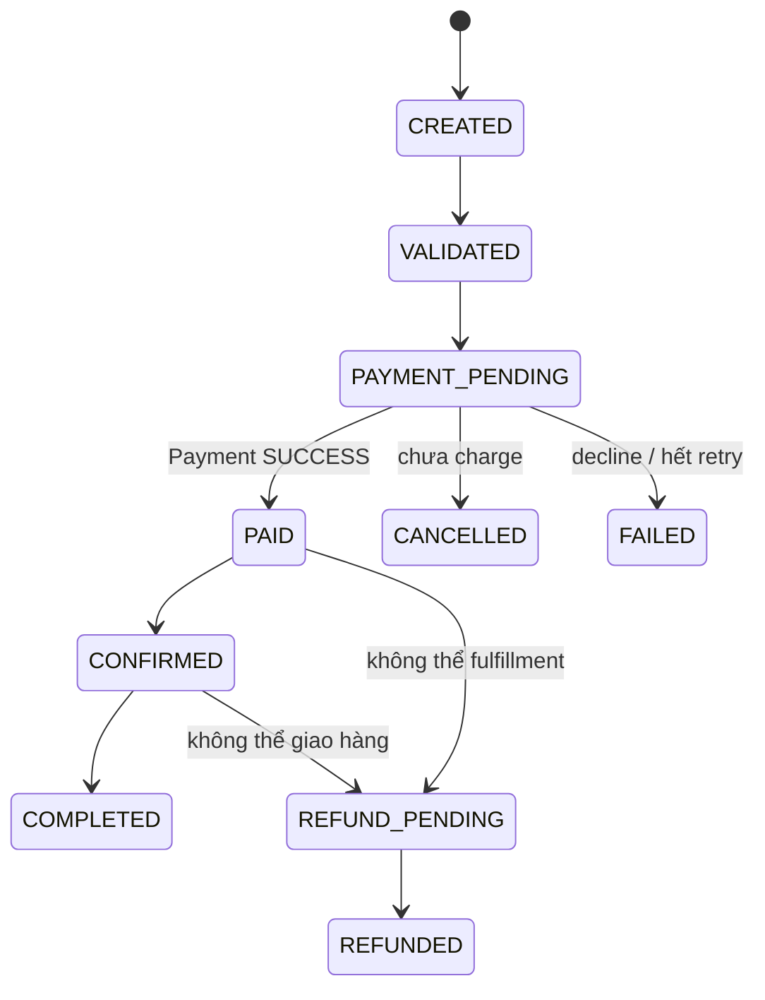
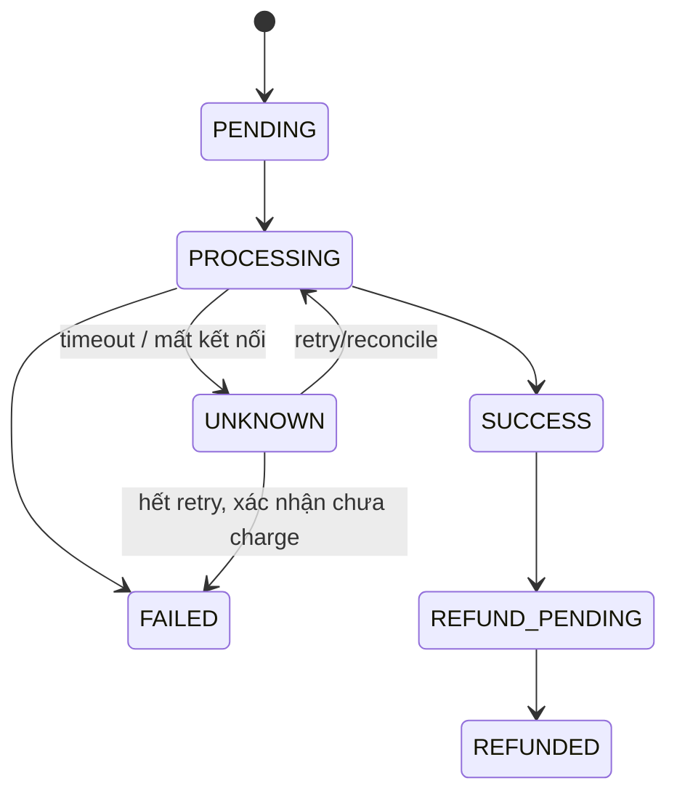

# Order–Payment lifecycle and invariants

## 1. Hai máy trạng thái độc lập

Order biểu diễn vòng đời nghiệp vụ; Payment biểu diễn kết quả giao tiếp với
gateway. Không đánh dấu Order là `PAID` chỉ vì đã gửi request tới gateway.

`PROCESSING` được ghi vào database trước khi gọi gateway. Gateway được gọi bên
ngoài transaction database. Nếu process chết ở cửa sổ này, endpoint reconcile
hỏi gateway bằng idempotency key và áp dụng kết quả đã tồn tại; nó không tạo
một logical payment mới.

## 2. Bất biến bắt buộc

1. `PAID`, `CONFIRMED`, `COMPLETED` phải có đúng một Payment `SUCCESS`.
2. `CANCELLED` và `FAILED` không được có bằng chứng charge thành công.
3. Payment `SUCCESS` chỉ được tạo khi amount bằng `Order.TotalAmount`.
4. Mỗi Order chỉ sở hữu một logical Payment; retry dùng lại payment và
   idempotency key cũ.
5. Không hủy Order khi Payment đang `PROCESSING`, `UNKNOWN`, `SUCCESS` hoặc
   `REFUND_PENDING`.
6. `REFUNDED` phải xuất phát từ `REFUND_PENDING`; không đổi thẳng `PAID` thành
   `FAILED` vì như vậy sẽ làm mất dấu tiền đã thu.
7. Inventory ở đúng một trong ba trạng thái: `RESERVED`, `RELEASED`,
   `CONSUMED`. Release là idempotent và không được hoàn kho hai lần.
8. `COMPLETED` sử dụng inventory `CONSUMED`; `CANCELLED`, `FAILED`, `REFUNDED`
   sử dụng inventory `RELEASED`.
9. Các trạng thái terminal `COMPLETED`, `CANCELLED`, `FAILED`, `REFUNDED`
   không có transition hồi sinh.

## 3. Quy tắc sự cố

| Sự cố | Trạng thái bền vững | Hành động |
|---|---|---|
| Gateway decline | Payment `FAILED`, Order `FAILED` | Hoàn tồn kho |
| Gateway timeout | Payment `UNKNOWN`, Order `PAYMENT_PENDING` | Reconcile rồi retry có giới hạn bằng cùng key |
| Process chết khi Payment `PROCESSING` | Giữ `PROCESSING` | Query gateway theo key; áp dụng kết quả, không charge mù |
| Hết retry và xác nhận chưa charge | Payment/Order `FAILED` | Dừng tự động, hoàn tồn kho |
| Không fulfillment được sau khi charge | Cả hai `REFUND_PENDING` | Gọi refund idempotent |
| Refund timeout/decline | Giữ `REFUND_PENDING` | Retry/query cùng refund key, không giả vờ đã refund |
| Refund thành công | Payment/Order `REFUNDED` | Lưu refund reference, hoàn tồn kho một lần |
| Payment và cancel chạy đồng thời | Serialize tại database | Cancel bị chặn khi thấy trạng thái payment đang hoạt động |

## 4. Ánh xạ implementation

- Transition Order: `Security/OrderStateMachine.cs`.
- Transition Payment: `Security/PaymentStateMachine.cs`.
- Điều phối gateway, retry, reconciliation, refund: `Services/PaymentService.cs`.
- Reserve/release/consume stock: `OrderService.cs` và
  `Services/InventoryReservation.cs`.
- Ràng buộc một payment/order và idempotency: `Data/AppDbContext.cs` cùng
  migration `AddDurableOrderPaymentLifecycle`.
- Mô hình hữu hạn có sự cố: `security-analysis/order_payment_recovery_model.json`.
- TLA+ đồng bộ hai state machine: `Security/OrderPayment.tla` và `.cfg`.

## 5. Giới hạn còn lại

- `FakePaymentGateway` chỉ là adapter phát triển, nhưng có lưu kết quả theo
  idempotency key để test reconciliation. Cần adapter gateway thật và xác minh
  chữ ký callback trước khi triển khai.
- Transaction `Serializable` và unique index cần integration test đồng thời
  trên PostgreSQL; EF InMemory không chứng minh hành vi khóa thật.
- File TLA+ đã được đồng bộ lại nhưng chỉ được coi là bằng chứng formal sau khi
  chạy TLC và lưu output/counterexample.
