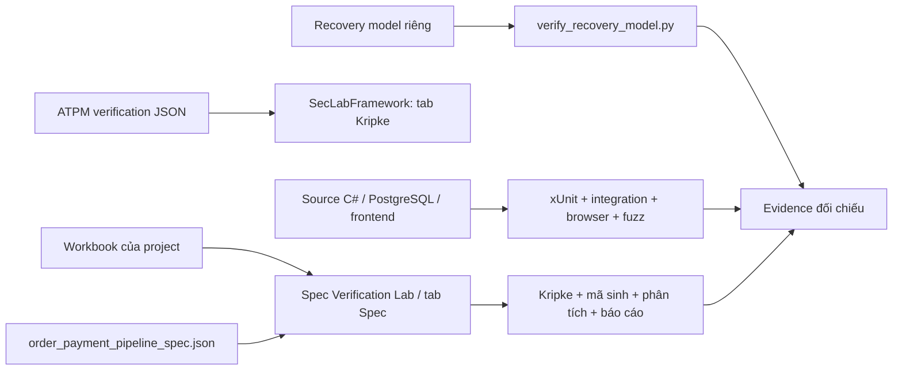

# Đánh giá project, cách dùng ATPM và kịch bản thuyết trình

Ngày đánh giá: **22/10/2026 — Asia/Bangkok** (cập nhật P3: CNF/DIMACS, DRAT proof, UNSAT core). Chạy các lệnh Bash từ **thư mục gốc repository**, trừ phần ghi rõ PowerShell/Windows. Tài liệu này là kịch bản bảo vệ; phần giải thích source chi tiết nằm trong [hướng dẫn bốn chương](../HUONG_DAN_DU_AN_VA_KIEM_CHUNG_4_CHUONG.md).

## 1. Project đã hoàn thiện đến đâu?

**Kết luận: phần ứng dụng và kiểm thử đã hoàn thiện ở mức cao, đủ cơ sở demo đồ án. Hồ sơ đặc tả đã đạt checklist Excel theo checker độc lập; xác nhận cuối bằng GUI Windows của thầy vẫn chưa chạy trong môi trường Linux này. Hệ thống chưa ở mức triển khai thanh toán thật.** Không quy đổi thành một phần trăm chính xác vì chưa có rubric chấm điểm riêng của lớp.

Tên project là OrderPaymentMicroservice nhưng hiện thực hiện tại là **một host ASP.NET Core .NET 10, các module dùng chung PostgreSQL**. Khi trình bày, gọi là hệ thống Order–Payment được tổ chức theo module; không khẳng định đã tách thành nhiều microservice triển khai độc lập.

### 1.1. Kết quả đã chạy lại trong lần đánh giá này

| Hạng mục                  | Kết quả mới                                              | Ý nghĩa                                                                                        |
| --------------------------- | ----------------------------------------------------------- | ------------------------------------------------------------------------------------------------ |
| Toàn bộ unit/regression   | **149/149 PASS, 0 SKIP**                              | Build và các kiểm tra logic hiện có chạy được                                           |
| Toàn bộ integration       | **35/35 PASS, 0 SKIP**                                | Có HTTP, PostgreSQL, cạnh tranh, restart/reconnect, browser, backup/restore và load hữu hạn |
| Workbook checker            | **PASS với phát hiện cố ý**                          | 10 sheet, 27 yêu cầu chức năng, 18 state (14 nghiệp vụ + 4 khóa), 28 cặp cạnh, 10 CTL (9 đúng, 1 vi phạm cố ý), 6 cặp mutex |
| Recovery model              | **15/15 property PASS; 6/6 mutation bị phát hiện** | 14 state, 35 chuyển tiếp có event, 7 contract; P10 có điều kiện progress-only             |
| Liveness audit              | **PASS phép đối chiếu**                           | Raw `AG AF terminal = false`; progress-only = true                                             |
| Payment SMT / inventory SMT | **7/7 và 3/3 PASS**                                  | SAT/UNSAT đúng oracle, không phải tất cả phải UNSAT                                       |
| C static / dynamic          | **Static PASS; dynamic 22/22 PASS**                   | Bản lỗi phải có đúng diagnostic; bản sửa và ca biên đạt                              |
| C BMC (CBMC)                | **10/10 case PASS**                                   | 5 BUGGY `VERIFICATION FAILED` đúng lỗi; 5 FIXED `SUCCESSFUL`; bound unwind=64, input 48 byte |
| C Valgrind                  | **10/10 case PASS**                                   | Memcheck trên build không sanitizer; BUGGY có lỗi đúng loại, FIXED sạch          |
| C SAT/CNF/DRAT              | **10/10 case PASS; 5 proof `VERIFIED`; 5 core UNSAT** | CBMC xuất DIMACS; BUGGY SAT có model, FIXED UNSAT có DRAT proof và core; vẫn bound 64 |
| End-to-end runner            | **PASS**                                              | `run_all_checks.py` chạy chuỗi nhanh + kiểm artifact; `--with-sat` cho proof; GUI Windows vẫn BLOCKED   |
| Fuzz ứng dụng             | Xem evidence lượt chạy mới                             | Seed 20261009; structured in-process; 25.000 vòng/campaign và 2.000 chuỗi stateful; line/branch coverage 5 target; **chưa** coverage-guided/HTTP black-box/path-edge |
| Threat model consistency    | **PASS**                                              | 6 tài sản, 4 trust boundary, 9 threat, đủ 6 nhóm STRIDE; vẫn có threat mở                |

Lệnh toàn suite dùng để đánh giá:

**184 = 149 unit + 35 integration.** Chạy file solution `.slnx` sẽ chạy cả hai project test. Nếu chỉ muốn 149 unit test:

```bash
dotnet test OrderPaymentMicroservice.Tests/OrderPaymentMicroservice.Tests.csproj --no-restore --nologo
```

Cảnh báo `Data collector 'Blame': All tests finished running, Sequence file will not be generated` không phải test thất bại: không có test treo nên collector không cần sinh sequence file. Các warning khác phải đọc riêng, không suy từ số lượng warning.

```bash
dotnet test OrderPaymentMicroservice.slnx --no-restore --nologo \
  --logger 'trx;LogFilePrefix=assessment' \
  --results-directory /tmp/orderpayment-assessment-verified \
  --blame-hang-timeout 90s
```

TRX của lần chạy mới nằm tại `/tmp/orderpayment-assessment-verified/` trên máy đánh giá; integration mất khoảng 2 phút, unit khoảng 6 giây. Evidence sinh trong lần đánh giá được lưu riêng tại `/tmp/orderpayment-assessment-evidence/`. Thư mục `/tmp` là tạm, cần sao chép nếu muốn mang sang máy khác. Snapshot evidence đã có trong repository vẫn được giữ để không trộn với manifest/báo cáo lịch sử. Số coverage riêng InputValidator 97,22% và TLC 35 state sinh/20 state phân biệt là **snapshot cũ**, không phải hai phép đo được chạy lại trong lần này.

Chuỗi kiểm chứng nhanh (không cần .NET/PostgreSQL) dùng khi demo phần model/C:

```bash
python3 security-analysis/run_all_checks.py
```

Runner chạy workbook/ATPM checker, recovery, liveness, SMT, threat, C static/sanitizer/CBMC/Valgrind, rồi package + report; kết quả ở `security-analysis/results/end_to_end.results.json`. Các nhóm .NET/PostgreSQL/TLC/fuzz/SAT là opt-in; mặc định runner không rerun 184 test .NET mà kiểm evidence đã lưu. `--with-sat` cần `cadical` và `drat-trim` trên `PATH`, và tái sinh proof/core thay vì chỉ đọc evidence. Runner không chạy GUI Windows.

### 1.2. Những phần đã xây dựng

| Phần            | Hiện thực và cách chứng minh                                                                                                                                                                                                                  |
| ---------------- | -------------------------------------------------------------------------------------------------------------------------------------------------------------------------------------------------------------------------------------------------- |
| User             | Đăng ký/đăng nhập, JWT, kiểm tra chủ sở hữu và Admin; PasswordHasher, nâng cấp hash SHA-256 cũ khi đăng nhập đúng. `UserService`, `UsersController`, `UserServiceTests`                                                   |
| Product          | Catalog, lọc theo category, CRUD có phân quyền; giá và tồn kho là dữ liệu server. `ProductService`, `ProductsController`                                                                                                             |
| Cart             | Thêm/sửa/xóa sản phẩm, tổng tiền, chặn truy cập giỏ của người khác. `CartService`, `CartController`, integration test giỏ hàng                                                                                                 |
| Order            | Validation, giá server, cộng dồn quantity trùng ProductId, reserve kho, transaction, state machine; hủy/confirm/complete; receipt chống tạo đơn lặp với cùng key. `OrderService`, `OrderStateMachine`, `OrderRetryContractTests` |
| Payment          | Kiểm số tiền chính xác theo order, idempotency, lưu PROCESSING trước gateway, timeout/UNKNOWN, retry/reconcile, refund. `PaymentService`, `PaymentStateMachine`, `PaymentServiceTests`                                               |
| Dữ liệu        | EF Core migrations, PostgreSQL, concurrency token/unique/CHECK và transaction Serializable; chống stock âm, quantity sai, mutation dở dang                                                                                                     |
| Recovery         | DurableFake gateway có journal trên đĩa; worker đối soát sau sự cố; test kill API và stop/start PostgreSQL; giữ kho khi outcome chưa rõ, refund hoàn tất mới release                                                               |
| Bảo vệ request | JWT/ownership/Admin, CORS cấu hình, giới hạn body/item, rate limit, validation tiền theo cent; test malformed/boundary và quyền truy cập                                                                                                   |
| Audit/vận hành | Correlation ID, audit COMMIT cùng transaction cho Order/Payment, trigger append-only; health live/ready, trạng thái vận hành dành cho Admin, metric/cảnh báo, backup/restore và load probe                                                |
| Frontend         | Shop HTML/CSS/JS, tài khoản, catalog, cart, checkout, thanh toán giả lập, history, session/logout; retry có giới hạn và giữ key/payload; browser smoke trên ứng dụng thật                                                            |
| Kiểm chứng     | Threat/STRIDE, recovery graph và contract, counterexample/mutation, SMT/Z3, mô hình TLA+/TLC, bộ C BUGGY/FIXED, fuzz/coverage, workbook, traceability và báo cáo                                                                            |

### 1.3. Các khoảng trống cần nói thật và ưu tiên xử lý

**Ưu tiên trước khi nộp:**

1. **Chạy GUI Windows của thầy trên máy bảo vệ và lưu báo cáo/ảnh.** Hai EXE đã được xác định là Windows x64 và kiểm tra tĩnh metadata/chuỗi giao diện, nhưng chưa chạy GUI trong môi trường Linux này. Python checker PASS không thay thế xác nhận EXE nạp và chạy hết pipeline.
2. **Đối chiếu lần cuối workbook với PDF bằng GUI Windows.** Checker độc lập đã PASS 10 sheet/27 FR/10 NFR/14 ràng buộc/50 testcase; vẫn nên xem cảnh báo/lỗi thực tế của EXE, vì checker không tái hiện đầy đủ parser của thầy.
3. **Thống nhất bản đặc tả dùng để nộp.** Dùng workbook tại gốc và JSON trong `security-analysis/`. JSON Order–Payment trong ATPM là phiên bản cũ khác nội dung.
4. **Kiểm tra link tài liệu trước khi đóng gói.** Các file `PHAM_VI_KIEM_CHUNG.md`, `IMPLEMENTATION_CONTRACTS.md`, `OPERATIONS.md`, `GIAI_THICH_KIEM_THU_INPUT_VALIDATOR.md` đã có; chỉ cần kiểm lại link sau khi đổi tên hoặc di chuyển.

Đối chiếu [PDF hướng dẫn Excel](<../ATPM/Hướng%20dẫn%20tạo%20Spec%20file%20dạng%20excel.pdf>), đặc biệt trang 4 và 25–26:

| Checklist của PDF                                                               | Workbook/project hiện tại                                                                                                    | Đánh giá                                                                                                             |
| -------------------------------------------------------------------------------- | ------------------------------------------------------------------------------------------------------------------------------ | ----------------------------------------------------------------------------------------------------------------------- |
| 10 sheet; yêu cầu, ràng buộc và testcase có truy vết                      | Đủ 10 sheet; 27 FR, 10 NFR, 14 ràng buộc, 50 testcase; đủ category functional/safety/liveness/memory                     | Đã có                                                                                                                |
| `LoaiTruLanNhau` ít nhất 5 dòng, pipeline đọc dòng đầu                 | 6 dòng; dòng đầu `main_locked/log_locked`, các cặp còn lại đã kiểm không vi phạm                          | Đã có; pipeline chỉ tự kiểm dòng đầu, checker kiểm cả 6                                                |
| `HamSinhMa` có 4 nhóm lỗi C và 2 loại Python `divide`, `magic_value`  | 5 hàm C đủ 4 nhóm lỗi + `return_rate_ratio` (divide) + `payment_override_code` (magic 6284/4917)                 | Đã có; GUI Windows vẫn là lần chạy xác nhận cuối                                                           |
| Cụm khóa free/main_holds/log_holds/conflict; CTL safety và liveness theo mẫu | Có cụm 4 state + nhãn violation; 10 CTL gồm `AG(!violation)`, `EF(main_locked)` và 5 công thức lồng `AG(...->AF(...))` | Đã khớp mẫu; `conflict` cố ý reachable để pipeline báo CWE-667/CWE-693      |
| Mỗi NFR có số đo cụ thể                                                    | Đã bổ sung số đo cho cả 10 NFR (coverage, timeout, trigger, test, load, model)                                  | Giữ phân biệt số đo snapshot và cam kết production                                                           |
| Số học theo biểu thức/ngưỡng quy định                                    | 6 bài toán cộng dồn phủ đủ ngưỡng 32767 / 65535 / 2.000.000.000 / 4.294.967.295; BieuThucTran là tổng biến       | Checker kiểm cú pháp; GUI Windows vẫn là lần chạy xác nhận cuối                                               |
| Nạp Excel, chạy hết pipeline, xuất đủ kết quả                            | Checker độc lập PASS; GUI Windows chưa được chạy tại đây                                                            | Chưa xác nhận E2E bằng công cụ thầy                                                                              |

Không tự thêm dữ liệu vô nghĩa để đủ số dòng. `KhoiTao` để trống ở state không khởi tạo là biểu diễn có chủ đích. Nếu thầy yêu cầu bám nguyên mẫu, cập nhật generator, workbook, JSON và checker cùng nhau; không sửa riêng Excel rồi dùng generator ghi đè mất thay đổi.

**Giới hạn sản phẩm:** gateway vẫn là mô phỏng local, limiter theo process, chưa webhook/provider thật, shared limiter, tách DB role migration/runtime, retention job hay deployment Kubernetes. Model đã bỏ state `CONFIRMATION_RETRY` vì runtime chỉ có Admin confirm/refund, không có scheduler/counter tự động. Chưa chứng minh mọi interleaving, network partition, failover, mất điện hoặc SLA. Đây là future work, không làm mất giá trị các kịch bản đã kiểm thử.

## 2. Dùng các file EXE, JSON và XLSX trong ATPM như thế nào?

### 2.1. Chọn đúng file

| File/nhóm file                                                                                           | Dùng vào đâu?                                                                                        | Có nên dùng khi bảo vệ?                                                                                                |
| --------------------------------------------------------------------------------------------------------- | -------------------------------------------------------------------------------------------------------- | --------------------------------------------------------------------------------------------------------------------------- |
| `ATPM/Ứng dụng hỗ trợ xử lý Spec - môn học Software_Security - updated/SpecVerificationLab.exe` | Ứng dụng chuyên nạp đặc tả JSON/XLSX → Kripke → sinh C/Python → pipeline → báo cáo          | **Ưu tiên cho workbook đề tài**                                                                                  |
| `ATPM/SecLabFramework.exe`                                                                              | Framework nhiều tab: Kripke, memory, SMT, fuzz, Secure C/C++, Spec pipeline                             | **Dùng cho demo JSON Kripke và từng kỹ thuật**; tab Spec cũng có parser Excel/JSON                             |
| `OrderPaymentMicroservice_Security_Spec.xlsx` tại gốc                                                 | Đặc tả hiện tại của chính project                                                                 | **File chính để trình thầy**; còn các khoảng trống checklist ở §1.3                                        |
| `security-analysis/order_payment_pipeline_spec.json`                                                    | Bản machine-readable khớp phần pipeline của workbook                                                 | **Dùng thay XLSX khi demo phần pipeline**                                                                           |
| `ATPM/Template_Software_Security_iot_gateway_spec.xlsx`                                                 | Mẫu workbook cho đề tài IoT gateway                                                                  | Dùng học cấu trúc; **không nộp như đặc tả Order–Payment**                                                  |
| `ATPM/specs/specs/order_payment_microservice_spec.json`                                                 | Đặc tả Order–Payment cũ: 18 yêu cầu, 32 cạnh, 7 hàm gồm 2 Python                               | Dùng tham khảo; **không dùng làm nguồn chính hiện tại**. Bản mới có 27 yêu cầu, 28 cặp cạnh, 5 hàm C + 2 hàm Python |
| `ATPM/specs/specs/*.json` còn lại                                                                     | Đặc tả mẫu đầy đủ của session, upload, IoT, resource pool…                                     | Nạp vào phần **Spec/Pipeline**, dùng kiểm tra công cụ hoặc minh họa, không coi là kết quả project        |
| `ATPM/verification/verification/*.json`                                                                 | Graph Kripke trực tiếp: `states`, `initial`, `labeling`, `transitions`, có thể có `flows` | Nạp vào **tab Kripke của SecLabFramework**                                                                         |
| `security-analysis/order_payment_recovery_model.json`                                                   | Model mở rộng có state object, incident, event, contract                                              | Chạy `verify_recovery_model.py`; **không nhập trực tiếp vào parser Kripke/Spec của EXE**                     |
| `security-analysis/order_state_model*.json`                                                             | Model riêng cho checker của project, gồm bản cố ý lỗi                                             | Dùng script/model evidence của project; không mặc định tương thích GUI                                             |
| `security-analysis/results/*.json`                                                                      | **Kết quả đầu ra**, có PASS/count/hash/timestamp                                              | Mở để trình evidence; không phải input đặc tả                                                                      |
| `ATPM/lab*/dataset/*.json`                                                                              | Dữ liệu theo schema từng lab: BMC, SMT, risk, coverage…                                              | Chỉ dùng cùng script của lab tương ứng; JSON hợp lệ về cú pháp chưa chắc hợp schema EXE                      |
| ZIP/RAR                                                                                                   | Gói phân phối/nén dữ liệu hoặc EXE                                                                | Giải nén trước, không chọn ZIP/RAR ở hộp nạp JSON/Excel; không cần giải nén lại bộ đã có                  |
| `ATPM/Soft-tookit/softsec-toolkit/`, `ATPM/atpm_project/`, `ATPM/lab1..8/`                          | Source tham khảo và bài thực hành                                                                   | Có thể học/chạy theo README riêng; demo chính ưu tiên script tích hợp trong `security-analysis/`                |

Workbook chứa cả NFR, constraints và testcase dạng bảng. JSON pipeline hiện tại không giữ mọi phần tài liệu hóa đó; do đó **JSON không thay thế toàn bộ hồ sơ Excel**. Sheet `TestCase` chỉ khai báo ca kiểm thử, không tự chạy 50 test xUnit khi bấm pipeline.



### 2.2. Demo Excel bằng Spec Verification Lab trên Windows

Mở PowerShell tại thư mục gốc bản sao project trên Windows:

```powershell
& '.\ATPM\Ứng dụng hỗ trợ xử lý Spec - môn học Software_Security - updated\SpecVerificationLab.exe'
```

1. Chọn **“Nap tu file Excel khac (.xlsx)...”**, chọn `OrderPaymentMicroservice_Security_Spec.xlsx` tại gốc. Không cần di chuyển workbook vào thư mục EXE.
2. Xem yêu cầu và đồ thị. Chọn **“1) Sinh Kripke + kiểm chứng (Ch1)”**. Đối chiếu 18 state (14 nghiệp vụ + 4 khóa), 28 cặp cạnh và 10 công thức của workbook.
3. Chọn **“2) Sinh mã C/Python từ đặc tả”**. Với workbook hiện tại, cần thấy 5 hàm C và 2 hàm Python (`return_rate_ratio` divide, `payment_override_code` magic_value).
4. Chọn **“3) Chạy TOÀN BỘ Pipeline”**. Xem từng kết quả, phản ví dụ, cảnh báo/lỗi; không chỉ nhìn thông báo chạy xong.
5. Dùng **“Xuất báo cáo TÍCH HỢP (PDF/DOCX)”** nếu chạy thành công. Lưu report và ảnh với tên có ngày chạy.
6. Có thể nạp `security-analysis/order_payment_pipeline_spec.json` qua **“Nap tu file JSON khac...”** để đối chiếu phần graph/requirements/functions. Chạy lại với file được chọn; không nhầm output của hai lượt.

Các tên điều khiển trên được đọc từ chuỗi giao diện đóng gói trong EXE; chưa kiểm tra thao tác GUI thực tế. Nếu bản chạy hiển thị khác, chọn chức năng tương ứng. EXE là Windows x64; lệnh trên không phải lệnh Bash/Linux. Nếu dùng WSL, mở EXE từ Windows và trỏ tới bản sao/đường dẫn Windows truy cập được.

Lời nói:

> “Đây là đặc tả đề tài của em. Excel phục vụ đọc và truy vết yêu cầu, còn JSON phục vụ công cụ. Công cụ kiểm tra mô hình và mã được sinh theo mẫu; việc ứng dụng C# thực hiện đúng còn được kiểm tra bằng test và PostgreSQL thật ở phần sau.”

### 2.3. Demo JSON tốt/xấu bằng SecLabFramework

```powershell
& '.\ATPM\SecLabFramework.exe'
```

Trong tab **Kripke Structure & Verification**, dùng **“Nap tu file khac...”**:

| Bước | File trong `ATPM/verification/verification/` | Kiểm tra                                                     | Kết quả mong đợi từ graph                                       |
| ------ | ---------------------------------------------- | ------------------------------------------------------------- | -------------------------------------------------------------------- |
| 1      | `mutex_two_process.json`                     | Chọn luồng hệ thống kết hợp, kiểm `AG(!violation)`   | **False**; đường `idle_idle → crit1_idle → crit1_crit2` |
| 2      | Cùng file                                     | `EF(violation)`; mutex hai atom `p1`, `p2`              | EF true; mutex vi phạm                                              |
| 3      | `mutex_fixed.json`                           | Luồng kết hợp; `AG(!violation)` và mutex `p1`, `p2` | AG true; mutex đạt                                                 |

Chọn **luồng kết hợp**, vì mỗi process riêng lẻ không biểu diễn được xung đột hai process. Dùng `p1`/`p2` là **nhãn atom**, không nhập tên state thay thế. Kết quả mong đợi trên được đối chiếu graph JSON, chưa phải log chạy EXE tại lần đánh giá này.

Lời nói:

> “Em dùng một model cố ý sai để cho thấy checker tìm được phản ví dụ. Sau khi loại trạng thái hai process cùng vào vùng tranh chấp, thuộc tính đạt trên graph đã sửa. Ví dụ này minh họa phương pháp; cơ chế chống cạnh tranh của ứng dụng được kiểm chứng bằng các test thanh toán/hủy đồng thời.”

Nếu muốn đưa graph **của project** vào tab Kripke, xuất phần `state_machine` của JSON pipeline sang schema trực tiếp, không nạp cả JSON lồng nhau:

```bash
python3 - <<'PY'
import json
from pathlib import Path
spec = json.loads(Path('security-analysis/order_payment_pipeline_spec.json').read_text())
model = dict(spec['state_machine'])
model['suggested_ctl_formulas'] = spec['safety_properties']
model['suggested_mutex_atoms'] = list(spec['mutual_exclusion'].values())
out = Path('security-analysis/results/demo/order_payment_kripke_gui.json')
out.parent.mkdir(parents=True, exist_ok=True)
out.write_text(json.dumps(model, ensure_ascii=False, indent=2) + '\n', encoding='utf-8')
print(out)
PY
```

Mang file vừa tạo sang Windows và nạp vào tab Kripke. Đây là **phép chiếu progress**: 22 cặp vòng đời (+6 cặp khóa = 28), không còn đầy đủ metadata 35 event, incident và 7 contract. Không dùng kết quả GUI này thay cho checker recovery.

## 3. Chuẩn bị buổi bảo vệ

Nên chuẩn bị ba cửa sổ: trình duyệt shop, terminal tại gốc repository, Excel/EXE trên Windows. Mở sẵn báo cáo [BAO_CAO.md](report/BAO_CAO.md) và [PHU_LUC_A_G.md](report/PHU_LUC_A_G.md).

Môi trường đã kiểm tra là Linux, .NET 10 SDK, Python 3, Z3, GCC/Make/Cppcheck, PostgreSQL binaries local và Google Chrome. Integration thông thường có thể dùng Docker; **reconnect, process/browser/operational demo cần PostgreSQL local theo fixture**. Toàn suite hiện tại nên chạy trên Linux/WSL như môi trường đã xác nhận; không mặc định mọi test local-PG chạy nguyên trạng trên Windows.

```bash
dotnet --version
python3 --version
z3 --version
gcc --version
cppcheck --version
google-chrome --version
ls /usr/lib/postgresql/*/bin/postgres
dotnet restore OrderPaymentMicroservice.slnx
dotnet build OrderPaymentMicroservice.slnx --no-restore --nologo
```

Nếu PostgreSQL cài vị trí khác, đặt `POSTGRES_BIN` tới thư mục chứa `postgres`, `initdb`, `pg_ctl`, `createdb`, `pg_dump`, `pg_restore`. Restore lần đầu cần dependencies; làm trước buổi bảo vệ. Các test dùng cluster/database tạm, không cần cấu hình database shop để chạy test tự động. Terminal phải được phép mở cổng localhost và tạo tiến trình PostgreSQL/Chrome.

Các script phân tích có thể ghi đè evidence trong `security-analysis/results/`. Chạy tuần tự; không chạy fuzz/coverage đồng thời với một lượt dotnet khác dùng chung assemblies. Một filtered test PASS không thay thế toàn suite; luôn đọc cả total/fail/skip.

Lịch thuyết trình khoảng **25–30 phút**:

| Thời gian   | Nội dung                                      | Màn hình chính        |
| ------------ | ---------------------------------------------- | ------------------------ |
| 0–2 phút   | Bài toán, phạm vi, kiến trúc              | Sơ đồ và source      |
| 2–6 phút   | Chức năng shop và bảo vệ nghiệp vụ      | Browser + HTTP/tests     |
| 6–10 phút  | Excel, Kripke, safety/liveness, counterexample | Excel/EXE + Python       |
| 10–13 phút | 5 lỗi bộ nhớ, sửa lỗi, static + sanitizer | C source + terminal      |
| 13–16 phút | SMT tiền và tồn kho                         | Z3 results               |
| 16–22 phút | Recovery khi DB gián đoạn; crash/refund     | Test + evidence timeline |
| 22–25 phút | Fuzz, coverage, audit/vận hành               | Test/results             |
| 25–30 phút | Giới hạn, kết luận và trả lời câu hỏi | Bảng kết quả          |

Nếu chỉ có 10 phút: giới thiệu 1 phút → shop 2 phút → workbook/model 2 phút → recovery 3 phút → kết quả C/SMT/fuzz và giới hạn 2 phút. Chạy toàn suite trước buổi, không chờ tất cả test ngay giữa phần nói.

## 4. Kịch bản mở đầu và demo chức năng

### 4.1. Mở đầu — lời nói khoảng 1 phút

> “Thưa thầy, đề tài của em là xây dựng và kiểm chứng an toàn hệ thống xử lý đơn hàng và thanh toán trực tuyến. Bài toán chính không chỉ là tạo đơn hay thanh toán thành công, mà là giữ dữ liệu đúng khi người dùng gửi lặp, hai yêu cầu chạy đồng thời, thanh toán timeout hoặc hệ thống gián đoạn.
>
> Em xây dựng năm module User, Product, Cart, Order và Payment trên ASP.NET Core và PostgreSQL, kèm giao diện shop. Hiện tại các module nằm trong một host và gateway là mô phỏng bền vững bằng journal. Em kiểm chứng bằng mô hình trạng thái, phân tích bộ nhớ C, SMT, unit/integration test và fuzzing.”

Vẽ/chiếu luồng:

```text
Shop → HTTP/JWT/admission/audit → service + validator/state machine
                                      ↘ PostgreSQL transaction
                                      ↘ DurableFake payment journal
Recovery worker → tra cứu kết quả cũ → finalize Order/Payment/Inventory
```

### 4.2. Chạy shop để bấm trực tiếp

Chuẩn bị một PostgreSQL database **dành riêng cho demo**, đã có user/quyền truy cập. Startup tự migrate và seed trên DB được cấu hình. Bash sau yêu cầu nhập connection string; không dán password thật vào tài liệu:

```bash
read -r -s -p 'Connection string PostgreSQL demo: ' ConnectionStrings__DefaultConnection
printf '\n'
export ConnectionStrings__DefaultConnection
export Jwt__Key="$(python3 -c 'import secrets; print(secrets.token_hex(32))')"
dotnet run --project OrderPaymentMicroservice/OrderPaymentMicroservice.csproj \
  --no-restore --launch-profile http
```

Ví dụ định dạng connection string: `Host=localhost;Port=5432;Database=orderpayment_demo;Username=<demo-user>;Password=<demo-password>`. Mở `http://localhost:5246`; schema OpenAPI Development tại `/openapi/v1.json`. JWT key sinh mới chỉ dùng cho phiên demo; đổi key làm token cũ mất hiệu lực.

Thao tác: đăng ký tài khoản demo → đăng nhập → chọn sản phẩm → thêm/sửa số lượng trong giỏ → checkout điền địa chỉ → thanh toán giả lập → xem history → reload → logout. Cho thầy xem Order ở PAID sau thanh toán. CONFIRMED/COMPLETED là thao tác nghiệp vụ tiếp theo của Admin; không nói browser thanh toán tự hoàn thành toàn vòng đời.

Lời nói:

> “Giá có thẩm quyền được lấy từ catalog server. Cùng một ProductId xuất hiện nhiều dòng phải cộng quantity trước khi kiểm kho. Tiền được kiểm theo đơn vị cent; dữ liệu không hợp lệ bị từ chối. Sau khi tạo đơn, kho được giữ trước; sau thanh toán thành công mới chuyển PAID.”

Terminal thứ hai:

```bash
curl -i http://localhost:5246/health/live
curl -i http://localhost:5246/health/ready
curl -i http://localhost:5246/api/orders/mine
```

Mong đợi: live 200, ready 200 khi DB khỏe; `/api/orders/mine` không JWT trả 401. Có thể chạy `pwsh ./test-api.ps1 -BaseUrl http://localhost:5246/api` nếu đã cài PowerShell 7; script tạo dữ liệu demo và kiểm replay payment. Không dùng `test-quick.sh` nguyên trạng vì script đó hard-code cổng 5245, khác profile 5246.

### 4.3. Bằng chứng HTTP/PostgreSQL và quyền truy cập

```bash
dotnet test OrderPaymentMicroservice.IntegrationTests/OrderPaymentMicroservice.IntegrationTests.csproj \
  --no-restore --nologo --filter 'FullyQualifiedName~OrderPaymentApiTests' \
  --blame-hang-timeout 90s
```

Nhóm này có **9 test**: flow đăng ký–giỏ–đơn–payment, quyền truy cập, payment đồng thời, payment/cancel cạnh tranh, Admin confirm/complete, payload sai không đổi dữ liệu, constraint DB, giỏ hàng và fractional cent. Dùng tên test để chỉ ra điều đang được kiểm, không chỉ đọc tổng PASS.

> “JWT xác nhận danh tính; kiểm ownership mới quyết định được xem hoặc sửa tài nguyên nào. Khi thanh toán cạnh tranh với hủy, hệ thống phải ra một kết quả nhất quán. Test kiểm cả response và dữ liệu PostgreSQL, không chỉ mock kết quả HTTP.”

Browser smoke độc lập, tự tạo API/DB tạm và chạy Chrome headless:

```bash
dotnet test OrderPaymentMicroservice.IntegrationTests/OrderPaymentMicroservice.IntegrationTests.csproj \
  --no-restore --nologo --filter 'FullyQualifiedName~ApplicationSmokeTests' \
  --blame-hang-timeout 90s
```

Mong đợi 1 PASS; xem `results/application_smoke.results.json`: flow hoàn tất, payment SUCCESS, history PAID, 1 order/1 payment/1 journal, không lỗi JavaScript. Đây là browser thật nhưng chạy headless, không tự mở cửa sổ để thầy bấm.

## 5. Demo chính: charge/refund khi PostgreSQL ngắt và phục hồi

Đây là phần thể hiện rõ nhất điểm mạnh của project. Chạy:

```bash
python3 security-analysis/run_recovery_demo.py
```

Script chạy hai test reconnect, xác nhận evidence mới và hash source; tự quản lý cluster/API tạm. Không tự dừng PostgreSQL đang dùng cho shop. Kết quả mong đợi:

```text
charge: PASS; ready 200 -> 503 -> 200; same API process; charge=1, refund=0, inventory_release=0
refund: PASS; ready 200 -> 503 -> 200; same API process; charge=1, refund=1, inventory_release=1
```

Lời nói trong khi chạy:

> “Nguy hiểm nhất là gateway đã ghi nhận giao dịch nhưng ứng dụng chưa ghi kết quả về DB. Nếu cứ gửi charge mới khi timeout, người dùng có thể bị trừ tiền hai lần. Em lưu operation/key trước khi gọi gateway. Khi kết quả chưa rõ thì giữ trạng thái chờ và reservation; worker tra cứu lại outcome của cùng giao dịch.
>
> Ở demo này, test dừng PostgreSQL sau khi journal đã có kết quả. API process vẫn giữ nguyên. Readiness chuyển 503; khi DB trở lại, worker đối soát và hoàn tất dữ liệu. Oracle là chỉ một charge; với refund thì chỉ một refund và một lần trả kho.”

Đọc timeline và số đếm:

```bash
python3 - <<'PY'
import json
from pathlib import Path
for op in ('charge', 'refund'):
    p = Path(f'security-analysis/results/postgres_reconnect_{op}.results.json')
    r = json.loads(p.read_text())
    print('\nCASE:', op)
    for k in ('passed', 'run_at_utc', 'api_pid', 'api_restarted',
              'health_ready_sequence', 'health_live_during_outage',
              'gateway_calls', 'inventory_release_count', 'worker_metrics'):
        print(k, '=', r.get(k))
    for k, v in r.items():
        if 'timeline' in k:
            print(k, json.dumps(v, ensure_ascii=False, indent=2))
PY
```

Kết quả nghiệp vụ: charge → Payment SUCCESS, Order PAID, kho RESERVED; refund → REFUNDED, kho RELEASED. `/health/live` vẫn 200 khi DB mất; `/health/ready` phản ánh khả năng phục vụ. Reconnect demo không restart API; test kill process dưới đây là tình huống khác.

Nếu thầy yêu cầu crash API thật:

```bash
dotnet test OrderPaymentMicroservice.IntegrationTests/OrderPaymentMicroservice.IntegrationTests.csproj \
  --no-restore --nologo \
  --filter 'FullyQualifiedName~ProcessRestartTests|FullyQualifiedName~RefundRestartTests' \
  --blame-hang-timeout 90s
```

Mong đợi 3 PASS. Mở `results/process_restart.results.json`, `results/refund_restart.results.json`: PID thay đổi, giao dịch/journal không bị lặp; refund giữ charge reference và trả kho một lần. Kết luận chỉ cho cửa sổ lỗi đã chủ động tạo, không suy ra chống mọi loại crash/mất điện.

## 6. Trình bày đầy đủ bốn chương học phần

### 6.1. Chương 1 — đặc tả, threat model, Kripke và safety/liveness

Mở workbook, giải thích 10 sheet theo thứ tự: thông tin → yêu cầu chức năng → phi chức năng → ràng buộc → trạng thái → CTL → mutex → hàm sinh mã → số học → testcase. Demo GUI theo §2 nếu có Windows.

```bash
python3 security-analysis/verify_teacher_spec.py
python3 security-analysis/verify_threat_model.py
python3 security-analysis/verify_recovery_model.py
python3 security-analysis/audit_liveness.py
```

> “Em dùng STRIDE để xác định giả mạo, sửa dữ liệu, chối bỏ, lộ thông tin, từ chối dịch vụ và nâng quyền. Các yêu cầu được nối với biện pháp và evidence. Checker threat model kiểm sự nhất quán của tài liệu, không tự chứng minh mọi nguy cơ đã được loại bỏ.
>
> Model recovery có 14 state và 35 event. Bảy contract chỉ rõ trách nhiệm, điều kiện và kết quả của từng thao tác. Các safety property yêu cầu trạng thái đã trả tiền phải có evidence, đơn hủy không chứa charge thành công, terminal không được hồi sinh và UNKNOWN không được tự trả kho.
>
> Em cố ý tạo sáu mutation sai để yêu cầu checker sinh phản ví dụ. DETECTED là kết quả đúng của phép thử âm. Với liveness, graph đầy đủ có thể chờ provider mãi nên AG AF terminal là false. Khi lọc cạnh stutter theo policy thì true; đó không phải chứng minh mọi lần chạy thực đều chắc chắn kết thúc.”

Chỉ trực tiếp một dòng `BUG-CANCELLED-PAID DETECTED` và mở counterexample trong `results/order_payment_recovery_model.results.json`. Nếu chiếu model cũ, phân biệt nó với recovery model hiện tại. Số **37** là event edge; **31** là cặp source-target sau bỏ metadata và loại trùng, không phải mâu thuẫn số liệu.

### 6.2. Chương 2 — bộ nhớ C, ownership và cách sửa

```bash
make -C security-analysis/c-memory static-check
make -C security-analysis/c-memory test
```

| Module C      | Lỗi cố ý           | Điểm sửa cần nói                                                    |
| ------------- | --------------------- | ------------------------------------------------------------------------ |
| `user.c`    | Stack buffer overflow | Buffer 32 byte nhận tối đa 31 byte, chừa NUL                         |
| `product.c` | Heap buffer overflow  | Kiểm độ dài trước copy, free cả nhánh từ chối                  |
| `cart.c`    | Use-after-free        | Đọc/chụp dữ liệu cần log trước free                              |
| `order.c`   | Memory leak           | Free mảng con trước struct cha                                        |
| `payment.c` | Double-free           | Quản lý ownership, free một lần và đặt con trỏ sở hữu về NULL |

> “Năm module C mô phỏng cùng ngữ cảnh nghiệp vụ để học quản lý bộ nhớ thủ công. Em không khẳng định C# managed đang có các lỗi malloc/free này. Phân tích tĩnh tìm mẫu lỗi; sanitizer xác nhận tại runtime; cùng input được chạy lại trên bản FIXED. Test chỉ PASS bản BUGGY khi có đúng diagnostic mong đợi, không chấp nhận một crash bất kỳ.”

Muốn cho thầy thấy stack trace trực tiếp, chạy **từng lệnh riêng**:

```bash
./security-analysis/c-memory/build/cart_buggy
./security-analysis/c-memory/build/cart_fixed
```

Bản buggy dự kiến thoát khác 0 và báo `heap-use-after-free`; bản fixed chạy sạch. Với `order_buggy`, giữ `ASAN_OPTIONS=detect_leaks=1` để chứng minh leak. Nếu sandbox/debugger làm LeakSanitizer không chạy, chuyển sang terminal thường; không tắt leak detection để lấy PASS.

Evidence: `c-memory/results/summary.json` và log từng ca sau chạy; snapshot bàn giao tại `c-memory/evidence/`. Static scanner chỉ phù hợp nhóm module này; Cppcheck có thể bỏ sót lỗi, nên không dùng “không cảnh báo” làm chứng minh tuyệt đối.

Hai lớp kiểm chứng chuyên sâu đã chạy lại, không chỉ là lệnh tham khảo:

```bash
make -C security-analysis/c-memory bmc-check
make -C security-analysis/c-memory valgrind-check
make -C security-analysis/c-memory sat-check   # cần cadical + drat-trim
```

- **CBMC** include trực tiếp 5 module C, đổi tên `main` để làm harness; kiểm `--bounds-check --pointer-check --memory-leak-check --unwind 64 --unwinding-assertions`. User/Product nhận input tượng trưng tối đa 48 byte. Kết quả: 5/5 BUGGY bị bác đúng lỗi (ghi ngoài buffer, use-after-free, leak, double-free), 5/5 FIXED được chứng minh trong bound. Evidence: `c-memory/evidence/bmc-analysis.json`.
- **Valgrind Memcheck** chạy trên build riêng không sanitizer (`-fno-stack-protector`) để thấy truy cập thô: 5/5 BUGGY có lỗi đúng loại, 5/5 FIXED sạch. Với User, chuỗi dài làm hỏng return address nên Memcheck báo invalid jump; CBMC chỉ ra chính xác ghi ngoài `email[32]`. Evidence: `c-memory/evidence/valgrind-analysis.json`.
- **CNF/DIMACS + DRAT** xuất CNF từ CBMC, giải bằng CaDiCaL: 5 BUGGY SAT có model thỏa CNF, 5 FIXED UNSAT; mỗi UNSAT có DRAT proof được `drat-trim` xác nhận `VERIFIED`, và UNSAT core được CaDiCaL kiểm lại. Evidence: `c-memory/evidence/sat-pipeline.json`, mẫu `c-memory/evidence/sat/cart_fixed.*`.

Nói rõ giới hạn: đây là BMC **có bound**, Memcheck trên input/harness đã chọn và DRAT proof cho **CNF bounded**, không phải chứng minh cho toàn bộ source C# hay mọi input. Không lấy TLC hay duyệt graph hữu hạn để gọi là BMC.

### 6.3. Chương 3 — SMT/Z3 và phân tích tĩnh

```bash
python3 security-analysis/verify_payment_smt.py
python3 security-analysis/verify_inventory_smt.py
```

Mở source `OrderPaymentMicroservice/Security/PaymentVerification.z3` và `InventoryVerification.z3`.

> “SAT nghĩa là tồn tại bộ giá trị thỏa ràng buộc. UNSAT nghĩa là không tồn tại trong mô hình đã mã hóa. Với tình huống hợp lệ, SAT là đúng; với giả thiết bất hợp lệ bị chặn, UNSAT mới là kết quả cần có.
>
> Ví dụ stock 10, hai dòng cùng sản phẩm có quantity 6 và 6. Kiểm từng dòng riêng đều thấy 6 không vượt 10 nhưng tổng lại là 12. SMT cho phản ví dụ ở cách kiểm cũ; khi kiểm tổng quantity trước reserve thì không tồn tại stock âm trong mô hình này. Test C#/PostgreSQL là bước nối lập luận đó với hiện thực.”

Payment SMT có 7 ca, inventory SMT có 3 ca. Giá trị tiền SMT dùng số nguyên cents; ứng dụng dùng decimal kèm guard. Chứng minh trên số nguyên toán học không tự chứng minh compiler/runtime, transaction hay mọi interleaving đúng.

**TLA+/TLC kiểm model TLA+ riêng**, không phải CBMC trên code C# (CBMC cho 5 module C ở mục 6.2). Đã chạy lại thành công ngày 15/10/2026 với Java 17 và JAR từ [release chính thức v1.7.4](https://github.com/tlaplus/tlaplus/releases/tag/v1.7.4). JAR hiện có tại `tmp/tools/tla2tools.jar` trong repository trên máy này; chạy từ gốc repository:

```bash
python3 security-analysis/run_tlc.py --jar tmp/tools/tla2tools.jar
```

Trên máy mới, tải công cụ trước (thư mục `tmp/` bị Git ignore nên không đi theo clone):

```bash
java -version
mkdir -p tmp/tools
curl --fail --location --retry 2 \
  https://github.com/tlaplus/tlaplus/releases/download/v1.7.4/tla2tools.jar \
  --output tmp/tools/tla2tools.jar
python3 security-analysis/run_tlc.py --jar tmp/tools/tla2tools.jar
```

Chỉ chạy Python sau khi tải thành công. `/duong-dan-thuc-te/tla2tools.jar` trong bản hướng dẫn trước là placeholder, không phải file có thật; dùng nguyên văn sẽ báo thiếu JAR. Đường dẫn `/tmp/tla2tools.jar` trong evidence lịch sử cũng đã không còn tồn tại.

Kết quả mới: `Model checking completed. No error has been found.`, **35 state sinh, 20 phân biệt, độ sâu 9**, lưu tại `results/tlc/OrderPayment.tlc.log` và `OrderPayment.tlc.results.json`. Nếu gặp `java.rmi.server.ExportException` / `Operation not permitted`, môi trường đang chặn cổng local Java RMI: chạy từ terminal thường ngoài sandbox. Đây là lỗi môi trường, không phải phản ví dụ của model.

Config hiện đặt `MaxAttempts = 2`, kiểm 5 invariant và `Termination`. Nêu rõ model/giả định này khác raw recovery graph. TLC là model checking cho model TLA+, không phải BMC; BMC có bound riêng cho 5 module C ở mục 6.2 (`bmc-analysis.json`). Project không có bằng chứng tự động suy toàn bộ model từ source C#, và không lấy `MaxAttempts=2` làm bound BMC. Các số TLC trong report/manifest cũ vẫn thuộc lần chạy lịch sử cho tới khi đóng gói lại; kết quả mới nằm trong hai file TLC nêu trên.

### 6.4. Chương 4 — fuzzing, oracle, coverage và hồi quy

```bash
python3 security-analysis/run_fuzzing.py
```

> “Em fuzz năm target: InputValidator, PaymentValidator, OrderStateMachine, PaymentStateMachine và MoneyAmounts. Có corpus ca biên riêng và các campaign sinh dữ liệu với seed cố định để tái lập. Oracle phân biệt input bị từ chối đúng bằng ArgumentException với lỗi ngoài dự kiến hoặc vi phạm invariant.
>
> Campaign gồm corpus, validator random, state-pair random và chuỗi stateful Order–Payment–Inventory. Campaign stateful kiểm invariant sau từng thao tác và in seed/trace nếu fail. Đây là generation-based fuzzing kết hợp oracle và đo coverage; chưa phải engine coverage-guided, symbolic hay concolic fuzzing trên toàn API.”

Mở `OrderPaymentMicroservice.Tests/SecurityFuzzingTests.cs`, `FuzzCorpus/order_requests.json`, `results/application_fuzzing.results.json`. Không nói 25.000 vòng là 25.000 HTTP request; target ở mức hàm/state machine. Cũng không dùng con số coverage này để đại diện toàn controller/service/UI/database.

Nếu bị hỏi sâu, nói đúng các khoảng trống: fuzz hiện tại **không phải end-to-end** vì stateful campaign chỉ chạy aggregate trong process; **không đập vào DB+HTTP service thật** (các integration/load test làm việc đó ở lớp riêng, không phải fuzz); **chưa black-box HTTP fuzz**; **chưa path/edge coverage**, chỉ line/branch; **frontend** mới có Chrome smoke một flow và checkout helper dùng mocked fetch, chưa fuzz qua mạng. Đây là các mục `CHƯA CÓ`, không được chuyển thành PASS nhờ test khác.

Muốn đo lại coverage unit của validator, chạy riêng sau fuzz:

```bash
dotnet test OrderPaymentMicroservice.Tests/OrderPaymentMicroservice.Tests.csproj \
  --no-restore --nologo \
  --filter 'FullyQualifiedName~InputValidatorTests|FullyQualifiedName~MoneyPrecisionTests' \
  /p:CollectCoverage=true \
  /p:CoverletOutput=../security-analysis/results/input-validator \
  /p:CoverletOutputFormat=cobertura \
  '/p:Include=[OrderPaymentMicroservice]OrderPaymentMicroservice.Security.InputValidator%2c[OrderPaymentMicroservice]OrderPaymentMicroservice.Security.MoneyAmounts'
python3 security-analysis/collect_validator_coverage.py
```

Chỉ chạy lệnh Python sau khi dotnet thành công. `CoverletOutput` tính tương đối từ thư mục project tests. Script Python chỉ tổng hợp XML đã có, không tự thực thi test; chạy riêng script đó không tạo một phép đo mới. Snapshot hiện lưu là InputValidator branch 97,22%, line 85,71%, MoneyAmounts branch 100%; đọc output mới nếu đã chạy lại. Coverage cao giúp phát hiện vùng chưa thử, không chứng minh chương trình không còn lỗi.

## 7. Audit, vận hành và bằng chứng mở rộng

Lời nói:

> “Ngoài happy path, em có audit COMMIT cùng transaction cho Order/Payment, correlation ID để truy vết và trigger ngăn sửa/xóa audit thông thường. Health live và ready tách biệt; thông tin vận hành chi tiết yêu cầu Admin. Em kiểm backup cả database lẫn gateway journal, phục hồi rồi đối soát giao dịch dở dang. Load test dùng hai API process để quan sát retry, conflict, độ trễ và bảo toàn kho.”

```bash
dotnet test OrderPaymentMicroservice.IntegrationTests/OrderPaymentMicroservice.IntegrationTests.csproj \
  --no-restore --nologo \
  --filter 'FullyQualifiedName~OperationsTests|FullyQualifiedName~OperationalDrillTests|FullyQualifiedName~OrderRetryLoadTests|FullyQualifiedName~AtomicAuditIdempotencyTests|FullyQualifiedName~AdmissionAuditTests' \
  --blame-hang-timeout 90s
```

Các evidence cần mở: `results/backup_restore.results.json`, `load_probe.results.json`, `order_retry_load.results.json`. Báo raw sample/status/p95/p99 của lượt đã chạy; không lấy throughput local làm cam kết production. Trigger audit không ngăn DBA sửa schema, metric/limiter hiện theo process, chưa có WORM/chữ ký log hay quota chung.

## 8. Kết thúc và câu hỏi thầy có thể hỏi

Lời kết khoảng 45 giây:

> “Kết quả chính của em là ứng dụng chạy được cùng một bộ bằng chứng ở nhiều tầng: đặc tả và mô hình, C sanitizer, SMT, unit/integration, browser và fuzz. Lượt đánh giá mới có 149 unit và 35 integration PASS, không skip. Điểm nhấn là giữ nhất quán Order–Payment–Inventory khi gửi lặp hoặc gián đoạn.
>
> Giới hạn là gateway chưa thu tiền thật, kiến trúc hiện một host, liveness còn phụ thuộc môi trường và model chưa chứng minh mọi thực thi của source. Em còn cần hoàn chỉnh workbook theo checklist của thầy và xác nhận pipeline trên Windows. Hướng phát triển tiếp là provider/webhook thật, cơ chế dùng chung giữa nhiều instance và kiểm chứng sâu hơn các cửa sổ sự cố.”

| Câu hỏi                                            | Câu trả lời ngắn                                                                                                                                                         |
| ---------------------------------------------------- | ---------------------------------------------------------------------------------------------------------------------------------------------------------------------------- |
| Vì sao không chỉ dùng unit test?                 | Unit kiểm từng ví dụ ở mức logic; model duyệt graph hữu hạn; SMT tìm nghiệm/phản ví dụ; integration xác nhận HTTP/DB/process thực. Các tầng bổ sung nhau |
| Có chắc không bị trừ tiền hai lần?            | Các case đã thử cho một charge với cùng operation/key; chưa chứng minh mọi provider hay mọi interleaving ngoài mô hình                                         |
| Timeout sao không chuyển FAILED và trả kho?      | Timeout chỉ cho biết chưa nhận được kết quả; gateway có thể đã charge. UNKNOWN giữ kho và chờ outcome đáng tin cậy                                        |
| Idempotency có nghĩa gì?                          | Gửi lại cùng key và cùng nội dung nhận lại kết quả cũ; tái sử dụng key với nội dung không khớp phải bị chặn                                             |
| 14 state có phải 14 giá trị enum OrderStatus?    | Không. Model kết hợp Order, Payment, Inventory; PRE_PAYMENT_REJECTED là quan sát reject trước persist, không phải enum runtime                                              |
| 50 testcase Excel và 184 test có quan hệ gì?     | Một testcase đặc tả có thể ánh xạ nhiều test thực thi hoặc checker model; số lượng không bằng nhau                                                           |
| Vì sao model checker PASS mà AG AF terminal false? | P10 kiểm graph progress-only; audit cố ý xác nhận graph đầy đủ chưa bảo đảm kết thúc vô điều kiện                                                         |
| Có làm white-box/concolic chưa?                   | Ứng dụng có fuzz sinh dữ liệu và oracle; chưa có engine concolic trên C#. Toolkit ATPM có ví dụ riêng, không tính thành hiện thực của project             |
| Những CWE trong report là lỗ hổng production?    | Các lỗi C là lỗi cố ý trong mô hình học tập. CWE phân loại loại lỗi; không suy ra C# có lỗi đó hoặc project được cấp mã CVE                         |
| Excel checker PASS thì đủ yêu cầu thầy chưa?  | Chưa. Checker xác nhận schema và một số ngữ nghĩa của project, không bao trùm checklist PDF hay thao tác GUI Windows                                             |
| Vì sao cần backup journal?                         | DB có thể chứa operation đang chờ, journal chứa outcome mô phỏng đã ghi; cần cả hai để tái lập bài diễn tập recovery                                      |

## 9. Bảng lệnh tra nhanh và phương án dự phòng

| Mục đích               | Lệnh/chỗ mở                                                    | Kết quả cần đọc                                              |
| ------------------------- | ----------------------------------------------------------------- | ----------------------------------------------------------------- |
| Kiểm workbook hiện tại | `python3 security-analysis/verify_teacher_spec.py`              | 10 sheet, 18 state, 10 CTL (1 vi phạm cố ý), 6 cặp mutex; không thay checklist PDF |
| Recovery model            | `python3 security-analysis/verify_recovery_model.py`            | 15 property + 6 mutation                                          |
| Liveness                  | `python3 security-analysis/audit_liveness.py`                   | raw false, progress-only true                                     |
| Safety/recovery thực     | `python3 security-analysis/run_recovery_demo.py`                | Charge/refund count và ready 200→503→200                       |
| Bộ nhớ C                | `make -C security-analysis/c-memory test`                       | 22 ca sanitizer với diagnostic đúng                            |
| BMC C                     | `make -C security-analysis/c-memory bmc-check`                  | 10/10; 5 BUGGY FAILED, 5 FIXED SUCCESSFUL; bound 64/48 byte    |
| Valgrind C                | `make -C security-analysis/c-memory valgrind-check`             | 10/10; BUGGY có lỗi, FIXED sạch                               |
| SAT/CNF/DRAT C            | `make -C security-analysis/c-memory sat-check`                  | 10/10; 5 DRAT `VERIFIED`; 5 core UNSAT; cần cadical/drat-trim |
| End-to-end                | `python3 security-analysis/run_all_checks.py`                   | Chuỗi nhanh + artifact PASS; GUI Windows vẫn BLOCKED          |
| End-to-end + proof        | `python3 security-analysis/run_all_checks.py --with-sat`        | Thêm CNF/DIMACS/DRAT step; cần cadical/drat-trim trên PATH    |
| Static C                  | `make -C security-analysis/c-memory static-check`               | Finding BUGGY/FIXED và layout                                    |
| SMT tiền/kho             | Hai script `verify_payment_smt.py`, `verify_inventory_smt.py` | 7/7, 3/3 theo kỳ vọng                                           |
| Fuzz C#                   | `python3 security-analysis/run_fuzzing.py`                      | 3 test, seed, coverage đúng target                              |
| Shop thủ công           | `dotnet run ... --launch-profile http` như §4.2               | `http://localhost:5246`                                         |

Khi gặp sự cố demo:

- **EXE không mở trên Linux:** dùng Windows cho EXE; trên Linux dùng checker Python. Không tuyên bố đã chạy EXE nếu chỉ chạy checker.
- **Không thấy file trong danh sách mẫu:** dùng nút nạp file khác, chọn đúng đường dẫn đã giải nén, không nhập ZIP.
- **JSON báo thiếu `state_machine` hoặc `states`:** đang nhầm Spec JSON với Kripke JSON; chọn đúng tab/schema theo §2.
- **Không có fuzz Python từ workbook:** do `HamSinhMa` hiện chỉ có C; dùng fuzz C# để trình phần đã làm, ghi nhận phần Excel cần bổ sung.
- **Máy demo thiếu CBMC/Valgrind/CaDiCaL/drat-trim:** mở evidence `bmc-analysis.json`/`valgrind-analysis.json`/`sat-pipeline.json` đã đóng gói và nói rõ công cụ/phiên bản/bound; không đọc log cũ như lượt chạy mới. Trên Ubuntu có thể cài `cbmc valgrind cadical` và build `drat-trim` trước buổi demo.
- **Test SKIP:** thiếu môi trường; không tính là PASS. Kiểm PostgreSQL local và Chrome, hoặc trình evidence đã lưu và nói rõ ngày chạy.
- **Shop không lên:** đọc lỗi startup; kiểm DB demo, connection string và JWT key ít nhất 32 ký tự; không đổi sang DB thật để cứu demo.
- **Không đủ thời gian:** mở JSON/report đã chuẩn bị, nói rõ đây là evidence của lượt nào; không gọi việc mở file là chạy lại kiểm thử.

Nếu cần tái sinh workbook sau khi sửa nội dung, `create_order_payment_spec.py` dùng workbook hiện tại làm nền và **ghi đè tại chỗ**; đây không phải lệnh cần chạy trước mọi demo. Sao lưu trước, sửa generator/model rồi mới chạy và đối chiếu lại. Không dùng các ví dụ `from core.spec_pipeline import ...` trong PDF như CLI sẵn có của repository: package `core` đó thuộc ứng dụng của thầy, không được cung cấp dưới dạng source Python độc lập tại đây.

Trước khi bàn giao, giữ source, workbook, model JSON, báo cáo và evidence. Chạy lại toàn suite nếu code thay đổi; dùng quy trình đóng gói trong README để cập nhật report/manifest đồng bộ. File kết quả có `passed: true` chỉ có giá trị trong phạm vi source, dữ liệu, giả định và lượt thực thi tương ứng.
