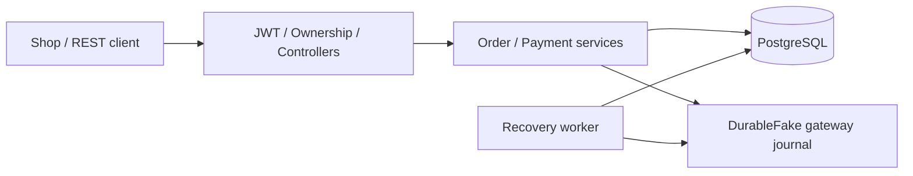

# Kịch bản thuyết trình và hướng dẫn demo Order–Payment

Đề tài Group 14: **Xây dựng và kiểm chứng an toàn hệ thống xử lý đơn hàng và
thanh toán trực tuyến**. Tài liệu này dùng để tập nói, điều khiển demo và trả lời
câu hỏi bảo vệ. Mốc nghiệm thu 14/10/2026: 148 unit + 35 integration PASS, không
SKIP. Khi chạy lại, dùng số liệu trong evidence vừa sinh; thời gian chạy, PID và
hash journal thay đổi giữa các lần chạy.

Tài liệu kỹ thuật chính: [báo cáo](report/BAO_CAO.md),
[phụ lục](report/PHU_LUC_A_G.md), [phạm vi nghiệm thu](PHAM_VI_KIEM_CHUNG.md).
Kịch bản chỉ dùng source và công cụ của project; không thao tác thư mục ATPM.

## 1. Cách sử dụng và phân bổ thời gian

Buổi trình bày đầy đủ khoảng 20–25 phút, chưa tính hỏi đáp. Các đoạn trích dẫn
bên dưới là lời nói gợi ý; nên tập giải thích bằng lời của mình. “Thao tác” là
phần cần thực hiện hoặc chỉ trên màn hình, không đọc thành lời.

| Phần                    | Thời lượng gợi ý | Nội dung phải làm rõ                                |
| ------------------------ | --------------------- | ------------------------------------------------------- |
| Mở đầu và hệ thống | 3 phút               | Bài toán; kiến trúc thực tế; phạm vi             |
| Chương 1 học phần    | 4 phút               | Threat model; trạng thái; safety/liveness; mutation   |
| Chương 2 học phần    | 2 phút               | Mô hình C; ownership/lifetime; BUGGY/FIXED            |
| Chương 3 học phần    | 3 phút               | Static analysis; witness kho; SAT/UNSAT; bản sửa      |
| Chương 4 học phần    | 2 phút               | Oracle; unit/integration/fuzz; coverage                 |
| Demo recovery            | 5–7 phút            | Charge/refund đã xảy ra; DB ngắt; worker phục hồi |
| Kết luận               | 1 phút               | Kết quả có evidence và giới hạn                   |

Nếu được yêu cầu trình bày theo **bốn chương học phần**, dùng cách ánh xạ này.
Báo cáo kỹ thuật hiện có chín chương để tách kiến trúc, phương pháp và evidence;
số chương trong báo cáo không trùng một-một với chương học phần.

| Chương học phần                            | Nơi mở trong báo cáo kỹ thuật |
| ---------------------------------------------- | ----------------------------------- |
| 1: Mô hình, threat model, thuộc tính       | Chương 1 và 3; Phụ lục A/B     |
| 2: An toàn bộ nhớ và biểu diễn dữ liệu | Chương 4; Phụ lục C             |
| 3: Phân tích tĩnh và SMT                   | Chương 4 và 5; Phụ lục C/D     |
| 4: Kiểm thử động và fuzzing               | Chương 6 và 7; Phụ lục E/F     |
| Mô tả hệ thống, giới hạn, kết luận     | Chương 2, 8 và 9                 |

Nếu chỉ có 10 phút: mở đầu 1 phút, bất biến/model 2 phút, lỗi kho/SMT 1 phút,
phân biệt C và C# 1 phút, demo recovery 4 phút, giới hạn 1 phút. Không chạy toàn
suite hoặc load benchmark trong buổi ngắn; mở kết quả nghiệm thu đã lưu.

## 2. Chuẩn bị trước buổi bảo vệ

### 2.1. Tệp cần mở sẵn

| Tệp                                                                                               | Dùng khi nói về                    |
| -------------------------------------------------------------------------------------------------- | ------------------------------------- |
| [BAO_CAO.md](report/BAO_CAO.md)                                                                     | Trình tự và kết luận kỹ thuật  |
| [order_payment_recovery_model.json](order_payment_recovery_model.json)                              | State, event, contract và assumption |
| [PaymentRecoveryWorker.cs](../OrderPaymentMicroservice/Services/Payments/PaymentRecoveryWorker.cs)  | Scan failure, lookup và recovery     |
| [PostgresReconnectTests.cs](../OrderPaymentMicroservice.IntegrationTests/PostgresReconnectTests.cs) | Vị trí ngắt DB; oracle; assertions |
| [charge evidence](results/postgres_reconnect_charge.results.json)                                   | Charge sau reconnect                  |
| [refund evidence](results/postgres_reconnect_refund.results.json)                                   | Refund sau reconnect                  |
| [application_tests.results.json](results/application_tests.results.json)                            | Kết quả toàn suite và từng test  |
| [inventory SMT](results/inventory_verification.results.json)                                        | Witness stock=10, q1=q2=6             |
| [liveness audit](results/liveness_audit.results.json)                                               | Raw false và progress-only true      |

Chuẩn bị terminal tại **thư mục gốc repository**. Tất cả lệnh bên dưới được chạy
từ đây, không chạy từ `security-analysis/`.

```bash
cd /home/phamhoang/OrderPaymentMicroservice
dotnet --version
python3 --version
```

Đường dẫn `cd` là đường dẫn trên máy hiện tại; trên máy khác thay bằng thư mục
checkout của project. Cần .NET 10 SDK, Python 3.10+ và PostgreSQL binaries cục bộ.
Để kiểm tra công cụ PostgreSQL mà không khởi động database:

```bash
python3 - <<'PY'
import os
from pathlib import Path
configured = os.environ.get('POSTGRES_BIN')
candidates = [Path(configured)] if configured else sorted(Path('/usr/lib/postgresql').glob('*/bin'), reverse=True)
required = ('postgres', 'initdb', 'pg_ctl', 'createdb')
available = [p for p in candidates if all((p/name).is_file() for name in required)]
print('PostgreSQL binaries:', available)
if not available:
    raise SystemExit('Cần PostgreSQL binaries; đặt POSTGRES_BIN tới thư mục bin đã cài.')
PY
```

Nếu PostgreSQL được cài ở vị trí khác, đặt `POSTGRES_BIN` tới thư mục chứa các
binaries đó. Hai case reconnect yêu cầu **local binaries**, kể cả khi Docker có
sẵn. Không thay demo này bằng thao tác dừng dịch vụ PostgreSQL của máy.

### 2.2. Build trước, tránh phụ thuộc mạng khi đang bảo vệ

```bash
dotnet restore OrderPaymentMicroservice.slnx
dotnet build OrderPaymentMicroservice.slnx --no-restore --nologo
```

Restore có thể cần NuGet/network ở lần đầu. Hoàn tất bước này và chạy thử demo
trước buổi trình bày. Chrome/Chromium chỉ cần cho smoke test giao diện; Z3 chỉ
cần cho demo SMT; GCC/Make/sanitizers chỉ cần cho demo C. Hai case reconnect
không yêu cầu Chrome, Z3 hoặc sửa workbook.

### 2.3. Kiểm tra mốc nghiệm thu toàn suite

```bash
python3 - <<'PY'
import json
from pathlib import Path
d = json.loads(Path('security-analysis/results/application_tests.results.json').read_text())
print('Full suite passed:', d['passed'])
for name, suite in d['suites'].items():
    print(name, 'passed=', suite['passed'], 'total=', suite['total'],
          'failed=', suite['failed'], 'skipped=', suite['skipped'])
PY
```

Đây là **đọc evidence đã lưu**, không phải chạy test mới. Mốc hiện tại là
unit 148/148, integration 35/35, failed=0, skipped=0. Sau khi thay source, cần
chạy lại toàn suite theo mục 9 trước khi dùng các số này để kết luận.

## 3. Lời thuyết trình: mở đầu và mô tả hệ thống

### 3.1. Mở đầu

> Kính thưa thầy/cô, nhóm em trình bày đề tài xây dựng và kiểm chứng an toàn hệ
> thống xử lý đơn hàng và thanh toán trực tuyến. Nhóm tập trung vào câu hỏi:
> khi có lỗi ở giữa các bước tạo đơn, thu tiền và cập nhật dữ liệu, hệ thống có
> giữ được sự nhất quán của đơn hàng, thanh toán và tồn kho hay không?
>
> Một response thành công ở happy path chưa đủ trả lời câu hỏi này. Ví dụ,
> gateway có thể đã thu tiền nhưng database bị ngắt trước khi ứng dụng lưu
> kết quả. Nếu gửi một yêu cầu thu tiền mới, người mua có thể bị thu hai lần.
> Nếu coi mọi timeout là thất bại và hoàn kho ngay, hệ thống có thể giải phóng
> hàng của một giao dịch thực tế đã được thanh toán.
>
> Vì vậy nhóm dùng mô hình trạng thái, các bất biến, phản ví dụ và kiểm thử với
> PostgreSQL thật để kiểm tra những tình huống này. Phạm vi là Order–Payment;
> gateway hiện là giả lập bền vững, không có giao dịch tiền thật.

Thao tác: mở báo cáo chương 1 và [phạm vi](PHAM_VI_KIEM_CHUNG.md). Không dùng
các cải tiến future work như DB RBAC hoặc Kubernetes làm tiêu chí đánh giá demo.

### 3.2. Kiến trúc thực tế

> Hệ thống có giao diện shop, REST API ASP.NET Core, lớp service, PostgreSQL và
> payment gateway abstraction. User, Product và Cart hỗ trợ luồng tạo đơn;
> đối tượng kiểm chứng chính là Order, Payment và inventory reservation.
>
> Hiện các module chạy trong một host và dùng chung PostgreSQL. Tên đề tài có
> microservice, nhưng nhóm không tuyên bố đã triển khai các service độc lập với
> database riêng. Các process API riêng trong test dùng để kiểm tra concurrency
> hoặc recovery; chúng không biến kiến trúc hiện tại thành hệ thống nhiều máy.
>
> JWT xác định người gọi, ownership kiểm tra tài nguyên của người dùng và các
> endpoint quản trị yêu cầu Admin. Giá sản phẩm dùng dữ liệu phía server. Khi
> tạo đơn, cập nhật Order, items và kho phải cùng transaction. Khi gọi gateway,
> hệ thống lưu trạng thái đang xử lý trước, rồi gọi gateway ngoài transaction
> database, vì hai hệ thống này không có một transaction chung.



Thao tác: mở báo cáo chương 2. Khi chỉ vào journal, nói rõ đó là kết quả provider
giả lập, tách khỏi dữ liệu business trong PostgreSQL và sống qua restart API.

## 4. Lời thuyết trình theo bốn chương học phần

### 4.1. Chương 1: threat model, state machine và kiểm chứng

> Đầu tiên nhóm xác định tài sản cần bảo vệ: danh tính, đơn hàng, payment,
> tồn kho, secrets và audit. Threat model gồm sáu asset, bốn trust boundary và
> chín threat, bao phủ sáu nhóm STRIDE. Bao phủ STRIDE có nghĩa là hoạt động
> phân tích đã xét đủ nhóm đe dọa, không có nghĩa là mọi đe dọa đều đã được đóng.
>
> Integrity được ưu tiên vì sửa một amount hoặc chuyển sai trạng thái có thể
> gây thu tiền trùng hoặc trả kho sai. Availability cũng quan trọng: khi DB
> gián đoạn, hệ thống cần giữ dấu vết giao dịch và phục hồi khi dependency trở lại.
> Gateway thật và xác thực callback vẫn nằm ngoài evidence hiện tại.

Thao tác: mở bảng asset/threat ở chương 1, đối chiếu nguồn
[threat_model.json](threat_model.json). Nếu được hỏi điểm rủi ro, giải thích
likelihood × impact là cách chấm của project; không gọi đó là CVSS chính thức.

> Sau threat model, nhóm đặc tả các trạng thái và event. Order và Payment có
> hai state machine riêng; model recovery biểu diễn aggregate kết hợp cả hai
> cùng reservation. Model có 15 state, 37 event transitions và bảy functional
> contracts. Khi chiếu xuống cặp state nguồn–đích và bỏ trùng, còn 31 cặp cạnh;
> 37 và 31 đo hai đối tượng khác nhau nên không mâu thuẫn.

Các bất biến cần giải thích bằng ví dụ:

| Bất biến                                                           | Ví dụ dễ nói                                                 | Nơi kiểm                               |
| -------------------------------------------------------------------- | ---------------------------------------------------------------- | ---------------------------------------- |
| PAID/CONFIRMED/COMPLETED cần payment SUCCESS                        | Gửi request chưa đủ để ghi PAID                            | State machine, service, model/test       |
| Một logical payment/order                                           | Gửi lại cùng thao tác không tạo khoản thu mới            | Unique constraints, key, regression      |
| Amount phải bằng Order.TotalAmount                                 | Không lấy số tiền do client tự sửa làm kết quả hợp lệ | Validator/service/SMT                    |
| UNKNOWN giữ reservation                                             | Timeout chưa nói được tiền đã bị trừ hay chưa         | Model recovery và test                  |
| Không hủy khi payment đang hoạt động hoặc chưa rõ kết quả | Payment và cancel không cùng thắng                           | Transaction/concurrency tests            |
| Đã thu tiền thì lỗi fulfillment cần compensation               | Không đổi PAID thẳng thành FAILED để bỏ dấu tiền       | Refund state machine/model               |
| Release kho idempotent                                               | Refund replay không cộng stock lần thứ hai                   | InventoryStatus, stock, audit assertions |
| Terminal không hồi sinh                                            | CANCELLED không quay lại PAID vì event đến muộn            | History monitor, mutation, guards        |

> Safety nói rằng một điều xấu không xảy ra, ví dụ không có hai payment thành
> công cho cùng một đơn. Liveness nói về tiến triển, ví dụ cuối cùng đi tới
> terminal. Hai điều này khác nhau: giữ UNKNOWN và kho có thể bảo toàn safety,
> nhưng nếu gateway không bao giờ trả kết quả xác định thì không thể cam kết
> giao dịch hoàn tất trong một thời hạn cố định.
>
> Trong audit hiện tại, AG AF terminal trên graph gốc là false vì có đường
> chờ vô hạn. Trên graph đã lọc các cạnh stutter theo policy của checker, kết
> quả là true. Nhóm trình bày đây là kết quả của semantics progress-only,
> không coi việc lọc cạnh là một chứng minh fair-CTL đầy đủ trên graph gốc.
> Một đường có thể tới terminal, tức EF terminal, cũng không đủ chứng minh
> mọi đường cuối cùng tới terminal.

Thao tác: chỉ hai trường `unconditional_AG_AF_terminal=false` và
`progress_only_AG_AF_terminal=true` trong liveness evidence. `passed=true` ở
audit nghĩa là đối chiếu semantics đạt oracle, không làm kết quả raw false thành true.

> Nhóm còn dùng sáu mutation để kiểm tra sức phát hiện của thuộc tính: hồi
> sinh đơn hủy, sai amount, hai payment SUCCESS, xung đột payment–cancel,
> bỏ refund sau charge và giải phóng kho khi payment UNKNOWN. Mỗi mutation
> phải làm thuộc tính tương ứng thất bại và có witness. Đây là các lỗi cố ý
> trên model; nhóm không gọi chúng là sáu lỗ hổng vừa khai thác trên API thật.

Thao tác: mở Phụ lục B. Có thể chỉ một counterexample
`CREATED → CANCELLED → PAID_AFTER_CANCELLED`, rồi giải thích history monitor
ghi lại việc đã terminal để phát hiện hồi sinh. BMC/TLC lịch sử được phân biệt
trong báo cáo; không gọi lượt checker Python hiện tại là một lượt TLC mới.

### 4.2. Chương 2: ownership, lifetime và mô hình C

> Backend thực tế viết bằng C# và dùng garbage collector. Để học kiểm chứng
> ownership và lifetime, nhóm xây dựng năm module C theo ngữ cảnh User,
> Product, Cart, Order và Payment. Đây là mô hình học tập có lỗi được chèn
> chủ động, không phải bản dịch service C#.
>
> Mỗi module có bản BUGGY và FIXED. Với một input như nhau, BUGGY cần tạo đúng
> diagnostic kỳ vọng, còn FIXED phải hết diagnostic đó. Kết quả 22/22 PASS
> nghĩa là 22 oracle đúng kỳ vọng, bao gồm các trường hợp phải phát hiện lỗi;
> không có nghĩa là cả 22 lần chạy đều không có lỗi bộ nhớ.

| Module  | Lỗi chủ động      | Nguyên nhân                                             | Cách sửa cần giải thích                            |
| ------- | --------------------- | --------------------------------------------------------- | ------------------------------------------------------- |
| Order   | Memory leak           | Free struct cha nhưng quên vùng items                  | Giải phóng phần con trước cha                      |
| Payment | Double free           | Nhánh lỗi và cleanup cùng sở hữu/free một con trỏ | Làm rõ ownership, đặt NULL sau free                 |
| Cart    | Use after free        | Đọc ProductId của item sau khi free                    | Chụp giá trị cần log trước khi free               |
| Product | Heap buffer overflow  | Copy tên dài vào buffer cố định                     | Kiểm chiều dài, xử lý nhánh từ chối và cleanup |
| User    | Stack buffer overflow | Copy email không kiểm chiều dài                       | Kiểm input theo sức chứa, tính cả byte kết thúc  |

> ASan quan sát lỗi như overflow, use after free và double free; LSan quan sát
> leak; UBSan kiểm undefined behavior trong phạm vi thực thi. Size, alignment
> và padding được đo trên ABI của máy dùng trong evidence, không mặc định
> coi layout đó giống mọi nền tảng.

Thao tác: mở Phụ lục C và [README C](c-memory/README.md). Nếu không demo C trực
tiếp, mở evidence đã lưu và gọi rõ là kết quả lần chạy được ghi trong artifact.

### 4.3. Chương 3: static analysis, SMT và sửa lỗi kho

> Phân tích tĩnh đọc source mà không thực thi từng input. Nhóm kết hợp GCC,
> cppcheck và scanner theo pattern của project. Một công cụ có thể bỏ sót lỗi:
> trong evidence, cppcheck không báo trực tiếp mọi lớp lỗi chủ động ở năm
> module. Vì vậy zero finding không được dùng như chứng minh an toàn; nhóm
> đối chiếu thêm với code review và sanitizer.
>
> Với SMT, nhóm đưa bất biến số học vào ràng buộc. Ví dụ lỗi kho ban đầu là
> kiểm từng dòng riêng: stock bằng 10, một dòng mua 6 và dòng thứ hai cũng mua
> 6 cùng sản phẩm. Mỗi dòng đều không vượt 10, nhưng tổng 12 làm kho thành −2.
> Z3 trả SAT cho baseline vì tìm được counterexample này.
>
> Bản sửa cộng quantity theo ProductId trước khi kiểm stock và mutation. Khi
> thêm điều kiện tổng quantity không vượt stock, truy vấn tìm stock âm trở
> thành UNSAT trong mô hình hai dòng. Implementation được đối chiếu bằng
> regression, transaction Serializable và CHECK stock không âm trong PostgreSQL.
> SMT không thay thế bằng chứng concurrency của database.

Thao tác: mở [inventory SMT evidence](results/inventory_verification.results.json)
để chỉ witness `stock=10, q1=6, q2=6`, sau đó mở `OrderService.cs` nếu cần chỉ chỗ
cộng dồn. Giải thích kho kiểm theo tổng quantity, không xóa hoặc bỏ qua dòng trùng.

> Bất biến tiền dùng integer cents trong mô hình và decimal có guard ở source.
> Payment hợp lệ phải có amount đúng tổng đơn. Bảy query payment SMT có verdict
> SAT/UNSAT đúng kỳ vọng. SAT có thể là witness hợp lệ hoặc witness lỗi, tùy
> điều đang hỏi; UNSAT nghĩa là không có nghiệm dưới chính các ràng buộc đó.
>
> Query Int32 tìm được tích lớn hơn miền signed 32-bit. Đây là lý do không
> dùng một phép nhân Int32 thiếu kiểm soát cho tiền. Nó không có nghĩa là
> implementation C# hiện tại đang dùng Int32 và vừa bị overflow.

Chuỗi cần nhấn mạnh: **finding → witness → phân tích nguyên nhân → guard/transaction
và constraint → regression → evidence**. Không chỉ trình chiếu một dòng UNSAT.

### 4.4. Chương 4: kiểm thử động, coverage và fuzzing

> Unit test kiểm logic và biên input; integration kiểm HTTP, quyền, transaction
> và dữ liệu PostgreSQL thật. Mốc toàn suite hiện tại là 148 unit và 35
> integration PASS, không SKIP. Mỗi assertion là một oracle cụ thể: request
> trả đúng HTTP status, database có đúng row, state đúng, stock đúng và
> provider không nhận thêm lời gọi mutation.
>
> Coverage của InputValidator là 97,22% branch và helper MoneyAmounts là 100%
> branch. Những số này chỉ áp dụng target đã đo, không phải coverage toàn API.
> Test mong đợi exception có thể PASS khi validator từ chối đúng input sai.
> Đường bất khả thi sau các guard không được ép chạy chỉ để đạt 100%.
>
> Fuzz có ba campaign với corpus/seed và oracle xác định; branch coverage
> target fuzz trong evidence hiện tại là 96,66%. Đây không phải cùng target
> với con số riêng của InputValidator. Fuzz làm rộng dữ liệu được thử nhưng
> không chứng minh mọi payload, HTTP parser hay background worker đều an toàn.

Thao tác: mở summary toàn suite, coverage summary và fuzz evidence. Có thể mở
[giải thích unit test](GIAI_THICH_KIEM_THU_INPUT_VALIDATOR.md) nếu được hỏi sâu về
Arrange–Act–Assert hoặc Fact/Theory. Không dùng số liệu 87 unit/5 integration của
báo cáo tiến độ cũ để mô tả phiên bản hiện tại.

## 5. Demo chính: charge/refund khi PostgreSQL ngắt và phục hồi

### 5.1. Giới thiệu trước khi chạy

> Demo tiếp theo cố ý tạo cửa sổ gateway đã thực hiện thao tác nhưng database
> chưa lưu được kết quả cuối. Harness tạo PostgreSQL và API riêng trong thư
> mục tạm. Nó không dùng database phát triển và không dừng dịch vụ PostgreSQL
> của máy. DB được stop/start thật; API process và pool kết nối được giữ nguyên.
>
> Barrier chỉ nằm trong executable test CrashProbe: sau khi gateway journal
> được ghi, nó giữ response để test ngắt DB, rồi thả response lúc DB còn tắt.
> Production executable không có endpoint gây lỗi. Đây là cách điều khiển
> thời điểm lỗi để demo tái lập, không phải giả lập một DB outage bằng mock.

### 5.2. Chạy cả hai case bằng một lệnh

```bash
python3 security-analysis/run_recovery_demo.py
```

Hai case thường chạy vài chục giây trên máy hiện tại; thời lượng không phải SLA.
Trong khi chờ, giải thích luồng charge ở mục 5.3. Script chờ hai test kết thúc,
kiểm evidence được sinh trong lượt này và hash source khớp. Nếu test SKIP hoặc
chỉ còn JSON cũ, script không được coi lượt đó là thành công.

Output thành công có dạng sau; phần duration có thể khác:

```text
Passed! ... Passed: 2 ... Skipped: 0 ... Total: 2
charge: PASS; ready 200 -> 503 -> 200; same API process; charge=1, refund=0, inventory_release=0
security-analysis/results/postgres_reconnect_charge.results.json
refund: PASS; ready 200 -> 503 -> 200; same API process; charge=1, refund=1, inventory_release=1
security-analysis/results/postgres_reconnect_refund.results.json
```

Hai tests tạo hai API process khác nhau. “Same API process” nghĩa là **trong từng
case** API không restart từ trước outage tới sau recovery, không phải hai case
phải có cùng PID. Stock có thể thay đổi theo seed; so sánh initial_stock/final_stock.

### 5.3. Charge: các bước và lời giải thích

| Bước do test thực hiện             | Quan sát cần chỉ                               | Lời nói gợi ý                                                        |
| -------------------------------------- | ------------------------------------------------- | ------------------------------------------------------------------------ |
| Tạo account/order mua một sản phẩm | Kho giảm một; reservation RESERVED              | “Đơn đã giữ hàng, chưa thể coi là đã trả tiền.”           |
| Ghi Payment PROCESSING và gọi charge | Gateway có một journal; response đang bị giữ | “Provider đã có kết quả; local finalize chưa chạy.”             |
| Stop cùng PostgreSQL cluster          | live=200; ready=503                               | “Process còn sống nhưng dependency chưa sẵn sàng.”               |
| Thả response khi DB tắt              | Original finalize HTTP 503                        | “503 không đủ suy ra gateway chưa charge.”                         |
| Replay cùng key trong outage          | HTTP 503, không thêm charge                     | “Không dùng key mới để thu tiền lại khi chưa biết kết quả.” |
| Chờ worker scan trong outage          | recovery_scan_failures ≥ 1                       | “Worker đã gặp DB lỗi thật; chưa bị dừng vĩnh viễn.”         |
| Start lại cluster, giữ API/pool      | ready=200                                         | “API reconnect mà không cần restart API.”                           |
| Worker lookup theo key và reconcile   | Payment SUCCESS, Order PAID                       | “Đọc kết quả đã có để finalize, không gọi charge lại.”     |
| Replay sau recovery                    | charge_calls=1; journal hash giữ nguyên         | “Kết quả cũ được dùng lại; không thêm provider mutation.”    |

> Kết quả charge mong đợi là Payment SUCCESS, Order PAID, inventory RESERVED
> và stock bằng initial_stock trừ một. Trong seed hiện tại là 50 xuống 49.
> Stock chưa được trả vì đơn đã thu tiền và tiếp tục có reservation hợp lệ.
> Một payment row, AttemptCount bằng một và key giữ nguyên hỗ trợ kết luận
> không tạo logical payment mới. Counter charge_calls bằng một kiểm thêm lời
> gọi provider, thay vì chỉ nhìn số file journal.

Lưu ý: case này giữ local `PROCESSING` khi finalize không ghi được DB; không nói
mọi DB outage đều tự lưu thành `UNKNOWN`. UNKNOWN là trạng thái của những nhánh
khác khi ứng dụng ghi được kết quả chưa xác định. Không retime payment để thúc worker.

### 5.4. Refund: các bước và lời giải thích

| Bước do test thực hiện         | Quan sát cần chỉ                             | Lời nói gợi ý                                                |
| ---------------------------------- | ----------------------------------------------- | ---------------------------------------------------------------- |
| Charge hoàn tất trước          | Một charge; stock đã giữ một đơn vị     | “Đã có bằng chứng thu tiền và charge reference.”        |
| Admin gửi refund cùng refund key | Payment REFUND_PENDING; journal refund đã ghi | “Refund có key riêng, gắn với charge đã tồn tại.”      |
| Stop DB trước refund finalize    | live=200, ready=503; finalize HTTP 503          | “Tiền có thể đã được refund dù local chưa REFUNDED.” |
| Worker scan gặp outage            | recovery_scan_failures ≥ 1                     | “Worker tiếp tục giữ khả năng quét ở lần sau.”         |
| DB start lại, API giữ nguyên    | ready=200; refund status lookup ≥ 1            | “Worker hỏi kết quả refund đã có bằng đúng key.”      |
| Finalize REFUNDED                  | Giữ charge reference; inventory RELEASED       | “Đối soát không ghi đè dấu vết charge bằng refund.”   |
| Same-key replay                    | refund_calls=1; release count=1                 | “Không refund lại và không cộng kho lần thứ hai.”       |

> Refund kết thúc với Payment và Order đều REFUNDED. Stock trở về initial_stock;
> trong seed hiện tại là 50. Counter vẫn là một charge và một refund. Có
> đúng một ORDER_UPDATE COMMIT sang REFUNDED, cùng InventoryStatus RELEASED
> và số stock đúng. Kết hợp các oracle này để chứng minh release một lần trong
> kịch bản đã chạy, không chỉ suy từ một HTTP response 200.

Admin ở đây là account fixture của cluster tạm. Test không cấp quyền Admin cho
account trên database của người dùng. Gateway call counters nằm trong adapter test.

### 5.5. Đọc JSON sau khi demo kết thúc

Test tự dọn API/cluster/ledger tạm. Sau khi kết thúc, mở JSON evidence trong repo;
không tìm port test để curl hoặc query DB tạm nữa. Dùng lệnh sau để in các trường
quan trọng theo đúng dữ liệu vừa sinh:

```bash
python3 - <<'PY'
import json
from pathlib import Path
for operation in ('charge', 'refund'):
    path = Path(f'security-analysis/results/postgres_reconnect_{operation}.results.json')
    d = json.loads(path.read_text())
    print('\nCASE:', operation, 'run_at_utc:', d['run_at_utc'])
    print('passed:', d['passed'], 'API PID:', d['api_pid'], 'restarted:', d['api_restarted'])
    print('ready:', d['health_ready_sequence'], 'live during outage:', d['health_live_during_outage'])
    print('finalize HTTP:', d['original_finalize_http_status'], 'API pooling:', d['connection_pooling'])
    print('final states:', d['final_order_status'], d['final_payment_status'], d['final_inventory_status'])
    print('stock:', d['initial_stock'], '->', d['final_stock'])
    print('gateway:', d['gateway_calls'])
    print('worker:', d['worker_metrics'])
    print('payment rows:', d['payment_records'], 'attempt count:', d['attempt_count'])
    print('reservation/release:', d['inventory_reservation_count'], d['inventory_release_count'])
    print('keys preserved:', d['idempotency_keys_preserved'])
    print('journal entries:', len(d['journal_hashes']))
    for step in d['timeline']:
        print(' ', step['step'], round(step['elapsed_ms'], 1), 'ms since scenario start')
PY
```

`elapsed_ms` là mốc tính từ đầu case, không phải duration riêng của mỗi bước.
`last_completed_scan_unix_ms` và các counters là thông tin process, không có
ý nghĩa là tổng lịch sử của mọi API instance. `audit_append_failures` có thể tăng
khi DB tắt; không gọi evidence đó là một audit trail đầy đủ không mất sự kiện.

Oracle DB mở connection mới để quan sát độc lập. API vẫn giữ pool qua outage;
điều này tránh nhầm một socket cũ trong test runner với việc API không phục hồi.

### 5.6. Chạy riêng từng case nếu cần nói chậm

Charge:

```bash
dotnet test OrderPaymentMicroservice.IntegrationTests/OrderPaymentMicroservice.IntegrationTests.csproj --no-restore --nologo --filter FullyQualifiedName~ChargeRecoversAfterDatabaseReconnectWithoutAnotherCharge --blame-hang-timeout 90s
```

Refund:

```bash
dotnet test OrderPaymentMicroservice.IntegrationTests/OrderPaymentMicroservice.IntegrationTests.csproj --no-restore --nologo --filter FullyQualifiedName~RefundRecoversAfterDatabaseReconnectWithoutAnotherRefundOrStockRelease --blame-hang-timeout 90s
```

Sau mỗi lệnh, yêu cầu Passed=1 và Skipped=0, rồi mở đúng JSON của case đó và
kiểm `run_at_utc`. Hai lệnh trực tiếp này không có bước kiểm freshness/source
hash của Python wrapper. Khi nghiệm thu tự động, ưu tiên lệnh ở mục 5.2.
Không thêm TRX của subset vào `results/dotnet`, vì summary dùng lượt mới nhất
của từng suite trong thư mục này.

## 6. Demo bổ sung nếu được yêu cầu

### 6.1. Model và phản ví dụ

```bash
python3 security-analysis/verify_recovery_model.py
python3 security-analysis/audit_liveness.py
```

Mở JSON recovery để chỉ thuộc tính và `negative_scenarios`, rồi mở liveness JSON
để chỉ raw/progress-only. Verifier recovery phải chấp nhận model đúng **và** phát
hiện mutation; thông báo FAIL của model bị mutation là kết quả mong đợi của oracle.
Nếu tool báo lỗi, thiếu file hoặc mutation không được phát hiện, không gọi đó là PASS.

### 6.2. SMT

```bash
python3 security-analysis/verify_inventory_smt.py
python3 security-analysis/verify_payment_smt.py
```

Yêu cầu Z3 trên PATH. Chỉ ba query inventory và bảy query payment có verdict đúng
kỳ vọng mới là thành công. Chỉ rõ SAT của witness lỗi kho và UNSAT của bản sửa;
không nói “tất cả phải UNSAT”. Đây là chạy tool của project, không mở toolkit ATPM.

### 6.3. C BUGGY/FIXED

```bash
make -C security-analysis/c-memory static-check
make -C security-analysis/c-memory test
```

Cần GCC, Make, cppcheck và runtime sanitizer. Mở evidence static/dynamic trong
`c-memory/evidence/`. Có thể trình chiếu Cart BUGGY/FIXED bằng source và diagnostic
được lưu trong Phụ lục C. Không dùng `make clean` ngay trước bảo vệ nếu đang cần
raw logs. Nếu LSan bị hạn chế bởi sandbox/debugger, ghi TOOL_ERROR hoặc lỗi môi
trường và dùng evidence lịch sử có nhãn; không tắt leak detection để lấy PASS.

### 6.4. Normal executable và giao diện thật

```bash
dotnet test OrderPaymentMicroservice.IntegrationTests/OrderPaymentMicroservice.IntegrationTests.csproj --no-restore --nologo --filter FullyQualifiedName~ApplicationSmokeTests --blame-hang-timeout 90s
```

Cần Chrome/Chromium và PostgreSQL binaries. Test chạy **normal API executable**,
Chrome headless và HTTP thật: signup → login → products → cart → order → payment
→ history → reload → logout. Nó tự tạo dữ liệu và dọn resources. Không xuất hiện
cửa sổ Chrome tương tác; evidence nằm ở
[application_smoke.results.json](results/application_smoke.results.json).

Nếu cần tự bấm shop, sử dụng database demo đã chuẩn bị riêng, cấu hình
`ConnectionStrings:DefaultConnection` và `Jwt:Key` ngoài source, rồi chạy:

```bash
dotnet run --project OrderPaymentMicroservice/OrderPaymentMicroservice.csproj --no-restore --launch-profile http
```

Mở `http://localhost:5246`, đăng ký account mới, login, thêm một sản phẩm vào cart,
tạo order và thanh toán mô phỏng. Mở history để chỉ PAID rồi reload/logout.
Startup gọi migration/seed trên DB đã cấu hình, vì vậy chỉ dùng DB demo riêng;
lệnh này không tự tạo cluster tạm. Không chạy fault injection bằng việc stop
database demo đang phục vụ shop; demo outage dùng harness ở mục 5.

Các lỗi giao diện đã sửa và được live smoke kiểm: API cùng origin `/api`, cache
JSON sai trở về signed-out, đọc error body một lần hỗ trợ text/JSON, bỏ thông tin
thẻ không dùng, cập nhật navbar sau logout và chặn payment double-submit. Những
chi tiết này được giữ trong báo cáo chương 6.12; không cần một biên bản review riêng.

### 6.5. API process bị kill khác gì PostgreSQL reconnect?

Charge process-kill: test `Killed_API_recovers_committed_gateway_charge_without_charging_or_releasing_again`.
Refund process-kill: test `KilledApiRecoversRefundWithoutRefundingOrReleasingInventoryTwice`.
Tìm hai test bằng lệnh list hoặc tên trong summary; nếu chạy subset, không ghi
TRX vào thư mục summary toàn suite.

| Demo                       | Thành phần bị dừng            | Thành phần phục hồi                    | Evidence                                |
| -------------------------- | --------------------------------- | ------------------------------------------ | --------------------------------------- |
| Charge/refund process kill | API sau provider journal          | API process mới và worker                | process_restart / refund_restart JSON   |
| Charge/refund DB reconnect | PostgreSQL trước local finalize | Cùng PostgreSQL cluster; giữ API process | postgres_reconnect_charge / refund JSON |

Hai loại evidence hỗ trợ hai cửa sổ lỗi khác nhau; không dùng một loại để khẳng
định đã kiểm tất cả các loại crash, power loss hoặc PostgreSQL failover.

## 7. Kết luận nên nói cuối buổi

> Kết quả của nhóm là chuỗi bằng chứng từ bất biến và model đến counterexample,
> bản sửa, regression và dữ liệu PostgreSQL. Toàn suite ở mốc nghiệm thu có
> 148 unit và 35 integration PASS. Hai demo reconnect xác nhận API còn sống,
> ready chuyển 200–503–200, worker phục hồi mà không gọi lại charge/refund và
> refund release kho đúng một lần trong những kịch bản đã thực thi.
>
> Kết luận này có giới hạn: provider là DurableFake, PostgreSQL là cluster
> local và chưa kiểm network partition, failover, power loss hay mọi crash
> window. Các model có abstraction và liveness cần giả định tiến triển phù
> hợp. Nhóm không tuyên bố đã chứng minh toàn bộ hệ thống an toàn.
>
> Tách DB roles, retention job, webhook thật, shared limiter, gateway thật và
> Kubernetes là future work ngoài phạm vi nghiệm thu Order–Payment hiện tại.
> Nếu còn thời gian, hướng cải thiện phù hợp là lặp load, đổi thứ tự scenario
> và đo recovery dưới tải với workload được công bố.

Không cần đọc hết mọi số đo load. Một sample baseline/retry có p95/success/cost
được lưu trong [order_retry_load.results.json](results/order_retry_load.results.json);
baseline chạy trước nên chưa có kết luận thống kê hoặc production capacity.

## 8. Câu hỏi bảo vệ và câu trả lời gợi ý

### Vì sao không dùng một transaction cho DB và gateway?

> PostgreSQL transaction không bao phủ side effect ở provider bên ngoài. Nhóm
> lưu trạng thái/key trước khi gọi gateway, rồi dùng key và status lookup để
> đối soát nếu finalize thất bại. Demo đặt lỗi đúng ở ranh giới này.

### Cùng key có đủ ngăn mọi double charge không?

> Cần key được giữ và bind đúng payload, constraint/business guards và provider
> có hợp đồng idempotency tương ứng. Test hiện xác minh adapter DurableFake và
> các đường đã chạy; không cam kết một provider thật chưa tích hợp sẽ làm đúng.
> Ngoài số row/file, nhóm kiểm số lời gọi charge/refund trong adapter test.

### Worker làm gì nếu DB vẫn chưa trở lại?

> Worker ghi scan failure và tiếp tục chờ lần quét sau. Nó không thể hoàn tất
> business mutation khi DB còn lỗi. Trong demo DB được phục hồi rồi worker mới
> resolve; điều này không tạo một bảo đảm liveness vô điều kiện khi dependency
> hỏng mãi. Interval/stale của fixture là 5 giây; mặc định source là 30/60 giây.

### Vì sao ready 200 chưa đủ nói payment đã phục hồi?

> Ready chỉ kiểm dependency DB theo health contract. Sau ready 200, test còn
> chờ payment terminal, SYSTEM audit RESULT, worker counter và kiểm stock,
> keys, transaction references. Health và consistency là hai oracle khác nhau.

### Vì sao timeout không chuyển thẳng FAILED và hoàn kho?

> Timeout cho biết caller chưa nhận kết quả, không chứng minh provider chưa
> charge. Giữ trạng thái unresolved/reservation và lookup theo key tránh mất
> dấu tiền. Chỉ decline/kết quả xác định phù hợp mới cho phép nhánh thất bại.

### Assertion refund release một lần dựa vào đâu?

> Stock trở về ban đầu, InventoryStatus là RELEASED, một COMMIT đổi Order sang
> REFUNDED, provider refund_calls=1 và replay không đổi journal. Đây là các
> quan sát phối hợp cho case đã chạy, không phải proof mọi concurrency scenario.

### Có 15/15 property PASS nhưng raw AG AF false có mâu thuẫn không?

> Không, nếu công bố đúng semantics. P10 ở checker dùng graph progress-only;
> raw AG AF trên graph đầy đủ có counterexample chờ vô hạn. Audit làm rõ sự
> khác biệt đó. Nhóm không gọi progress-only PASS là raw/fair-CTL PASS.

### Vì sao dùng C khi project viết C#?

> C là mô hình học tập cho ownership/lifetime theo học phần. Finding trong C
> không được gán cho backend C#. Backend được đối chiếu bằng các kiểm thử và
> bất biến khác; mô hình C giúp minh họa phương pháp static/dynamic và bản sửa.

### Coverage cao có nghĩa an toàn hoàn toàn không?

> Coverage cho biết code/branch đã được thực thi trong target đo. Nó không
> xác minh oracle đúng hay mọi input/interleaving. Nhóm dùng cùng assertions,
> mutation, SMT và PostgreSQL tests; luôn nói rõ phạm vi target của từng số.

### Tại sao chưa tách migration/runtime DB roles?

> Đề tài tập trung vào idempotency, consistency và recovery Order–Payment.
> Tách quyền DB có giá trị vận hành nhưng ngoài nghiệm thu chính. Nó được
> ghi future work; nhóm không thay startup/migration để mở rộng scope lúc này.

### Có thể xóa audit hoặc coi audit hiện tại là đầy đủ không?

> Trigger chặn UPDATE/DELETE/TRUNCATE AuditEvents trong các phép kiểm hiện tại,
> COMMIT audit nguyên tử với Orders/Payments. BEGIN/RESULT riêng có thể thiếu
> khi DB lỗi. DBA có thể sửa schema/disable trigger; retention và governance
> chưa được chứng minh. Không gọi đây là audit chống được mọi privileged actor.

### Có phải hệ thống production hoặc microservice độc lập không?

> Chưa. Hiện một host, chung PostgreSQL, gateway local simulation. Các replica
> API trong test phục vụ những oracle cụ thể. Nhóm giữ kết luận ở mức evidence
> đã chạy, không suy từ localhost sang production deployment.

## 9. Chạy lại và cập nhật hồ sơ sau khi thay source

Chỉ cần chạy lại toàn suite khi source thay đổi hoặc cần một lượt nghiệm thu mới.
Không chạy nhiều lệnh dotnet/coverage/fuzz song song trên cùng assemblies.

```bash
dotnet test OrderPaymentMicroservice.slnx --no-restore --nologo --logger 'trx;LogFilePrefix=verification' --results-directory security-analysis/results/dotnet --blame-hang-timeout 90s
```

Nếu có FAILED/SKIP/host crash, dừng việc chốt kết quả và xử lý nguyên nhân. Một
lượt trước từng có Chrome startup failure; targeted rerun và toàn suite sau đó
đã PASS. Driver có stderr/exit-code cho lỗi startup và deadline riêng cho tải
trang; nguyên nhân của lượt lỗi ban đầu chưa được xác định. Không gọi failure đó
là PASS và không kết luận đã sửa một nguyên nhân chưa biết.

Sau khi toàn suite đạt yêu cầu, cập nhật summary, report và hash manifest theo
đúng thứ tự; dừng nếu bất kỳ lệnh nào thất bại:

```bash
python3 security-analysis/package_evidence.py &&
python3 security-analysis/verify_threat_model.py &&
python3 security-analysis/build_report.py &&
python3 security-analysis/package_evidence.py
```

Package lần đầu cập nhật summary từ TRX toàn suite. Report đọc JSON và templates
`report/chapters/`; vì vậy các templates phải được giữ. Package cuối lấy hash của
report vừa sinh. Build report từ chối full-suite summary chưa PASS. Chỉ chạy demo
subset không tự cập nhật summary toàn suite.

Nếu chạy lại model/SMT/C/fuzz, thực hiện trước package cuối và nêu đúng thời điểm
của từng evidence. TLC lịch sử không tự trở thành evidence mới vì chạy package.
Manifest có base commit và trạng thái dirty; không nói kết quả thuộc một commit
sạch nếu working tree vẫn có thay đổi.

## 10. Khi demo không chạy đúng

| Triệu chứng                                   | Cách xử lý                                                        | Cách trình bày trung thực                                        |
| ----------------------------------------------- | -------------------------------------------------------------------- | -------------------------------------------------------------------- |
| Dependency chưa restore                        | Restore trước buổi bảo vệ, rồi build                           | Không coi BUILD_ERROR là FAIL nghiệp vụ hay PASS                 |
| Local PostgreSQL test SKIP                      | Kiểm binaries và POSTGRES_BIN; chạy lại                          | Wrapper từ chối JSON cũ; không dùng SKIP làm evidence recovery |
| Charge/refund assertion FAIL                    | Đọc stack trace, giữ kết quả lỗi và timeline nếu có         | Không sửa expected count để lấy PASS                            |
| ready trở lại 200 nhưng worker chưa resolve | Kiểm deadline, state/key và worker logs/counters                   | Health thành công chưa đủ chứng minh consistency               |
| Chrome không khởi động                      | Đọc diagnostic; chạy lại smoke riêng sau khi sửa môi trường | Core reconnect không cần Chrome; ghi rõ lỗi smoke                |
| Source hash mismatch                            | Rerun case sau khi sửa source                                       | Không chỉ sửa SHA-256 trong JSON cũ                              |
| Không đủ thời gian chạy live               | Mở evidence đã lưu, chỉ run_at_utc và source provenance        | Gọi rõ là evidence lần chạy trước, không gọi là live demo  |
| Sandbox chặn process/socket/sanitizer          | Chạy ở môi trường được cho phép, giữ log lỗi              | Không bỏ assertion hoặc tắt sanitizer để giả PASS             |

Không dùng `systemctl stop postgresql`, không sửa timestamp payment, không sửa
gateway counter và không tự xóa dữ liệu phát triển để demo đẹp hơn.

## 11. Danh mục tài liệu sau khi dọn trùng

Các nguồn đọc chính là README gốc, [index kiểm chứng](README.md), báo cáo/phụ lục,
phạm vi, contracts, operations và tài liệu thuyết trình này. Tutorial InputValidator
và README C được giữ để giải thích kỹ thuật riêng. Chín templates chương được giữ
vì là đầu vào sinh report, không phải chín báo cáo độc lập cần xóa.

| Tài liệu cũ đã bỏ                                   | Nơi thay thế thông tin cần dùng                                 |
| --------------------------------------------------------- | -------------------------------------------------------------------- |
| `OrderPaymentMicroservice/readme.md`                    | Phạm vi nghiệm thu, README gốc, mở đầu của tài liệu này    |
| `security-analysis/BAO_CAO_TIEN_DO_ATPM.md`             | Báo cáo/Phụ lục hiện tại; không dùng các thống kê cũ     |
| `security-analysis/REVIEW_2026_10_13.md`                | Báo cáo 6.12 và mục 6.4: sáu lỗi giao diện đã sửa          |
| `security-analysis/REVIEW_2026_10_14.md`                | Evidence reconnect, mục 5 và ghi nhận Chrome ở mục 9            |
| `security-analysis/THREAT_MODEL_CHUONG1.md`             | Báo cáo 1, Phụ lục A, threat_model.json và mục 4.1             |
| `security-analysis/MO_HINH_XU_LY_SU_CO.md`              | Báo cáo 3, Phụ lục B, model JSON và ma trận state-response CSV |
| `OrderPaymentMicroservice/Security/WorkflowAnalysis.md` | Báo cáo 2/3, contracts, bảng bất biến và recovery demo         |

Không xóa source, model, JSON/CSV evidence hoặc công cụ để giảm số Markdown.
Sau khi dọn, report được sinh lại và manifest bỏ các paths tài liệu đã xóa.
