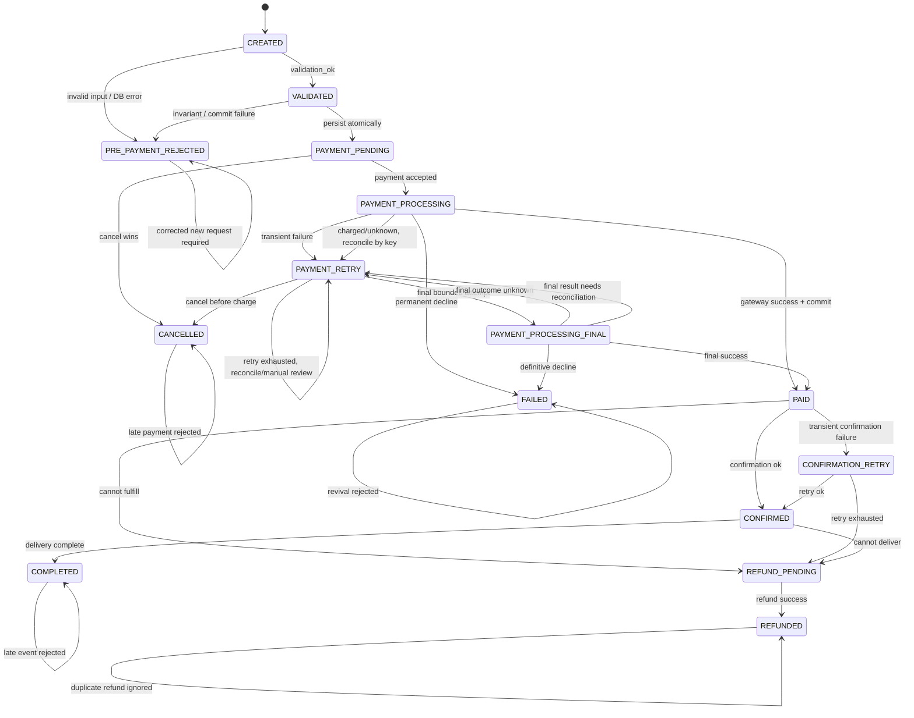

# Mô hình xử lý sự cố Order–Payment

## Mục tiêu

Mô hình trả lời hai câu hỏi cho từng trạng thái:

1. Nếu không có lỗi, hệ thống chuyển đi đâu và thực hiện hành động gì?
2. Nếu có sự cố, hệ thống phát hiện bằng cách nào, xử lý ra sao và chuyển tới trạng thái nào?

Nguồn máy đọc được là `order_payment_recovery_model.json`. Script
`verify_recovery_model.py` duyệt toàn bộ mô hình hữu hạn, không gọi API và
không dựa vào số lượng test case.

## Kiểm chứng chức năng, không phải kiểm thử chức năng

Mỗi chức năng được đặc tả bằng một hợp đồng gồm: state nguồn hợp lệ, tiền điều
kiện, tập event có thể xảy ra, state đích bắt buộc và các bảo đảm phải được giữ.
Hợp đồng này độc lập với danh sách cạnh của Kripke. P11 đối chiếu hai phía theo
khóa `(state, event)`: thiếu event, thừa event, một event thuộc hai chức năng,
hoặc state đích khác hợp đồng đều làm kết quả FAIL và sinh phản ví dụ.

| Hợp đồng | State thuộc phạm vi | Quyết định chức năng phải bảo đảm |
|---|---|---|
| F1_CREATE_ORDER | CREATED, VALIDATED | Chỉ dữ liệu/giá server hợp lệ mới được lưu; lỗi phải rollback nguyên tử |
| F2_ACCEPT_PAYMENT_OR_CANCEL | PAYMENT_PENDING | Payment và cancel được tuần tự hóa; request sai/trùng không tạo payment mới |
| F3_EXECUTE_AND_RECONCILE_PAYMENT | PAYMENT_PROCESSING, PAYMENT_RETRY, PAYMENT_PROCESSING_FINAL | Timeout không bị suy diễn thành decline; retry/reconcile dùng cùng idempotency key |
| F4_CONFIRM_OR_COMPENSATE | PAID, CONFIRMATION_RETRY | Đã thu tiền thì xác nhận tiếp hoặc refund, không chuyển thẳng FAILED |
| F5_COMPLETE_OR_COMPENSATE | CONFIRMED | Giao thành công → COMPLETED; không giao được → REFUND_PENDING |
| F6_REFUND | REFUND_PENDING | Refund idempotent; timeout giữ REFUND_PENDING để đối soát |
| F7_PROTECT_TERMINAL_STATE | COMPLETED, CANCELLED, PRE_PAYMENT_REJECTED, FAILED, REFUNDED | Event đến muộn chỉ no-op/reject, không hồi sinh aggregate |

Vì vậy một dòng của ma trận không có nghĩa “gọi API với input X”. Nó là mệnh
đề hành vi: **nếu hệ thống đang ở state S và event E xảy ra, quyết định duy nhất
được phép là action A, state kế tiếp là S', đồng thời các guarantee của chức
năng vẫn đúng**. Unit/integration test chỉ là bằng chứng phụ để xem
implementation có phù hợp model hay không; chúng không tạo nên chứng minh
Kripke.

## Luồng chính và luồng phục hồi



| State | Thành công | Sự cố chính | Giải pháp và state tiếp theo |
|---|---|---|---|
| CREATED | Dữ liệu, sản phẩm và tồn kho hợp lệ → VALIDATED | Input sai, thiếu hàng, lỗi đọc DB | Từ chối/rollback → PRE_PAYMENT_REJECTED; chưa tạo Payment |
| VALIDATED | Lưu Order và item nguyên tử → PAYMENT_PENDING | Sai tổng tiền, overflow, commit lỗi | Rollback và nhả tồn kho → PRE_PAYMENT_REJECTED; Payment vẫn NONE |
| PAYMENT_PENDING | Nhận payment hợp lệ → PAYMENT_PROCESSING | Hủy đơn; trùng idempotency key; sai amount | Hủy → CANCELLED; request trùng/sai giữ nguyên PAYMENT_PENDING |
| PAYMENT_PROCESSING | Gateway thành công và commit được → PAID | Timeout; decline; đã charge nhưng commit lỗi; race với cancel | Reconcile/retry cùng idempotency key → PAYMENT_RETRY; decline → FAILED; race được serialize |
| PAYMENT_RETRY | Còn ngân sách retry → PAYMENT_PROCESSING_FINAL | Hết retry nhưng kết quả vẫn unknown; người dùng hủy khi đã xác nhận chưa charge | Giữ UNKNOWN để reconcile/manual review; chỉ CANCELLED khi có bằng chứng chưa charge |
| PAYMENT_PROCESSING_FINAL | Gateway thành công → PAID | Decline cuối cùng; timeout cuối cùng | Decline xác thực → FAILED; timeout → giữ UNKNOWN và reconcile, không charge mới |
| PAID | Xác nhận fulfillment → CONFIRMED | Callback trùng; xác nhận lỗi tạm thời; không thể fulfillment | Giữ PAID; → CONFIRMATION_RETRY; hoặc → REFUND_PENDING |
| CONFIRMATION_RETRY | Retry thành công → CONFIRMED | Hết retry | Bù trừ → REFUND_PENDING |
| CONFIRMED | Giao hàng hoàn tất → COMPLETED | Không thể giao hàng | Bù trừ → REFUND_PENDING |
| REFUND_PENDING | Hoàn tiền thành công → REFUNDED | Gateway hoàn tiền timeout | Retry cùng idempotency key, cảnh báo vận hành, giữ REFUND_PENDING |
| COMPLETED | Terminal | Callback/yêu cầu đổi trạng thái đến muộn | No-op hoặc từ chối, audit, giữ COMPLETED |
| CANCELLED | Terminal | Payment đến muộn | Từ chối; nếu gateway báo đã charge thì cảnh báo, giữ CANCELLED |
| PRE_PAYMENT_REJECTED | Terminal quan sát trước payment | Retry cố hồi sinh request/order đã rollback | Từ chối mutation; yêu cầu request mới đã sửa, Payment vẫn NONE |
| FAILED | Terminal | Retry đến muộn | Không hồi sinh Order; yêu cầu tạo Order mới |
| REFUNDED | Terminal | Callback refund trùng | Trả kết quả cũ, không hoàn tiền hai lần |

## Ma trận quyết định chi tiết theo state

File kết quả JSON chứa `state_response_matrix`, trong đó mỗi dòng có:

- `function`, `state`, `order_status`, `payment_status`;
- `case`: `NORMAL` hoặc `INCIDENT`;
- `event` và vấn đề xảy ra;
- tiền điều kiện hoặc dấu hiệu phát hiện;
- giải pháp;
- `next_state`;
- các guarantee chức năng phải giữ;
- `kind`: tiến triển hoặc `stutter`.

Ma trận này được sinh trực tiếp từ model thay vì chép tay, nên bộ kiểm chứng và
bảng trình bày dùng cùng một nguồn dữ liệu. P9 buộc mọi incident phải có đủ
thông tin phát hiện, giải pháp và state đích hợp lệ.

### Quy tắc chọn giải pháp

| Tình huống | Biện pháp | Lý do |
|---|---|---|
| Chưa ghi dữ liệu và chưa charge | Reject hoặc rollback | Không cần tạo trạng thái trung gian không có ý nghĩa |
| Lỗi tạm thời, chưa biết kết quả gateway | Retry có bound và giữ nguyên idempotency key | Tránh charge trùng và tránh livelock |
| Gateway đã charge nhưng lưu PAID thất bại | Reconcile charge theo idempotency key | Payment đã được ghi PROCESSING trước khi gọi gateway; không charge lại và không hoàn tiền khi Order vẫn có thể hoàn tất |
| Hai thao tác payment/cancel cạnh tranh | Serialize bằng transaction/row version | Chỉ một thao tác được quyết định trạng thái cuối |
| Callback/request đến sau terminal | No-op hoặc reject, kèm audit | Không hồi sinh terminal state |
| Retry tự động đã hết | Chỉ FAILED khi gateway xác nhận decline/chưa charge; nếu còn unknown thì giữ reservation và manual review | Không suy diễn “timeout = thất bại”, tránh bỏ quên khoản tiền có thể đã thu |

## Thuộc tính được kiểm chứng

- P1: không state reachable nào có nhãn `violation`.
- P2: mọi state `paid` đều có `payment_success`.
- P3: `completed` luôn kéo theo `payment_success`.
- P4: `cancelled` loại trừ `payment_success`.
- P5: `failed` loại trừ `payment_success`; nếu đã charge thì phải đi nhánh refund.
- P6: `payment_pending` loại trừ `payment_success`.
- P7: không có `resource_conflict` giữa payment và cancellation.
- P8: tất cả state khai báo đều reachable.
- P9: mỗi incident phải có problem, event, detection, solution và next state.
- P10: sau khi loại đúng các cạnh stutter được ghi rõ, mọi đường tiến triển đều tới terminal.
- P11: mọi cặp `(state, event)` thuộc đúng một hợp đồng chức năng và đi tới
  đúng state đích của hợp đồng.
- P12: terminal chỉ có self-loop `stutter`; event đến muộn không thể hồi sinh
  Order.
- P13: sau khi có `payment_success`, mọi lỗi phải giữ bằng chứng thanh toán hoặc
  đi vào compensation/refund; không được sang FAILED/CANCELLED.
- P14: kết quả payment `UNKNOWN` không được thành terminal, giải phóng inventory
  hoặc giả là SUCCESS khi chưa có kết quả xác thực.
- P15: trong cùng một state, một event không thể có hai state đích.

Kết quả hiện tại là **P1–P15 PASS trên 15 state, 37 transition và 7 hợp đồng
chức năng**. Đây là duyệt vét cạn toàn bộ graph hữu hạn đã khai báo, không phải
thống kê số test case.

## Kiểm chứng âm và phản ví dụ

Script tự chèn sáu mutation, sau đó yêu cầu công cụ phải phát hiện:

1. `CANCELLED → PAID_AFTER_CANCELLED`.
2. Chấp nhận payment sai amount.
3. Lưu hai payment SUCCESS cho một Order.
4. Payment và cancellation cùng sở hữu critical resource.
5. Order đã PAID đi thẳng sang FAILED mà không compensation/refund.
6. Payment còn UNKNOWN nhưng hệ thống kết thúc và giải phóng inventory.

Nếu một mutation không làm thuộc tính kỳ vọng thất bại, script kết thúc với
`AssertionError`. Điều này ngăn tình trạng thuộc tính PASS nhưng không đủ sức
phát hiện lỗi mà nó được viết để kiểm chứng.

## Giới hạn và khoảng cách với source

- Đây là mô hình aggregate hữu hạn, không phải bản sao toàn bộ database/API.
- `PAYMENT_PROCESSING`, `PAYMENT_RETRY` và `CONFIRMATION_RETRY` là trạng thái
  kết hợp quan sát từ Order + Payment; chúng không nhất thiết là giá trị riêng
  của `OrderStatus`. Source lưu PROCESSING/UNKNOWN tại `PaymentStatus`, còn
  `REFUND_PENDING` và `REFUNDED` được lưu ở cả hai aggregate tương ứng.
- `PRE_PAYMENT_REJECTED` là terminal quan sát của workflow khi create/commit bị
  từ chối hoặc rollback; row Order có thể chưa tồn tại. State này được tách khỏi
  `FAILED` để không gán sai `payment_status=FAILED` cho luồng chưa có Payment.
- Source dùng `IPaymentGateway`; adapter mặc định là gateway giả lập có lưu kết
  quả theo idempotency key. Các nhánh success, decline, unknown, bounded retry,
  reconciliation và refund đã có unit test; gateway sản xuất vẫn cần adapter
  và integration test riêng.
- P10 dùng giả định weak fairness: cạnh retry/no-op được đánh dấu `stutter`
  có thể lặp, nhưng một transition tiến triển đang enable cuối cùng phải chạy.

## Chạy lại

Từ thư mục gốc repository:

```powershell
python security-analysis/verify_recovery_model.py
```

Kết quả máy đọc được lưu tại
`security-analysis/results/order_payment_recovery_model.results.json`.
