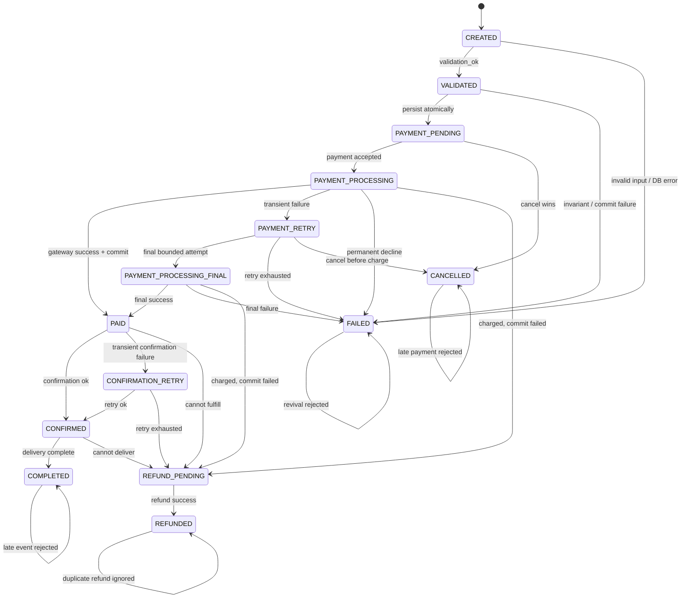

# Mô hình xử lý sự cố Order–Payment

## Mục tiêu

Mô hình trả lời hai câu hỏi cho từng trạng thái:

1. Nếu không có lỗi, hệ thống chuyển đi đâu và thực hiện hành động gì?
2. Nếu có sự cố, hệ thống phát hiện bằng cách nào, xử lý ra sao và chuyển tới trạng thái nào?

Nguồn máy đọc được là `order_payment_recovery_model.json`. Script
`verify_recovery_model.py` duyệt toàn bộ mô hình hữu hạn, không gọi API và
không dựa vào số lượng test case.

## Luồng chính và luồng phục hồi



| State | Thành công | Sự cố chính | Giải pháp và state tiếp theo |
|---|---|---|---|
| CREATED | Dữ liệu, sản phẩm và tồn kho hợp lệ → VALIDATED | Input sai, thiếu hàng, lỗi đọc DB | Từ chối/rollback → FAILED |
| VALIDATED | Lưu Order và item nguyên tử → PAYMENT_PENDING | Sai tổng tiền, overflow, commit lỗi | Rollback và nhả tồn kho → FAILED |
| PAYMENT_PENDING | Nhận payment hợp lệ → PAYMENT_PROCESSING | Hủy đơn; trùng idempotency key; sai amount | Hủy → CANCELLED; request trùng/sai giữ nguyên PAYMENT_PENDING |
| PAYMENT_PROCESSING | Gateway thành công và commit được → PAID | Timeout; decline; đã charge nhưng commit lỗi; race với cancel | Retry → PAYMENT_RETRY; decline → FAILED; cần hoàn tiền → REFUND_PENDING; race được serialize |
| PAYMENT_RETRY | Còn ngân sách retry → PAYMENT_PROCESSING_FINAL | Hết retry; người dùng hủy khi chưa charge | FAILED hoặc CANCELLED |
| PAYMENT_PROCESSING_FINAL | Gateway thành công → PAID | Lần cuối timeout/decline; đã charge nhưng commit lỗi | FAILED hoặc REFUND_PENDING; không quay lại retry |
| PAID | Xác nhận fulfillment → CONFIRMED | Callback trùng; xác nhận lỗi tạm thời; không thể fulfillment | Giữ PAID; → CONFIRMATION_RETRY; hoặc → REFUND_PENDING |
| CONFIRMATION_RETRY | Retry thành công → CONFIRMED | Hết retry | Bù trừ → REFUND_PENDING |
| CONFIRMED | Giao hàng hoàn tất → COMPLETED | Không thể giao hàng | Bù trừ → REFUND_PENDING |
| REFUND_PENDING | Hoàn tiền thành công → REFUNDED | Gateway hoàn tiền timeout | Retry cùng idempotency key, cảnh báo vận hành, giữ REFUND_PENDING |
| COMPLETED | Terminal | Callback/yêu cầu đổi trạng thái đến muộn | No-op hoặc từ chối, audit, giữ COMPLETED |
| CANCELLED | Terminal | Payment đến muộn | Từ chối; nếu gateway báo đã charge thì cảnh báo, giữ CANCELLED |
| FAILED | Terminal | Retry đến muộn | Không hồi sinh Order; yêu cầu tạo Order mới |
| REFUNDED | Terminal | Callback refund trùng | Trả kết quả cũ, không hoàn tiền hai lần |

## Ma trận quyết định chi tiết theo state

File kết quả JSON chứa `state_response_matrix`, trong đó mỗi dòng có:

- `state`, `order_status`, `payment_status`;
- `case`: `NORMAL` hoặc `INCIDENT`;
- event hoặc vấn đề xảy ra;
- dấu hiệu phát hiện;
- giải pháp;
- `next_state`;
- `kind`: tiến triển hoặc `stutter`.

Ma trận này được sinh trực tiếp từ model thay vì chép tay, nên bộ kiểm chứng và
bảng trình bày dùng cùng một nguồn dữ liệu. P9 buộc mọi incident phải có đủ
thông tin phát hiện, giải pháp và state đích hợp lệ.

### Quy tắc chọn giải pháp

| Tình huống | Biện pháp | Lý do |
|---|---|---|
| Chưa ghi dữ liệu và chưa charge | Reject hoặc rollback | Không cần tạo trạng thái trung gian không có ý nghĩa |
| Lỗi tạm thời, chưa biết kết quả gateway | Retry có bound và giữ nguyên idempotency key | Tránh charge trùng và tránh livelock |
| Gateway đã charge nhưng lưu PAID thất bại | REFUND_PENDING | Không được đánh dấu FAILED rồi bỏ quên tiền đã thu |
| Hai thao tác payment/cancel cạnh tranh | Serialize bằng transaction/row version | Chỉ một thao tác được quyết định trạng thái cuối |
| Callback/request đến sau terminal | No-op hoặc reject, kèm audit | Không hồi sinh terminal state |
| Retry tự động đã hết | FAILED nếu chưa charge; REFUND_PENDING nếu đã charge | Phân biệt thất bại trước và sau khi tiền đã được thu |

## Thuộc tính được kiểm chứng

- P1: không state reachable nào có nhãn `violation`.
- P2: mọi state `paid` đều có `payment_success`.
- P3: `completed` luôn kéo theo `payment_success`.
- P4: `cancelled` loại trừ `payment_success`.
- P5: `failed` loại trừ `payment_success`; nếu đã charge thì phải đi nhánh refund.
- P6: `payment_pending` loại trừ `payment_success`.
- P7: không có `resource_conflict` giữa payment và cancellation.
- P8: tất cả state khai báo đều reachable.
- P9: mỗi incident phải có problem, event, detection, solution và next state.
- P10: sau khi loại đúng các cạnh stutter được ghi rõ, mọi đường tiến triển đều tới terminal.

## Kiểm chứng âm và phản ví dụ

Script tự chèn bốn mutation, sau đó yêu cầu công cụ phải phát hiện:

1. `CANCELLED → PAID_AFTER_CANCELLED`.
2. Chấp nhận payment sai amount.
3. Lưu hai payment SUCCESS cho một Order.
4. Payment và cancellation cùng sở hữu critical resource.

Nếu một mutation không làm thuộc tính kỳ vọng thất bại, script kết thúc với
`AssertionError`. Điều này ngăn tình trạng thuộc tính PASS nhưng không đủ sức
phát hiện lỗi mà nó được viết để kiểm chứng.

## Giới hạn và khoảng cách với source

- Đây là mô hình aggregate hữu hạn, không phải bản sao toàn bộ database/API.
- `PAYMENT_PROCESSING`, `PAYMENT_RETRY`, `CONFIRMATION_RETRY`,
  `REFUND_PENDING` và `REFUNDED` là các trạng thái thiết kế cần có để mô tả
  phục hồi. Enum `OrderStatus` hiện chưa biểu diễn riêng các trạng thái này.
- Source hiện mô phỏng gateway luôn SUCCESS. Vì vậy nhánh timeout, decline,
  callback và refund mới được kiểm chứng ở mức thiết kế, chưa phải bằng chứng
  implementation.
- P10 dùng giả định weak fairness: cạnh retry/no-op được đánh dấu `stutter`
  có thể lặp, nhưng một transition tiến triển đang enable cuối cùng phải chạy.

## Chạy lại

Từ thư mục gốc repository:

```powershell
python security-analysis/verify_recovery_model.py
```

Kết quả máy đọc được lưu tại
`security-analysis/results/order_payment_recovery_model.results.json`.
