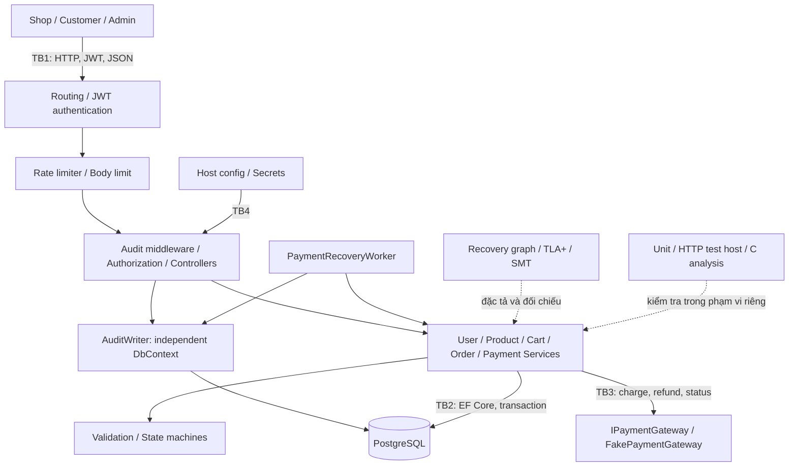
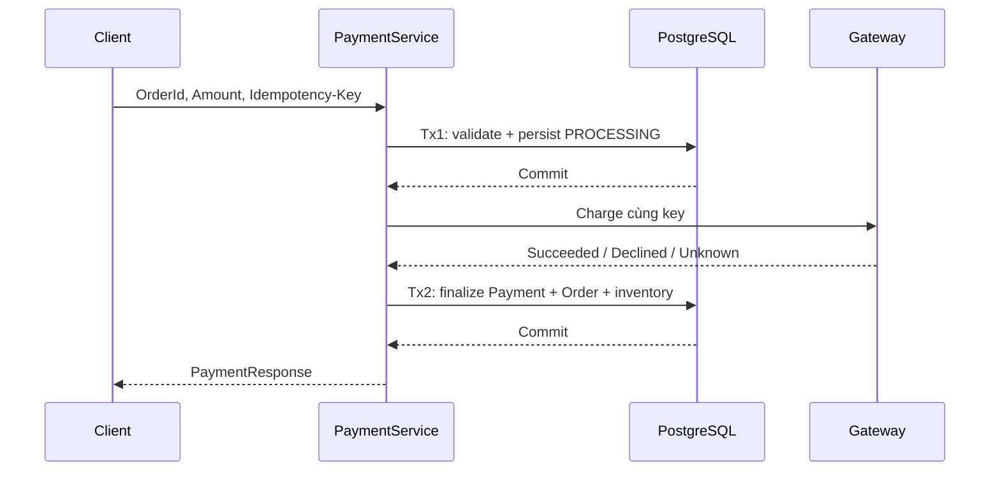

# Báo cáo kiểm chứng an toàn OrderPaymentMicroservice

Ngày tổng hợp: 13/10/2026. Các thời điểm thực thi cụ thể nằm trong evidence.

## 1. Mục tiêu, phương pháp và mô hình đe dọa

### 1.1. Bài toán và lý do lựa chọn

Một giao dịch mua hàng đi qua ít nhất ba quyết định độc lập: chấp nhận đơn,
xác định kết quả thanh toán và thực hiện hoặc hủy fulfillment. Sai sót giữa các
quyết định có thể gây mất tiền, bán vượt tồn kho hoặc hoàn hàng khi khoản thu vẫn
chưa rõ kết quả. Vì vậy đối tượng đánh giá là tính nhất quán giữa Order, Payment
và inventory reservation, ngoài việc API trả mã thành công.

Ví dụ, khi gateway timeout, ứng dụng chưa biết tiền đã bị trừ hay chưa. Nếu coi
mọi timeout là FAILED rồi hoàn kho, một đơn đã thu tiền có thể mất reservation.
Ngược lại, nếu retry bằng một key mới, một yêu cầu có thể tạo hai khoản thu. Đây
là lý do cần state machine, idempotency và reconciliation cùng bằng chứng kiểm
chứng cho điều kiện chuyển, thay vì chỉ một happy path.

### 1.2. Câu hỏi nghiên cứu và tiêu chí nghiệm thu

| Mã | Câu hỏi | Tiêu chí có thể kiểm tra | Phép kiểm phù hợp |
| --- | --- | --- | --- |
| Q1 | Client có thể quyết định giá hoặc dùng tài nguyên của user khác không? | Giá tính từ Product; route ID phải đối chiếu subject; Customer bị chặn ở endpoint Admin | Source, regression và HTTP authorization |
| Q2 | Đơn terminal có bị hồi sinh hoặc payment-cancel cùng thắng không? | Không có cạnh chuyển terminal trái phép; kết quả cạnh tranh giữ một aggregate nhất quán | Recovery mutation, state machine và PostgreSQL |
| Q3 | Timeout và lỗi sau charge có làm mất dấu vết tiền không? | UNKNOWN giữ reservation; lỗi sau charge giữ evidence hoặc đi refund | Recovery P13/P14, gateway giả lập và unit test |
| Q4 | Kiểm tra từng dòng sản phẩm có đủ bảo vệ kho không? | Stock ≥ tổng quantity cùng ProductId; reservation sau trừ không âm | Witness SMT, regression, CHECK database |
| Q5 | Tool có phát hiện được lỗi cố ý và bản sửa tương ứng không? | BUGGY phải có đúng diagnostic; FIXED cùng input không có diagnostic; biên chấp nhận/từ chối đúng | Static, sanitizer và test oracle |
| Q6 | Người đọc có thể tái lập và truy vết kết luận không? | Có source/model, command, tool version, outcome, hash và giới hạn từng evidence | Manifest, phụ lục và verifier |

Các tiêu chí này giới hạn kết luận theo phép kiểm. “Đủ sáu nhóm STRIDE” là coverage
của hoạt động phân tích đe dọa; “140 unit PASS” là outcome của các ca thực thi;
“UNSAT” là kết luận trên tập ràng buộc. Ba loại kết quả không thay thế nhau.

### 1.3. Phạm vi và giả định vận hành

Repository hiện có một host ASP.NET Core, chung PostgreSQL, các Controller/Service
User, Product, Cart, Order và Payment. Tên đề tài dùng microservice theo dịch vụ
Order/Payment cung cấp REST API; các module trong host chưa được triển khai độc
lập hoặc có database riêng. C# là implementation nghiệp vụ. Năm executable C là
mô hình học tập ownership/lifetime, không phải bản dịch của implementation.

Phạm vi xác minh gồm request validation, authorization ở đường đã test, lifecycle,
reservation, số học model và một số cạnh tranh database. Chưa bao gồm bảo mật
thiết bị client, cấu hình cloud, gateway thật, audit bền vững, throughput mục tiêu
hay tất cả interleaving. Gateway mặc định DurableFake trả thành công và lưu journal ngoài memory của process.
MemoryFake vẫn được chọn rõ ràng trong fixture thông thường; test gateway có kịch
bản riêng quan sát UNKNOWN. Process-kill recovery đã được xác minh với local journal,
chưa phải provider thật hoặc mất điện.

### 1.4. Asset và ưu tiên CIA

Confidentiality bảo vệ credential và dữ liệu riêng của khách hàng. Integrity bảo
vệ ownership, giá, payment evidence và tồn kho. Availability bảo đảm hệ thống
có thể xử lý và đối soát các trạng thái đang chờ. Giữ UNKNOWN có thể giảm tiến
triển trước mắt nhưng tránh kết luận sai về khoản thu; đây là đánh đổi giữa an
toàn nghiệp vụ và khả năng hoàn tất, không phải lỗi có thể giải quyết bằng cách
đặt terminal tùy ý.

| Asset | Tên | Phân loại | C / I / A |
| --- | --- | --- | --- |
| A1 | Customer identity and credentials | RESTRICTED | HIGH / HIGH / MEDIUM |
| A2 | Order, cart and ownership data | CONFIDENTIAL | HIGH / HIGH / MEDIUM |
| A3 | Payment state, amount and idempotency records | RESTRICTED | MEDIUM / HIGH / HIGH |
| A4 | Product price and inventory | INTERNAL | LOW / HIGH / HIGH |
| A5 | JWT signing key and database connection secret | RESTRICTED | HIGH / HIGH / HIGH |
| A6 | Security and transaction audit trail | CONFIDENTIAL | MEDIUM / HIGH / MEDIUM |

### 1.5. Chuỗi đe dọa và trust boundary

Phân tích sử dụng chuỗi **asset → threat → vulnerability → attack → risk → control
→ evidence**. Ví dụ, asset là stock; threat là bán vượt kho; vulnerability là
so sánh stock với từng dòng riêng; attack là gửi hai dòng cùng sản phẩm; control
là kiểm tổng quantity và CHECK database; evidence là witness `10−6−6=−2`, SMT
cho guard mới và regression từ chối đơn mà không đổi stock.

Bốn trust boundary được phân biệt: TB1 Client→API, TB2 Process→PostgreSQL,
TB3 Service→Gateway và TB4 Host configuration→Process. JWT/ownership bảo vệ TB1;
transaction và database constraint bảo vệ TB2; idempotency hỗ trợ TB3 nhưng không
xác thực phản hồi gateway; startup validation hỗ trợ TB4 nhưng không thay thế
rotation hay quyền đọc secret trên host.

| Threat | STRIDE / boundary | Kịch bản | L×I | Trạng thái |
| --- | --- | --- | --- | --- |
| T1 | SPOOFING / TB1 | Forge or omit identity and act as another customer | 4×5=20 | VERIFIED_IN_TEST_SCOPE |
| T2 | TAMPERING / TB1 | Change client-supplied price, total or payment amount | 5×5=25 | MITIGATED |
| T3 | REPUDIATION / TB1 | Deny having initiated a payment, retry or cancellation | 3×4=12 | PARTIALLY_MITIGATED |
| T4 | INFORMATION_DISCLOSURE / TB1 | Read another customer's order, cart or payment | 4×4=16 | VERIFIED_IN_TEST_SCOPE |
| T5 | DENIAL_OF_SERVICE / TB1 | Exhaust API, database or recovery capacity | 4×4=16 | PARTIALLY_MITIGATED |
| T6 | ELEVATION_OF_PRIVILEGE / TB1 | Invoke administrator-only listing or refund operations | 3×5=15 | VERIFIED_IN_TEST_SCOPE |
| T7 | TAMPERING / TB2 | Exploit concurrent payment/cancel or invalid transitions to corrupt workflow state | 4×5=20 | VERIFIED_IN_TEST_SCOPE |
| T8 | SPOOFING / TB3 | Supply a forged or replayed successful gateway result | 3×5=15 | OPEN_FOR_REAL_GATEWAY |
| T9 | INFORMATION_DISCLOSURE / TB4 | Expose JWT key or database credentials through source, logs or weak host permissions | 3×5=15 | PARTIALLY_MITIGATED |

Risk dùng thang giáo dục likelihood×impact (mỗi thành phần 1–5). Điểm thể hiện
**inherent risk trước control**, không phải CVSS hay residual risk đã đo. Một threat
mang trạng thái VERIFIED_IN_TEST_SCOPE vẫn có giới hạn về endpoint và môi trường.
T3/T5 đã giảm thiểu một phần với audit/admission; retention, DBA governance, distributed
quota và load verification còn mở. T8 còn mở; T9 mới giảm thiểu một phần. Bộ test quyền đã được mở rộng để kiểm
Payment chéo user và Customer gọi các đường Admin; chưa kiểm token hết hạn, key
rotation hay mọi cách giả mạo identity.

### 1.6. Phương pháp và đóng góp

Quy trình gồm đặc tả điều kiện an toàn, mô hình hóa, tạo counterexample, đối chiếu
source, sửa lỗi và chạy regression. Model BUGGY là mutation chủ động; nó khác một
lỗ hổng được khai thác trên môi trường triển khai. Finding inventory được xác định
trong source và có test cho bản sửa; không được gọi witness SMT là kết quả pentest.

Đóng góp chính là liên kết lỗi nghiệp vụ với bất biến và evidence: trạng thái
terminal được bảo vệ bởi state machine; timeout được giữ riêng khỏi decline;
stock được kiểm theo tổng quantity; model recovery được đối chiếu với graph
workbook; static và dynamic analysis được dùng để chỉ ra cả năng lực và điểm bỏ
sót của tool. Cách tổ chức evidence cùng các giới hạn là một đầu ra của đề tài.

Nguồn: [mục tiêu gốc](../../OrderPaymentMicroservice/readme.md),
[threat model](../threat_model.json),
[traceability](../results/traceability_matrix.csv) và
[Phụ lục A](PHU_LUC_A_G.md#phụ-lục-a--hệ-thống).

## 2. Mô tả chương trình mục tiêu và hợp đồng nghiệp vụ

### 2.1. Kiến trúc thực thi và kiến trúc kiểm chứng

Các cạnh nét liền mô tả tương tác runtime; nét đứt là hoạt động kiểm chứng ngoài
runtime. Z3, checker Kripke và sanitizer không phải thành phần mà API gọi để xử lý
mỗi request. State machine chỉ kiểm cặp trạng thái; service bổ sung điều kiện như
payment SUCCESS, amount equality và inventory RESERVED.

`Program.cs` đăng ký service scoped theo request, DbContext scoped, gateway mô phỏng
singleton và recovery worker. Khởi động yêu cầu connection string và JWT key dài
ít nhất 32 ký tự; `Data.DbInitializer` chạy migration và seed Product nếu chưa có.
Môi trường Development có OpenAPI và developer exception page; test host dùng
Testing. Các điều kiện này là cấu hình của source, không phải xác nhận môi trường
triển khai ngoài test đã được harden.

### 2.2. Mô hình dữ liệu và lớp bảo vệ

| Aggregate | Dữ liệu quan trọng | Ràng buộc hiện thực | Ý nghĩa và giới hạn |
| --- | --- | --- | --- |
| User | Email, PasswordHash, Role, IsActive | Email unique; hash password; JWT role | Role trong token đã phát hành không tự cập nhật khi database đổi |
| Product | Price, Stock, UpdatedAt, IsActive | CHECK Price>0/Stock≥0; UpdatedAt concurrency token | Application giới hạn giá; CHECK database không thay toàn bộ DTO validation |
| ShoppingCart/CartItem | UserId, Quantity, PriceAtAdd, SubTotal, TotalPrice | Ownership; CHECK Quantity>0; transaction khi add/update/remove | Cart không reserve; giá tại lúc thêm có thể khác giá lúc checkout |
| Order/OrderItem | CustomerId/UserId, TotalAmount, Status, InventoryStatus, Version | Giá server; tổng quantity theo ProductId; CHECK item quantity; Version token | Một request có thể có nhiều dòng trùng; kiểm kho dùng tổng nhưng giữ dòng riêng |
| Payment | OrderId, Amount, Status, key, refund key, AttemptCount, Version | Unique OrderId/key/refund key; exact amount; Version token | Một Order có một logical Payment record trong schema hiện tại |

Tiền lưu `numeric(19,2)`; runtime dùng `decimal`. Request Order vẫn mang UnitPrice
và TotalAmount để validation và kiểm mismatch, nhưng giá được ghi vào OrderItem
lấy từ Product. Request CustomerId bị Controller ghi đè bằng JWT subject. Vì vậy
một client truyền CustomerId khác không có quyền thay owner của đơn.

### 2.3. Tạo đơn và giữ tồn kho

`CreateOrderAsync` kiểm input, mở transaction Serializable, lấy các Product cần
thiết và tính tổng quantity bằng `long` theo ProductId. Service kiểm Product tồn
tại, active và stock đủ tổng lượng; tính serverTotal và kiểm chênh lệch với total
client không vượt 0,01. Chỉ sau các guard mới trừ kho, tạo OrderItem bằng giá server
và chuyển CREATED→VALIDATED→PAYMENT_PENDING trước khi lưu/commit.

CREATED và VALIDATED trong thao tác tạo mới thường là trạng thái trong bộ nhớ,
không phải hai bản ghi intermediate đã commit để endpoint đọc được. Khi bị reject
trước persist, không có Order durable tương ứng với PRE_PAYMENT_REJECTED của model.
Reservation được biểu diễn bằng InventoryStatus và việc giảm Product.Stock;
không có bảng reservation riêng. Đây là điều cần nêu rõ khi vẽ ERD hoặc mô tả rollback.

Ví dụ Product stock=10/price=25: hai dòng quantity=6 bị từ chối dù từng dòng đều
nhỏ hơn 10. Hai dòng quantity=5 được chấp nhận, stock về 0; cancel hợp lệ trả stock
về 10 và lần cancel thứ hai không hoàn thêm. Database CHECK là lớp cuối nếu một
đường code khác bỏ qua guard, nhưng không thay thế kiểm tổng lượng ở service.

### 2.4. Thanh toán và cửa sổ lỗi

| Vị trí lỗi | Dữ liệu durable có thể còn lại | Quy tắc xử lý |
| --- | --- | --- |
| Trước commit Tx1 | Chưa có payment mới | Rollback; chưa gọi charge |
| Sau Tx1, trước charge | Payment PROCESSING | Đối soát trước khi quyết định gọi lại cùng key |
| Gateway đã charge, Tx2 lỗi | Payment có thể vẫn PROCESSING; gateway đã thu | Không suy diễn FAILED; reconcile bằng key |
| Gateway timeout | Payment UNKNOWN nếu finalize lưu được | Giữ Order PAYMENT_PENDING và inventory RESERVED |
| Decline cuối cùng | Payment FAILED, Order FAILED | Release inventory trong transaction finalize |
| Success lưu thành công | Payment SUCCESS, Order PAID | Không cho cancel; fulfillment hoặc refund |

Idempotency ràng buộc request lặp vào cùng logical payment. Key cũ cùng amount trả
record cũ; key cũ nhưng amount khác bị conflict; Order đã có logical payment không
nhận record mới chỉ vì client tạo key khác. MaxChargeAttempts=2 gồm lần đầu và
một lần retry, không phải hai lần retry bổ sung. Hết budget vẫn UNKNOWN thì chỉ
reconcile; không được tự release reservation.

### 2.5. Hủy, fulfillment và compensation

Cancel cần state nguồn hợp lệ và không có Payment PROCESSING/UNKNOWN/SUCCESS/
REFUND_PENDING. Điều kiện service mạnh hơn bảng CanTransition: chỉ thấy Order
PAYMENT_PENDING chưa đủ để kết luận được hủy. PAID→CONFIRMED→COMPLETED yêu cầu
Admin và payment evidence; complete đổi reservation thành CONSUMED.

Refund được bắt đầu từ PAID/CONFIRMED, tạo REFUND_PENDING cho cả Order/Payment
trước lời gọi gateway. Refund thành công chuyển REFUNDED và release reservation.
Nếu refund bị decline hoặc unknown, source giữ REFUND_PENDING và lưu error;
không có một terminal “refund failed” làm mất nghĩa vụ bù trừ. Flow hiện không
hoàn tiền cho Order đã COMPLETED; không suy rộng sang chính sách trả hàng sau giao.

### 2.6. Recovery worker và giới hạn vận hành

Worker mặc định quét mỗi 30 giây, chọn payment cũ ít nhất 60 giây, batch 50; source
áp dụng mức tối thiểu 5 giây và giới hạn batch 1..500. Worker chỉ hỏi lại charge
hoặc refund, không tự phát charge retry. TimeoutPaymentGateway áp deadline cho
cả charge/refund/status; mặc định 5.000 ms, cấu hình hợp lệ 50..60.000 ms.

Status reconciliation nhận stopping token của worker qua gateway lookup, load,
save và finalize transaction. Shutdown cancellation được truyền ra ngoài, không
biến thành UNKNOWN mới. Worker xóa tracker trước mỗi candidate để không mang
mutation chưa commit của candidate lỗi sang candidate tiếp theo.

WaitAsync giới hạn thời gian chờ ngay cả khi adapter không tuân cancellation;
late task fault được observe và late result không tự finalize. Timeout vẫn có
thể đã charge ở provider nên giữ UNKNOWN/reservation; refund giữ REFUND_PENDING.
Deadline giới hạn caller waiting, không thể cưỡng chế dừng adapter hoặc chứng
minh provider không thu tiền. Task không hợp tác và overload/backpressure còn cần
kiểm thêm cho môi trường thực tế.

Fixture HTTP thông thường tắt worker để test xác định. ProcessRestartTests dùng
hai OS process riêng: process đầu bị kill sau khi gateway publish journal nhưng
trước finalize, process mới bật worker và tự chuyển payment SUCCESS/Order PAID,
không tăng attempt hay release stock. Đây là evidence cho một cửa sổ crash với
local ledger; chưa chứng minh mọi scheduler/network fault hoặc provider thật.

DurableFake là mode mặc định, lưu journal trong App_Data/payment-gateway và bind
key với payload; ghi file tạm, flush rồi rename dưới file lock. Unit test kiểm
replay/mismatch và instance restart cho cả charge/refund. Không coi atomic file
publication là distributed transaction hoặc bảo đảm mất điện.

### 2.7. Input contract, attack surface và HTTP outcome

Quantity Order 1..10000; UnitPrice/amount theo guard 0,01..999999,99. Cart add nhận
1..10000; update nhận 0..10000, zero nghĩa là xóa. Registration yêu cầu email hợp
lệ, password 8..128 và tên; login vẫn cho mật khẩu legacy ngắn hợp lệ để tương
thích. Product create/update giới hạn price và stock; nullable update field nghĩa
là không thay đổi, không phải đã có chính sách xóa mọi field.

401 biểu thị thiếu identity hợp lệ; 403 biểu thị thiếu quyền; 400 là input sai;
409 là conflict nghiệp vụ hoặc persistence cạnh tranh được xử lý; 500 vẫn là lỗi
ngoài hợp đồng xử lý của endpoint. Classifier mới nhận SQLSTATE 40001/40P01 cả khi Npgsql execution strategy bọc
exception, trả 409 thay vì 500 ở catch tương ứng. Các SQLSTATE/network exception
khác không được tự coi là conflict cạnh tranh.

Order hiện giới hạn tối đa 100 item và body 64 KiB mặc định. Auth login/register
dùng IP quota 10/phút; API dùng subject đã xác thực hoặc connection IP quota
120/phút. Fixed windows nằm trong process, không distributed. Request 429/413
bị chặn trước JSON binding và trước audit để tránh log amplification. API đọc
danh sách vẫn chưa có pagination. Chi tiết endpoint và requirement
được giữ trong [Phụ lục A](PHU_LUC_A_G.md#phụ-lục-a--hệ-thống).

Nguồn: [Program](../../OrderPaymentMicroservice/Program.cs),
[OrderService](../../OrderPaymentMicroservice/Services/OrderService.cs),
[PaymentService](../../OrderPaymentMicroservice/Services/PaymentService.cs),
[DbContext](../../OrderPaymentMicroservice/Data/AppDbContext.cs),
[recovery worker](../../OrderPaymentMicroservice/Services/Payments/PaymentRecoveryWorker.cs).

### 2.8. Audit durable và chính sách khi ghi log lỗi

AuditWriter dùng DbContext riêng để insert BEGIN/RESULT, không SaveChanges trên
tracker nghiệp vụ. Middleware giữ transport response tới khi RESULT đã lưu;
worker reconciliation lưu SYSTEM events. Field allowlist không có body, header,
password, JWT, idempotency key hay exception message. HTTP_SUCCESS chỉ nói HTTP
outcome; worker RESULT nói trạng thái nghiệp vụ.

Trigger PostgreSQL chặn UPDATE/DELETE/TRUNCATE, nhưng DBA có thể disable trigger;
chưa có retention và audit access governance. BEGIN failure chặn action; RESULT
failure có thể sau business commit và trả 503 cần reconcile. Create BEGIN có thể
chưa biết resource ID. Trigger Orders/Payments ghi COMMIT với ID thật trong cùng
transaction nghiệp vụ; ghi audit lỗi làm rollback. BEGIN/RESULT vẫn là HTTP events
riêng, còn outbox chỉ cần khi chuyển audit tới một đích ngoài PostgreSQL.

Admission/audit error dùng JSON message. Audit 503 có requiresReconciliation=false
khi BEGIN lỗi trước action, true khi RESULT lỗi sau action; correlationId do server
sinh. CORS expose correlation/retry headers cho origin được cho phép.

### 2.9. Tạo đơn có idempotency và audit COMMIT

POST /api/orders nhận Idempotency-Key tùy chọn; frontend đã gửi key. Server bind
key hash với customer đã xác thực và payload hash, giữ original response trong
transaction Serializable cùng reserve/order. Unique index ngăn hai đơn cùng
customer/key. Cùng key/payload trả lại 201, cùng ID/receipt; khác payload trả 409.
Race 409 phải retry bằng key cũ. Client không gửi key không có bảo đảm chống trùng.
Sau cancel, replay vẫn trả receipt ban đầu; GET order trả trạng thái hiện tại.

AFTER INSERT/UPDATE/DELETE trigger trên Orders/Payments ghi COMMIT vào AuditEvents,
bao gồm resource ID và state integer, trong cùng transaction. Trigger bao phủ cả SQL
trực tiếp, không chỉ controller. Request có verified actor/correlation qua metadata
transaction-local; worker/direct SQL ghi SYSTEM khi không có request metadata.
Rollback cả audit và stock/order đã được fault-injection test. Chưa audit toàn bộ
Products/Cart/Users hay chứng minh DBA không sửa schema. Không backfill lịch sử cũ.

Checkout lưu key trước fetch trong sessionStorage, giữ khi mất response/503, chặn
đổi payload khi chưa rõ outcome và tránh double submit trong cùng tab. Browser
mocked-fetch regression PASS; HTTP/PostgreSQL tests kiểm chứng backend riêng.
Snapshot receipt chứa thông tin giao hàng; phải bảo vệ như dữ liệu order.

## 3. Mô hình trạng thái, kiểm chứng và đối chiếu implementation

### 3.1. Kripke và mức trừu tượng

Mô hình Kripke được viết M=(S,S₀,R,L): S là tập trạng thái hữu hạn, S₀ là trạng
thái khởi tạo, R⊆S×S là quan hệ chuyển, L gán tập proposition cho từng state. Một
proposition như payment_success là nhãn của model; nó chưa phải chữ ký xác thực
gateway hay kết quả đo trực tiếp từ database. Việc kiểm nhãn đúng chỉ có ý nghĩa
khi cách ánh xạ nhãn sang nghiệp vụ được giải thích và đối chiếu.

| Model | Đối tượng quan sát | Mục đích | Phần bị trừu tượng hóa |
| --- | --- | --- | --- |
| Order cơ sở | Order state và nhãn payment | Guard terminal, pending/paid và liveness của thiết kế ngắn | Identity, stock số học, retry và transaction |
| Recovery | Aggregate Order/Payment, event, incident, solution | Hợp đồng F1–F7, safety, compensation và tiến triển | Gateway/network cụ thể, nhiều order và dữ liệu tiền thực |
| Workbook graph | Cặp state nguồn–đích và proposition | Tương thích schema và CTL subset | Event/action/kind và hợp đồng chi tiết |
| TLA+ | Order/Payment/Inventory status và attemptCount | Safety/liveness trên tổ hợp biến hữu hạn | Product stock cụ thể, identity, key values và gateway state bền vững |

P1..P4 của Order cơ sở khác P1..P15 của recovery. Trong chương và phụ lục, dùng
`base:P3` hoặc `recovery:P3` để tránh hiểu sai: base:P3 là “PAID có payment SUCCESS”,
còn recovery:P3 là “COMPLETED có payment evidence”. Không ghép kết quả chỉ bằng ID.

### 3.2. Aggregate state và invariant

Recovery có 15 state; source Order có 10 trạng thái, Payment có 7. Ví dụ
PAYMENT_PROCESSING=(Order PAYMENT_PENDING, Payment PROCESSING),
PAYMENT_RETRY=(PAYMENT_PENDING, UNKNOWN), PAID=(PAID,SUCCESS).
CONFIRMATION_RETRY là state thiết kế giữ PAID/SUCCESS; PRE_PAYMENT_REJECTED là
quan sát việc reject trước persist, không phải tên enum trong implementation.

Safety được diễn giải thành điều kiện: paid phải có evidence; cancelled không
chứa successful charge; failure sau thu tiền giữ evidence hoặc đi compensation;
UNKNOWN không là terminal và vẫn RESERVED; terminal không chuyển sang aggregate
mới. Tập state và nhãn được liệt kê đầy đủ trong phụ lục, thay vì coi một sơ đồ
happy path là toàn bộ model.

### 3.3. Hợp đồng chức năng và kiểm tra tính nhất quán

Bảy hợp đồng F1–F7 định nghĩa độc lập responsibility, precondition và bảng
(state,event)→next_state. Checker recovery:P11 đối chiếu graph với bảng hợp đồng;
P15 từ chối cùng một event trong cùng state được khai báo nhiều lần. P9 chỉ kiểm
incident có đầy đủ mô tả/detection/solution/target, không tự chứng minh detection
đó có implementation hoặc phát hiện được sự cố thật.

Checker dùng BFS từ CREATED để tính reachability và lưu shortest witness.
P8 kiểm mọi state khai báo có reachable. State không reachable chưa chắc là lỗi
runtime; nó có thể là state thừa hoặc trường hợp bị guard loại bỏ. Với label safety,
checker duyệt các state reachable và lưu path tới state vi phạm.

### 3.4. Safety, EF và AF

`AG p` nghĩa là p đúng ở mọi state trên mọi đường reachable. `EF p` chứng minh tồn
tại một đường cuối cùng gặp p. `AF p` yêu cầu mọi đường cuối cùng gặp p. Vì vậy
workbook `EF(terminal)` PASS không đủ để kết luận mọi request hoàn tất. Ví dụ graph
có cạnh tới terminal và self-loop ở PAYMENT_RETRY: EF terminal có thể đúng trong
khi AF terminal sai.

Model BUGGY dùng state PAID_AFTER_CANCELLED để giữ dấu vết lịch sử. Nếu chỉ nhìn
state PAID hợp lệ với payment_success, property kiểm nhãn có thể bỏ sót việc đi
qua CANCELLED trước đó. History monitor gắn invalid_transition làm base:P1 phát
hiện witness CREATED→CANCELLED→PAID_AFTER_CANCELLED.

### 3.5. Phân tích liveness có điều kiện

Để kiểm AF terminal trên graph, bắt đầu T₀ là tập terminal rồi lặp
Tᵢ₊₁=Tᵢ∪{s: Succ(s)≠∅ và Succ(s)⊆Tᵢ} đến điểm cố định. Một state ngoài tập cuối
có khả năng tránh terminal. Điều kiện Succ(s)≠∅ ngăn dead end không terminal được
chấp nhận do phép “mọi successor” trên tập rỗng.

Checker recovery:P10 trước hết xóa cạnh có kind=stutter rồi áp dụng phép tính trên.
Phép audit mới kiểm cả graph gốc và graph đã lọc:

| Phép kiểm | Kết quả | Nghĩa |
| --- | --- | --- |
| AG AF terminal trên graph gốc | False | Có đường infinite nonterminal |
| AG AF terminal trên graph chỉ progress | True | Kết quả của policy lọc cạnh |
| Audit đối chiếu hai semantics | True | PASS xác nhận sự khác biệt, không phủ nhận counterexample |

Counterexample dạng prefix+cycle đi tới PAYMENT_RETRY rồi lặp sự kiện
retry_exhausted_unknown vô hạn. Audit PASS nghĩa là đã xác nhận sự khác biệt mong
đợi giữa hai graph, không phải unconditional AF đã PASS. Trong runtime, gateway
có thể không trả kết quả cuối và UNKNOWN tiếp tục được giữ là lựa chọn safety.

Hai cạnh gắn stutter từ PAYMENT_PROCESSING_FINAL về PAYMENT_RETRY còn đổi aggregate
state. Từ “stutter” ở JSON là nhãn phân loại của project, không đồng nghĩa bước
không đổi mọi biến theo ngữ nghĩa TLA+. Xóa các cạnh này không phải thuật toán
fair-CTL tổng quát. Muốn kết luận fair liveness cần mô hình hóa rõ điều kiện môi
trường và fairness của từng hành động tiến triển.

TLA+ dùng Init∧[][Next]_vars∧WF_vars(Next). Fairness ở Next yêu cầu một bước được
enable liên tục cuối cùng tiến hành, nhưng không tự buộc mọi action riêng lẻ được
chọn, cũng không bảo đảm gateway thật cho ra outcome. Mô hình hiện cho phép chọn
reconcile success/decline khi UNKNOWN; đây là abstraction cần assumption môi
trường. Evidence TLC 20 state phân biệt là kết quả model lịch sử, chưa được chạy
lại trong đợt mở rộng chương.

### 3.6. Mutation và năng lực phát hiện lỗi

| Mutation | Property FAIL thực tế | Detected |
| --- | --- | --- |
| BUG-CANCELLED-PAID | recovery:P1, recovery:P10, recovery:P11, recovery:P12, recovery:P4 | True |
| BUG-WRONG-AMOUNT | recovery:P1, recovery:P10, recovery:P11 | True |
| BUG-DUPLICATE-SUCCESS | recovery:P1, recovery:P10, recovery:P11 | True |
| BUG-RESOURCE-CONFLICT | recovery:P1, recovery:P10, recovery:P11, recovery:P7 | True |
| BUG-PAID-FAILED-WITHOUT-REFUND | recovery:P11, recovery:P13 | True |
| BUG-UNKNOWN-RELEASED | recovery:P11, recovery:P14 | True |

Sáu mutation dùng lỗi chủ động để kiểm độ nhạy của property. Một mutation gây
FAIL đúng kỳ vọng là kết quả tốt của checker. Bảng không dùng số lượng mutation
để suy ra mọi lỗi đã bị phát hiện. Witness đi tới state vi phạm là bằng chứng của
model mutated, chưa phải trace HTTP/PostgreSQL của ứng dụng đang triển khai.

### 3.7. Phép chiếu recovery sang workbook

Graph recovery có 37 event transition. Workbook bỏ event/action/kind và gộp các
cặp (from,to) trùng, còn 31 cặp; phép đối chiếu hai tập cạnh cho kết quả bằng nhau.
Nhiều event như request trùng và amount sai cùng giữ PAYMENT_PENDING sẽ hợp thành
một cạnh self-loop. Do đó phép chiếu giữ quan hệ state đích nhưng làm mất lý do,
biện pháp xử lý và assumption gắn trên event.

Không kết luận property preservation toàn bộ từ equality của tập cạnh: workbook
có 7 CTL, recovery có 15 checks gồm checks cấu trúc và hợp đồng. TLA+ còn có attempt
counter nên 20 trạng thái reachable của TLC không mâu thuẫn 15 aggregate state.

### 3.8. Đối chiếu thiết kế với source

| Chi tiết model | Implementation hiện tại | Mức kết luận |
| --- | --- | --- |
| CREATED→VALIDATED→PAYMENT_PENDING | CreateOrderAsync chuyển trong cùng thao tác trước persist | Ánh xạ thiết kế; không phải ba commit riêng |
| Retry cuối có bound | MaxChargeAttempts=2; UNKNOWN giữ logical payment/key | Có unit; chưa chứng minh mọi crash window |
| CONFIRMATION_RETRY→refund sau exhaustion | Source cho Admin gọi confirm/refund; không có retry counter tự động cho confirmation | MODEL_ONLY cho cơ chế retry tự động |
| Cancel tại PAYMENT_RETRY khi outcome UNKNOWN | Model đã giữ PAYMENT_RETRY; CancelOrderAsync từ chối, giữ reservation | IMPLEMENTED_POLICY; regression cancel UNKNOWN |
| Gateway persistence và callback xác thực | DurableFake journal; process restart test có worker bật | Persistence local đã test; callback authenticity vẫn ASSUMPTION_ONLY |
| Atomic payment-cancel | Serializable, Version và unique payment per order | PostgreSQL test cho interleaving đã chạy; chưa refinement proof |
| Không vượt tồn kho | Model lifecycle chỉ có RESERVED/RELEASED/CONSUMED | Cần SMT quantity và regression riêng |

Những khoảng cách này được ghi là giới hạn thiết kế–implementation, không che bằng
câu “model và source hoàn toàn đồng nghĩa”. Một proof đầy đủ cần abstraction
function, relation giữa state cụ thể và trừu tượng, cùng nghĩa vụ chứng minh mọi
bước source mô phỏng bước model. Project hiện cung cấp đối chiếu và test hỗ trợ,
chưa có refinement proof.

### 3.9. Reproducibility và giới hạn BMC

`verify_recovery_model.py` và `audit_liveness.py` chạy độc lập với thư mục ATPM.
Kết quả gồm property, mutation, witness và hash model trong audit. Duyệt graph hữu
hạn và TLC không được gọi là thí nghiệm bounded model checking có bound k. BMC
riêng cần encode transition/initial/bad, công bố k, solver và verdict; UNSAT trong
bound không tự chứng minh safety vô hạn.

Nguồn: [recovery model](../order_payment_recovery_model.json),
[checker](../verify_recovery_model.py), [audit](../results/liveness_audit.results.json),
[TLA+](../../OrderPaymentMicroservice/Security/OrderPayment.tla),
[Phụ lục B](PHU_LUC_A_G.md#phụ-lục-b--model-và-thuộc-tính).

### 3.10. Contract hiện thực và crash-recovery đã bổ sung

`implementation_scope` trong recovery JSON phân biệt IMPLEMENTED_POLICY,
DESIGN_EXTENSION và EXTERNAL_ASSUMPTION. Event cancel_during_retry giờ giữ
PAYMENT_RETRY khi outcome UNKNOWN, trùng policy source; regression xác minh
CancelOrderAsync không đổi stock/reservation. Không bổ sung một policy hủy dựa
trên outcome chưa rõ chỉ để đóng liveness.

Gateway DurableFake và process-kill test bổ sung evidence cho một crash window:
provider ledger đã ghi, API chưa finalize. RecoveryWorker trong process mới hỏi
lại cùng key, nhận transaction cũ và lưu PAID/SUCCESS. Evidence này hỗ trợ mapping
F3, không chứng minh chữ ký provider, mất điện hoặc mọi interleaving.

[Hợp đồng hiện thực](../IMPLEMENTATION_CONTRACTS.md) và
[evidence restart](../results/process_restart.results.json) ghi phạm vi cụ thể.

## 4. Phân tích mã nguồn, ownership và an toàn bộ nhớ

### 4.1. Vai trò của mô hình C trong một project C#

ASP.NET implementation dùng C# và garbage collector; mô hình C trong c-memory
đưa vào malloc/free, buffer cố định và linked list để quan sát ownership/lifetime
bằng công cụ học phần. Liên hệ là ngữ cảnh nghiệp vụ và trách nhiệm quản lý tài
nguyên, không phải sự tương đương mã hoặc bằng chứng C# có CWE-415/CWE-416.

GC quản lý memory của object không thay trách nhiệm dispose DbContext/transaction,
stream hoặc cancellation của tác vụ. Trong source C#, `await using` đóng transaction
và scope; các lỗi logic như hoàn kho sai, stale entity hay gateway UNKNOWN phải
được kiểm ở service/test, không được kỳ vọng ASan của executable C phát hiện.
Chương này phân biệt kết quả C trực tiếp với nhận xét source C# cần phép kiểm khác.

### 4.2. Phương pháp static và dynamic

Static pipeline biên dịch syntax với GCC, chạy cppcheck riêng từng cấu hình và
scanner theo pattern/data-flow đơn giản. BUGGY dùng `-UFIXED`, FIXED dùng
`-DFIXED=1`, max-configs=1 để tránh tool trộn hai nhánh tiền xử lý. Compiler exit 0
chỉ nói nguồn qua syntax check, không nói không có undefined behavior.

Dynamic pipeline build bằng `-g -O0 -fno-omit-frame-pointer`, AddressSanitizer và
UndefinedBehaviorSanitizer; LeakSanitizer bật detect_leaks. Mỗi executable chạy
trong process riêng để crash ở một case không làm mất case còn lại. Oracle cần
exit khác 0 **và** diagnostic mong đợi với BUGGY, hoặc exit 0 và không có diagnostic
với FIXED. Chuỗi REJECTED là validation được xử lý, không được tính là crash.

| Phép kiểm | Outcome | Điều kiện |
| --- | --- | --- |
| GCC + cppcheck + scanner + layout | True | gcc (Ubuntu 13.3.0-6ubuntu2~24.04.1) 13.3.0; Cppcheck 2.13.0 |
| Sanitizer case oracle | 22/22 PASS | Ngoài sandbox, ASan/UBSan/LSan; detect_leaks=1 |
| Đóng gói evidence | True | Hash source/binary/evidence; timestamp ghi sau lệnh |

Lần sandbox đầu không đạt oracle ở nhiều case; lần chạy ngoài sandbox đạt 22/22.
Không tắt detect_leaks để biến outcome thành PASS. Điều kiện thực thi và hash
source/binary được giữ trong chapter4_run.results.json. Outcome hợp lệ là của lần
chạy ngoài sandbox; hạn chế môi trường được giữ riêng, không chuyển thành finding
memory của source mà chưa có đúng diagnostic.

### 4.3. Phân tích từng lớp lỗi và cách sửa

| Module | Ownership/lifetime đúng | Nguyên nhân BUGGY | Bản sửa và lý do |
| --- | --- | --- | --- |
| Order | Order sở hữu mảng OrderItem cấp phát riêng | free(parent) bỏ quên child allocation | Free items trước Order; một parent pointer không tự giải phóng allocation khác |
| Payment | Một Payment chịu trách nhiệm transaction_code | Cleanup nhánh lỗi và cleanup chung cùng free | Sau free đặt pointer sở hữu NULL; free(NULL) không release lần hai |
| Cart | List sở hữu node; sau unlink nhánh remove kết thúc lifetime | Log dereference removed sau free | Chụp ProductId trước free, sau đó log giá trị đã sao chép |
| Product | Product sở hữu name trên heap | strcpy không kiểm độ dài với buffer 32 byte | Reject strlen≥32 và free cả nhánh reject; chừa byte NUL |
| User | Activation record chứa email[32] | Copy email dài vào stack buffer | Guard strlen<input capacity trước copy; không free stack memory |

Product/User có cùng family unbounded-copy CWE-120 nhưng vị trí vùng nhớ khác:
Product là heap buffer overflow CWE-122, User là stack buffer overflow CWE-121.
Cppcheck có thể gắn CWE-788 cho finding bufferAccessOutOfBounds; đó là taxonomy
của tool, không nên sửa tên tool finding để ép giống taxonomy phân tích của tác giả.

Bản sửa Payment chỉ bảo vệ biến pointer đã đặt NULL, không chữa dangling alias
nếu tồn tại con trỏ khác tới cùng allocation. Bản sửa Cart tránh dereference sau
free; gán NULL bổ trợ nhưng không hồi sinh lifetime. Buffer guard theo byte,
không theo số ký tự Unicode hoặc độ hợp lệ email. Những điểm này xác định đúng
điều bản sửa thực sự bảo đảm.

### 4.4. Diễn giải diagnostic và test biên

Order lặp cancel năm lần, mỗi lần cấp ba OrderItem. Trên ABI đã đo, mảng mỗi lần
48 byte; leak được mong đợi là allocation con không được giải phóng. Số byte
runtime của diagnostic phải lấy từ log, không áp công thức này cho mọi ABI.
Payment báo attempting double-free; Cart báo heap-use-after-free; Product/User
với input dài báo đúng loại heap/stack-buffer-overflow.

Năm BUGGY phải có diagnostic, năm FIXED cùng kịch bản phải sạch. Product và User
thử length 0,1,31,32,128; 31 chấp nhận, 32 từ chối vì cần một byte cho NUL. Hai
BUGGY với input ngắn vẫn chạy được, minh họa việc không crash ở một input không
chứng minh chương trình không có lỗi. Tổng là 5+5+10+2=22 case.

Đọc log cần xác định operation bị lỗi, vị trí source và allocation/free liên quan.
Một nonzero exit do hết memory hoặc lỗi tool không phải bằng chứng bắt đúng CWE.
Helper allocate thoát 2 khi malloc thất bại; chưa có campaign fault injection
cho mọi nhánh allocation failure, alias và concurrency.

### 4.5. Đánh giá khả năng static analyzer

| Module | Scanner BUGGY | Scanner FIXED | Cppcheck trực tiếp memory finding BUGGY |
| --- | --- | --- | --- |
| order | owned-allocation-leak | Không có | Không báo loại lỗi kỳ vọng |
| payment | double-free | Không có | Không báo loại lỗi kỳ vọng |
| cart | use-after-free | Không có | Không báo loại lỗi kỳ vọng |
| product | unbounded-string-copy | Không có | Không báo loại lỗi kỳ vọng |
| user | unbounded-string-copy | Không có | bufferAccessOutOfBounds |

Đối với tập BUGGY nhỏ có ground truth, scanner riêng bắt 5/5 loại lỗi kỳ vọng,
cppcheck chỉ bắt trực tiếp buffer của User. Đây là quan sát trên đúng năm source,
không là recall chung của hai tool. Scanner được viết cho syntax của demo nên có
nguy cơ khớp pattern mà không hiểu đầy đủ control flow hoặc alias.

Ví dụ rule strcpy hiện tìm guard strlen ở các dòng trước, không chứng minh guard
thống trị mọi đường đến copy hoặc capacity được so sánh đúng. Rule leak dựa vào
sự xuất hiện free(child), không phải chứng minh mọi nhánh đều free. Compiler không
báo warning trong các case vẫn không chứng minh memory safety. Finding style
unusedStructMember ở Payment xuất hiện cả BUGGY và FIXED, không tính là lỗi memory.

### 4.6. Alignment, padding và ảnh hưởng ABI

| Struct | sizeof | _Alignof | Môi trường |
| --- | --- | --- | --- |
| CartItem | 16 | 8 | Linux-7.0.0-34-generic-x86_64-with-glibc2.39 |
| OrderItem | 16 | 8 | Linux-7.0.0-34-generic-x86_64-with-glibc2.39 |
| Order | 24 | 8 | Linux-7.0.0-34-generic-x86_64-with-glibc2.39 |
| Payment | 16 | 8 | Linux-7.0.0-34-generic-x86_64-with-glibc2.39 |
| Product | 16 | 8 | Linux-7.0.0-34-generic-x86_64-with-glibc2.39 |

Layout probe include source struct thật thay vì khai báo bản sao. Padding trước
pointer/size_t giữ alignment đúng; sizeof là bội alignment giúp phần tử kế tiếp
trong mảng vẫn aligned. Không dùng packed chỉ để giảm byte khi chưa đánh giá truy
cập lệch alignment. Số đo thuộc GCC/Linux/ABI của evidence, không là hằng của mọi
compiler/kiến trúc. Padding không giải quyết leak, UAF hay copy vượt allocation.

### 4.7. Đối chiếu với application và tiêu chí chấp nhận

| Quan sát trong C | Điểm cần kiểm tra trong C# | Evidence phù hợp |
| --- | --- | --- |
| Ownership cleanup | Transaction/scope được dispose khi exception | Source `await using`; cần fault injection để kiểm mọi cửa sổ rollback |
| Double cleanup | Duplicate request không tạo double charge/refund/release | Idempotency, Version, regression và PostgreSQL |
| Sử dụng dữ liệu sau remove | Ownership/cartItemId và dữ liệu cache sau mutation | Service guard và HTTP test; không gọi đây là native UAF |
| Chuỗi quá dài | DTO StringLength, body/item limits, database lengths | Validation unit/HTTP; body/item limits còn mở |
| Tràn phép tính/miền dữ liệu | Quantity/price/amount và stock không âm | SMT và regression Chương 5–6 |

Trong phạm vi demo C, tiêu chí đạt là đúng diagnostic trên BUGGY và sạch sanitizer
trên FIXED với input và biên công bố. Không yêu cầu zero finding style. Với C#,
chỉ đưa kết luận đã có test tương ứng; không suy từ sanitizer C sang an toàn API.

### 4.8. Tái lập và giới hạn kết luận

Các lệnh `make -C security-analysis/c-memory static-check` và `make -C
security-analysis/c-memory test` chỉ dùng source/tool của project, không truy cập
ATPM. Report giữ tool version, compiler command, case oracle, environment và hash;
raw sanitizer log/binary là artifact cục bộ. Clang-Tidy và Clang Static Analyzer
chưa chạy, không được ghi như kết quả có sẵn.

Static và dynamic bổ sung cho nhau: finding static giúp định vị trước execution;
sanitizer xác nhận đường đã chạy; code review giải thích ownership; regression
kiểm bản sửa không làm hỏng input hợp lệ. Chưa có proof memory safety tổng quát,
coverage mọi nhánh, đa luồng hoặc kiểm mọi allocation failure.

Nguồn: [module C](../c-memory/README.md),
[static evidence](../c-memory/evidence/static-analysis.json),
[dynamic evidence](../c-memory/evidence/dynamic-analysis.json),
[Phụ lục C](PHU_LUC_A_G.md#phụ-lục-c--static-và-bộ-nhớ).

## 5. Kiểm chứng số học

Payment SMT dùng integer cents, bảy truy vấn SAT/UNSAT đúng kỳ vọng. SAT trong truy
vấn lỗi là witness tồn tại; UNSAT chỉ áp dụng các assumption được mã hóa. Runtime
sử dụng decimal, database lưu tiền với precision 19,2; mô hình integer không tự
chứng minh rounding/overflow của mọi đường thực thi.

Đợt này bổ sung SMT inventory hai dòng cùng sản phẩm. Baseline stock=10, q1=q2=6
cho witness tồn kho âm dù từng dòng riêng lẻ hợp lệ. Với điều kiện mới stock ≥ q1+q2,
truy vấn tồn kho âm UNSAT; trường hợp đúng biên stock=10, q1=q2=5 vẫn SAT.

Kết quả inventory là chứng minh số học về phép trừ tổng lượng, chưa chứng minh
interleaving nhiều transaction. Evidence PostgreSQL bổ sung kiểm tra constraint và
đồng bộ schema. Các truy vấn: [Phụ lục D](PHU_LUC_A_G.md#phụ-lục-d--smt-và-biên).

### 5.1. Nghĩa vụ chứng minh và miền biểu diễn

TotalAmount bằng tổng Quantity×UnitPrice là một invariant số học; Payment.Amount
bằng Order.TotalAmount là invariant liên aggregate. Integer cents cho phép mô
hình hóa equality không qua số thực. Trong runtime, Order chấp nhận tolerance 0,01
ở boundary client nhưng lưu serverTotal; Payment yêu cầu equality chính xác với
số tiền đã lưu. Vì vậy tolerance của Order không phải quyền trả thiếu ở Payment.

Mọi price/total/payment amount ở boundary hiện phải là bội của 0,01. MoneyAmounts
so sánh giá trị với decimal.Round(value,2) để từ chối fractional cent mà không
nhân gây overflow; MoneyAmountAttribute áp vào Product DTO và service validation.
25,0100 hợp lệ vì có cùng giá trị số với 25,01; 25,005 bị từ chối, không round
âm thầm. Order còn kiểm Product.Price ở service để guard dữ liệu bất thường.

HTTP/PostgreSQL test xác minh Product 25,0100 lưu 25,01; update 25,005 bị 400 và
không đổi giá; Order total sai scale không được lưu; payment sai scale không tạo
record; amount hợp lệ round-trip 25,01. Database vẫn có khả năng round khi một
writer ngoài API gửi trực tiếp numeric nhiều scale; policy này bảo vệ các boundary
application đã kiểm, không thay quyền kiểm soát mọi database writer.

### 5.2. SAT/UNSAT theo mục đích truy vấn

| Loại query | Điều kiện cần hỏi solver | Cách diễn giải |
| --- | --- | --- |
| Input hợp lệ | Invariant ∧ sample hợp lệ | SAT là witness chương trình có trường hợp hợp lệ |
| Vi phạm invariant | Guard ∧ negated invariant | UNSAT loại vi phạm trong tập giả định |
| Baseline lỗi | Guard cũ ∧ bad-state | SAT chỉ ra counterexample cần regression |
| Bound overflow | Miền Int32 hoặc total bound | Không áp UNSAT toán học nguyên cho machine integer nếu thiếu bound |

TEST6 tìm Int32 subtotal overflow nhưng source nghiệp vụ dùng checked decimal;
đó là ví dụ nguy cơ của một miền biểu diễn khác, không là lỗ hổng overflow C# đã
xác nhận. Inventory SMT dùng integer quantity không giới hạn máy; source cộng
bằng long và mỗi dòng có bound. Proof hiện cho hai dòng cùng sản phẩm, không tự
chứng minh mọi collection size hay transaction interleaving.

### 5.3. Traceability và khoảng trống

Mỗi query phải liên kết assumption, guard source, sample test và outcome. SMT
UNSAT không kiểm entity tracking, rollback hoặc phản hồi gateway. Precision/scale boundary đã có regression;
subtotal consistency trong database, refund amount và retry counter arithmetic
cần phép kiểm riêng nếu được đưa thành yêu cầu nghiệm thu. Danh sách query và
model solver được giữ tại Phụ lục D, không đưa verdict suy đoán vào bảng tổng hợp.

## 6. Kiểm thử động và fuzzing

Bộ test ứng dụng mới nhất ghi nhận 140/140 unit test và
24/24 integration test PASS, không SKIP.
Ba campaign fuzz cũng nằm trong unit suite; đợt này đo lại coverage campaign.
Branch coverage 97.36% áp dụng InputValidator,
PaymentValidator, hai state machine và MoneyAmounts. InputValidator có branch coverage 97.22%,
không phải coverage toàn ứng dụng.

Regression mới kiểm tra sản phẩm trùng trong Order, quantity âm/0/quá lớn, cộng dồn
Cart vượt kho, sản phẩm inactive, đăng ký sai và giá/tồn kho Product sai. Test HTTP
xác minh status trả về và dữ liệu lưu; test PostgreSQL kiểm constraint 23514, schema
không lệch migration, và cập nhật/xóa giỏ giữ tổng tiền nhất quán.

Các campaign chưa fuzz toàn HTTP API, chưa dùng gateway sandbox và chưa thực hiện
mọi cửa sổ crash; process-kill sau charge đã có evidence riêng. Cấu hình và danh sách test: [Phụ lục E](PHU_LUC_A_G.md#phụ-lục-e--fuzzing-và-test).

### 6.1. Thiết kế oracle và lớp test

| Lớp | Điều quan sát | Oracle | Không kết luận được |
| --- | --- | --- | --- |
| Validator unit | Chấp nhận/từ chối miền input | Exception có kiểm soát hoặc response hợp lệ | Middleware, SQL constraints và lỗi mạng |
| Service unit với EF InMemory | Aggregate và thay đổi kho | State/amount/stock đúng, từ chối không đổi dữ liệu | Serializable PostgreSQL và semantics SQL |
| HTTP/PostgreSQL | Authentication, route, DTO, migration và persistence | Status code + query dữ liệu durable | Production proxy, TLS deployment, gateway thật |
| Model mutation | Graph có vi phạm chủ động | Thuộc tính phải FAIL, có witness | Exploit thực tế của app hiện tại |
| Sanitizer C | Memory access/lifetime ở executable | Đúng diagnostic BUGGY; FIXED sạch | C# hoặc toàn bộ input chưa chạy |

Không gọi chỉ status 200 là end-to-end consistency. Khi Order thiếu stock, test
query lại Product và Order để thấy stock không đổi và không có Order persisted.
Khi xóa item bằng quantity=0, test query Cart/CartItems để thấy total=0 và không
còn item. Test constraint kiểm SQLSTATE 23514 và tên CHECK, nên không nhận một
foreign-key error bất kỳ như bằng chứng chặn quantity.

### 6.2. Corpus, budget và mức độ đa dạng

Seed xác định giúp tái lập failure; corpus bao gồm trường hợp biên và payload
lỗi. Budget 25.000 iteration cho từng random campaign là số lần thử, không phải
số input khác nhau hay phần trăm miền input. State transition fuzz có oracle từ
bảng chuyển và invariant; chưa chứng minh vượt qua mọi chuỗi gateway/database.
Không gọi campaign này là coverage-guided fuzzing nếu thuật toán không dùng
coverage để chọn mutation tiếp theo.

### 6.3. Phạm vi test authorization sau mở rộng

Test ownership đã thêm read/retry/reconcile Payment của owner khác; test role
thêm Customer gọi global Order listing, confirm/complete, refund/refund retry và
Product create/update/delete. Các đường này phải trả 403 trước thay đổi nghiệp
vụ. Token hết hạn, forged issuer/audience/signature và việc revoke role khi JWT
còn hạn chưa có đầy đủ scenario. Fixture HTTP thường tắt worker; test process-kill riêng bật worker trong OS process
khởi động lại. PASS đó xác nhận một stale charge được reconcile tự động, không
chứng minh scheduler trong mọi tải hoặc mọi lỗi mạng.

### 6.4. Coverage và ca lỗi môi trường

Nhánh subtotal<0 của validator không reachable sau guard quantity và price dương;
không sửa implementation chỉ để làm số coverage đẹp hơn. Coverage target cần
kèm Include filter và tool command. Với sanitizer, lần sandbox thất bại và lần
ngoài sandbox PASS được phân biệt bằng môi trường thực thi, giữ detect_leaks.
Nếu timeout, tool error hoặc build error xuất hiện, lưu outcome đó riêng; không
chuyển sang controlled rejection bằng catch quá rộng trong harness.

### 6.5. Process-kill recovery đã thực hiện

Test chặn sau journal charge, xác nhận database còn PROCESSING/PAYMENT_PENDING,
kill process đầu rồi start process mới cùng PostgreSQL và ledger. Worker phải tự
khôi phục SUCCESS/PAID; transaction code giữ nguyên, AttemptCount=1, một payment,
một journal entry byte-for-byte không đổi và stock không được hoàn.

[Evidence restart](../results/process_restart.results.json) ghi verdict, PID khác
nhau và cửa sổ kill. Test host riêng chèn barrier, API sản phẩm không có crash
endpoint. Test chủ động đặt UpdatedAt stale để worker chọn candidate; chưa là
thí nghiệm crash giữa refund và finalize hay lỗi disk/power loss.

### 6.6. Timeout, shutdown và precision đã bổ sung

GatewayTimeoutTests kiểm cả bốn lời gọi với adapter không tuân cancellation,
late charge success chỉ được áp qua reconciliation, và refund timeout chỉ hoàn
kho sau definitive refund. WorkerContinuesAfterHungStatusLookupAndStopsPromptly
xác nhận một candidate treo không chặn candidate tiếp theo. Test shutdown trong
lookup đang chạy xác nhận dừng trước budget shutdown và giữ PROCESSING cho lượt
khôi phục sau, không invent outcome.

MoneyPrecisionTests và HTTP/PostgreSQL regression kiểm fractional cent, trailing
zeroes và persistence. Fuzz random bổ sung 25,005 và oracle kiểm amount là cent;
coverage campaign được đo lại, bao gồm MoneyAmounts. Wrapper PostgreSQL 40001
được quan sát trong race test; classifier có regression riêng cho 40001/40P01,
không nhận 23514/23505 là loại concurrency này.

### 6.7. Admission và audit regression

Test rate dùng host riêng permit nhỏ: login lần hai trả 429/Retry-After, verified
user A bị throttle nhưng user B vẫn dùng bucket riêng. Body tests kiểm cả header
Content-Length và stream thiếu length; exact cap được rewind cho reader. Item
count bị chặn trước vòng xử lý và không có Order persisted.

Audit regression kiểm payment/cancel/refund, correlation server sinh, sentinel
secret không xuất hiện, và SQL trigger chặn UPDATE/DELETE/TRUNCATE với P0001.
Begin-failure test xác nhận không có business record; result-failure test xác nhận
503 dù Order đã commit và còn BEGIN durable. Restart test chờ cả worker SUCCESS
và SYSTEM audit RESULT, không suy chỉ state change là audit đã lưu.

### 6.8. Atomic audit, order replay và concurrency qua hai host

AtomicAuditIdempotencyTests kiểm chứng original receipt sau cancel và qua host mới,
payload conflict, namespace JWT, malformed/multiple keys, tám request cùng key,
COMMIT insert failure rollback stock/order, raw SQL commit/rollback và hai host
cạnh tranh 10 stock với 16 request. AdmissionAuditTests còn mô phỏng RESULT lỗi:
503 sau business commit vẫn có COMMIT audit và retry key cũ trả đơn ban đầu.
Browser checkout regression kiểm syntax toàn app.js và thực thi hàm checkout với
mocked fetch cho network loss/503/double submit/payload change/payment cleanup.
Không gọi browser test là end-to-end HTTP hoặc kết quả chịu tải production.

## 7. Kết quả và truy vết

| Phép kiểm | Kết quả | Phạm vi |
| --- | --- | --- |
| Unit | 140/140 PASS | Source hiện tại; regression lifecycle, timeout, precision và conflict |
| HTTP/PostgreSQL | 24/24 PASS | Database tạm, migration/seed và test host |
| Recovery | 15/15 thuộc tính; 6 mutation detected | Graph hữu hạn, giả định được khai báo |
| Payment SMT | 7/7 đúng kỳ vọng | Số học integer cents |
| Inventory SMT | 3/3 đúng kỳ vọng | Hai dòng của một sản phẩm |
| Workbook checker | 10 sheet; 7 CTL PASS | Checker độc lập, không chạy công cụ Windows giảng viên |
| Model projection | 37 event → 31 cặp | Tập cạnh sau phép chiếu bằng nhau |

Bảng truy vết máy đọc được nằm ở ../results/traceability_matrix.csv. Manifest ghi
hash artifact và base commit; working tree còn thay đổi chưa commit nên không gán
kết quả cho một commit sạch. Hash đóng gói không thay thế hash tại thời điểm thực
thi của evidence lịch sử. [Phụ lục F](PHU_LUC_A_G.md#phụ-lục-f--evidence-và-truy-vết)
liệt kê kết quả từng test và cách tái lập.

### 7.1. Mức bằng chứng và quy tắc diễn giải

| Mức | Điều đã biết | Cách ghi trong kết luận |
| --- | --- | --- |
| SOURCE_CONTROL | Có guard/cấu hình trong source | “Đã hiện thực”, kèm đường code và chưa suy runtime |
| MODEL_PASS | Checker thỏa thuộc tính trong model/assumption | “Model PASS trong phạm vi...” |
| TEST_PASS | Ca thực thi có oracle đạt | “Test PASS trên input và môi trường...” |
| HISTORICAL | Artifact được giữ từ lần chạy trước | Nêu lần chạy trước và không đổi thành vừa chạy |
| OPEN / MODEL_ONLY | Chưa có implementation/evidence phù hợp | Nêu đầu ra cần bổ sung để đóng khoảng trống |

Hash đóng gói ghi lại bytes hiện có; provenance của một lần chạy phải liên kết
input hash, tool version, command và outcome. Với metadata Chapter 4 ghi sau lệnh,
không có timestamp bắt đầu/kết thúc chính xác: report nêu rõ giới hạn đó. Base
commit cùng dirty working tree không tương đương kết quả trên commit sạch.

### 7.2. Các thay đổi có thể truy vết

Chuỗi inventory bắt đầu từ điều kiện sai theo từng dòng, witness 10−6−6, guard
kiểm tổng lượng, SMT cho phép trừ mới, unit test biên 5+5 và HTTP/database
regression. Chuỗi liveness bắt đầu từ assumption stutter, audit raw graph, lasso
counterexample và giới hạn fair-CTL. Chuỗi memory bắt đầu từ ownership allocation,
static finding hoặc false negative, diagnostic sanitizer và bản FIXED cùng input.

Ma trận truy vết giữ SEC-* cho yêu cầu bổ sung, REQ-* cho workbook gốc. Tên property
luôn cần namespace model khi P1..P4 trùng ID. Không tự gán risk score residual khi
chỉ có source guard hoặc vài test PASS.

### 7.3. Điều kiện tái lập

Đọc phụ lục bằng source/model đã hash, chạy đúng tool version/command nếu có thể,
và kiểm lại oracle. Khi môi trường hoặc input thay đổi, lưu run mới và phân loại
kết quả mới thay vì ghi đè kết luận lịch sử không giải thích. Không cần đưa local
binary vào source control; manifest lưu hash và raw log có thể tạo lại bằng các
lệnh thuộc project. Không lệnh tái lập trong bộ báo cáo mới cần truy cập ATPM.

## 8. Phát hiện, sửa lỗi và giới hạn

Lỗi inventory phát sinh vì kiểm từng dòng trước khi trừ tổng lượng. Sửa bằng cộng
quantity theo ProductId với long, so sánh stock trước mọi mutation. Các dòng vẫn
được giữ riêng trong OrderItem; cancel hoàn lại tổng reservation đúng một lần.

Cart thêm guard quantity và tổng cộng, chặn inactive và kiểm stock khi update.
Add/update/remove dùng transaction Serializable trên PostgreSQL để các lần lưu item
và tổng không commit riêng. Quantity=0 ở update tiếp tục xóa item; quantity âm bị từ
chối. Cart chỉ báo lượng khả dụng, không giữ chỗ; Order vẫn kiểm tra lại kho.

DTO User/Product thêm annotation validation; service cũng kiểm tra để lời gọi trực
tiếp không bỏ qua guard MVC. Invalid input trả 400; Order thiếu kho trả 409.
Database bổ sung CHECK Stock≥0, Price>0 và Quantity>0 ở OrderItem/CartItem.

Migration không tự sửa/xóa dữ liệu cũ vi phạm constraint: database có dữ liệu sai
cần được kiểm tra và chỉnh có chủ đích trước khi nâng cấp. Kiểm chứng hiện dùng
database sạch, không thực hiện migration lên database phát triển của người dùng.

Gateway mặc định DurableFake lưu journal bền vững; process-kill recovery sau charge
đã PASS. Audit/admission đã hiện thực và test trong phạm vi local; COMMIT audit đã nguyên tử và Order create có key tùy chọn.
External audit outbox, retention, distributed quota, callback thật, refund crash và BMC riêng còn mở.
Không dùng PASS của suite hiện tại để gọi hệ thống production-ready.
[Phụ lục G](PHU_LUC_A_G.md#phụ-lục-g--hạn-chế-và-công-việc-còn-mở).

### 8.1. Phân loại giới hạn theo nguyên nhân

| Loại | Ví dụ hiện tại | Hệ quả |
| --- | --- | --- |
| Abstraction | Model không có stock cụ thể, identity hoặc durable gateway | Không suy safety của các phần bị lược bỏ |
| Thiết kế chưa hiện thực | CONFIRMATION_RETRY tự động; callback authenticity | Cần mapping rõ hoặc thay model để khớp policy source |
| Environment assumption | Gateway cuối cùng trả definitive outcome | Liveness có điều kiện, không cam kết thời hạn hoàn tất |
| Audit scope | COMMIT nguyên tử với Orders/Payments; BEGIN/RESULT vẫn riêng; DBA có thể disable trigger | Retention/least-privilege và outbox nếu thêm external sink |
| Tool capability | Scanner syntax-specific; cppcheck false negative | Kết hợp review và dynamic, không lấy zero finding làm proof |
| Test coverage | Đã kill/restart sau charge; chưa refund crash, network/commit fault đa dạng | PASS hiện tại không bao phủ crash windows ngoài kịch bản |
| Provenance | Hash đóng gói của evidence lịch sử | Không biết source tại thời điểm cũ nếu chưa có run-time hash |

### 8.2. Ưu tiên cải thiện theo tiêu chí đóng vấn đề

Ưu tiên một đã có kết quả local: cancel UNKNOWN đồng bộ model/source,
confirmation tự động được đánh dấu DESIGN_EXTENSION; gateway journal bền vững
và process-kill recovery sau charge PASS. Phần tiếp theo là refund crash, cửa sổ
trước charge và provider sandbox; không suy từ test local sang xác thực gateway thật.

Admission và audit đã có regression: body/item cap, auth/user quotas, durable
BEGIN/RESULT, COMMIT cùng transaction, field allowlist và trigger append-only.
Order-create có idempotency tùy chọn và original receipt. Phần tiếp theo là
retention/least-privilege audit access, load/distributed quota và external outbox
nếu thêm một đích audit bên ngoài PostgreSQL. Audit RESULT failure có thể sau commit;
503 không tự chứng minh nghiệp vụ chưa thực hiện.

Precision/scale và timeout/cancellation worker đã có regression; phần tiếp theo
là network/commit fault injection đa dạng, worker scheduler trên tải thực tế và
backpressure khi provider không tuân cancellation. Historical evidence cần liên
kết run-time hashes khi chạy lại. BMC riêng chỉ bổ
sung nếu tiêu chí học phần yêu cầu, với bound và semantics công bố. Không thêm
Kafka/Kubernetes chỉ để tăng số công nghệ khi chưa có nghĩa vụ nghiệp vụ cần nó.

### 8.3. Rủi ro khi áp dụng migration

CHECK mới có thể không apply nếu dữ liệu cũ đã âm hoặc quantity không dương.
Không có script tự xóa dữ liệu vì việc đó có thể phá lịch sử giao dịch. Trước
nâng cấp môi trường có dữ liệu, cần đọc/query vi phạm, xác định nguồn và phương
án correction; giữ migration test database sạch riêng khỏi thao tác dữ liệu thật.

Hai host API đã có kiểm thử hữu hạn tranh 10 đơn vị tồn kho với 16 yêu cầu và retry
có giới hạn, cùng kiểm thử tám request cùng key. Đây là regression về concurrency
và consistency, chưa là benchmark throughput/p95, soak test hoặc kiểm chứng cluster
nhiều máy. Rate quota vẫn local từng process. Runbook backup/restore và chính sách
retention đề xuất nằm trong [OPERATIONS.md](../OPERATIONS.md); restore drill chưa
được thực hiện trên môi trường của người dùng.

## 9. Kết luận

Project có chuỗi bằng chứng từ lỗi inventory đến witness SMT, guard source,
regression test và constraint PostgreSQL. Bộ báo cáo và phụ lục phân biệt rõ
implementation, mô hình học tập, kiểm tra độc lập và evidence lịch sử. Phần còn
mở được giữ rõ trong bảng truy vết để tránh suy rộng ngoài phạm vi đã xác minh.

### 9.1. Trả lời câu hỏi nghiên cứu

Q1 có source guard và HTTP evidence trên đường đã kiểm; chưa bao phủ toàn bộ vòng
đời token. Q2 có model mutation và PostgreSQL race test; không là proof mọi
interleaving. Q3 có safety cho UNKNOWN/compensation và một process-kill charge recovery với worker; liveness vẫn
phụ thuộc môi trường. Q4 có witness cụ thể, bản sửa theo tổng quantity và evidence
SMT/test/database. Q5 có 22 case memory cùng static false-negative analysis,
không suy rộng sang C#. Q6 có report, phụ lục, traceability và manifest; evidence
lịch sử còn giới hạn provenance tại thời điểm thực thi.

### 9.2. Giá trị và điều kiện mở rộng

Đầu ra có giá trị là kết luận có thể kiểm tra và bị bác bỏ bằng counterexample,
thay vì tuyên bố tuyệt đối về an toàn. Audit liveness bổ sung một kết quả FAIL
có nghĩa trên graph gốc; điều này làm rõ safety-vs-progress của UNKNOWN. Khi mở
rộng gateway hoặc deployment, cần cập nhật assumption, model mapping và scenario
test cùng nhau, rồi đóng gói run mới. Bộ tài liệu này là baseline kỹ thuật cho
việc đó, chưa là chứng nhận an toàn toàn hệ thống.
