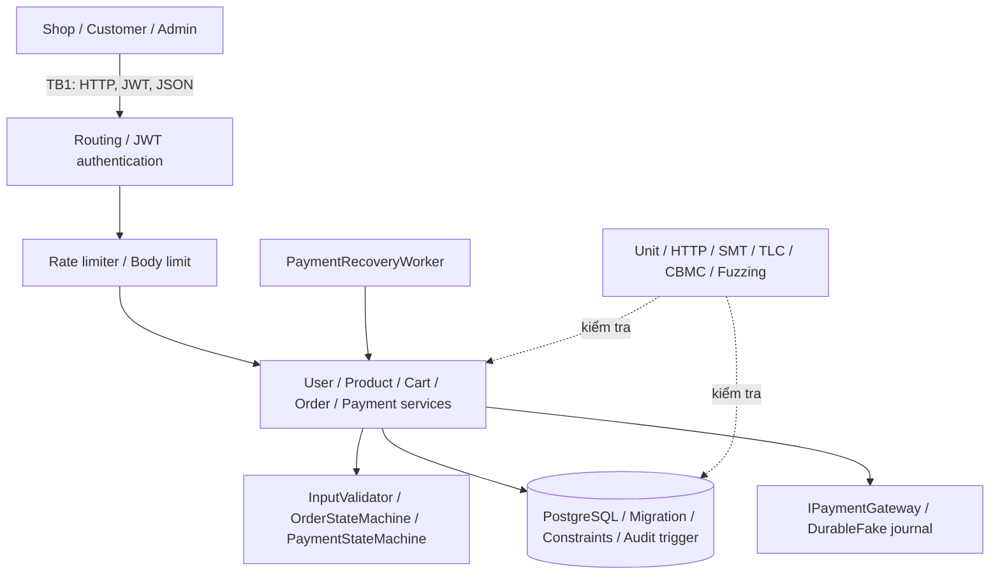

# BÁO CÁO ĐỒ ÁN MÔN HỌC — CSE703153 Kỹ thuật Lập trình An toàn

> **Ghi chú kỹ thuật (không in vào bản nộp):** Tệp này được viết lại theo **cấu trúc 8 phần bắt buộc**
> của `ATPM/report_guide.pdf`. Nội dung kỹ thuật chi tiết vẫn nằm ở các tệp đã có trong
> `security-analysis/report/`: `BAO_CAO.md` (phân tích đầy đủ), `PHU_LUC_A_G.md` (phụ lục A–G)
> và các `results/*.json` (evidence). Khi nộp, biên dịch sang PDF, giữ font có dấu và đánh số trang.

---

# PHẦN 1 — TRANG BÌA & THÔNG TIN NHÓM

> Điền các trường `[...]` trước khi nộp. Giữ đúng bố cục mẫu ở Mục 5.2 của hướng dẫn.

```
                TRƯỜNG CÔNG NGHỆ THÔNG TIN — ĐẠI HỌC PHENIKAA
                          BÁO CÁO ĐỒ ÁN MÔN HỌC
                     CSE703153 — Kỹ thuật Lập trình An toàn

      Đề tài: Xây dựng và kiểm chứng an toàn hệ thống xử lý đơn hàng
              và thanh toán trực tuyến (OrderPaymentMicroservice)

                    Nhóm: 14            Lớp: [Mã lớp]
      Thành viên: [Họ tên — MSSV], [Họ tên — MSSV], [Họ tên — MSSV]
                 Giảng viên hướng dẫn: MSc. Vũ Quang Dũng

                            Hà Nội, [Tháng, Năm]
```

## Thông tin nhóm

| STT | Họ và tên | MSSV | Vai trò chính |
| --- | --- | --- | --- |
| 1 | [Họ tên] | [MSSV] | Thiết kế mô hình, kiểm chứng state/ownership |
| 2 | [Họ tên] | [MSSV] | Phân tích mã nguồn, sanitizer, vá lỗi |
| 3 | [Họ tên] | [MSSV] | Kiểm thử động, fuzzing, HTTP/browser, evidence |

## Cấu trúc báo cáo

Báo cáo gồm đủ 8 phần theo đúng thứ tự hướng dẫn:

1. Trang bìa & Thông tin nhóm
2. Tổng quan đề tài
3. Phương pháp luận
4. Phân tích lỗ hổng & Bản vá
5. Bảng tổng hợp before/after
6. Bằng chứng kiểm chứng
7. Phản biện & Bài học
8. Phụ lục

---

# PHẦN 2 — TỔNG QUAN ĐỀ TÀI

## 2.1. Tên đề tài, ngôn ngữ và tuần học liên quan

- **Tên đề tài:** Xây dựng và kiểm chứng an toàn hệ thống xử lý đơn hàng và thanh toán trực tuyến
  (OrderPaymentMicroservice), Nhóm 14.
- **Ngôn ngữ:** C# (.NET 10, ASP.NET Core) cho ứng dụng nghiệp vụ; **C11** cho các module mô hình
  ownership/lifetime (`security-analysis/c-memory/modules/`).
- **Tuần học liên quan:** Chương 1 (threat model, trust boundary), Chương 2 (kiểm thử và kiểm chứng),
  Chương 3 (SAT/SMT/BMC/static), Chương 4 (fuzzing, coverage, dynamic memory).

## 2.2. Mô tả chức năng hệ thống v0

Hệ thống là một host ASP.NET Core với các module User, Product, Cart, Order và Payment dùng chung
một PostgreSQL. Khách đăng ký/đăng nhập, thêm sản phẩm vào giỏ, tạo đơn, trả tiền qua gateway
**mô phỏng local**, rồi xem lịch sử. Trọng tâm an toàn không chỉ là API trả 2xx mà là **tính nhất
quán giữa Order, Payment và inventory reservation**, idempotency khi retry và khả năng phục hồi
sau crash/restart. Bản v0 (trước khi vá) để lộ các lỗi ở Bảng 5.1; bản v1 đã vá trong source hiện tại.

## 2.3. Kiến trúc và những phần đã thay đổi so với v0



Các phần **đã thay đổi so với v0** (đánh dấu *):

- * Thêm JWT authentication + `[Authorize]` + ownership check theo claim (vá CWE-306, CWE-639).
- * `OrderService` đọc giá từ `Product` server, tự tính `TotalAmount`, mở transaction stock (vá CWE-602).
- * Thêm `OrderStateMachine`/`PaymentStateMachine` cấm hồi sinh terminal, kiểm amount chính xác,
  idempotency key (vá CWE-841).
- * `InputValidator` từ chối lệch tổng > 0,01 và giá dưới ngưỡng tối thiểu (vá CWE-20).
- * Guard độ dài trước `strcpy`, đặt owner pointer `NULL` sau `free`, free child trước parent,
  copy id trước khi free trong 5 module C (vá CWE-120/121/122/415/416/401).

## 2.4. Phạm vi đã làm và chưa làm

| Hạng mục | Trạng thái | Ghi chú |
| --- | --- | --- |
| 5 lỗi bộ nhớ trong module C (CWE-121/122/416/401/415) | **Đã vá và kiểm chứng** | ASan/UBSan/LSan 22/22, CBMC 10/10, Valgrind 10/10, SAT/DRAT 10/10 |
| 5 lỗ hổng nghiệp vụ (CWE-306/602/841/20/639) | **Đã vá** | Unit + integration + HTTP authorization; gateway thật ngoài phạm vi |
| Idempotency, crash recovery, PostgreSQL reconnect | **Đã kiểm chứng trong test scope** | Process-kill, disconnect→reconnect, backup drill |
| Gateway thanh toán thật (TLS, webhook, WAN) | **Chưa làm** | Chỉ DurableFake local; chưa xác thực callback thật |
| GUI Windows `SpecVerificationLab.exe` | **BLOCKED** | Cần môi trường Windows; chưa chạy trên Linux |
| Taint analysis tự động, symbolic execution C# | **Chưa làm** | Luồng source→sink mới review thủ công |

Chi tiết phạm vi: [`BAO_CAO.md`](BAO_CAO.md) mục 1–2 và [`PHU_LUC_A_G.md`](PHU_LUC_A_G.md) Phụ lục A.

---

# PHẦN 3 — PHƯƠNG PHÁP LUẬN

## 3.1. Quy trình 5 bước áp dụng

1. **Đặc tả điều kiện an toàn:** mỗi lỗi gắn một CWE và một điều kiện kiểm tra được (ví dụ
   `stock ≥ Σ quantity cùng ProductId`; `Payment.Amount == Order.TotalAmount`).
2. **Mô hình hóa:** recovery state machine, Kripke structure, SMT-LIB cho số học, và module C
   cho ownership/lifetime.
3. **Tạo counterexample:** Z3 witness, TLC counterexample, CBMC unwinding, mutation âm.
4. **Đối chiếu source:** kiểm guard/transaction/DTO có thật trong C#; chỉ kết luận trong test scope.
5. **Sửa và regression:** vá theo nguyên nhân gốc rễ rồi chạy lại sanitizer, unit, integration,
   HTTP và browser trên bản vá.

## 3.2. Công cụ sử dụng

| Công cụ | Phần dùng | Cấu hình / cờ chính |
| --- | --- | --- |
| GCC 13.3.0 | Build C | buggy `-UFIXED`, fixed `-DFIXED=1`; dynamic `-g -O0 -fno-omit-frame-pointer` |
| AddressSanitizer / UBSan / LeakSanitizer | Dynamic memory | `-fsanitize=address,undefined`; `detect_leaks=1` |
| Cppcheck 2.13.0 | Static analysis | `--enable=all --inconclusive --std=c11 --max-configs=1` |
| CBMC 5.95.1 | Bounded model checking | `--bounds-check --pointer-check --memory-leak-check --unwind 64 --unwinding-assertions` |
| Valgrind 3.22.0 | Memcheck | build **không sanitizer**, `-fno-stack-protector` |
| CaDiCaL 1.7.3 + drat-trim | SAT/CNF/DRAT | CBMC `--dimacs`; `s VERIFIED`; UNSAT core kiểm lại |
| Z3 | SMT số học | `PaymentVerification.z3`, `InventoryVerification.z3` (QF_NIA) |
| TLA+ / TLC 1.7.4 | Explicit-state model checking | recovery model, 35 states generated |
| .NET test + Coverlet | Unit/integration/coverage | `dotnet test`, `/p:CollectCoverage=true` |
| Chrome + CDP | Browser fault | Fetch interception trên `/api/products` |

## 3.3. Cách sinh dữ liệu

Đề tài **không dùng script `data_gen/` của học phần**; thay vào đó dữ liệu được sinh tất định và
có ghi seed:

| Nguồn dữ liệu | Cách sinh | Seed / tham số |
| --- | --- | --- |
| Fuzzing .NET có cấu trúc | PRNG tất định + corpus JSON 8 input | seed `20261009`; 25.000 vòng/campaign; 2.000 chuỗi stateful |
| HTTP black-box fuzz | Mutation corpus trên executable + PostgreSQL thật | seed `20261022`; 500 mutation → 601 request |
| Coverage-guided C | GCC `trace-pc`, edge map, fork/input | seed `20261022`; 20.000 mutation |
| C memory demo | Input cố định + biên 0/1/31/32/128 | tham số dòng lệnh |
| SMT / BMC / TLC | Ràng buộc tượng trưng | unwind=64; input tượng trưng ≤48 byte |

Vì seed cố định, mọi kết quả **tái lập được** bằng đúng lệnh đã ghi. Không có nghĩa là đã chạy
nhiều seed độc lập; giới hạn này nêu ở Phần 6–7.

## 3.4. Harness tự viết ngoài phần cấp sẵn

| Harness | Tệp | Chức năng |
| --- | --- | --- |
| Structured fuzz .NET | `SecurityFuzzingTests.cs` | Sinh input, gọi target, oracle exception/invariant |
| HTTP black-box fuzz | `security-analysis/http_fuzz.py` | Khởi động executable + PostgreSQL tạm, oracle response + DB |
| Browser CDP fault | `security-analysis/browser/network_fuzz.py` | Chrome thật, chặn response, oracle UI error state |
| Coverage-guided C | `security-analysis/run_c_coverage_fuzz.py` + `c-memory/fuzz/` | `trace-pc`, queue theo coverage mới |
| Scanner C | `c-memory/tests/check_static.py` | Pattern/data-flow đơn giản, tách nhánh `#ifdef FIXED` |

Về định dạng: đoạn mã trích dẫn dùng font đơn cách và ghi rõ tệp + số dòng; tên phiên bản dùng quy
ước `v0` = cấu hình BUGGY (`-UFIXED`), `v1` = cấu hình FIXED (`-DFIXED=1`) do project không phát
hành tệp `*_v0.*`/`*_v1.*` riêng.

---

# PHẦN 4 — PHÂN TÍCH LỖ HỔNG & BẢN VÁ

> **Trọng tâm báo cáo.** Mỗi CWE trình bày đủ 5 mục: (1) vị trí & mô tả, (2) nguyên nhân gốc rễ,
> (3) bằng chứng lỗi tồn tại, (4) cách vá — mã trước/sau, (5) bằng chứng đã vá.
> Mục 4.1–4.5 là lỗi bộ nhớ trong mô hình C; mục 4.6 là các lỗ hổng nghiệp vụ trong ứng dụng C#.

## 4.1. CWE-121 — Stack buffer overflow tại `register_user` (User)

**(1) Vị trí & mô tả.** `security-analysis/c-memory/modules/user.c`, hàm `register_user`;
`EMAIL_CAPACITY 32` dòng 4, mảng `char email[EMAIL_CAPACITY]` dòng 6, `strcpy(email, input)` dòng 13
(v0). CERT tương ứng: **STR31-C**.

**(2) Nguyên nhân gốc rễ.** `strcpy` sao chép đến ký tự NUL đầu tiên mà **không kiểm sức chứa đích**.
`email` là mảng trên stack 32 byte, nên email dài ≥32 ký tự (kể cả NUL) ghi vượt khung stack của
hàm. Đây là lỗi thiếu kiểm biên trước phép copy, không phải lỗi cú pháp hay API C#.

**(3) Bằng chứng lỗi tồn tại (v0).** Input mặc định dài hơn 32 ký tự; log ASan trong
`c-memory/results/user_buggy.log`:

```
==571506==ERROR: AddressSanitizer: stack-buffer-overflow on address 0x7747d9200040 ...
WRITE of size 56 at 0x7747d9200040 thread T0
SUMMARY: AddressSanitizer: stack-buffer-overflow ... in strcpy
```

CBMC cũng chỉ đúng ghi ngoài `email[32]`:

```
[strcpy.pointer_dereference.11] line 30 dereference failure:
pointer outside object bounds in dst[(signed long int)i]: FAILURE
```

Cppcheck gắn `bufferAccessOutOfBounds` (CWE-788 theo taxonomy của tool) tại `modules/user.c:13`.

**(4) Cách vá — trước (v0) / sau (v1).**

```c
/* v0 — user.c (BUGGY): không kiểm biên trước khi copy */
static void register_user(const char *input) {
    char email[EMAIL_CAPACITY];       /* 32 byte trên stack */
    strcpy(email, input);             /* BUG: ghi vượt biên nếu input >= 32 */
    printf("Registered email: %s\n", email);
}
```

```c
/* v1 — user.c (FIXED): từ chối thay vì cắt bớt âm thầm */
static void register_user(const char *input) {
    char email[EMAIL_CAPACITY];
    if (strlen(input) >= sizeof(email)) {   /* chừa 1 byte cho NUL */
        puts("REJECTED: email too long");
        return;
    }
    strcpy(email, input);
    printf("Registered email: %s\n", email);
}
```

Vì sao loại bỏ gốc rễ: guard chặn **mọi** đường tới `strcpy` khi độ dài ≥ sức chứa, nên phép copy
luôn nằm trong `email[0..31]`. Không chỉ "làm im" triệu chứng.

**(5) Bằng chứng đã vá.** `user_fixed` exit 0, sanitizer sạch; biên 0/1/31 chấp nhận, 32/128 bị
`REJECTED` (`dynamic-analysis.json`, `c-memory/results/user_fixed*.log`). CBMC: `VERIFICATION
SUCCESSFUL`; Valgrind: clean. Xem Bảng 6.1.

## 4.2. CWE-122 — Heap buffer overflow tại import Product

**(1) Vị trí & mô tả.** `modules/product.c`, `NAME_CAPACITY 32` dòng 4; `product.name =
allocate(NAME_CAPACITY)` dòng 9, `strcpy(product.name, input)` dòng 17 (v0).

**(2) Nguyên nhân gốc rễ.** Vùng đích là **heap allocation 32 byte** nhưng `strcpy` không kiểm độ
dài nguồn; tên dài hơn allocation ghi vượt biên heap. Cùng họ CWE-120 (unbounded copy) nhưng khác
vị trí vùng nhớ với User (heap thay vì stack) nên ASan báo `heap-buffer-overflow`.

**(3) Bằng chứng lỗi tồn tại (v0).** `c-memory/results/product_buggy.log`:

```
==571503==ERROR: AddressSanitizer: heap-buffer-overflow ...
WRITE of size 59 at 0x503000000060 thread T0
SUMMARY: AddressSanitizer: heap-buffer-overflow ... in strcpy
```

CBMC báo `strcpy.pointer_dereference` ngoài object bounds; Valgrind báo `Invalid write of size 1`.

**(4) Cách vá — trước (v0) / sau (v1).**

```c
/* v0 — product.c (BUGGY) */
Product product = {101, allocate(NAME_CAPACITY)};
strcpy(product.name, input);          /* BUG: không kiểm độ dài */
printf("Product %d: %s\n", product.id, product.name);
free(product.name);
```

```c
/* v1 — product.c (FIXED): reject và vẫn free nhánh reject */
Product product = {101, allocate(NAME_CAPACITY)};
if (strlen(input) >= NAME_CAPACITY) {
    puts("REJECTED: product name too long");
    free(product.name);               /* không rò rỉ ở nhánh từ chối */
    return 0;
}
strcpy(product.name, input);
printf("Product %d: %s\n", product.id, product.name);
free(product.name);
```

Vì sao loại bỏ gốc rễ: guard so độ dài trước copy; nhánh từ chối **giải phóng allocation** nên
không tạo leak mới. Byte NUL được chừa vì điều kiện là `>=`.

**(5) Bằng chứng đã vá.** `product_fixed` exit 0 sạch; biên 0/1/31 chấp nhận (`Product 101: AAA…`),
32/128 trả `REJECTED`; ASan/UBSan/LSan sạch; CBMC `VERIFICATION SUCCESSFUL`; Valgrind clean.

## 4.3. CWE-416 — Use-after-free tại audit log Cart

**(1) Vị trí & mô tả.** `modules/cart.c`, hàm `main` đóng vai `RemoveItemFromCartAsync`; nhánh v0
dòng 16 `free(removed);` rồi dòng 17 `printf("...", removed->product_id);`.

**(2) Nguyên nhân gốc rễ.** Sau khi `free(removed)`, vòng đời của node kết thúc; dòng log vẫn
**dereference con trỏ** tới vùng đã giải phóng. Trong C, `free` không xóa con trỏ và không cấm
đọc lại, nên đây là UAF (CERT MEM30-C/MEM50-C).

**(3) Bằng chứng lỗi tồn tại (v0).** `c-memory/results/cart_buggy.log`:

```
==571500==ERROR: AddressSanitizer: heap-use-after-free on address 0x502000000010 ...
READ of size 4 at 0x502000000010 thread T0
SUMMARY: AddressSanitizer: heap-use-after-free modules/cart.c:17 in main
```

CBMC: `deallocated dynamic object in removed->product_id: FAILURE`; Valgrind: `Invalid read of size 4`.

**(4) Cách vá — trước (v0) / sau (v1).**

```c
/* v0 — cart.c (BUGGY) */
free(removed);
printf("Removed product %d\n", removed->product_id); /* BUG: đọc sau free */
```

```c
/* v1 — cart.c (FIXED): copy giá trị trước khi free */
int product_id = removed->product_id;   /* đọc khi còn hợp lệ */
free(removed);
removed = NULL;                         /* hạn chế dùng lại con trỏ */
printf("Removed product %d\n", product_id);
```

Vì sao loại bỏ gốc rễ: dữ liệu cần log được **sao chép trước** khi vùng nhớ bị giải phóng; sau đó
không còn dereference. Gán `NULL` là biện pháp bổ trợ, không thay thế việc copy.

**(5) Bằng chứng đã vá.** `cart_fixed` exit 0 sạch; in đúng `Removed product 101`; CBMC
`VERIFICATION SUCCESSFUL`; Valgrind clean; scanner FIXED không còn `use-after-free`.

## 4.4. CWE-401 — Memory leak tại hủy Order

**(1) Vị trí & mô tả.** `modules/order.c`, `cancel_order`; `order->items = allocate(...)` dòng 10,
`free(order)` dòng 17 (v0), không có `free(order->items)`.

**(2) Nguyên nhân gốc rễ.** `Order` sở hữu một **allocation con** (`items`) tách khỏi `Order`. Trong
C, `free(order)` chỉ giải phóng struct cha, không tự giải phóng `order->items`. Hàm `main` gọi
`cancel_order()` 5 lần nên mỗi lần rò rỉ 3 phần tử.

**(3) Bằng chứng lỗi tồn tại (v0).** `c-memory/results/order_buggy.log`:

```
==571481==ERROR: LeakSanitizer: detected memory leaks
Direct leak of 240 byte(s) in 5 object(s) allocated from:
SUMMARY: AddressSanitizer: 240 byte(s) leaked in 5 allocation(s).
```

CBMC: `dynamically allocated memory never freed`; Valgrind: `240 bytes in 5 blocks are definitely lost`.

**(4) Cách vá — trước (v0) / sau (v1).**

```c
/* v0 — order.c (BUGGY) */
free(order);          /* BUG: order->items vẫn còn được cấp phát */
```

```c
/* v1 — order.c (FIXED): free con trước cha */
free(order->items);
free(order);
```

Vì sao loại bỏ gốc rễ: mọi allocation do `Order` sở hữu đều được giải phóng trước khi mất con trỏ
cha; thứ tự con→cha tránh mất tham chiếu tới vùng cần free.

**(5) Bằng chứng đã vá.** `order_fixed` exit 0, LeakSanitizer sạch; CBMC `VERIFICATION SUCCESSFUL`;
Valgrind clean; scanner FIXED không còn `owned-allocation-leak`.

## 4.5. CWE-415 — Double free tại cleanup Payment

**(1) Vị trí & mô tả.** `modules/payment.c`, `main` đóng vai nhánh lỗi gateway rồi cleanup chung;
`free(payment.transaction_code)` dòng 9 (nhánh lỗi) và lần nữa dòng 13 (cleanup chung) trong v0.

**(2) Nguyên nhân gốc rễ.** Hai đường cleanup **cùng cho rằng mình sở hữu** `transaction_code`.
Con trỏ không bị vô hiệu hóa sau lần free đầu, nên lần free thứ hai giải phóng cùng địa chỉ →
double free (CERT MEM30-C).

**(3) Bằng chứng lỗi tồn tại (v0).** `c-memory/results/payment_buggy.log`:

```
==571497==ERROR: AddressSanitizer: attempting double-free on 0x503000000040 in thread T0:
SUMMARY: AddressSanitizer: double-free ... in free
```

CBMC: `free argument must be NULL or valid pointer: FAILURE` và `double free: FAILURE`;
Valgrind: `Invalid free()`.

**(4) Cách vá — trước (v0) / sau (v1).**

```c
/* v0 — payment.c (BUGGY) */
free(payment.transaction_code);          /* nhánh lỗi */
free(payment.transaction_code);          /* BUG: cleanup chung free lần nữa */
```

```c
/* v1 — payment.c (FIXED): chuyển owner thành NULL sau lần free đầu */
free(payment.transaction_code);
payment.transaction_code = NULL;         /* free(NULL) là hợp lệ, không release lần hai */
free(payment.transaction_code);
```

Vì sao loại bỏ gốc rễ: sau lần free đầu, con trỏ không còn là owner hợp lệ; đặt `NULL` khiến lần
cleanup sau trở thành no-op. Giới hạn: cách này chỉ bảo vệ **chính biến con trỏ đó**, không chữa
dangling alias nếu còn con trỏ khác trỏ tới cùng allocation.

**(5) Bằng chứng đã vá.** `payment_fixed` exit 0 sạch; CBMC `VERIFICATION SUCCESSFUL`; Valgrind
clean; scanner FIXED không còn `double-free`.

## 4.6. Lỗ hổng nghiệp vụ trong ứng dụng C#

Năm finding dưới đây nằm trong `security-analysis/vulnerabilities.json` (review/characterization v0).
Mô tả là **tình trạng trước remediation**; bản v1 hiện tại đã vá và được giữ bởi unit/integration/HTTP test.

### 4.6.1. CWE-306 — Truy cập Order không xác thực

- **Vị trí:** `OrderPaymentMicroservice/Controllers/OrdersController.cs`; `Program.cs` (v0).
- **Nguyên nhân gốc rễ:** thiếu authentication middleware và `[Authorize]`, thiếu kiểm ownership
  theo claim, nên client đọc/hủy đơn không cần chứng minh danh tính (CWE-306, kèm CWE-862).
- **Bằng chứng v0:** finding `VULN-001`, `detected_by = Static code review`; endpoint Order không
  gắn policy quyền.
- **Cách vá (v0 → v1):** thêm JWT authentication, `[Authorize]`, policy Admin cho listing và
  ownership theo `sub`; `GET /api/orders/mine` luôn dùng subject thay vì nhận ID từ client.
- **Bằng chứng đã vá:** integration/HTTP kiểm anonymous → 401, cross-user → 403, Admin được phép;
  xem `results/application_tests.results.json` và `results/http_fuzz.results.json`.

### 4.6.2. CWE-602 — Tin giá và tổng tiền từ client

- **Vị trí:** `OrderPaymentMicroservice/Services/OrderService.cs`: `CreateOrderAsync` (v0).
- **Nguyên nhân gốc rễ:** `UnitPrice`/`TotalAmount` được lưu trực tiếp từ payload; client kiểm soát
  dữ liệu có thẩm quyền về giá.
- **Bằng chứng v0:** `VULN-002`; mô tả ghi rõ giá/tổng lấy từ request.
- **Cách vá (v0 → v1):** đọc `Product.Price` từ server, tự tính `TotalAmount`, mở transaction
  stock/CHECK constraint; cộng dồn quantity theo ProductId trước khi kiểm tồn.
- **Bằng chứng đã vá:** `OrderServiceTests.ClientCannotCreateOrderUsingTamperedPrice`; witness SMT
  tồn kho âm và bản vá guard; regression HTTP.

### 4.6.3. CWE-841 — Hồi sinh đơn đã hủy qua thanh toán

- **Vị trí:** `OrderPaymentMicroservice/Services/PaymentService.cs`: `CreatePaymentAsync` (v0).
- **Nguyên nhân gốc rễ:** mọi Order tồn tại đều bị đánh dấu PAID, kể cả CANCELLED; kết quả SUCCESS
  mô phỏng không được xác minh.
- **Bằng chứng v0:** `VULN-003`, `remediation_status = FIXED_FOR_SIMULATED_GATEWAY`.
- **Cách vá (v0 → v1):** `OrderStateMachine` trung tâm, guard trạng thái nguồn, kiểm amount chính
  xác bằng `Order.TotalAmount`, idempotency key; giữ UNKNOWN thay vì suy FAILED.
- **Bằng chứng đã vá:** `OrderStateMachineTests`, `PaymentServiceTests`, model counterexample;
  **gateway thật vẫn ngoài phạm vi** nên không claim CWE-841 đã đóng hoàn toàn.

### 4.6.4. CWE-20 — Bỏ qua lệch tổng tiền

- **Vị trí:** `OrderPaymentMicroservice/Security/InputValidator.cs`: nhánh tolerance (v0).
- **Nguyên nhân gốc rễ:** điều kiện lệch > 0,01 rơi vào **khối rỗng**, nên mismatch được chấp nhận
  thay vì bị từ chối (improper input validation).
- **Bằng chứng v0:** `VULN-004`; unit test chứng minh tổng 0,01 so với item 999999.99 từng được nhận.
- **Cách vá (v0 → v1):** validator từ chối lệch quá 0,01 và từ chối giá dưới ngưỡng tối thiểu.
- **Bằng chứng đã vá:** `InputValidatorTests.MismatchOrBelowMinimumPriceIsRejected`; boundary +
  regression + fuzz oracle; coverage InputValidator branch 97,22%.

### 4.6.5. CWE-639 — Sửa/đọc giỏ của người khác

- **Vị trí:** `OrderPaymentMicroservice/Controllers/CartController.cs`:
  `user/{userId}/add` và `{cartId}/item/{itemId}` (v0).
- **Nguyên nhân gốc rễ:** caller tự cấp `userId`/`cartId`/`itemId` mà không có danh tính xác thực
  và không kiểm ownership → IDOR.
- **Bằng chứng v0:** `VULN-005`, finding mới, impact integrity HIGH.
- **Cách vá (v0 → v1):** JWT identity + kiểm ownership trên **mọi** thao tác cart.
- **Bằng chứng đã vá:** regression/HTTP authorization; `http_fuzz.results.json` có nhóm status
  401/403 tương ứng.

---

# PHẦN 5 — BẢNG TỔNG HỢP BEFORE/AFTER

> Một dòng cho mỗi CWE đã vá. Cột trạng thái mô tả **có thể kiểm chứng** (tên diagnostic, số dòng
> log, hoặc kết quả test), không viết "có lỗi/đã sửa".

| CWE | Vị trí | Trạng thái v0 | Trạng thái v1 | Công cụ xác minh |
| --- | --- | --- | --- | --- |
| CWE-121 | `user.c::register_user` | `AddressSanitizer: stack-buffer-overflow`, WRITE of size 56, `user.c:13` | Từ chối email ≥32 byte; 0 finding | ASan/UBSan/LSan, CBMC, Valgrind |
| CWE-122 | `product.c::main` | `AddressSanitizer: heap-buffer-overflow`, WRITE of size 59 | Từ chối tên ≥32 byte + free nhánh reject; 0 finding | ASan/UBSan/LSan, CBMC, Valgrind |
| CWE-416 | `cart.c::main` | `AddressSanitizer: heap-use-after-free`, READ of size 4, `cart.c:17` | Copy id trước free, `removed=NULL`; 0 finding | ASan/UBSan/LSan, CBMC, Valgrind |
| CWE-401 | `order.c::cancel_order` | `LeakSanitizer: detected memory leaks`, 240 byte / 5 block | free `order->items` trước `order`; 0 leak | LSan, CBMC, Valgrind |
| CWE-415 | `payment.c::main` | `AddressSanitizer: attempting double-free` tại `0x5030…040` | Owner pointer `NULL` sau free; 0 finding | ASan/UBSan/LSan, CBMC, Valgrind |
| CWE-306 | `OrdersController.cs`, `Program.cs` | Order listing/read/cancel không cần JWT | JWT + `[Authorize]` + ownership; anonymous 401, cross-user 403 | Unit/Integration/HTTP |
| CWE-602 | `OrderService.cs::CreateOrderAsync` | Lưu `UnitPrice`/`TotalAmount` từ client | Giá server + tự tính tổng + transaction stock | `OrderServiceTests`, SMT, HTTP |
| CWE-841 | `PaymentService.cs::CreatePaymentAsync` | Mọi Order bị đánh PAID, kể cả CANCELLED | State guard + exact amount + idempotency | `OrderStateMachineTests`, model, DB |
| CWE-20 | `InputValidator.cs` | Lệch tổng >0,01 vào khối rỗng | Từ chối mismatch và giá dưới ngưỡng | `InputValidatorTests`, boundary, fuzz |
| CWE-639 | `CartController.cs` | `userId`/`cartId` do client cấp | JWT identity + ownership mọi thao tác | Integration/HTTP |

Hai dòng bộ nhớ Product/User cùng họ CWE-120 (buffer copy without size check) nhưng phiên bản cụ
thể là CWE-122 (heap) và CWE-121 (stack). Cppcheck có thể gắn CWE-788; đó là taxonomy của tool.

---

# PHẦN 6 — BẰNG CHỨNG KIỂM CHỨNG

## 6.1. Bảng tổng hợp số lần chạy công cụ

| Phép kiểm | Số case | Kết quả | Điều kiện / seed | Evidence |
| --- | --- | --- | --- | --- |
| Sanitizer case (ASan/UBSan/LSan) | 22 | 22/22 PASS | Input/biên công bố; ngoài sandbox | `c-memory/evidence/dynamic-analysis.json` |
| CBMC bounded model checking | 10 | 10/10 PASS | `unwind=64`, input tượng trưng ≤48 byte | `c-memory/evidence/bmc-analysis.json` |
| Valgrind Memcheck | 10 | 10/10 PASS | build không sanitizer | `c-memory/evidence/valgrind-analysis.json` |
| SAT/CNF/DIMACS + DRAT | 10 | 10/10 PASS | 5 BUGGY SAT, 5 FIXED UNSAT + `s VERIFIED` | `c-memory/evidence/sat-pipeline.json` |
| Unit | 149 | 149/149 PASS | 0 fail, 0 skip | `results/application_tests.results.json` |
| Integration (HTTP + PostgreSQL) | 35 | 35/35 PASS | 0 fail, 0 skip | `results/application_tests.results.json` |
| Structured .NET fuzz | 4 campaign | 4/4 PASS | seed `20261009`; 25.000 + 2.000 | `results/application_fuzzing.results.json` |
| HTTP black-box fuzz | 601 request | PASS | seed `20261022`; 0 HTTP 5xx, 0 DB violation | `results/http_fuzz.results.json` |
| Browser CDP fault | 8 scenario | 8/8 PASS | control 8 card; 7/7 fault có UI error state | `results/browser_network_fuzz.results.json` |
| Coverage-guided C | 20.000 mutation | PASS | seed `20261022`; 81 → 148 edge | `results/c_coverage_fuzz.results.json` |

Ghi chú trung thực: các campaign .NET và C dùng **một seed cố định**, không phải 5 seed độc lập;
HTTP fuzz và browser cũng chạy một lượt. Vì vậy đây là "0 failure trong budget đã chạy", không phải
chứng minh không có lỗi trên mọi seed/mọi lịch trình.

## 6.2. Trích log quan trọng (có chú thích)

**Hình/Log 6.1 — Trước khi vá (CWE-121, User).** `c-memory/results/user_buggy.log`:
ASan báo `stack-buffer-overflow`, `WRITE of size 56`, thực hiện trong `strcpy`. Chú thích: email dài
hơn buffer stack 32 byte ghi vượt khung hàm `register_user`.

**Hình/Log 6.2 — Sau khi vá (CWE-121, User).** `c-memory/results/user_fixed.log`: exit 0, sanitizer
sạch; biên 32/128 in `REJECTED: email too long`. Chú thích: cùng kịch bản input không còn ghi vượt biên.

**Hình/Log 6.3 — Trước/sau CWE-122 (Product).** `product_buggy.log` báo `heap-buffer-overflow`,
`WRITE of size 59`; `product_fixed.log` exit 0 và `REJECTED: product name too long`.

**Hình/Log 6.4 — CWE-416 (Cart).** `cart_buggy.log` báo `heap-use-after-free`, `READ of size 4`,
`cart.c:17`; `cart_fixed.log` sạch và in `Removed product 101`.

**Hình/Log 6.5 — CWE-401 (Order).** `order_buggy.log` báo `LeakSanitizer`, `240 byte(s) in 5 object(s)`;
`order_fixed.log` sạch.

**Hình/Log 6.6 — CWE-415 (Payment).** `payment_buggy.log` báo `attempting double-free`;
`payment_fixed.log` sạch.

**Hình/Log 6.7 — Static trước/sau.** Bảng C.5 (`PHU_LUC_A_G.md`): scanner BUGGY bắt 5/5 loại lỗi kỳ
vọng, FIXED không finding; Cppcheck chỉ bắt trực tiếp buffer của User ở BUGGY (false negative ở 4
module còn lại).

**Hình/Log 6.8 — Evidence cha của HTTP/browser.** `http_fuzz.results.json`:
`requests_executed=601`, `coverage.unique_features=108`, `coverage.unique_semantic_edges=500`,
`database.invariant_checks=272`, `database.violations=[]`, `http.5xx=0`. `browser_network_fuzz.results.json`:
`passed=true`, 7/7 fault `ui_handles_fault=true`, `all_javascript_errors=[]`.

> **Bắt buộc trước khi nộp:** đặt **log đầy đủ** (không cắt) trong Phụ lục và chỉ trích đoạn quan
> trọng vào Phần 4/6; mỗi log phải có chú thích gắn với CWE/lỗi cụ thể.

---

# PHẦN 7 — PHẢN BIỆN & BÀI HỌC

**Nếu bắt đầu lại, nhóm sẽ thiết kế lại phần nào để tránh lỗ hổng ngay từ đầu?**
Nhóm sẽ chọn ngay kiểu dữ liệu và API an toàn thay vì vá sau: dùng buffer có kèm độ dài/`std::span`
thay cho `strcpy` vào mảng cố định; tách hàm "kiểm biên rồi copy" thành API duy nhất; và với C#,
đặt ownership/giá/trạng thái thành guard cưỡng chế ở tầng service ngay từ đầu. Điều này biến các lớp
CWE-120/121/122/416/415/602/841 từ "lỗi cần phát hiện" thành "không biểu diễn được".

**Có lỗ hổng nào nhóm nghi ngờ còn tồn tại nhưng chưa đủ thời gian/công cụ xác nhận?**
Có. (a) Alias/dangling còn lại ngoài con trỏ đã đặt `NULL` (CWE-415) chưa được kiểm toàn diện.
(b) Toàn bộ interleaving đa luồng giữa payment và cancel chưa được mô hình hóa/kiểm hết.
(c) Gateway thật, TLS, webhook và xác thực callback còn mở (CWE-841 chỉ đóng với gateway mô phỏng).
(d) Chưa có taint analysis tự động nên luồng dữ liệu độc hại xuyên tầng mới kiểm bằng review thủ công.
(e) GUI Windows của học phần chưa chạy nên một phần đối chiếu đặc tả vẫn `BLOCKED`.

**Bài học lớn nhất về phương pháp luận?**
Không có công cụ đơn lẻ nào đủ. Cppcheck bỏ sót 4/5 lỗi bộ nhớ; sanitizer chỉ thấy đường đã chạy;
CBMC/DRAT chỉ đúng trong bound; SMT chỉ đúng trong tập ràng buộc; fuzzing không crash không có nghĩa
là an toàn. Giá trị thật nằm ở việc **nối mỗi kết luận với đúng phép kiểm và ghi rõ giới hạn**, thay
vì gộp mọi "PASS" thành một chữ "an toàn".

---

# PHẦN 8 — PHỤ LỤC

## 8.1. Phụ lục kỹ thuật đầy đủ

Toàn bộ bảng model, CWE, log và traceability nằm ở [`PHU_LUC_A_G.md`](PHU_LUC_A_G.md), gồm:

- **Phụ lục A — Hệ thống:** boundary, requirement, ma trận endpoint/quyền, asset/threat.
- **Phụ lục B — Model và thuộc tính:** trạng thái recovery, transition, counterexample, liveness.
- **Phụ lục C — Static và bộ nhớ:** CWE, toàn bộ case sanitizer, CBMC, SAT/DRAT, Valgrind, source.
- **Phụ lục D — SMT và biên:** payment SMT 7/7, inventory SMT 3/3.
- **Phụ lục E — Fuzzing và test:** campaign, coverage, oracle.
- **Phụ lục F — Evidence và truy vết:** kết quả từng test, process-kill, manifest.
- **Phụ lục G — Hạn chế và công việc còn mở.**

Phân tích đầy đủ theo chương: [`BAO_CAO.md`](BAO_CAO.md).

## 8.2. Hướng dẫn build và chạy lại

```bash
# C memory: static, dynamic, BMC, Valgrind, SAT
make -C security-analysis/c-memory static-check
make -C security-analysis/c-memory test
make -C security-analysis/c-memory bmc-check
make -C security-analysis/c-memory valgrind-check
make -C security-analysis/c-memory sat-check

# .NET unit + integration
dotnet test OrderPaymentMicroservice.Tests/OrderPaymentMicroservice.Tests.csproj --no-restore --nologo
dotnet test OrderPaymentMicroservice.IntegrationTests/OrderPaymentMicroservice.IntegrationTests.csproj --no-restore --nologo

# Fuzzing / HTTP / browser / coverage-guided
python3 security-analysis/run_fuzzing.py
python3 security-analysis/http_fuzz.py --iterations 500 --no-build
python3 security-analysis/browser/network_fuzz.py
python3 security-analysis/run_c_coverage_fuzz.py --iterations 20000
```

Chạy từ gốc repository; mọi kết quả ghi vào `security-analysis/results/*.json` và
`security-analysis/c-memory/evidence/*.json`.

## 8.3. Phân công công việc

| Thành viên | Phần phụ trách |
| --- | --- |
| [Họ tên] | Phần 2, 3; mô hình state/SMT; Phụ lục B, D |
| [Họ tên] | Phần 4.1–4.5; static/dynamic/BMC/Valgrind; Phụ lục C |
| [Họ tên] | Phần 4.6, 5, 6; unit/integration/HTTP/browser/fuzz; Phụ lục E, F |

## 8.4. Checklist trước khi nộp (theo Mục 8 của hướng dẫn)

- [ ] Đủ 8 phần, đúng thứ tự, đúng tên.
- [ ] Mọi CWE có mã số cụ thể (CWE-XXX).
- [ ] Mỗi CWE ở Phần 4 đủ 5 mục con (vị trí, nguyên nhân, bằng chứng trước, cách vá, bằng chứng sau).
- [ ] Bảng Phần 5 khớp 1–1 với CWE đã phân tích ở Phần 4.
- [ ] Mọi log/ảnh ở Phần 6 có chú thích rõ ràng.
- [ ] Mã nguồn v0 (BUGGY) còn nguyên; bản vá build được từ đầu bằng Makefile.
- [ ] Đã chạy lại các lệnh đúng seed ghi trong báo cáo và kết quả khớp log.
- [ ] Phần 7 viết cụ thể, không sáo rỗng.
- [ ] Xuất PDF mở được, không lỗi font, không thiếu trang.
- [ ] Điền hết các trường `[...]` ở Phần 1 và 8.3.
