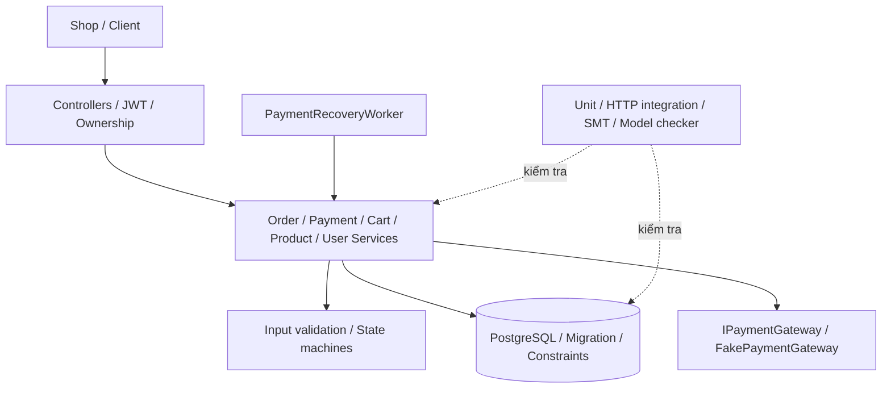

# Phụ lục kỹ thuật OrderPaymentMicroservice

Các bảng được sinh từ model và evidence của project. Không sao chép số liệu Smart EV.

## Phụ lục A — Hệ thống



### A.1. Ranh giới và dữ liệu

| Giao diện | Đầu vào | Đầu ra | Guard |
| --- | --- | --- | --- |
| Register/Login | Email/password/name | User/JWT hoặc 400/401 | DTO + service validation; hash password |
| Product create/update | Name/price/stock | Product hoặc 400 | Admin, validation, CHECK price/stock |
| Cart add/update | ProductId/quantity | Cart hoặc 400/409 | Ownership, quantity, stock, transaction |
| Order create | Items/total/address | Order hoặc 400/409 | Claim customer, giá server, tổng quantity |
| Payment create | OrderId/amount/key | Payment hoặc 400/403/409 | Ownership, exact amount, idempotency |
| Confirm/Complete/Refund | ID/key | Lifecycle mới hoặc conflict | Admin, state guard, payment evidence |
| Reconcile | Payment ID | Kết quả gateway/UNKNOWN | Ownership hoặc recovery worker |

Chi tiết endpoint: các Controller trong source. User/Order/Payment/Cart là dữ liệu
cần kiểm tra ownership; gateway là trust boundary riêng. State của gateway không
thay thế trực tiếp state Order.

### A.2. Requirement đặc tả

| ID | Nội dung | Danh mục | Ưu tiên |
| --- | --- | --- | --- |
| REQ-1 | Mọi API Cart, Order và Payment phải yêu cầu JWT hợp lệ; chỉ Admin được liệt kê toàn bộ đơn hàng. | safety | HIGH |
| REQ-2 | Người dùng chỉ được đọc hoặc thay đổi User, Cart, Order và Payment thuộc chính mình; quyền Admin là ngoại lệ được kiểm soát. | safety | HIGH |
| REQ-3 | Khi tạo đơn, giá sản phẩm phải lấy từ cơ sở dữ liệu phía server, sản phẩm phải tồn tại/đang hoạt động và tồn kho phải đủ. | functional | HIGH |
| REQ-4 | TotalAmount phải dương, trong giới hạn cho phép và khớp tổng Quantity × UnitPrice với sai số tối đa 0,01; dữ liệu sai phải bị từ chối. | safety | HIGH |
| REQ-5 | Order chỉ được chuyển theo chuỗi CREATED → VALIDATED → PAYMENT_PENDING → PAID → CONFIRMED → COMPLETED; không bỏ bước, quay ngược hoặc hồi sinh trạng thái terminal. | safety | HIGH |
| REQ-6 | Order chỉ được chuyển từ PAYMENT_PENDING sang PAID khi có Payment SUCCESS với Amount đúng bằng Order.TotalAmount. | safety | HIGH |
| REQ-7 | Mỗi yêu cầu thanh toán phải có IdempotencyKey; gửi lại cùng khóa và cùng Amount phải trả về giao dịch cũ, còn tái dùng khóa với Amount khác phải bị từ chối. | functional | HIGH |
| REQ-8 | Mật khẩu mới phải được băm bằng PasswordHasher có salt/work factor; tài khoản SHA-256 cũ chỉ được xác minh để nâng cấp một lần. | safety | HIGH |
| REQ-9 | register_user() không được sao chép email dài từ 32 byte trở lên vào buffer stack 32 byte. | memory | HIGH |
| REQ-10 | Product name không được vượt biên buffer heap 32 byte; nhánh từ chối vẫn phải giải phóng vùng nhớ đã cấp phát. | memory | HIGH |
| REQ-11 | Cart audit log không được đọc CartItem sau khi phần tử đã được free. | memory | HIGH |
| REQ-12 | Khi hủy Order trong mô hình C, mảng OrderItem thuộc sở hữu của Order phải được free trước struct cha. | memory | MEDIUM |
| REQ-13 | Payment cleanup không được free TransactionCode hai lần; con trỏ sở hữu phải được đặt NULL sau lần free đầu. | memory | HIGH |
| REQ-14 | Từ mọi trạng thái Order có thể đạt tới, mọi đường thực thi hữu hạn tiến triển phải cuối cùng tới COMPLETED, CANCELLED hoặc FAILED. | liveness | HIGH |
| REQ-15 | Mỗi trạng thái Order-Payment phải đặc tả sự cố, cách phát hiện, biện pháp xử lý và trạng thái tiếp theo; không được có sự cố không có đường phục hồi hoặc kết thúc. | safety | HIGH |
| REQ-16 | Retry thanh toán và xác nhận phải có bound; khi hết ngân sách retry phải chuyển FAILED hoặc REFUND_PENDING thay vì lặp vô hạn. | liveness | HIGH |
| REQ-17 | Nếu gateway đã charge nhưng không thể hoàn tất đơn hoặc commit PAID, hệ thống phải dùng REFUND_PENDING và REFUNDED để bù trừ; không được đổi thẳng sang FAILED. | safety | HIGH |
| REQ-18 | Payment và cancellation trên cùng Order phải được serialize; không được đồng thời sở hữu critical resource hoặc tạo hai Payment SUCCESS. | safety | HIGH |

SEC-STOCK-01, SEC-CART-01/02 và SEC-INPUT-01 trong traceability là yêu cầu bổ sung của đợt sửa lỗi, không thay số ID REQ gốc.

## Phụ lục B — Model và thuộc tính

### B.1. Giả định

- The database transaction serializes payment and cancellation updates for one order.
- A retry transition marked stutter may repeat, but weak fairness requires an enabled progress transition to eventually run.
- Gateway callbacks are authenticated and contain an idempotency key.
- Inventory is reserved after validation and released on cancellation, terminal failure or refund.

### B.2. Toàn bộ trạng thái recovery

| Aggregate state | Order | Payment | Labels | Ý nghĩa |
| --- | --- | --- | --- | --- |
| CREATED | CREATED | NONE | created, inventory_unreserved | Receive an order request before trusting client data. |
| VALIDATED | VALIDATED | NONE | validated, inventory_reserved, amount_verified | Represent an order whose server price, total and inventory have been checked. |
| PAYMENT_PENDING | PAYMENT_PENDING | NONE | payment_pending, inventory_reserved, amount_verified | Wait for a payment request while cancellation is still legal. |
| PAYMENT_PROCESSING | PAYMENT_PENDING | PROCESSING | payment_processing, inventory_reserved, amount_verified, payment_lock | Own the exclusive payment operation and wait for a gateway result. |
| PAYMENT_RETRY | PAYMENT_PENDING | UNKNOWN | payment_retry, inventory_reserved, amount_verified | Resolve an unknown gateway outcome without creating a second logical charge. |
| PAYMENT_PROCESSING_FINAL | PAYMENT_PENDING | PROCESSING | payment_processing, final_retry, inventory_reserved, amount_verified, payment_lock | Execute the final bounded payment reconciliation/attempt. |
| PAID | PAID | SUCCESS | paid, payment_success, amount_verified, inventory_reserved | Represent exactly one successful payment whose amount matches the order. |
| CONFIRMATION_RETRY | PAID | SUCCESS | paid, payment_success, confirmation_retry, amount_verified | Retry fulfillment confirmation without issuing another charge. |
| CONFIRMED | CONFIRMED | SUCCESS | confirmed, paid, payment_success, amount_verified | Order is paid and accepted for fulfillment. |
| REFUND_PENDING | REFUND_PENDING | REFUND_PENDING | paid, payment_success, refund_pending, amount_verified | Compensate a successful charge that cannot lead to completion. |
| COMPLETED | COMPLETED | SUCCESS | completed, paid, payment_success, amount_verified, terminal | Successful terminal state. |
| CANCELLED | CANCELLED | NONE | cancelled, inventory_released, terminal | Terminal state for a cancellation that won before a confirmed charge. |
| PRE_PAYMENT_REJECTED | FAILED | NONE | failed, pre_payment_failure, inventory_unreserved, terminal | Terminal observation for a request/order transaction rejected before any payment existed; the order row may not have been persisted. |
| FAILED | FAILED | FAILED | failed, inventory_released, terminal | Terminal state when no successful charge exists and automatic recovery is exhausted. |
| REFUNDED | REFUNDED | REFUNDED | refunded, payment_compensated, inventory_released, terminal | Terminal compensated state after a previously successful charge. |

### B.3. Toàn bộ chuyển tiếp có event

| Nguồn | Event | Đích | Kind | Action |
| --- | --- | --- | --- | --- |
| CREATED | validation_ok | VALIDATED | progress | Load server prices, validate quantities and reserve inventory. |
| CREATED | validation_rejected | PRE_PAYMENT_REJECTED | progress | Reject atomically; do not persist the order or reserve inventory |
| CREATED | validation_storage_error | PRE_PAYMENT_REJECTED | progress | Rollback and return a retryable error without creating an order |
| VALIDATED | order_persisted | PAYMENT_PENDING | progress | Persist order and items in the same transaction. |
| VALIDATED | amount_invariant_failed | PRE_PAYMENT_REJECTED | progress | Rollback the transaction and release the reservation |
| VALIDATED | order_commit_failed | PRE_PAYMENT_REJECTED | progress | Rollback all order and stock changes |
| PAYMENT_PENDING | payment_request_accepted | PAYMENT_PROCESSING | progress | Acquire the per-order transaction lock and record the idempotency key. |
| PAYMENT_PENDING | cancel_requested | CANCELLED | progress | Cancel the order and release reserved inventory |
| PAYMENT_PENDING | duplicate_pending_request | PAYMENT_PENDING | stutter | Return the existing in-progress result and create no second payment |
| PAYMENT_PENDING | payment_amount_rejected | PAYMENT_PENDING | stutter | Reject the payment; keep the order payable with the correct amount |
| PAYMENT_PROCESSING | gateway_success_and_commit | PAID | progress | Persist one SUCCESS payment and transition the order atomically. |
| PAYMENT_PROCESSING | gateway_transient_failure | PAYMENT_RETRY | progress | Release the lock and enter a bounded retry state using the same idempotency key |
| PAYMENT_PROCESSING | gateway_declined | FAILED | progress | Mark the flow failed and release inventory |
| PAYMENT_PROCESSING | charged_but_commit_failed | PAYMENT_RETRY | progress | Reconcile the existing charge by idempotency key; never create another logical payment |
| PAYMENT_PROCESSING | concurrent_cancel_loses_lock | PAYMENT_PROCESSING | stutter | Serialize the operations; cancellation retries after the payment result |
| PAYMENT_RETRY | retry_budget_available | PAYMENT_PROCESSING_FINAL | progress | Use the final bounded attempt with the same idempotency key. |
| PAYMENT_RETRY | retry_exhausted_unknown | PAYMENT_RETRY | stutter | Stop automatic charging, keep inventory reserved and require reconciliation/manual review |
| PAYMENT_RETRY | cancel_during_retry | CANCELLED | progress | Cancel and release inventory |
| PAYMENT_PROCESSING_FINAL | final_gateway_success_and_commit | PAID | progress | Persist one SUCCESS payment and transition the order atomically. |
| PAYMENT_PROCESSING_FINAL | final_payment_declined | FAILED | progress | Mark failed and release inventory |
| PAYMENT_PROCESSING_FINAL | final_payment_unknown | PAYMENT_RETRY | stutter | Stop charging automatically and continue reconciliation/manual review without releasing inventory |
| PAYMENT_PROCESSING_FINAL | final_charged_but_commit_failed | PAYMENT_RETRY | stutter | Reconcile the existing charge; do not increase the charge attempt counter |
| PAID | confirmation_ok | CONFIRMED | progress | Confirm fulfillment and preserve the successful payment evidence. |
| PAID | duplicate_success | PAID | stutter | Return the original payment; do not insert or charge again |
| PAID | confirmation_transient_failure | CONFIRMATION_RETRY | progress | Keep PAID and retry confirmation without charging again |
| PAID | fulfillment_unrecoverable | REFUND_PENDING | progress | Start compensation; never silently change PAID to FAILED |
| CONFIRMATION_RETRY | confirmation_retry_ok | CONFIRMED | progress | Persist confirmation. |
| CONFIRMATION_RETRY | confirmation_retry_exhausted | REFUND_PENDING | progress | Escalate to compensating refund |
| CONFIRMED | delivery_completed | COMPLETED | progress | Close the successful order. |
| CONFIRMED | confirmed_fulfillment_failed | REFUND_PENDING | progress | Start a refund and release inventory when compensation completes |
| REFUND_PENDING | refund_success | REFUNDED | progress | Persist refund evidence and release inventory. |
| REFUND_PENDING | refund_retry | REFUND_PENDING | stutter | Retry or query with the same refund idempotency key and alert operations |
| COMPLETED | completed_late_event | COMPLETED | stutter | Return the stored result, reject state mutation and audit the event |
| CANCELLED | cancelled_late_payment | CANCELLED | stutter | Reject the charge/state mutation and raise an alert if the gateway reports money captured |
| PRE_PAYMENT_REJECTED | rejected_late_retry | PRE_PAYMENT_REJECTED | stutter | Reject mutation; require a corrected new request with a new operation identity |
| FAILED | failed_late_retry | FAILED | stutter | Reject mutation; require a new order rather than reviving this one |
| REFUNDED | duplicate_refund | REFUNDED | stutter | Return the original refund result and do not refund twice |

### B.4. Thuộc tính

| ID | Loại | Nội dung |
| --- | --- | --- |
| P1 | AG_NOT | No reachable state is explicitly unsafe. |
| P2 | AG_IMPLIES | Every paid state has successful payment evidence. |
| P3 | AG_IMPLIES | A completed order is paid. |
| P4 | AG_EXCLUDES | A cancelled order cannot contain a successful charge. |
| P5 | AG_EXCLUDES | FAILED is used only when no successful charge exists. |
| P6 | AG_EXCLUDES | Pending is not yet paid. |
| P7 | AG_NOT | Payment and cancellation never own the critical resource simultaneously. |
| P8 | ALL_REACHABLE | Every declared state is reachable from CREATED. |
| P9 | INCIDENT_COMPLETE | Every state documents detection, solution and next state for each incident. |
| P10 | AF_TERMINAL_FAIR | Ignoring explicitly marked stutter retries, every reachable state inevitably reaches a terminal state. |
| P11 | FUNCTION_CONTRACTS | Every state/event transition belongs to exactly one function and matches its declared outcome. |
| P12 | TERMINAL_CLOSED | A terminal state can only reject/no-op and remain in the same terminal state. |
| P13 | PAID_FAILURE_COMPENSATES | A failure after successful payment can only preserve paid evidence or enter the refund path, never FAILED/CANCELLED. |
| P14 | UNKNOWN_PAYMENT_SAFE | An unknown payment outcome remains non-terminal with inventory reserved until an authoritative outcome is known. |
| P15 | EVENT_DETERMINISTIC | Within one state, one event has exactly one declared next state. |

### B.5. Đối chiếu và counterexample

Model cơ sở có witness CREATED → CANCELLED → PAID_AFTER_CANCELLED. Sáu negative mutation của recovery và witness đầy đủ nằm trong ../results/order_payment_recovery_model.results.json.

37 event → 32 cặp state; hai tập cạnh sau phép chiếu bằng nhau. Property workbook có ngữ nghĩa riêng; EF(terminal) chỉ chứng minh tồn tại đường tới terminal.

## Phụ lục C — Static và bộ nhớ

### C.1. CWE và phạm vi

| Module | Lỗi BUGGY | CWE |
| --- | --- | --- |
| Order | Owned allocation leak | CWE-401 |
| Payment | Double free | CWE-415 |
| Cart | Use after free | CWE-416 |
| Product | Heap buffer copy | CWE-120 |
| User | Stack buffer copy | CWE-120 |

GCC/cppcheck version, finding và layout: ../c-memory/evidence/static-analysis.json. Pattern rules là scanner riêng; cppcheck có false negative được ghi rõ trong ../c-memory/README.md. Không tuyên bố Clang-Tidy/Clang Analyzer đã chạy.

### C.2. Toàn bộ case sanitizer (evidence lịch sử)

| Case | Test PASS | Exit code | Diagnostic mong đợi |
| --- | --- | --- | --- |
| order_buggy | True | 1 | LeakSanitizer: detected memory leaks |
| order_fixed | True | 0 | clean sanitizer run |
| payment_buggy | True | 1 | AddressSanitizer: attempting double-free |
| payment_fixed | True | 0 | clean sanitizer run |
| cart_buggy | True | 1 | AddressSanitizer: heap-use-after-free |
| cart_fixed | True | 0 | clean sanitizer run |
| product_buggy | True | 1 | AddressSanitizer: heap-buffer-overflow |
| product_fixed | True | 0 | clean sanitizer run |
| user_buggy | True | 1 | AddressSanitizer: stack-buffer-overflow |
| user_fixed | True | 0 | clean sanitizer run |
| product_fixed_length_0 | True | 0 | clean sanitizer run |
| product_fixed_length_1 | True | 0 | clean sanitizer run |
| product_fixed_length_31 | True | 0 | clean sanitizer run |
| product_fixed_length_32 | True | 0 | clean sanitizer run |
| product_fixed_length_128 | True | 0 | clean sanitizer run |
| product_buggy_valid | True | 0 | clean sanitizer run |
| user_fixed_length_0 | True | 0 | clean sanitizer run |
| user_fixed_length_1 | True | 0 | clean sanitizer run |
| user_fixed_length_31 | True | 0 | clean sanitizer run |
| user_fixed_length_32 | True | 0 | clean sanitizer run |
| user_fixed_length_128 | True | 0 | clean sanitizer run |
| user_buggy_valid | True | 0 | clean sanitizer run |

## Phụ lục D — SMT và biên

### D.1. Payment SMT

| Query | Expected | Actual | PASS |
| --- | --- | --- | --- |
| TEST1_VALID_PAID | sat | sat | True |
| TEST2_TOTAL_MISMATCH | unsat | unsat | True |
| TEST3_PAID_UNDERPAYMENT | unsat | unsat | True |
| TEST4_NEGATIVE_PAYMENT | unsat | unsat | True |
| TEST5_PAYMENT_EXCEEDS_TOTAL | unsat | unsat | True |
| TEST6_INT32_SUBTOTAL_OVERFLOW_EXISTS | sat | sat | True |
| TEST7_TOTAL_BOUND_BLOCKS_OVERSIZED_SUBTOTAL | unsat | unsat | True |

Đặc tả: ../../OrderPaymentMicroservice/Security/PaymentVerification.z3. Model integer cents; witness/model solver nằm trong ../results/payment_verification.results.json.

### D.2. Inventory SMT

| Query | Expected | Actual | PASS |
| --- | --- | --- | --- |
| DUPLICATE_LINES_BASELINE_OVERSOLD | sat | sat | True |
| AGGREGATED_STOCK_CANNOT_BE_NEGATIVE | unsat | unsat | True |
| AGGREGATED_EXACT_STOCK_ACCEPTED | sat | sat | True |

Stock=10/q1=q2=6 minh họa baseline sai. Guard tổng quantity loại stock âm. Biên 5+5 vẫn được chấp nhận, và regression kiểm cancel trả lại đúng 10.

### D.3. BMC

Chưa có thí nghiệm BMC riêng với bound k trong đợt này. Không thay bằng kết quả TLC hay gọi duyệt graph hữu hạn là BMC.

## Phụ lục E — Fuzzing và test

| Cấu hình lịch sử | Giá trị |
| --- | --- |
| Seed | 20261009 |
| Iterations mỗi campaign random | 25000 |
| Timeout giây | 120 |
| Targets | InputValidator, PaymentValidator, OrderStateMachine, PaymentStateMachine |
| Crash policy | ArgumentException is a controlled rejection; timeout, any other exception, invariant mismatch or test failure is a crash. |
| Branch coverage target | 99.07 |

Corpus: ../../OrderPaymentMicroservice.Tests/FuzzCorpus/order_requests.json. Oracle thực thi: ../../OrderPaymentMicroservice.Tests/SecurityFuzzingTests.cs. Coverage XML: ../results/application-fuzzing-coverage.cobertura.xml. Campaign có random xác định, không chứng minh mọi input hoặc coverage-guided native fuzzing.

## Phụ lục F — Evidence và truy vết

### F.1. Kết quả từng test (lần chạy mới nhất)

#### unit: 108/108

| Case | Outcome | Duration |
| --- | --- | --- |
| OrderPaymentMicroservice.Tests.InputValidatorTests.InvalidCustomer(id: -1) | Passed | 00:00:00.0008245 |
| OrderPaymentMicroservice.Tests.InputValidatorTests.InvalidCustomer(id: -2147483648) | Passed | 00:00:00.0002021 |
| OrderPaymentMicroservice.Tests.InputValidatorTests.InvalidCustomer(id: 0) | Passed | 00:00:00.0000106 |
| OrderPaymentMicroservice.Tests.InputValidatorTests.InvalidPrice(price: "-0.01") | Passed | 00:00:00.0001493 |
| OrderPaymentMicroservice.Tests.InputValidatorTests.InvalidPrice(price: "1000000") | Passed | 00:00:00.0000142 |
| OrderPaymentMicroservice.Tests.InputValidatorTests.InvalidPrice(price: "79228162514264337593543950335") | Passed | 00:00:00.0007829 |
| OrderPaymentMicroservice.Tests.InputValidatorTests.InvalidProduct(id: -1) | Passed | 00:00:00.0001704 |
| OrderPaymentMicroservice.Tests.InputValidatorTests.InvalidProduct(id: 0) | Passed | 00:00:00.0012558 |
| OrderPaymentMicroservice.Tests.InputValidatorTests.InvalidQuantity(quantity: -1) | Passed | 00:00:00.0000054 |
| OrderPaymentMicroservice.Tests.InputValidatorTests.InvalidQuantity(quantity: 0) | Passed | 00:00:00.0000118 |
| OrderPaymentMicroservice.Tests.InputValidatorTests.InvalidQuantity(quantity: 10001) | Passed | 00:00:00.0001919 |
| OrderPaymentMicroservice.Tests.InputValidatorTests.InvalidQuantity(quantity: 2147483647) | Passed | 00:00:00.0002040 |
| OrderPaymentMicroservice.Tests.InputValidatorTests.InvalidTotal(amount: "-1") | Passed | 00:00:00.0004058 |
| OrderPaymentMicroservice.Tests.InputValidatorTests.InvalidTotal(amount: "0") | Passed | 00:00:00.0002607 |
| OrderPaymentMicroservice.Tests.InputValidatorTests.InvalidTotal(amount: "0.009") | Passed | 00:00:00.0000063 |
| OrderPaymentMicroservice.Tests.InputValidatorTests.InvalidTotal(amount: "1000000") | Passed | 00:00:00.0000050 |
| OrderPaymentMicroservice.Tests.InputValidatorTests.InvalidTotal(amount: "79228162514264337593543950335") | Passed | 00:00:00.0000193 |
| OrderPaymentMicroservice.Tests.InputValidatorTests.ItemSubtotalAboveMaximumOrderTotalIsRejected | Passed | 00:00:00.0006981 |
| OrderPaymentMicroservice.Tests.InputValidatorTests.MismatchOrBelowMinimumPriceIsRejected(total: "0.01", price: "999999.99") | Passed | 00:00:00.0002810 |
| OrderPaymentMicroservice.Tests.InputValidatorTests.MismatchOrBelowMinimumPriceIsRejected(total: "10", price: "0") | Passed | 00:00:00.0000054 |
| OrderPaymentMicroservice.Tests.InputValidatorTests.MismatchOrBelowMinimumPriceIsRejected(total: "10", price: "0.001") | Passed | 00:00:00.0000108 |
| OrderPaymentMicroservice.Tests.InputValidatorTests.MismatchOrBelowMinimumPriceIsRejected(total: "10.011", price: "10") | Passed | 00:00:00.0000117 |
| OrderPaymentMicroservice.Tests.InputValidatorTests.MismatchOrBelowMinimumPriceIsRejected(total: "9.989", price: "10") | Passed | 00:00:00.0007917 |
| OrderPaymentMicroservice.Tests.InputValidatorTests.MissingItems(isNull: False) | Passed | 00:00:00.0001618 |
| OrderPaymentMicroservice.Tests.InputValidatorTests.MissingItems(isNull: True) | Passed | 00:00:00.0009050 |
| OrderPaymentMicroservice.Tests.InputValidatorTests.MultipleItems | Passed | 00:00:00.0007269 |
| OrderPaymentMicroservice.Tests.InputValidatorTests.NullItem | Passed | 00:00:00.0009193 |
| OrderPaymentMicroservice.Tests.InputValidatorTests.NullRequest | Passed | 00:00:00.0006704 |
| OrderPaymentMicroservice.Tests.InputValidatorTests.ValidBoundariesAndTolerance(total: "0.01", quantity: 1, price: "0.01") | Passed | 00:00:00.0000012 |
| OrderPaymentMicroservice.Tests.InputValidatorTests.ValidBoundariesAndTolerance(total: "10", quantity: 1, price: "10") | Passed | 00:00:00.0001828 |
| OrderPaymentMicroservice.Tests.InputValidatorTests.ValidBoundariesAndTolerance(total: "10.01", quantity: 1, price: "10") | Passed | 00:00:00.0001881 |
| OrderPaymentMicroservice.Tests.InputValidatorTests.ValidBoundariesAndTolerance(total: "100", quantity: 10000, price: "0.01") | Passed | 00:00:00.0000053 |
| OrderPaymentMicroservice.Tests.InputValidatorTests.ValidBoundariesAndTolerance(total: "9.99", quantity: 1, price: "10") | Passed | 00:00:00.0000013 |
| OrderPaymentMicroservice.Tests.InputValidatorTests.ValidBoundariesAndTolerance(total: "999999.99", quantity: 1, price: "999999.99") | Passed | 00:00:00.0000016 |
| OrderPaymentMicroservice.Tests.OrderServiceTests.CancellingPendingOrderReleasesReservedInventoryExactlyOnce | Passed | 00:00:00.3262492 |
| OrderPaymentMicroservice.Tests.OrderServiceTests.ClientCannotCreateOrderUsingTamperedPrice | Passed | 00:00:00.0021000 |
| OrderPaymentMicroservice.Tests.OrderServiceTests.ConcurrentOrdersCannotBothUseTheSameStaleStockVersion | Passed | 00:00:00.0443774 |
| OrderPaymentMicroservice.Tests.OrderServiceTests.OrderUsesServerPriceAndDecrementsStock | Passed | 00:00:00.0026256 |
| OrderPaymentMicroservice.Tests.OrderServiceTests.OrderWithoutSuccessfulPaymentCannotBeConfirmed | Passed | 00:00:02.6616816 |
| OrderPaymentMicroservice.Tests.OrderServiceTests.PaidOrderMustBeConfirmedBeforeCompletion | Passed | 00:00:00.0068150 |
| OrderPaymentMicroservice.Tests.OrderStateMachineTests.CancelledOrderCannotBeRevivedByPayment | Passed | 00:00:00.0016541 |
| OrderPaymentMicroservice.Tests.OrderStateMachineTests.ExpectedForwardTransitionsAreAllowed(from: CONFIRMED, to: COMPLETED) | Passed | 00:00:00.0000004 |
| OrderPaymentMicroservice.Tests.OrderStateMachineTests.ExpectedForwardTransitionsAreAllowed(from: CONFIRMED, to: REFUND_PENDING) | Passed | 00:00:00.0000005 |
| OrderPaymentMicroservice.Tests.OrderStateMachineTests.ExpectedForwardTransitionsAreAllowed(from: CREATED, to: VALIDATED) | Passed | 00:00:00.0000005 |
| OrderPaymentMicroservice.Tests.OrderStateMachineTests.ExpectedForwardTransitionsAreAllowed(from: PAID, to: CONFIRMED) | Passed | 00:00:00.0000005 |
| OrderPaymentMicroservice.Tests.OrderStateMachineTests.ExpectedForwardTransitionsAreAllowed(from: PAID, to: REFUND_PENDING) | Passed | 00:00:00.0000025 |
| OrderPaymentMicroservice.Tests.OrderStateMachineTests.ExpectedForwardTransitionsAreAllowed(from: PAYMENT_PENDING, to: PAID) | Passed | 00:00:00.0000514 |
| OrderPaymentMicroservice.Tests.OrderStateMachineTests.ExpectedForwardTransitionsAreAllowed(from: REFUND_PENDING, to: REFUNDED) | Passed | 00:00:00.0000006 |
| OrderPaymentMicroservice.Tests.OrderStateMachineTests.ExpectedForwardTransitionsAreAllowed(from: VALIDATED, to: PAYMENT_PENDING) | Passed | 00:00:00.0001343 |
| OrderPaymentMicroservice.Tests.OrderStateMachineTests.TerminalStatesCannotTransitionAnywhere(terminal: CANCELLED) | Passed | 00:00:00.0001041 |
| OrderPaymentMicroservice.Tests.OrderStateMachineTests.TerminalStatesCannotTransitionAnywhere(terminal: COMPLETED) | Passed | 00:00:00.0001427 |
| OrderPaymentMicroservice.Tests.OrderStateMachineTests.TerminalStatesCannotTransitionAnywhere(terminal: FAILED) | Passed | 00:00:00.0000034 |
| OrderPaymentMicroservice.Tests.OrderStateMachineTests.TerminalStatesCannotTransitionAnywhere(terminal: REFUNDED) | Passed | 00:00:00.0000009 |
| OrderPaymentMicroservice.Tests.OrderStateMachineTests.UnsafeTransitionsAreRejected(from: CANCELLED, to: PAID) | Passed | 00:00:00.0000005 |
| OrderPaymentMicroservice.Tests.OrderStateMachineTests.UnsafeTransitionsAreRejected(from: COMPLETED, to: CANCELLED) | Passed | 00:00:00.0000007 |
| OrderPaymentMicroservice.Tests.OrderStateMachineTests.UnsafeTransitionsAreRejected(from: CREATED, to: PAID) | Passed | 00:00:00.0000030 |
| OrderPaymentMicroservice.Tests.OrderStateMachineTests.UnsafeTransitionsAreRejected(from: FAILED, to: PAYMENT_PENDING) | Passed | 00:00:00.0000530 |
| OrderPaymentMicroservice.Tests.OrderStateMachineTests.UnsafeTransitionsAreRejected(from: PAID, to: PAYMENT_PENDING) | Passed | 00:00:00.0001461 |
| OrderPaymentMicroservice.Tests.OrderStateMachineTests.UnsafeTransitionsAreRejected(from: REFUNDED, to: PAID) | Passed | 00:00:00.0000005 |
| OrderPaymentMicroservice.Tests.PaymentServiceTests.CancellationCannotWinAfterPaymentEnteredProcessing | Passed | 00:00:00.6778175 |
| OrderPaymentMicroservice.Tests.PaymentServiceTests.CancelledOrderCannotBePaid | Passed | 00:00:00.0038904 |
| OrderPaymentMicroservice.Tests.PaymentServiceTests.DeclineFailsOrderAndReleasesInventory | Passed | 00:00:00.0023913 |
| OrderPaymentMicroservice.Tests.PaymentServiceTests.ExhaustedUnknownPaymentRemainsReservedUntilOutcomeIsKnown | Passed | 00:00:00.0050649 |
| OrderPaymentMicroservice.Tests.PaymentServiceTests.PaymentAmountMustEqualOrderTotal | Passed | 00:00:00.0037335 |
| OrderPaymentMicroservice.Tests.PaymentServiceTests.ReconciliationRecoversPaymentLeftProcessingByProcessCrash | Passed | 00:00:00.0020910 |
| OrderPaymentMicroservice.Tests.PaymentServiceTests.RefundReconciliationRecoversAfterProcessCrashWithoutIssuingAnotherRefund | Passed | 00:00:00.0062283 |
| OrderPaymentMicroservice.Tests.PaymentServiceTests.RetryingSameIdempotencyKeyReturnsOriginalPayment | Passed | 00:00:00.0017075 |
| OrderPaymentMicroservice.Tests.PaymentServiceTests.SuccessfulGatewayResultMovesPaymentAndOrderAtomically | Passed | 00:00:00.0015183 |
| OrderPaymentMicroservice.Tests.PaymentServiceTests.SuccessfulRefundCompensatesOrderAndReleasesInventory | Passed | 00:00:00.0155204 |
| OrderPaymentMicroservice.Tests.PaymentServiceTests.TimeoutBecomesUnknownAndRetryUsesSameLogicalPayment | Passed | 00:00:00.0209871 |
| OrderPaymentMicroservice.Tests.PaymentServiceTests.UnknownRefundStaysPendingUntilSameRefundIsRetried | Passed | 00:00:00.0028905 |
| OrderPaymentMicroservice.Tests.PaymentStateMachineTests.DeclaredTransitionsAreAllowed(from: PENDING, to: PROCESSING) | Passed | 00:00:00.0056708 |
| OrderPaymentMicroservice.Tests.PaymentStateMachineTests.DeclaredTransitionsAreAllowed(from: PROCESSING, to: FAILED) | Passed | 00:00:00.0000034 |
| OrderPaymentMicroservice.Tests.PaymentStateMachineTests.DeclaredTransitionsAreAllowed(from: PROCESSING, to: SUCCESS) | Passed | 00:00:00.0000041 |
| OrderPaymentMicroservice.Tests.PaymentStateMachineTests.DeclaredTransitionsAreAllowed(from: PROCESSING, to: UNKNOWN) | Passed | 00:00:00.0000030 |
| OrderPaymentMicroservice.Tests.PaymentStateMachineTests.DeclaredTransitionsAreAllowed(from: REFUND_PENDING, to: REFUNDED) | Passed | 00:00:00.0000110 |
| OrderPaymentMicroservice.Tests.PaymentStateMachineTests.DeclaredTransitionsAreAllowed(from: SUCCESS, to: REFUND_PENDING) | Passed | 00:00:00.0002415 |
| OrderPaymentMicroservice.Tests.PaymentStateMachineTests.DeclaredTransitionsAreAllowed(from: UNKNOWN, to: FAILED) | Passed | 00:00:00.0000032 |
| OrderPaymentMicroservice.Tests.PaymentStateMachineTests.DeclaredTransitionsAreAllowed(from: UNKNOWN, to: PROCESSING) | Passed | 00:00:00.0087422 |
| OrderPaymentMicroservice.Tests.PaymentStateMachineTests.FailureAndRefundAreTerminal(terminal: FAILED) | Passed | 00:00:00.0016056 |
| OrderPaymentMicroservice.Tests.PaymentStateMachineTests.FailureAndRefundAreTerminal(terminal: REFUNDED) | Passed | 00:00:00.0012544 |
| OrderPaymentMicroservice.Tests.PaymentStateMachineTests.SuccessfulPaymentCanOnlyEnterRefundFlow | Passed | 00:00:00.1253643 |
| OrderPaymentMicroservice.Tests.RequestBoundaryRegressionTests.CartAdditionChecksCombinedQuantityAndLeavesTotalUnchangedOnRejection | Passed | 00:00:00.0082520 |
| OrderPaymentMicroservice.Tests.RequestBoundaryRegressionTests.CartZeroUpdateRemovesItemAndRecalculatesTotal | Passed | 00:00:00.3680494 |
| OrderPaymentMicroservice.Tests.RequestBoundaryRegressionTests.DuplicateProductLinesRespectCombinedStock(perLine: 5, accepted: True) | Passed | 00:00:00.0728483 |
| OrderPaymentMicroservice.Tests.RequestBoundaryRegressionTests.DuplicateProductLinesRespectCombinedStock(perLine: 6, accepted: False) | Passed | 00:00:00.0230622 |
| OrderPaymentMicroservice.Tests.RequestBoundaryRegressionTests.InactiveProductCannotBeAddedOrUpdatedInCart | Passed | 00:00:00.0044382 |
| OrderPaymentMicroservice.Tests.RequestBoundaryRegressionTests.InvalidCartAdditionDoesNotCreateCartOrItems(quantity: -1) | Passed | 00:00:00.0003791 |
| OrderPaymentMicroservice.Tests.RequestBoundaryRegressionTests.InvalidCartAdditionDoesNotCreateCartOrItems(quantity: 0) | Passed | 00:00:00.0004344 |
| OrderPaymentMicroservice.Tests.RequestBoundaryRegressionTests.InvalidCartAdditionDoesNotCreateCartOrItems(quantity: 10001) | Passed | 00:00:00.0018284 |
| OrderPaymentMicroservice.Tests.RequestBoundaryRegressionTests.InvalidCartAdditionDoesNotCreateCartOrItems(quantity: 2147483647) | Passed | 00:00:00.0682524 |
| OrderPaymentMicroservice.Tests.RequestBoundaryRegressionTests.InvalidCartUpdatePreservesItemAndTotal(quantity: -1) | Passed | 00:00:00.0011558 |
| OrderPaymentMicroservice.Tests.RequestBoundaryRegressionTests.InvalidCartUpdatePreservesItemAndTotal(quantity: 10001) | Passed | 00:00:00.0045668 |
| OrderPaymentMicroservice.Tests.RequestBoundaryRegressionTests.InvalidCartUpdatePreservesItemAndTotal(quantity: 11) | Passed | 00:00:00.0007146 |
| OrderPaymentMicroservice.Tests.RequestBoundaryRegressionTests.InvalidProductCreateAndUpdateDoNotPersistChanges(price: -1, stock: 10) | Passed | 00:00:00.0002634 |
| OrderPaymentMicroservice.Tests.RequestBoundaryRegressionTests.InvalidProductCreateAndUpdateDoNotPersistChanges(price: 0, stock: 10) | Passed | 00:00:00.0204793 |
| OrderPaymentMicroservice.Tests.RequestBoundaryRegressionTests.InvalidProductCreateAndUpdateDoNotPersistChanges(price: 1000000, stock: 10) | Passed | 00:00:00.0042640 |
| OrderPaymentMicroservice.Tests.RequestBoundaryRegressionTests.InvalidProductCreateAndUpdateDoNotPersistChanges(price: 25, stock: -1) | Passed | 00:00:00.0005366 |
| OrderPaymentMicroservice.Tests.RequestBoundaryRegressionTests.InvalidRegistrationDoesNotPersistUser(email: "", password: "StrongPassword!123", name: "Customer") | Passed | 00:00:00.0542494 |
| OrderPaymentMicroservice.Tests.RequestBoundaryRegressionTests.InvalidRegistrationDoesNotPersistUser(email: "customer@example.test", password: "", name: "Customer") | Passed | 00:00:00.0001717 |
| OrderPaymentMicroservice.Tests.RequestBoundaryRegressionTests.InvalidRegistrationDoesNotPersistUser(email: "customer@example.test", password: "StrongPassword!123", name: " ") | Passed | 00:00:00.0004019 |
| OrderPaymentMicroservice.Tests.RequestBoundaryRegressionTests.InvalidRegistrationDoesNotPersistUser(email: "customer@example.test", password: "short", name: "Customer") | Passed | 00:00:00.0035554 |
| OrderPaymentMicroservice.Tests.RequestBoundaryRegressionTests.InvalidRegistrationDoesNotPersistUser(email: "invalid", password: "StrongPassword!123", name: "Customer") | Passed | 00:00:02.3790413 |
| OrderPaymentMicroservice.Tests.SecurityFuzzingTests.SeedCorpusMatchesExpectedValidatorOutcome | Passed | 00:00:00.1587473 |
| OrderPaymentMicroservice.Tests.SecurityFuzzingTests.SeededOrderAndPaymentValidatorCampaignHasNoUnexpectedCrash | Passed | 00:00:00.1345259 |
| OrderPaymentMicroservice.Tests.SecurityFuzzingTests.SeededStateMachineCampaignMatchesIndependentTransitionTables | Passed | 00:00:00.7525602 |
| OrderPaymentMicroservice.Tests.UserServiceTests.LegacySha256PasswordIsUpgradedAfterSuccessfulLogin | Passed | 00:00:01.5469908 |
| OrderPaymentMicroservice.Tests.UserServiceTests.RegisterHashesPasswordAndLoginReturnsSignedJwt | Passed | 00:00:00.2539938 |

#### integration: 8/8

| Case | Outcome | Duration |
| --- | --- | --- |
| OrderPaymentMicroservice.IntegrationTests.OrderPaymentApiTests.Admin_can_confirm_and_complete_paid_order | Passed | 00:00:01.7119356 |
| OrderPaymentMicroservice.IntegrationTests.OrderPaymentApiTests.Authentication_and_resource_ownership_are_enforced | Passed | 00:00:01.0608837 |
| OrderPaymentMicroservice.IntegrationTests.OrderPaymentApiTests.Cart_updates_and_removal_commit_consistent_totals_on_PostgreSQL | Passed | 00:00:00.8056347 |
| OrderPaymentMicroservice.IntegrationTests.OrderPaymentApiTests.Concurrent_payment_and_cancellation_end_in_one_consistent_outcome | Passed | 00:00:00.5828586 |
| OrderPaymentMicroservice.IntegrationTests.OrderPaymentApiTests.Concurrent_payment_requests_create_only_one_charge_record | Passed | 00:00:00.5865082 |
| OrderPaymentMicroservice.IntegrationTests.OrderPaymentApiTests.Customer_can_complete_register_cart_order_payment_flow | Passed | 00:00:01.0068675 |
| OrderPaymentMicroservice.IntegrationTests.OrderPaymentApiTests.Database_rejects_negative_stock_and_nonpositive_quantity | Passed | 00:00:00.3606960 |
| OrderPaymentMicroservice.IntegrationTests.OrderPaymentApiTests.Invalid_payloads_are_rejected_without_changing_persisted_data | Passed | 00:00:00.3417484 |

### F.2. Ma trận truy vết

Bản CSV đầy đủ: [traceability_matrix.csv](../results/traceability_matrix.csv). Mỗi dòng có requirement, property, implementation/model, testcase, evidence, level và limitations.

### F.3. Manifest và cách tái lập

Manifest: [evidence_manifest.json](../results/evidence_manifest.json), gồm SHA-256, byte size, base commit, trạng thái dirty, SDK và phân loại fresh/historical. Hash đóng gói chỉ xác nhận bytes hiện tại. TRX gốc cục bộ không đưa vào source; hash và tên từng case được giữ trong application_tests.results.json.

Từ thư mục gốc, sau khi restore dependency và cài PostgreSQL binaries hoặc Docker:

```bash
dotnet test OrderPaymentMicroservice.slnx --no-restore --nologo --logger 'trx;LogFilePrefix=verification' --results-directory security-analysis/results/dotnet --blame-hang-timeout 60s
python3 security-analysis/verify_recovery_model.py
python3 security-analysis/verify_payment_smt.py
python3 security-analysis/verify_inventory_smt.py
python3 security-analysis/create_order_payment_spec.py
python3 security-analysis/verify_teacher_spec.py
python3 security-analysis/package_evidence.py
python3 security-analysis/build_report.py
python3 security-analysis/package_evidence.py
```

Không lệnh nào trong quy trình này đọc hay sửa ATPM. Generator giữ layout workbook
của chính project và xuất pipeline JSON vào security-analysis/.

## Phụ lục G — Hạn chế và công việc còn mở

| Hạng mục | Trạng thái | Điều kiện nghiệm thu |
| --- | --- | --- |
| Gateway bền vững/sandbox | OPEN | Charge rồi kill/restart process; reconcile cùng key ra kết quả gốc |
| BMC có bound | OPEN | Ghi tool, k, assumption, verdict và witness |
| Công cụ Windows giảng viên | NOT_RUN_THIS_SESSION | Lưu manifest/log/export thực tế; checker độc lập không thay thế |
| Rate limiting/audit | OPEN | Test giới hạn request; audit có actor/action/result và redaction |
| API fuzz/network fault injection | OPEN | Target HTTP, corpus, oracle và campaign log |
| Migration dữ liệu cũ | NOT_TESTED | Kiểm tra dữ liệu vi phạm trước khi apply; không tự xóa/sửa |
| TLC/static/sanitizer coverage | HISTORICAL | Giữ source hash/tool/run timestamp khi chạy lại |
| Model→implementation | PARTIAL | Traceability và test hỗ trợ; chưa có refinement proof |

INCONCLUSIVE, TOOL_ERROR, BUILD_ERROR hoặc SKIP không được chuyển thành PASS. Evidence thiếu phải được ghi rõ, không điền ID/hash giả.
