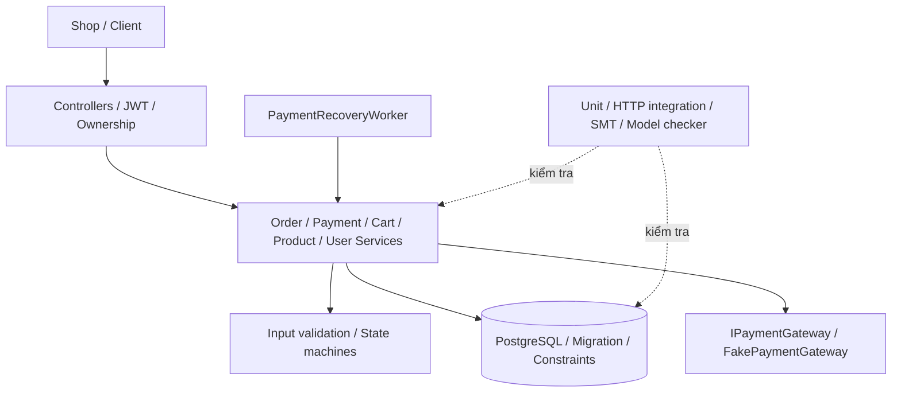

# Phụ lục kỹ thuật OrderPaymentMicroservice

Các bảng được sinh từ model và evidence của project. Không sao chép số liệu Smart EV.

## Phụ lục A — Hệ thống



### A.1. Ranh giới và dữ liệu

| Giao diện | Đầu vào | Đầu ra | Guard |
| --- | --- | --- | --- |
| Register/Login | Email/password/name | User/JWT hoặc 400/401 | DTO + service validation; hash password |
| Product create/update | Name/price/stock | Product hoặc 400 | Admin, validation, CHECK price/stock |
| Cart add/update | ProductId/quantity | Cart hoặc 400/409 | Ownership, quantity, stock, transaction |
| Order create | Items/total/address | Order hoặc 400/409 | Claim customer, giá server, tổng quantity |
| Payment create | OrderId/amount/key | Payment hoặc 400/403/409 | Ownership, exact amount, idempotency |
| Confirm/Complete/Refund | ID/key | Lifecycle mới hoặc conflict | Admin, state guard, payment evidence |
| Reconcile | Payment ID | Kết quả gateway/UNKNOWN | Ownership hoặc recovery worker |

Chi tiết endpoint: các Controller trong source. User/Order/Payment/Cart là dữ liệu
cần kiểm tra ownership; gateway là trust boundary riêng. State của gateway không
thay thế trực tiếp state Order.

### A.2. Requirement đặc tả

| ID | Nội dung | Danh mục | Ưu tiên |
| --- | --- | --- | --- |
| REQ-1 | Mọi API Cart, Order và Payment phải yêu cầu JWT hợp lệ; chỉ Admin được liệt kê toàn bộ đơn hàng. | safety | HIGH |
| REQ-2 | Người dùng chỉ được đọc hoặc thay đổi User, Cart, Order và Payment thuộc chính mình; quyền Admin là ngoại lệ được kiểm soát. | safety | HIGH |
| REQ-3 | Tạo Order lấy UnitPrice/TotalAmount từ catalog server; kiểm sản phẩm tồn tại/active và cộng dồn quantity theo ProductId trước kiểm stock. Payload giá/tổng không hợp lệ bị từ chối; client UnitPrice không là nguồn giá có thẩm quyền. | functional | HIGH |
| REQ-4 | Price/TotalAmount/Payment.Amount phải là bội 0,01 trong giới hạn; fractional cent bị từ chối, không round âm thầm. InputValidator/OrderService chấp nhận lệch tổng tối đa 0,01; Order lưu tổng giá server, Payment phải bằng chính xác tổng đã lưu. | safety | HIGH |
| REQ-5 | Order đi CREATED → VALIDATED → PAYMENT_PENDING → PAID → CONFIRMED → COMPLETED; cho phép cancel trước charge, FAILED khi decline, PAID/CONFIRMED → REFUND_PENDING → REFUNDED. Guard cấm hồi sinh terminal; model có các state trừu tượng bổ sung, không đồng nhất với enum runtime. | safety | HIGH |
| REQ-6 | Order chỉ được chuyển từ PAYMENT_PENDING sang PAID khi có Payment SUCCESS với Amount đúng bằng Order.TotalAmount. | safety | HIGH |
| REQ-7 | Mỗi yêu cầu thanh toán phải có IdempotencyKey; gửi lại cùng khóa và cùng Amount phải trả về giao dịch cũ, còn tái dùng khóa với Amount khác phải bị từ chối. | functional | HIGH |
| REQ-8 | Mật khẩu mới phải được băm bằng PasswordHasher có salt/work factor; tài khoản SHA-256 cũ chỉ được xác minh để nâng cấp một lần. | safety | HIGH |
| REQ-9 | register_user() không được sao chép email dài từ 32 byte trở lên vào buffer stack 32 byte. | memory | HIGH |
| REQ-10 | Product name không được vượt biên buffer heap 32 byte; nhánh từ chối vẫn phải giải phóng vùng nhớ đã cấp phát. | memory | HIGH |
| REQ-11 | Cart audit log không được đọc CartItem sau khi phần tử đã được free. | memory | HIGH |
| REQ-12 | Khi hủy Order trong mô hình C, mảng OrderItem thuộc sở hữu của Order phải được free trước struct cha. | memory | MEDIUM |
| REQ-13 | Payment cleanup không được free TransactionCode hai lần; con trỏ sở hữu phải được đặt NULL sau lần free đầu. | memory | HIGH |
| REQ-14 | Liveness có điều kiện: checker progress-only đạt terminal khi lọc các cạnh đánh dấu stutter. Raw AG AF terminal trên graph đầy đủ là false; không suy ra runtime luôn kết thúc khi provider còn UNKNOWN. | liveness | HIGH |
| REQ-15 | Mỗi trạng thái Order-Payment phải đặc tả sự cố, cách phát hiện, biện pháp xử lý và trạng thái tiếp theo; không được có sự cố không có đường phục hồi hoặc kết thúc. | safety | HIGH |
| REQ-16 | PaymentService giới hạn charge tối đa 2 attempts cho cùng logical payment/key. Hết budget mà UNKNOWN vẫn giữ reservation và chỉ lookup/reconcile; không suy thành FAILED. Bounded confirmation retry chỉ có trong model, chưa hiện thực scheduler/counter tự động. | safety | HIGH |
| REQ-17 | Charge đã xảy ra nhưng finalize PAID lỗi phải được lookup bằng cùng key và hoàn tất SUCCESS/PAID, không charge mù hoặc đổi FAILED. Khi yêu cầu refund cho Order PAID/CONFIRMED, dùng REFUND_PENDING → REFUNDED, giữ dấu vết charge và release kho một lần. | safety | HIGH |
| REQ-18 | Payment và cancellation trên cùng Order phải được serialize; không được đồng thời sở hữu critical resource hoặc tạo hai Payment SUCCESS. | safety | HIGH |
| REQ-19 | PROCESSING/UNKNOWN phải được worker reconciliation hỏi trạng thái charge cũ; REFUND_PENDING hỏi trạng thái refund cũ. Lookup không tăng AttemptCount, không tự phát charge/refund; UNKNOWN giữ reservation và chặn cancel. | safety | HIGH |
| REQ-20 | Với DurableFake journal đã publish trước local finalize, API kill/restart hoặc PostgreSQL stop/start phải phục hồi đúng charge/refund. Reconnect giữ nguyên API process/pool; giữ key, transaction reference và journal, không duplicate operation hoặc release kho. | safety | HIGH |
| REQ-21 | POST /api/orders hỗ trợ Idempotency-Key tùy chọn, namespace theo customer từ JWT. Cùng key/payload trả 201 và receipt gốc kể cả sau cancel/catalog đổi; payload khác trả 409. Unique key hash, reserve, order và receipt commit cùng transaction; client không key vẫn có thể tạo Order mới. | functional | HIGH |
| REQ-22 | Mutation Orders/Payments phải có COMMIT audit cùng transaction bằng DB trigger; audit lỗi phải rollback nghiệp vụ. BEGIN/RESULT HTTP dùng correlation server và allowlist không có secrets; BEGIN lỗi trả 503 trước action, RESULT lỗi sau action trả 503 với requiresReconciliation=true. | safety | HIGH |
| REQ-23 | Admission mặc định body ≤65536 byte, tối đa 100 order items, auth 10 request/60s theo connection IP, API 120 request/60s theo subject hoặc IP. Quá quota trả 429/Retry-After; body quá lớn trả 413 cả khi thiếu Content-Length, trước JSON binding. | safety | HIGH |
| REQ-24 | Checkout giữ attempt/key/payload theo tài khoản trong sessionStorage; chặn double submit và thay payload khi outcome chưa rõ. Create-order retry tối đa 4 HTTP attempts/8s, chỉ cho 409 ORDER_CONCURRENT_WRITE với retryable=true; 503/network giữ key để đối soát. | functional | HIGH |
| REQ-25 | Health live/ready trả thông tin tối thiểu; ready phản ánh DB outage. /api/operations/status chỉ Admin, no-store và không lộ secret; PendingSince giữ tuổi unresolved qua status lookup, có chỉ số recovery/audit failure và cảnh báo pending quá lâu. | functional | HIGH |
| REQ-26 | Backup/restore trên môi trường tạm phải giữ database, receipt, audit triggers, identity sequence và gateway ledger nhất quán; worker phục hồi pending charge sau restore không charge lại. Không dùng phép đo drill làm cam kết RPO/RTO. | functional | HIGH |
| REQ-27 | Shop chạy được register/login → cart → order → payment giả lập → history qua HTTP/PostgreSQL thật; reload/logout đúng, không thu/gửi card fields. Browser smoke và browser mocked-fetch có phạm vi bằng chứng riêng. | functional | MEDIUM |

SEC-STOCK-01, SEC-CART-01/02 và SEC-INPUT-01 trong traceability là yêu cầu bổ sung của đợt sửa lỗi, không thay số ID REQ gốc.

### A.3. Ma trận endpoint/quyền

| Method/route | Anonymous | Customer | Admin | Điều kiện |
| --- | --- | --- | --- | --- |
| POST users/register, users/login | Cho phép | Cho phép | Cho phép | DTO/service validation |
| GET products, category, id | Cho phép | Cho phép | Cho phép | Active product |
| POST/PUT/DELETE products | 401 | 403 | Cho phép | Validation và state data |
| GET/PUT users/id | 401 | Owner | Cho phép | Claim→route user |
| GET cart/user/id; POST add | 401 | Owner | Cho phép | Quantity/product guard |
| PUT/DELETE cart/id/item/id; DELETE clear | 401 | Owner | Cho phép | Cart.UserId; CartItem.CartId |
| POST orders | 401 | Cho phép | Cho phép | CustomerId từ subject; server price/stock |
| GET orders | 401 | 403 | Cho phép | Global listing |
| GET orders/mine; GET id; POST cancel | 401 | Owner | Theo policy endpoint | mine luôn dùng subject; cancel có payment guard |
| POST orders/id/confirm, complete | 401 | 403 | Cho phép | Paid evidence và state nguồn |
| POST payments; GET id; POST retry, reconcile | 401 | Owner | Cho phép | Order owner; amount/key/state guard |
| POST payments/id/refund, refund/retry | 401 | 403 | Cho phép | Refund key và trạng thái hợp lệ |

“Cho phép” là qua lớp quyền, không cam kết nghiệp vụ trả 2xx. Test hiện kiểm một
phần các đường trong bảng; không dùng bảng chính sách source thay danh sách test.

### A.4. Asset, boundary và qualified property references

| Threat | Asset | Boundary | Model-qualified properties | Control status |
| --- | --- | --- | --- | --- |
| T1 | A1, A2, A3 | TB1 | Ngoài model lifecycle | VERIFIED_IN_TEST_SCOPE |
| T2 | A2, A3, A4 | TB1 | base:P3, base:P4, recovery:P2, recovery:P6, recovery:P11 | MITIGATED |
| T3 | A3, A6 | TB1 | Ngoài model lifecycle | PARTIALLY_MITIGATED |
| T4 | A1, A2, A3 | TB1 | Ngoài model lifecycle | VERIFIED_IN_TEST_SCOPE |
| T5 | A3, A4 | TB1 | recovery:P10, recovery:P14 | PARTIALLY_MITIGATED |
| T6 | A2, A3, A5 | TB1 | Ngoài model lifecycle | VERIFIED_IN_TEST_SCOPE |
| T7 | A2, A3, A4 | TB2 | base:P1, recovery:P1, recovery:P4, recovery:P7, recovery:P11, recovery:P12, recovery:P13, recovery:P14, recovery:P15 | VERIFIED_IN_TEST_SCOPE |
| T8 | A3 | TB3 | base:P3, recovery:P2, recovery:P13, recovery:P14 | OPEN_FOR_REAL_GATEWAY |
| T9 | A5 | TB4 | Ngoài model lifecycle | PARTIALLY_MITIGATED |

### A.5. Chính sách data ownership

UserId/CustomerId trong request không tự cấp quyền. PriceAtAdd là snapshot của Cart;
Order dùng Product.Price hiện tại. Payment.Amount bind với Order.TotalAmount.
InventoryStatus biểu diễn reservation cùng stock đã giảm; không có bảng reservation
riêng. Hash/authenticity của gateway response chưa được mock chứng minh.


## Phụ lục B — Model và thuộc tính

### B.1. Giả định

- The database transaction serializes payment and cancellation updates for one order.
- A retry transition marked stutter may repeat, but weak fairness requires an enabled progress transition to eventually run.
- Gateway callbacks are authenticated and contain an idempotency key.
- Inventory is reserved after validation and released on cancellation, terminal failure or refund.

### B.2. Toàn bộ trạng thái recovery

| Aggregate state | Order | Payment | Labels | Ý nghĩa |
| --- | --- | --- | --- | --- |
| CREATED | CREATED | NONE | created, inventory_unreserved | Receive an order request before trusting client data. |
| VALIDATED | VALIDATED | NONE | validated, inventory_reserved, amount_verified | Represent an order whose server price, total and inventory have been checked. |
| PAYMENT_PENDING | PAYMENT_PENDING | NONE | payment_pending, inventory_reserved, amount_verified | Wait for a payment request while cancellation is still legal. |
| PAYMENT_PROCESSING | PAYMENT_PENDING | PROCESSING | payment_processing, inventory_reserved, amount_verified, payment_lock | Own the exclusive payment operation and wait for a gateway result. |
| PAYMENT_RETRY | PAYMENT_PENDING | UNKNOWN | payment_retry, inventory_reserved, amount_verified | Resolve an unknown gateway outcome without creating a second logical charge. |
| PAYMENT_PROCESSING_FINAL | PAYMENT_PENDING | PROCESSING | payment_processing, final_retry, inventory_reserved, amount_verified, payment_lock | Execute the final bounded payment reconciliation/attempt. |
| PAID | PAID | SUCCESS | paid, payment_success, amount_verified, inventory_reserved | Represent exactly one successful payment whose amount matches the order. |
| CONFIRMATION_RETRY | PAID | SUCCESS | paid, payment_success, confirmation_retry, amount_verified | Retry fulfillment confirmation without issuing another charge. |
| CONFIRMED | CONFIRMED | SUCCESS | confirmed, paid, payment_success, amount_verified | Order is paid and accepted for fulfillment. |
| REFUND_PENDING | REFUND_PENDING | REFUND_PENDING | paid, payment_success, refund_pending, amount_verified | Compensate a successful charge that cannot lead to completion. |
| COMPLETED | COMPLETED | SUCCESS | completed, paid, payment_success, amount_verified, terminal | Successful terminal state. |
| CANCELLED | CANCELLED | NONE | cancelled, inventory_released, terminal | Terminal state for a cancellation that won before a confirmed charge. |
| PRE_PAYMENT_REJECTED | FAILED | NONE | failed, pre_payment_failure, inventory_unreserved, terminal | Terminal observation for a request/order transaction rejected before any payment existed; the order row may not have been persisted. |
| FAILED | FAILED | FAILED | failed, inventory_released, terminal | Terminal state when no successful charge exists and automatic recovery is exhausted. |
| REFUNDED | REFUNDED | REFUNDED | refunded, payment_compensated, inventory_released, terminal | Terminal compensated state after a previously successful charge. |

### B.3. Toàn bộ chuyển tiếp có event

| Nguồn | Event | Đích | Kind | Action |
| --- | --- | --- | --- | --- |
| CREATED | validation_ok | VALIDATED | progress | Load server prices, validate quantities and reserve inventory. |
| CREATED | validation_rejected | PRE_PAYMENT_REJECTED | progress | Reject atomically; do not persist the order or reserve inventory |
| CREATED | validation_storage_error | PRE_PAYMENT_REJECTED | progress | Rollback and return a retryable error without creating an order |
| VALIDATED | order_persisted | PAYMENT_PENDING | progress | Persist order and items in the same transaction. |
| VALIDATED | amount_invariant_failed | PRE_PAYMENT_REJECTED | progress | Rollback the transaction and release the reservation |
| VALIDATED | order_commit_failed | PRE_PAYMENT_REJECTED | progress | Rollback all order and stock changes |
| PAYMENT_PENDING | payment_request_accepted | PAYMENT_PROCESSING | progress | Acquire the per-order transaction lock and record the idempotency key. |
| PAYMENT_PENDING | cancel_requested | CANCELLED | progress | Cancel the order and release reserved inventory |
| PAYMENT_PENDING | duplicate_pending_request | PAYMENT_PENDING | stutter | Return the existing in-progress result and create no second payment |
| PAYMENT_PENDING | payment_amount_rejected | PAYMENT_PENDING | stutter | Reject the payment; keep the order payable with the correct amount |
| PAYMENT_PROCESSING | gateway_success_and_commit | PAID | progress | Persist one SUCCESS payment and transition the order atomically. |
| PAYMENT_PROCESSING | gateway_transient_failure | PAYMENT_RETRY | progress | Release the lock and enter a bounded retry state using the same idempotency key |
| PAYMENT_PROCESSING | gateway_declined | FAILED | progress | Mark the flow failed and release inventory |
| PAYMENT_PROCESSING | charged_but_commit_failed | PAYMENT_RETRY | progress | Reconcile the existing charge by idempotency key; never create another logical payment |
| PAYMENT_PROCESSING | concurrent_cancel_loses_lock | PAYMENT_PROCESSING | stutter | Serialize the operations; cancellation retries after the payment result |
| PAYMENT_RETRY | retry_budget_available | PAYMENT_PROCESSING_FINAL | progress | Use the final bounded attempt with the same idempotency key. |
| PAYMENT_RETRY | retry_exhausted_unknown | PAYMENT_RETRY | stutter | Stop automatic charging, keep inventory reserved and require reconciliation/manual review |
| PAYMENT_RETRY | cancel_during_retry | PAYMENT_RETRY | stutter | Reject cancellation and keep the reservation; reconcile the existing payment instead |
| PAYMENT_PROCESSING_FINAL | final_gateway_success_and_commit | PAID | progress | Persist one SUCCESS payment and transition the order atomically. |
| PAYMENT_PROCESSING_FINAL | final_payment_declined | FAILED | progress | Mark failed and release inventory |
| PAYMENT_PROCESSING_FINAL | final_payment_unknown | PAYMENT_RETRY | stutter | Stop charging automatically and continue reconciliation/manual review without releasing inventory |
| PAYMENT_PROCESSING_FINAL | final_charged_but_commit_failed | PAYMENT_RETRY | stutter | Reconcile the existing charge; do not increase the charge attempt counter |
| PAID | confirmation_ok | CONFIRMED | progress | Confirm fulfillment and preserve the successful payment evidence. |
| PAID | duplicate_success | PAID | stutter | Return the original payment; do not insert or charge again |
| PAID | confirmation_transient_failure | CONFIRMATION_RETRY | progress | Keep PAID and retry confirmation without charging again |
| PAID | fulfillment_unrecoverable | REFUND_PENDING | progress | Start compensation; never silently change PAID to FAILED |
| CONFIRMATION_RETRY | confirmation_retry_ok | CONFIRMED | progress | Persist confirmation. |
| CONFIRMATION_RETRY | confirmation_retry_exhausted | REFUND_PENDING | progress | Escalate to compensating refund |
| CONFIRMED | delivery_completed | COMPLETED | progress | Close the successful order. |
| CONFIRMED | confirmed_fulfillment_failed | REFUND_PENDING | progress | Start a refund and release inventory when compensation completes |
| REFUND_PENDING | refund_success | REFUNDED | progress | Persist refund evidence and release inventory. |
| REFUND_PENDING | refund_retry | REFUND_PENDING | stutter | Retry or query with the same refund idempotency key and alert operations |
| COMPLETED | completed_late_event | COMPLETED | stutter | Return the stored result, reject state mutation and audit the event |
| CANCELLED | cancelled_late_payment | CANCELLED | stutter | Reject the charge/state mutation and raise an alert if the gateway reports money captured |
| PRE_PAYMENT_REJECTED | rejected_late_retry | PRE_PAYMENT_REJECTED | stutter | Reject mutation; require a corrected new request with a new operation identity |
| FAILED | failed_late_retry | FAILED | stutter | Reject mutation; require a new order rather than reviving this one |
| REFUNDED | duplicate_refund | REFUNDED | stutter | Return the original refund result and do not refund twice |

### B.4. Thuộc tính

| ID | Loại | Nội dung |
| --- | --- | --- |
| P1 | AG_NOT | No reachable state is explicitly unsafe. |
| P2 | AG_IMPLIES | Every paid state has successful payment evidence. |
| P3 | AG_IMPLIES | A completed order is paid. |
| P4 | AG_EXCLUDES | A cancelled order cannot contain a successful charge. |
| P5 | AG_EXCLUDES | FAILED is used only when no successful charge exists. |
| P6 | AG_EXCLUDES | Pending is not yet paid. |
| P7 | AG_NOT | Payment and cancellation never own the critical resource simultaneously. |
| P8 | ALL_REACHABLE | Every declared state is reachable from CREATED. |
| P9 | INCIDENT_COMPLETE | Every state documents detection, solution and next state for each incident. |
| P10 | AF_TERMINAL_FAIR | Ignoring explicitly marked stutter retries, every reachable state inevitably reaches a terminal state. |
| P11 | FUNCTION_CONTRACTS | Every state/event transition belongs to exactly one function and matches its declared outcome. |
| P12 | TERMINAL_CLOSED | A terminal state can only reject/no-op and remain in the same terminal state. |
| P13 | PAID_FAILURE_COMPENSATES | A failure after successful payment can only preserve paid evidence or enter the refund path, never FAILED/CANCELLED. |
| P14 | UNKNOWN_PAYMENT_SAFE | An unknown payment outcome remains non-terminal with inventory reserved until an authoritative outcome is known. |
| P15 | EVENT_DETERMINISTIC | Within one state, one event has exactly one declared next state. |

### B.5. Đối chiếu và counterexample

Model cơ sở có witness CREATED → CANCELLED → PAID_AFTER_CANCELLED. Sáu negative mutation của recovery và witness đầy đủ nằm trong ../results/order_payment_recovery_model.results.json.

37 event → 31 cặp state; hai tập cạnh sau phép chiếu bằng nhau. Property workbook có ngữ nghĩa riêng; EF(terminal) chỉ chứng minh tồn tại đường tới terminal.

### B.6. Chi tiết hợp đồng F1–F7

#### F1_CREATE_ORDER

Validate trusted server data and persist the order atomically before payment is allowed.

Precondition: The request is new and no payment exists.

| State | Event | Đích |
| --- | --- | --- |
| CREATED | validation_ok | VALIDATED |
| CREATED | validation_rejected | PRE_PAYMENT_REJECTED |
| CREATED | validation_storage_error | PRE_PAYMENT_REJECTED |
| VALIDATED | order_persisted | PAYMENT_PENDING |
| VALIDATED | amount_invariant_failed | PRE_PAYMENT_REJECTED |
| VALIDATED | order_commit_failed | PRE_PAYMENT_REJECTED |

- Client-supplied prices never become the authoritative amount.
- A persistence failure cannot leave an order payable with a partial inventory update.

#### F2_ACCEPT_PAYMENT_OR_CANCEL

Choose exactly one legal decision while the order is payable: start payment, cancel, or reject a duplicate/invalid request.

Precondition: Order is PAYMENT_PENDING, amount was verified and inventory is reserved.

| State | Event | Đích |
| --- | --- | --- |
| PAYMENT_PENDING | payment_request_accepted | PAYMENT_PROCESSING |
| PAYMENT_PENDING | cancel_requested | CANCELLED |
| PAYMENT_PENDING | duplicate_pending_request | PAYMENT_PENDING |
| PAYMENT_PENDING | payment_amount_rejected | PAYMENT_PENDING |

- Payment and cancellation decisions are serialized.
- A rejected or duplicate request cannot create another logical payment.

#### F3_EXECUTE_AND_RECONCILE_PAYMENT

Resolve the gateway outcome with bounded retry and one idempotency key without interpreting timeout as decline.

Precondition: The order is payable and no successful payment has been committed.

| State | Event | Đích |
| --- | --- | --- |
| PAYMENT_PROCESSING | gateway_success_and_commit | PAID |
| PAYMENT_PROCESSING | gateway_transient_failure | PAYMENT_RETRY |
| PAYMENT_PROCESSING | gateway_declined | FAILED |
| PAYMENT_PROCESSING | charged_but_commit_failed | PAYMENT_RETRY |
| PAYMENT_PROCESSING | concurrent_cancel_loses_lock | PAYMENT_PROCESSING |
| PAYMENT_RETRY | retry_budget_available | PAYMENT_PROCESSING_FINAL |
| PAYMENT_RETRY | retry_exhausted_unknown | PAYMENT_RETRY |
| PAYMENT_RETRY | cancel_during_retry | PAYMENT_RETRY |
| PAYMENT_PROCESSING_FINAL | final_gateway_success_and_commit | PAID |
| PAYMENT_PROCESSING_FINAL | final_payment_declined | FAILED |
| PAYMENT_PROCESSING_FINAL | final_payment_unknown | PAYMENT_RETRY |
| PAYMENT_PROCESSING_FINAL | final_charged_but_commit_failed | PAYMENT_RETRY |

- Only an authenticated definitive decline may end the payment flow as FAILED.
- An UNKNOWN outcome keeps inventory reserved and is reconciled with the same idempotency key.
- A successful charge is committed at most once.

#### F4_CONFIRM_OR_COMPENSATE

Confirm a paid order or start compensation when confirmation cannot succeed.

Precondition: Successful payment evidence exists.

| State | Event | Đích |
| --- | --- | --- |
| PAID | confirmation_ok | CONFIRMED |
| PAID | duplicate_success | PAID |
| PAID | confirmation_transient_failure | CONFIRMATION_RETRY |
| PAID | fulfillment_unrecoverable | REFUND_PENDING |
| CONFIRMATION_RETRY | confirmation_retry_ok | CONFIRMED |
| CONFIRMATION_RETRY | confirmation_retry_exhausted | REFUND_PENDING |

- Confirmation retry never charges the customer again.
- A paid order that cannot be confirmed enters compensation instead of FAILED.

#### F5_COMPLETE_OR_COMPENSATE

Complete delivery or compensate a paid order that can no longer be fulfilled.

Precondition: Order is CONFIRMED and successful payment evidence is retained.

| State | Event | Đích |
| --- | --- | --- |
| CONFIRMED | delivery_completed | COMPLETED |
| CONFIRMED | confirmed_fulfillment_failed | REFUND_PENDING |

- Completion preserves successful payment evidence.
- Post-payment fulfillment failure always starts refund compensation.

#### F6_REFUND

Finish compensation idempotently and release inventory only with durable refund evidence.

Precondition: A successful charge exists and the order is REFUND_PENDING.

| State | Event | Đích |
| --- | --- | --- |
| REFUND_PENDING | refund_success | REFUNDED |
| REFUND_PENDING | refund_retry | REFUND_PENDING |

- Refund retry uses the same refund idempotency key.
- A timeout cannot be treated as proof that no refund occurred.

#### F7_PROTECT_TERMINAL_STATE

Reject late mutation and return the stored result without reviving a terminal aggregate.

Precondition: Order is already terminal.

| State | Event | Đích |
| --- | --- | --- |
| COMPLETED | completed_late_event | COMPLETED |
| CANCELLED | cancelled_late_payment | CANCELLED |
| PRE_PAYMENT_REJECTED | rejected_late_retry | PRE_PAYMENT_REJECTED |
| FAILED | failed_late_retry | FAILED |
| REFUNDED | duplicate_refund | REFUNDED |

- No terminal state is revived by a late request or callback.
- Repeated terminal operations are idempotent and auditable.

### B.7. Counterexample recovery và property namespace

#### BUG-CANCELLED-PAID

Expected FAIL: P1, P4; actual FAIL: P1, P10, P11, P12, P4.

```json
{
  "P1": [
    {
      "state": "PAID_AFTER_CANCELLED",
      "witness": [
        "CREATED",
        "VALIDATED",
        "PAYMENT_PENDING",
        "CANCELLED",
        "PAID_AFTER_CANCELLED"
      ]
    }
  ],
  "P4": [
    {
      "state": "PAID_AFTER_CANCELLED",
      "witness": [
        "CREATED",
        "VALIDATED",
        "PAYMENT_PENDING",
        "CANCELLED",
        "PAID_AFTER_CANCELLED"
      ]
    }
  ]
}
```

#### BUG-WRONG-AMOUNT

Expected FAIL: P1; actual FAIL: P1, P10, P11.

```json
{
  "P1": [
    {
      "state": "PAID_WRONG_AMOUNT",
      "witness": [
        "CREATED",
        "VALIDATED",
        "PAYMENT_PENDING",
        "PAYMENT_PROCESSING",
        "PAID_WRONG_AMOUNT"
      ]
    }
  ]
}
```

#### BUG-DUPLICATE-SUCCESS

Expected FAIL: P1; actual FAIL: P1, P10, P11.

```json
{
  "P1": [
    {
      "state": "PAID_TWICE",
      "witness": [
        "CREATED",
        "VALIDATED",
        "PAYMENT_PENDING",
        "PAYMENT_PROCESSING",
        "PAID",
        "PAID_TWICE"
      ]
    }
  ]
}
```

#### BUG-RESOURCE-CONFLICT

Expected FAIL: P1, P7; actual FAIL: P1, P10, P11, P7.

```json
{
  "P1": [
    {
      "state": "PAY_CANCEL_CONFLICT",
      "witness": [
        "CREATED",
        "VALIDATED",
        "PAYMENT_PENDING",
        "PAY_CANCEL_CONFLICT"
      ]
    }
  ],
  "P7": [
    {
      "state": "PAY_CANCEL_CONFLICT",
      "witness": [
        "CREATED",
        "VALIDATED",
        "PAYMENT_PENDING",
        "PAY_CANCEL_CONFLICT"
      ]
    }
  ]
}
```

#### BUG-PAID-FAILED-WITHOUT-REFUND

Expected FAIL: P13; actual FAIL: P11, P13.

```json
{
  "P13": [
    {
      "state": "PAID",
      "event": "silent_post_payment_failure",
      "target": "FAILED",
      "reason": "successful payment evidence was lost without compensation"
    }
  ]
}
```

#### BUG-UNKNOWN-RELEASED

Expected FAIL: P14; actual FAIL: P11, P14.

```json
{
  "P14": [
    {
      "state": "UNKNOWN_RELEASED",
      "witness": [
        "CREATED",
        "VALIDATED",
        "PAYMENT_PENDING",
        "PAYMENT_PROCESSING",
        "PAYMENT_RETRY",
        "UNKNOWN_RELEASED"
      ],
      "reason": "UNKNOWN outcome is terminal, released, or incorrectly marked successful"
    }
  ]
}
```

### B.8. Audit liveness

| Raw AG AF | Progress-only AG AF | Audit PASS |
| --- | --- | --- |
| False | True | True |

Lasso là prefix hữu hạn nối cycle lặp vô hạn; cycle không chứa terminal.

```json
{
  "prefix": [
    "CREATED",
    "VALIDATED",
    "PAYMENT_PENDING",
    "PAYMENT_PROCESSING",
    "PAYMENT_RETRY"
  ],
  "loop": [
    "PAYMENT_RETRY",
    "PAYMENT_RETRY"
  ],
  "event": "retry_exhausted_unknown",
  "interpretation": "Repeat the loop forever; terminal is never reached."
}
```

Các cạnh được checker loại dù thay đổi state:

| Nguồn | Event | Đích | Kind |
| --- | --- | --- | --- |
| PAYMENT_PROCESSING_FINAL | final_payment_unknown | PAYMENT_RETRY | stutter |
| PAYMENT_PROCESSING_FINAL | final_charged_but_commit_failed | PAYMENT_RETRY | stutter |

Fixed-point rounds của cả graph nằm trong [liveness audit](../results/liveness_audit.results.json). Policy lọc cạnh không tự chứng minh fair-CTL.


## Phụ lục C — Static và bộ nhớ

### C.1. CWE và phạm vi

| Module | Lỗi BUGGY | CWE |
| --- | --- | --- |
| Order | Owned allocation leak | CWE-401 |
| Payment | Double free | CWE-415 |
| Cart | Use after free | CWE-416 |
| Product | Heap buffer copy | CWE-120 |
| User | Stack buffer copy | CWE-120 |

GCC/cppcheck version, finding và layout: ../c-memory/evidence/static-analysis.json. Pattern rules là scanner riêng; cppcheck có false negative được ghi rõ trong ../c-memory/README.md. Không tuyên bố Clang-Tidy/Clang Analyzer đã chạy.

### C.2. Toàn bộ case sanitizer (lần chạy ngoài sandbox mới nhất)

| Case | Test PASS | Exit code | Diagnostic mong đợi |
| --- | --- | --- | --- |
| order_buggy | True | 1 | LeakSanitizer: detected memory leaks |
| order_fixed | True | 0 | clean sanitizer run |
| payment_buggy | True | 1 | AddressSanitizer: attempting double-free |
| payment_fixed | True | 0 | clean sanitizer run |
| cart_buggy | True | 1 | AddressSanitizer: heap-use-after-free |
| cart_fixed | True | 0 | clean sanitizer run |
| product_buggy | True | 1 | AddressSanitizer: heap-buffer-overflow |
| product_fixed | True | 0 | clean sanitizer run |
| user_buggy | True | 1 | AddressSanitizer: stack-buffer-overflow |
| user_fixed | True | 0 | clean sanitizer run |
| product_fixed_length_0 | True | 0 | clean sanitizer run |
| product_fixed_length_1 | True | 0 | clean sanitizer run |
| product_fixed_length_31 | True | 0 | clean sanitizer run |
| product_fixed_length_32 | True | 0 | clean sanitizer run |
| product_fixed_length_128 | True | 0 | clean sanitizer run |
| product_buggy_valid | True | 0 | clean sanitizer run |
| user_fixed_length_0 | True | 0 | clean sanitizer run |
| user_fixed_length_1 | True | 0 | clean sanitizer run |
| user_fixed_length_31 | True | 0 | clean sanitizer run |
| user_fixed_length_32 | True | 0 | clean sanitizer run |
| user_fixed_length_128 | True | 0 | clean sanitizer run |
| user_buggy_valid | True | 0 | clean sanitizer run |

### C.3. Compiler, configuration và ground truth

| Module | Scanner BUGGY | Scanner FIXED | Cppcheck trực tiếp memory finding BUGGY |
| --- | --- | --- | --- |
| order | owned-allocation-leak | Không có | Không báo loại lỗi kỳ vọng |
| payment | double-free | Không có | Không báo loại lỗi kỳ vọng |
| cart | use-after-free | Không có | Không báo loại lỗi kỳ vọng |
| product | unbounded-string-copy | Không có | Không báo loại lỗi kỳ vọng |
| user | unbounded-string-copy | Không có | bufferAccessOutOfBounds |

Cppcheck return_code=0 không đồng nghĩa không finding; XML vẫn có error/style. BUGGY và FIXED được chạy theo cấu hình preprocessor riêng.

### C.4. Source minh họa ownership/lifetime

#### order.c

```c
/* OrderService: cancel an order and release its owned OrderItems.
 * CWE-401: freeing the parent does not free its child allocation in C. */
#include "demo.h"
typedef struct { int product_id, quantity; long unit_price; } OrderItem;
typedef struct { int id; size_t count; OrderItem *items; } Order;
static void cancel_order(void) {
    Order *order = allocate(sizeof(*order));
    order->id = 1;
    order->count = 3;
    order->items = allocate(order->count * sizeof(*order->items));
    for (size_t i = 0; i < order->count; ++i)
        order->items[i] = (OrderItem){(int)i + 1, 2, 45000};
    printf("Cancel order %d: %zu items\n", order->id, order->count);
#ifdef FIXED
    free(order->items);
#endif
    free(order);
}
int main(void) {
    for (int i = 0; i < 5; ++i) cancel_order();
    return 0;
}
```

#### payment.c

```c
/* PaymentService: gateway failure followed by common cleanup.
 * CWE-415: two cleanup paths both believe they own TransactionCode. */
#include "demo.h"
typedef struct { int order_id; char *transaction_code; } Payment;
int main(void) {
    Payment payment = {1, allocate(32)};
    snprintf(payment.transaction_code, 32, "%s", "TX-DEMO-001");
    puts("Gateway failure: release transaction code");
    free(payment.transaction_code);
#ifdef FIXED
    payment.transaction_code = NULL;
#endif
    free(payment.transaction_code); /* BUG: common cleanup frees it again. */
    return 0;
}
```

#### cart.c

```c
/* CartService.RemoveItemFromCartAsync modeled as a C linked list.
 * CWE-416: audit logging reads the deleted item after free. */
#include "demo.h"
typedef struct CartItem { int product_id, quantity; struct CartItem *next; } CartItem;
int main(void) {
    CartItem *head = allocate(sizeof(*head));
    *head = (CartItem){101, 2, NULL};
    CartItem *removed = head;
    head = removed->next;
#ifdef FIXED
    int product_id = removed->product_id;
    free(removed);
    removed = NULL;
    printf("Removed product %d\n", product_id);
#else
    free(removed);
    printf("Removed product %d\n", removed->product_id); /* BUG */
#endif
    return head != NULL;
}
```

#### product.c

```c
/* ProductService: import a product name into a fixed heap buffer.
 * CWE-122: unchecked copy crosses the allocation boundary. */
#include "demo.h"
#define NAME_CAPACITY 32
typedef struct { int id; char *name; } Product;
int main(int argc, char **argv) {
    const char *input = argc > 1 ? argv[1] :
        "Product-name-that-is-much-longer-than-the-allocated-buffer";
    Product product = {101, allocate(NAME_CAPACITY)};
#ifdef FIXED
    if (strlen(input) >= NAME_CAPACITY) {
        puts("REJECTED: product name too long");
        free(product.name);
        return 0;
    }
#endif
    strcpy(product.name, input);
    printf("Product %d: %s\n", product.id, product.name);
    free(product.name);
    return 0;
}
```

#### user.c

```c
/* UserService: copy a registration email into a local buffer.
 * CWE-121: stack buffer overflow. This is not a full email validator. */
#include "demo.h"
#define EMAIL_CAPACITY 32
static void register_user(const char *input) {
    char email[EMAIL_CAPACITY];
#ifdef FIXED
    if (strlen(input) >= sizeof(email)) {
        puts("REJECTED: email too long");
        return;
    }
#endif
    strcpy(email, input);
    printf("Registered email: %s\n", email);
}
int main(int argc, char **argv) {
    register_user(argc > 1 ? argv[1] :
        "very-long-email-address-over-32-characters@example.test");
    return 0;
}
```

### C.5. Diagnostic thực thi

#### order_buggy

```text
==35394==ERROR: LeakSanitizer: detected memory leaks
Direct leak of 240 byte(s) in 5 object(s) allocated from:
    #0 0x772c9e2fd9c7 in malloc ../../../../src/libsanitizer/asan/asan_malloc_linux.cpp:69
    #1 0x40136d in allocate modules/demo.h:8
SUMMARY: AddressSanitizer: 240 byte(s) leaked in 5 allocation(s).
```

#### payment_buggy

```text
==35398==ERROR: AddressSanitizer: attempting double-free on 0x503000000040 in thread T0:
    #0 0x7eb4338fc4d8 in free ../../../../src/libsanitizer/asan/asan_malloc_linux.cpp:52
    #1 0x40142e in main modules/payment.c:13
    #0 0x7eb4338fc4d8 in free ../../../../src/libsanitizer/asan/asan_malloc_linux.cpp:52
    #1 0x401421 in main modules/payment.c:9
    #0 0x7eb4338fd9c7 in malloc ../../../../src/libsanitizer/asan/asan_malloc_linux.cpp:69
    #1 0x4012ed in allocate modules/demo.h:8
SUMMARY: AddressSanitizer: double-free ../../../../src/libsanitizer/asan/asan_malloc_linux.cpp:52 in free
```

#### cart_buggy

```text
==35401==ERROR: AddressSanitizer: heap-use-after-free on address 0x502000000010 at pc 0x00000040160c bp 0x7ffc058378e0 sp 0x7ffc058378d0
    #0 0x40160b in main modules/cart.c:17
    #1 0x7a9b6ae2a1c9 in __libc_start_call_main ../sysdeps/nptl/libc_start_call_main.h:58
    #0 0x7a9b6bafc4d8 in free ../../../../src/libsanitizer/asan/asan_malloc_linux.cpp:52
    #1 0x4015b9 in main modules/cart.c:16
    #0 0x7a9b6bafd9c7 in malloc ../../../../src/libsanitizer/asan/asan_malloc_linux.cpp:69
    #1 0x40134d in allocate modules/demo.h:8
SUMMARY: AddressSanitizer: heap-use-after-free modules/cart.c:17 in main
```

#### product_buggy

```text
==35404==ERROR: AddressSanitizer: heap-buffer-overflow on address 0x503000000060 at pc 0x7b2d576a7923 bp 0x7fff93062150 sp 0x7fff930618f8
    #0 0x7b2d576a7922 in strcpy ../../../../src/libsanitizer/asan/asan_interceptors.cpp:563
    #1 0x4014ee in main modules/product.c:17
    #0 0x7b2d576fd9c7 in malloc ../../../../src/libsanitizer/asan/asan_malloc_linux.cpp:69
    #1 0x40132d in allocate modules/demo.h:8
SUMMARY: AddressSanitizer: heap-buffer-overflow ../../../../src/libsanitizer/asan/asan_interceptors.cpp:563 in strcpy
```

#### user_buggy

```text
==35407==ERROR: AddressSanitizer: stack-buffer-overflow on address 0x77f434e00040 at pc 0x77f437ea7923 bp 0x7ffc482807b0 sp 0x7ffc4827ff58
    #0 0x77f437ea7922 in strcpy ../../../../src/libsanitizer/asan/asan_interceptors.cpp:563
    #1 0x401375 in register_user modules/user.c:13
    #0 0x4012c5 in register_user modules/user.c:5
SUMMARY: AddressSanitizer: stack-buffer-overflow ../../../../src/libsanitizer/asan/asan_interceptors.cpp:563 in strcpy
```

### C.6. ABI và provenance

| Struct | sizeof | _Alignof | Môi trường |
| --- | --- | --- | --- |
| CartItem | 16 | 8 | Linux-7.0.0-34-generic-x86_64-with-glibc2.39 |
| OrderItem | 16 | 8 | Linux-7.0.0-34-generic-x86_64-with-glibc2.39 |
| Order | 24 | 8 | Linux-7.0.0-34-generic-x86_64-with-glibc2.39 |
| Payment | 16 | 8 | Linux-7.0.0-34-generic-x86_64-with-glibc2.39 |
| Product | 16 | 8 | Linux-7.0.0-34-generic-x86_64-with-glibc2.39 |

Offsets đo được: {"Order.items": 16, "Payment.transaction_code": 8, "Product.name": 8}.

Metadata source/binary/environment: [chapter4 run](../results/chapter4_run.results.json). Không có timestamp start/finish chính xác; make dùng binary hiện có nếu còn mới hơn source.

### C.7. Tái lập chỉ bằng project

```bash
make -C security-analysis/c-memory static-check
make -C security-analysis/c-memory test
```

Không chạy make clean nếu muốn giữ raw log để đọc. Khi sandbox làm LSan thất bại, giữ failure riêng và chạy trong môi trường được phép; không tắt detect_leaks để đạt PASS.


## Phụ lục D — SMT và biên

### D.1. Payment SMT

| Query | Expected | Actual | PASS |
| --- | --- | --- | --- |
| TEST1_VALID_PAID | sat | sat | True |
| TEST2_TOTAL_MISMATCH | unsat | unsat | True |
| TEST3_PAID_UNDERPAYMENT | unsat | unsat | True |
| TEST4_NEGATIVE_PAYMENT | unsat | unsat | True |
| TEST5_PAYMENT_EXCEEDS_TOTAL | unsat | unsat | True |
| TEST6_INT32_SUBTOTAL_OVERFLOW_EXISTS | sat | sat | True |
| TEST7_TOTAL_BOUND_BLOCKS_OVERSIZED_SUBTOTAL | unsat | unsat | True |

Đặc tả: ../../OrderPaymentMicroservice/Security/PaymentVerification.z3. Model integer cents; witness/model solver nằm trong ../results/payment_verification.results.json.

### D.2. Inventory SMT

| Query | Expected | Actual | PASS |
| --- | --- | --- | --- |
| DUPLICATE_LINES_BASELINE_OVERSOLD | sat | sat | True |
| AGGREGATED_STOCK_CANNOT_BE_NEGATIVE | unsat | unsat | True |
| AGGREGATED_EXACT_STOCK_ACCEPTED | sat | sat | True |

Stock=10/q1=q2=6 minh họa baseline sai. Guard tổng quantity loại stock âm. Biên 5+5 vẫn được chấp nhận, và regression kiểm cancel trả lại đúng 10.

### D.3. BMC

Chưa có thí nghiệm BMC riêng với bound k trong đợt này. Không thay bằng kết quả TLC hay gọi duyệt graph hữu hạn là BMC.

## Phụ lục E — Fuzzing và test

| Cấu hình campaign mới nhất | Giá trị |
| --- | --- |
| Seed | 20261009 |
| Iterations mỗi campaign random | 25000 |
| Timeout giây | 120 |
| Targets | InputValidator, PaymentValidator, OrderStateMachine, PaymentStateMachine, MoneyAmounts |
| Crash policy | ArgumentException is a controlled rejection; timeout, any other exception, invariant mismatch or test failure is a crash. |
| Branch coverage target | 97.5 |

Corpus: ../../OrderPaymentMicroservice.Tests/FuzzCorpus/order_requests.json. Oracle thực thi: ../../OrderPaymentMicroservice.Tests/SecurityFuzzingTests.cs. Coverage XML: ../results/application-fuzzing-coverage.cobertura.xml. Campaign có random xác định, không chứng minh mọi input hoặc coverage-guided native fuzzing.

## Phụ lục F — Evidence và truy vết

### F.1. Kết quả từng test (lần chạy mới nhất)

### F.1a. Process-kill charge recovery

| Chỉ số | Kết quả |
| --- | --- |
| PASS | True |
| Kill window | Gateway journal published; API payment still PROCESSING before finalize |
| Recovered by | PaymentRecoveryWorker in restarted OS process |
| Charge records | 1 |
| AttemptCount | 1 |
| Inventory released | False |
| Journal unchanged | True |

[Evidence restart](../results/process_restart.results.json); [Hợp đồng hiện thực](../IMPLEMENTATION_CONTRACTS.md).

#### unit: 149/149

| Case | Outcome | Duration |
| --- | --- | --- |
| OrderPaymentMicroservice.Tests.AdmissionBoundaryTests.ItemCountLimitRejectsBeforeProcessingItems(count: 3, accepted: True) | Passed | 00:00:00.0043222 |
| OrderPaymentMicroservice.Tests.AdmissionBoundaryTests.ItemCountLimitRejectsBeforeProcessingItems(count: 4, accepted: False) | Passed | 00:00:00.0023882 |
| OrderPaymentMicroservice.Tests.AuditMiddlewareTests.AuditCapturesOnlyAllowlistedFieldsAndServerCorrelation | Passed | 00:00:00.0705368 |
| OrderPaymentMicroservice.Tests.AuditMiddlewareTests.AuditFailureRejectsResponseAndMarksPossibleCommittedOperation(failAt: 1, executed: False) | Passed | 00:00:00.0006058 |
| OrderPaymentMicroservice.Tests.AuditMiddlewareTests.AuditFailureRejectsResponseAndMarksPossibleCommittedOperation(failAt: 2, executed: True) | Passed | 00:00:00.0842842 |
| OrderPaymentMicroservice.Tests.BodyLimitTests.ExactLimitBodyIsRewoundForJsonReader | Passed | 00:00:00.0157707 |
| OrderPaymentMicroservice.Tests.BodyLimitTests.OverLimitBodiesAreRejectedWithOrWithoutContentLength(knownLength: False) | Passed | 00:00:00.0280940 |
| OrderPaymentMicroservice.Tests.BodyLimitTests.OverLimitBodiesAreRejectedWithOrWithoutContentLength(knownLength: True) | Passed | 00:00:00.0144189 |
| OrderPaymentMicroservice.Tests.BodyLimitTests.ServerBodyLimitExceptionRemains413 | Passed | 00:00:00.0091508 |
| OrderPaymentMicroservice.Tests.DurableGatewayTests.ConcurrentGatewayInstancesPublishOneCharge | Passed | 00:00:02.9312069 |
| OrderPaymentMicroservice.Tests.DurableGatewayTests.MissingOutcomeAndCancelledCallDoNotPublishCharge | Passed | 00:00:00.0731382 |
| OrderPaymentMicroservice.Tests.DurableGatewayTests.RestartRetainsChargeAndRefundAndBindsPayload | Passed | 00:00:00.1891460 |
| OrderPaymentMicroservice.Tests.GatewayTimeoutTests.AllGatewayOperationsBoundWaitingForNonCooperativeAdapter(operation: 0) | Passed | 00:00:00.0972501 |
| OrderPaymentMicroservice.Tests.GatewayTimeoutTests.AllGatewayOperationsBoundWaitingForNonCooperativeAdapter(operation: 1) | Passed | 00:00:00.0932859 |
| OrderPaymentMicroservice.Tests.GatewayTimeoutTests.AllGatewayOperationsBoundWaitingForNonCooperativeAdapter(operation: 2) | Passed | 00:00:00.1051558 |
| OrderPaymentMicroservice.Tests.GatewayTimeoutTests.AllGatewayOperationsBoundWaitingForNonCooperativeAdapter(operation: 3) | Passed | 00:00:00.1009468 |
| OrderPaymentMicroservice.Tests.GatewayTimeoutTests.CallerCancellationIsNotMisreportedAsTimeout | Passed | 00:00:00.0015272 |
| OrderPaymentMicroservice.Tests.GatewayTimeoutTests.ChargeTimeoutPreservesReservationAndLateResultRequiresReconciliation | Passed | 00:00:00.1343461 |
| OrderPaymentMicroservice.Tests.GatewayTimeoutTests.RefundTimeoutKeepsCompensationPendingUntilStatusIsKnown | Passed | 00:00:00.1574153 |
| OrderPaymentMicroservice.Tests.GatewayTimeoutTests.WorkerContinuesAfterHungStatusLookupAndStopsPromptly | Passed | 00:00:00.2888685 |
| OrderPaymentMicroservice.Tests.GatewayTimeoutTests.WorkerShutdownCancelsActiveLookupWithoutInventingOutcome | Passed | 00:00:00.1590592 |
| OrderPaymentMicroservice.Tests.InputValidatorTests.InvalidCustomer(id: -1) | Passed | 00:00:00.0002895 |
| OrderPaymentMicroservice.Tests.InputValidatorTests.InvalidCustomer(id: -2147483648) | Passed | 00:00:00.0003900 |
| OrderPaymentMicroservice.Tests.InputValidatorTests.InvalidCustomer(id: 0) | Passed | 00:00:00.0000095 |
| OrderPaymentMicroservice.Tests.InputValidatorTests.InvalidPrice(price: "-0.01") | Passed | 00:00:00.0001156 |
| OrderPaymentMicroservice.Tests.InputValidatorTests.InvalidPrice(price: "1000000") | Passed | 00:00:00.0000106 |
| OrderPaymentMicroservice.Tests.InputValidatorTests.InvalidPrice(price: "79228162514264337593543950335") | Passed | 00:00:00.0001869 |
| OrderPaymentMicroservice.Tests.InputValidatorTests.InvalidProduct(id: -1) | Passed | 00:00:00.0001544 |
| OrderPaymentMicroservice.Tests.InputValidatorTests.InvalidProduct(id: 0) | Passed | 00:00:00.0003222 |
| OrderPaymentMicroservice.Tests.InputValidatorTests.InvalidQuantity(quantity: -1) | Passed | 00:00:00.0000046 |
| OrderPaymentMicroservice.Tests.InputValidatorTests.InvalidQuantity(quantity: 0) | Passed | 00:00:00.0000095 |
| OrderPaymentMicroservice.Tests.InputValidatorTests.InvalidQuantity(quantity: 10001) | Passed | 00:00:00.0001189 |
| OrderPaymentMicroservice.Tests.InputValidatorTests.InvalidQuantity(quantity: 2147483647) | Passed | 00:00:00.0001388 |
| OrderPaymentMicroservice.Tests.InputValidatorTests.InvalidTotal(amount: "-1") | Passed | 00:00:00.0001635 |
| OrderPaymentMicroservice.Tests.InputValidatorTests.InvalidTotal(amount: "0") | Passed | 00:00:00.0147192 |
| OrderPaymentMicroservice.Tests.InputValidatorTests.InvalidTotal(amount: "0.009") | Passed | 00:00:00.0000636 |
| OrderPaymentMicroservice.Tests.InputValidatorTests.InvalidTotal(amount: "1000000") | Passed | 00:00:00.0000077 |
| OrderPaymentMicroservice.Tests.InputValidatorTests.InvalidTotal(amount: "79228162514264337593543950335") | Passed | 00:00:00.0153647 |
| OrderPaymentMicroservice.Tests.InputValidatorTests.ItemSubtotalAboveMaximumOrderTotalIsRejected | Passed | 00:00:00.0003616 |
| OrderPaymentMicroservice.Tests.InputValidatorTests.MismatchOrBelowMinimumPriceIsRejected(total: "0.01", price: "999999.99") | Passed | 00:00:00.0001943 |
| OrderPaymentMicroservice.Tests.InputValidatorTests.MismatchOrBelowMinimumPriceIsRejected(total: "10", price: "0") | Passed | 00:00:00.0000046 |
| OrderPaymentMicroservice.Tests.InputValidatorTests.MismatchOrBelowMinimumPriceIsRejected(total: "10", price: "0.001") | Passed | 00:00:00.0000151 |
| OrderPaymentMicroservice.Tests.InputValidatorTests.MismatchOrBelowMinimumPriceIsRejected(total: "10.011", price: "10") | Passed | 00:00:00.0000180 |
| OrderPaymentMicroservice.Tests.InputValidatorTests.MismatchOrBelowMinimumPriceIsRejected(total: "9.989", price: "10") | Passed | 00:00:00.0133007 |
| OrderPaymentMicroservice.Tests.InputValidatorTests.MissingItems(isNull: False) | Passed | 00:00:00.0001264 |
| OrderPaymentMicroservice.Tests.InputValidatorTests.MissingItems(isNull: True) | Passed | 00:00:00.0001975 |
| OrderPaymentMicroservice.Tests.InputValidatorTests.MultipleItems | Passed | 00:00:00.0002206 |
| OrderPaymentMicroservice.Tests.InputValidatorTests.NullItem | Passed | 00:00:00.0337658 |
| OrderPaymentMicroservice.Tests.InputValidatorTests.NullRequest | Passed | 00:00:00.0001432 |
| OrderPaymentMicroservice.Tests.InputValidatorTests.ValidBoundariesAndTolerance(total: "0.01", quantity: 1, price: "0.01") | Passed | 00:00:00.0000010 |
| OrderPaymentMicroservice.Tests.InputValidatorTests.ValidBoundariesAndTolerance(total: "10", quantity: 1, price: "10") | Passed | 00:00:00.0015698 |
| OrderPaymentMicroservice.Tests.InputValidatorTests.ValidBoundariesAndTolerance(total: "10.01", quantity: 1, price: "10") | Passed | 00:00:00.0092517 |
| OrderPaymentMicroservice.Tests.InputValidatorTests.ValidBoundariesAndTolerance(total: "100", quantity: 10000, price: "0.01") | Passed | 00:00:00.0000106 |
| OrderPaymentMicroservice.Tests.InputValidatorTests.ValidBoundariesAndTolerance(total: "9.99", quantity: 1, price: "10") | Passed | 00:00:00.0000017 |
| OrderPaymentMicroservice.Tests.InputValidatorTests.ValidBoundariesAndTolerance(total: "999999.99", quantity: 1, price: "999999.99") | Passed | 00:00:00.0000028 |
| OrderPaymentMicroservice.Tests.MoneyPrecisionTests.CentAmountsIncludingTrailingZeroesAreAccepted(input: "0.01") | Passed | 00:00:00.0000068 |
| OrderPaymentMicroservice.Tests.MoneyPrecisionTests.CentAmountsIncludingTrailingZeroesAreAccepted(input: "25.0100") | Passed | 00:00:00.0006594 |
| OrderPaymentMicroservice.Tests.MoneyPrecisionTests.CentAmountsIncludingTrailingZeroesAreAccepted(input: "999999.99") | Passed | 00:00:00.0090562 |
| OrderPaymentMicroservice.Tests.MoneyPrecisionTests.FractionalCentsAreRejectedAcrossAllRequestBoundaries(input: "0.019") | Passed | 00:00:00.5452346 |
| OrderPaymentMicroservice.Tests.MoneyPrecisionTests.FractionalCentsAreRejectedAcrossAllRequestBoundaries(input: "25.001") | Passed | 00:00:00.0063646 |
| OrderPaymentMicroservice.Tests.MoneyPrecisionTests.FractionalCentsAreRejectedAcrossAllRequestBoundaries(input: "25.005") | Passed | 00:00:00.0003864 |
| OrderPaymentMicroservice.Tests.MoneyPrecisionTests.FractionalCentsAreRejectedAcrossAllRequestBoundaries(input: "999999.999") | Passed | 00:00:00.0106555 |
| OrderPaymentMicroservice.Tests.OrderRetryContractTests.OnlyAllowlistedDatabaseConflictsAreRetryable(state: "23505", constraint: "IX_Orders_CustomerId_CreationKeyHash", expected: True, code: "ORDER_CONCURRENT_WRITE") | Passed | 00:00:00.0008752 |
| OrderPaymentMicroservice.Tests.OrderRetryContractTests.OnlyAllowlistedDatabaseConflictsAreRetryable(state: "23505", constraint: "IX_Users_Email", expected: False, code: "ORDER_PERSISTENCE_REJECTED") | Passed | 00:00:00.0000156 |
| OrderPaymentMicroservice.Tests.OrderRetryContractTests.OnlyAllowlistedDatabaseConflictsAreRetryable(state: "23514", constraint: "CK_Products_Stock_Nonnegative", expected: False, code: "ORDER_PERSISTENCE_REJECTED") | Passed | 00:00:00.0002745 |
| OrderPaymentMicroservice.Tests.OrderRetryContractTests.OnlyAllowlistedDatabaseConflictsAreRetryable(state: "40001", constraint: null, expected: True, code: "ORDER_CONCURRENT_WRITE") | Passed | 00:00:00.0000255 |
| OrderPaymentMicroservice.Tests.OrderRetryContractTests.OnlyAllowlistedDatabaseConflictsAreRetryable(state: "40P01", constraint: null, expected: True, code: "ORDER_CONCURRENT_WRITE") | Passed | 00:00:00.0000120 |
| OrderPaymentMicroservice.Tests.OrderRetryContractTests.OnlyAllowlistedDatabaseConflictsAreRetryable(state: "P0001", constraint: null, expected: False, code: "ORDER_PERSISTENCE_REJECTED") | Passed | 00:00:00.0000550 |
| OrderPaymentMicroservice.Tests.OrderRetryContractTests.WrappedSerializationConflictIsRecognizedButLegacyRequestCannotAutoRetry | Passed | 00:00:00.2131406 |
| OrderPaymentMicroservice.Tests.OrderServiceTests.CancellingPendingOrderReleasesReservedInventoryExactlyOnce | Passed | 00:00:00.4656594 |
| OrderPaymentMicroservice.Tests.OrderServiceTests.ClientCannotCreateOrderUsingTamperedPrice | Passed | 00:00:00.0218927 |
| OrderPaymentMicroservice.Tests.OrderServiceTests.ConcurrentOrdersCannotBothUseTheSameStaleStockVersion | Passed | 00:00:00.0287405 |
| OrderPaymentMicroservice.Tests.OrderServiceTests.OrderUsesServerPriceAndDecrementsStock | Passed | 00:00:00.0175777 |
| OrderPaymentMicroservice.Tests.OrderServiceTests.OrderWithoutSuccessfulPaymentCannotBeConfirmed | Passed | 00:00:02.6235672 |
| OrderPaymentMicroservice.Tests.OrderServiceTests.PaidOrderMustBeConfirmedBeforeCompletion | Passed | 00:00:00.0128705 |
| OrderPaymentMicroservice.Tests.OrderStateMachineTests.CancelledOrderCannotBeRevivedByPayment | Passed | 00:00:00.0513854 |
| OrderPaymentMicroservice.Tests.OrderStateMachineTests.ExpectedForwardTransitionsAreAllowed(from: CONFIRMED, to: COMPLETED) | Passed | 00:00:00.0000005 |
| OrderPaymentMicroservice.Tests.OrderStateMachineTests.ExpectedForwardTransitionsAreAllowed(from: CONFIRMED, to: REFUND_PENDING) | Passed | 00:00:00.0000005 |
| OrderPaymentMicroservice.Tests.OrderStateMachineTests.ExpectedForwardTransitionsAreAllowed(from: CREATED, to: VALIDATED) | Passed | 00:00:00.0000004 |
| OrderPaymentMicroservice.Tests.OrderStateMachineTests.ExpectedForwardTransitionsAreAllowed(from: PAID, to: CONFIRMED) | Passed | 00:00:00.0000004 |
| OrderPaymentMicroservice.Tests.OrderStateMachineTests.ExpectedForwardTransitionsAreAllowed(from: PAID, to: REFUND_PENDING) | Passed | 00:00:00.0000034 |
| OrderPaymentMicroservice.Tests.OrderStateMachineTests.ExpectedForwardTransitionsAreAllowed(from: PAYMENT_PENDING, to: PAID) | Passed | 00:00:00.0001431 |
| OrderPaymentMicroservice.Tests.OrderStateMachineTests.ExpectedForwardTransitionsAreAllowed(from: REFUND_PENDING, to: REFUNDED) | Passed | 00:00:00.0000006 |
| OrderPaymentMicroservice.Tests.OrderStateMachineTests.ExpectedForwardTransitionsAreAllowed(from: VALIDATED, to: PAYMENT_PENDING) | Passed | 00:00:00.0001881 |
| OrderPaymentMicroservice.Tests.OrderStateMachineTests.TerminalStatesCannotTransitionAnywhere(terminal: CANCELLED) | Passed | 00:00:00.0002151 |
| OrderPaymentMicroservice.Tests.OrderStateMachineTests.TerminalStatesCannotTransitionAnywhere(terminal: COMPLETED) | Passed | 00:00:00.0003579 |
| OrderPaymentMicroservice.Tests.OrderStateMachineTests.TerminalStatesCannotTransitionAnywhere(terminal: FAILED) | Passed | 00:00:00.0000063 |
| OrderPaymentMicroservice.Tests.OrderStateMachineTests.TerminalStatesCannotTransitionAnywhere(terminal: REFUNDED) | Passed | 00:00:00.0000008 |
| OrderPaymentMicroservice.Tests.OrderStateMachineTests.UnsafeTransitionsAreRejected(from: CANCELLED, to: PAID) | Passed | 00:00:00.0000004 |
| OrderPaymentMicroservice.Tests.OrderStateMachineTests.UnsafeTransitionsAreRejected(from: COMPLETED, to: CANCELLED) | Passed | 00:00:00.0000005 |
| OrderPaymentMicroservice.Tests.OrderStateMachineTests.UnsafeTransitionsAreRejected(from: CREATED, to: PAID) | Passed | 00:00:00.0000031 |
| OrderPaymentMicroservice.Tests.OrderStateMachineTests.UnsafeTransitionsAreRejected(from: FAILED, to: PAYMENT_PENDING) | Passed | 00:00:00.0012397 |
| OrderPaymentMicroservice.Tests.OrderStateMachineTests.UnsafeTransitionsAreRejected(from: PAID, to: PAYMENT_PENDING) | Passed | 00:00:00.0001530 |
| OrderPaymentMicroservice.Tests.OrderStateMachineTests.UnsafeTransitionsAreRejected(from: REFUNDED, to: PAID) | Passed | 00:00:00.0000005 |
| OrderPaymentMicroservice.Tests.PaymentServiceTests.CancellationCannotWinAfterPaymentEnteredProcessing | Passed | 00:00:02.9784309 |
| OrderPaymentMicroservice.Tests.PaymentServiceTests.CancelledOrderCannotBePaid | Passed | 00:00:00.0053202 |
| OrderPaymentMicroservice.Tests.PaymentServiceTests.DeclineFailsOrderAndReleasesInventory | Passed | 00:00:00.0041520 |
| OrderPaymentMicroservice.Tests.PaymentServiceTests.ExhaustedUnknownPaymentRemainsReservedUntilOutcomeIsKnown | Passed | 00:00:00.0105525 |
| OrderPaymentMicroservice.Tests.PaymentServiceTests.PaymentAmountMustEqualOrderTotal | Passed | 00:00:00.0085038 |
| OrderPaymentMicroservice.Tests.PaymentServiceTests.ReconciliationRecoversPaymentLeftProcessingByProcessCrash | Passed | 00:00:00.0065430 |
| OrderPaymentMicroservice.Tests.PaymentServiceTests.RefundReconciliationRecoversAfterProcessCrashWithoutIssuingAnotherRefund | Passed | 00:00:00.0387703 |
| OrderPaymentMicroservice.Tests.PaymentServiceTests.RetryingSameIdempotencyKeyReturnsOriginalPayment | Passed | 00:00:00.0061009 |
| OrderPaymentMicroservice.Tests.PaymentServiceTests.SuccessfulGatewayResultMovesPaymentAndOrderAtomically | Passed | 00:00:00.0228803 |
| OrderPaymentMicroservice.Tests.PaymentServiceTests.SuccessfulRefundCompensatesOrderAndReleasesInventory | Passed | 00:00:00.0438148 |
| OrderPaymentMicroservice.Tests.PaymentServiceTests.TimeoutBecomesUnknownAndRetryUsesSameLogicalPayment | Passed | 00:00:00.0474692 |
| OrderPaymentMicroservice.Tests.PaymentServiceTests.UnknownRefundStaysPendingUntilSameRefundIsRetried | Passed | 00:00:00.0148734 |
| OrderPaymentMicroservice.Tests.PaymentStateMachineTests.DeclaredTransitionsAreAllowed(from: PENDING, to: PROCESSING) | Passed | 00:00:00.0016938 |
| OrderPaymentMicroservice.Tests.PaymentStateMachineTests.DeclaredTransitionsAreAllowed(from: PROCESSING, to: FAILED) | Passed | 00:00:00.0000005 |
| OrderPaymentMicroservice.Tests.PaymentStateMachineTests.DeclaredTransitionsAreAllowed(from: PROCESSING, to: SUCCESS) | Passed | 00:00:00.0000007 |
| OrderPaymentMicroservice.Tests.PaymentStateMachineTests.DeclaredTransitionsAreAllowed(from: PROCESSING, to: UNKNOWN) | Passed | 00:00:00.0000004 |
| OrderPaymentMicroservice.Tests.PaymentStateMachineTests.DeclaredTransitionsAreAllowed(from: REFUND_PENDING, to: REFUNDED) | Passed | 00:00:00.0000014 |
| OrderPaymentMicroservice.Tests.PaymentStateMachineTests.DeclaredTransitionsAreAllowed(from: SUCCESS, to: REFUND_PENDING) | Passed | 00:00:00.0000062 |
| OrderPaymentMicroservice.Tests.PaymentStateMachineTests.DeclaredTransitionsAreAllowed(from: UNKNOWN, to: FAILED) | Passed | 00:00:00.0000005 |
| OrderPaymentMicroservice.Tests.PaymentStateMachineTests.DeclaredTransitionsAreAllowed(from: UNKNOWN, to: PROCESSING) | Passed | 00:00:00.0005192 |
| OrderPaymentMicroservice.Tests.PaymentStateMachineTests.FailureAndRefundAreTerminal(terminal: FAILED) | Passed | 00:00:00.0000824 |
| OrderPaymentMicroservice.Tests.PaymentStateMachineTests.FailureAndRefundAreTerminal(terminal: REFUNDED) | Passed | 00:00:00.0029039 |
| OrderPaymentMicroservice.Tests.PaymentStateMachineTests.SuccessfulPaymentCanOnlyEnterRefundFlow | Passed | 00:00:00.0305889 |
| OrderPaymentMicroservice.Tests.PendingAgeTests.UnknownReconciliationKeepsPendingAgeAndRefundStartsANewWindow | Passed | 00:00:00.0297259 |
| OrderPaymentMicroservice.Tests.PersistenceConflictTests.DetectsWrappedPostgresConcurrencyWithoutMisclassifyingOtherConstraints(state: "23505", expected: False) | Passed | 00:00:00.0000065 |
| OrderPaymentMicroservice.Tests.PersistenceConflictTests.DetectsWrappedPostgresConcurrencyWithoutMisclassifyingOtherConstraints(state: "23514", expected: False) | Passed | 00:00:00.0000016 |
| OrderPaymentMicroservice.Tests.PersistenceConflictTests.DetectsWrappedPostgresConcurrencyWithoutMisclassifyingOtherConstraints(state: "40001", expected: True) | Passed | 00:00:00.0001665 |
| OrderPaymentMicroservice.Tests.PersistenceConflictTests.DetectsWrappedPostgresConcurrencyWithoutMisclassifyingOtherConstraints(state: "40P01", expected: True) | Passed | 00:00:00.0002095 |
| OrderPaymentMicroservice.Tests.RequestBoundaryRegressionTests.CartAdditionChecksCombinedQuantityAndLeavesTotalUnchangedOnRejection | Passed | 00:00:00.0080557 |
| OrderPaymentMicroservice.Tests.RequestBoundaryRegressionTests.CartZeroUpdateRemovesItemAndRecalculatesTotal | Passed | 00:00:00.4284173 |
| OrderPaymentMicroservice.Tests.RequestBoundaryRegressionTests.DuplicateProductLinesRespectCombinedStock(perLine: 5, accepted: True) | Passed | 00:00:00.0035946 |
| OrderPaymentMicroservice.Tests.RequestBoundaryRegressionTests.DuplicateProductLinesRespectCombinedStock(perLine: 6, accepted: False) | Passed | 00:00:00.0088984 |
| OrderPaymentMicroservice.Tests.RequestBoundaryRegressionTests.InactiveProductCannotBeAddedOrUpdatedInCart | Passed | 00:00:00.0055716 |
| OrderPaymentMicroservice.Tests.RequestBoundaryRegressionTests.InvalidCartAdditionDoesNotCreateCartOrItems(quantity: -1) | Passed | 00:00:00.0005217 |
| OrderPaymentMicroservice.Tests.RequestBoundaryRegressionTests.InvalidCartAdditionDoesNotCreateCartOrItems(quantity: 0) | Passed | 00:00:00.0012826 |
| OrderPaymentMicroservice.Tests.RequestBoundaryRegressionTests.InvalidCartAdditionDoesNotCreateCartOrItems(quantity: 10001) | Passed | 00:00:00.0021851 |
| OrderPaymentMicroservice.Tests.RequestBoundaryRegressionTests.InvalidCartAdditionDoesNotCreateCartOrItems(quantity: 2147483647) | Passed | 00:00:00.0176208 |
| OrderPaymentMicroservice.Tests.RequestBoundaryRegressionTests.InvalidCartUpdatePreservesItemAndTotal(quantity: -1) | Passed | 00:00:00.0025477 |
| OrderPaymentMicroservice.Tests.RequestBoundaryRegressionTests.InvalidCartUpdatePreservesItemAndTotal(quantity: 10001) | Passed | 00:00:00.0177346 |
| OrderPaymentMicroservice.Tests.RequestBoundaryRegressionTests.InvalidCartUpdatePreservesItemAndTotal(quantity: 11) | Passed | 00:00:00.0065583 |
| OrderPaymentMicroservice.Tests.RequestBoundaryRegressionTests.InvalidProductCreateAndUpdateDoNotPersistChanges(price: -1, stock: 10) | Passed | 00:00:00.0002763 |
| OrderPaymentMicroservice.Tests.RequestBoundaryRegressionTests.InvalidProductCreateAndUpdateDoNotPersistChanges(price: 0, stock: 10) | Passed | 00:00:00.0095798 |
| OrderPaymentMicroservice.Tests.RequestBoundaryRegressionTests.InvalidProductCreateAndUpdateDoNotPersistChanges(price: 1000000, stock: 10) | Passed | 00:00:00.0046070 |
| OrderPaymentMicroservice.Tests.RequestBoundaryRegressionTests.InvalidProductCreateAndUpdateDoNotPersistChanges(price: 25, stock: -1) | Passed | 00:00:00.0005592 |
| OrderPaymentMicroservice.Tests.RequestBoundaryRegressionTests.InvalidRegistrationDoesNotPersistUser(email: "", password: "StrongPassword!123", name: "Customer") | Passed | 00:00:00.0053746 |
| OrderPaymentMicroservice.Tests.RequestBoundaryRegressionTests.InvalidRegistrationDoesNotPersistUser(email: "customer@example.test", password: "", name: "Customer") | Passed | 00:00:00.0141046 |
| OrderPaymentMicroservice.Tests.RequestBoundaryRegressionTests.InvalidRegistrationDoesNotPersistUser(email: "customer@example.test", password: "StrongPassword!123", name: " ") | Passed | 00:00:00.0008510 |
| OrderPaymentMicroservice.Tests.RequestBoundaryRegressionTests.InvalidRegistrationDoesNotPersistUser(email: "customer@example.test", password: "short", name: "Customer") | Passed | 00:00:00.0004671 |
| OrderPaymentMicroservice.Tests.RequestBoundaryRegressionTests.InvalidRegistrationDoesNotPersistUser(email: "invalid", password: "StrongPassword!123", name: "Customer") | Passed | 00:00:00.0194974 |
| OrderPaymentMicroservice.Tests.SecurityFuzzingTests.SeedCorpusMatchesExpectedValidatorOutcome | Passed | 00:00:00.0116446 |
| OrderPaymentMicroservice.Tests.SecurityFuzzingTests.SeededOrderAndPaymentValidatorCampaignHasNoUnexpectedCrash | Passed | 00:00:00.2651569 |
| OrderPaymentMicroservice.Tests.SecurityFuzzingTests.SeededStateMachineCampaignMatchesIndependentTransitionTables | Passed | 00:00:00.6300123 |
| OrderPaymentMicroservice.Tests.SecurityFuzzingTests.SeededStatefulOrderPaymentSequencesRespectAggregateInvariants | Passed | 00:00:00.0398889 |
| OrderPaymentMicroservice.Tests.UserServiceTests.LegacySha256PasswordIsUpgradedAfterSuccessfulLogin | Passed | 00:00:00.8901019 |
| OrderPaymentMicroservice.Tests.UserServiceTests.RegisterHashesPasswordAndLoginReturnsSignedJwt | Passed | 00:00:00.4612151 |

#### integration: 35/35

| Case | Outcome | Duration |
| --- | --- | --- |
| OrderPaymentMicroservice.IntegrationTests.AdmissionAuditTests.BodyAndItemLimitsRejectBeforeOrderPersistence | Passed | 00:00:00.3389471 |
| OrderPaymentMicroservice.IntegrationTests.AdmissionAuditTests.MissingAuditResultReturns503WithDurableBeginAndCommittedOrder | Passed | 00:00:00.4793951 |
| OrderPaymentMicroservice.IntegrationTests.AdmissionAuditTests.MissingAuditStorePreventsBusinessOperation | Passed | 00:00:00.3286570 |
| OrderPaymentMicroservice.IntegrationTests.AdmissionAuditTests.PaymentCancelRefundAuditPersistsWithoutSecretsAndRejectsMutation | Passed | 00:00:00.7589680 |
| OrderPaymentMicroservice.IntegrationTests.AdmissionAuditTests.RateLimitsUseSeparateAuthBucketAndSeparateVerifiedUserBuckets | Passed | 00:00:00.5418489 |
| OrderPaymentMicroservice.IntegrationTests.AdmissionAuditTests.StreamingBodyWithoutLengthIsRejectedBeforeJsonBinding | Passed | 00:00:00.1220599 |
| OrderPaymentMicroservice.IntegrationTests.ApplicationSmokeTests.NormalApplicationServesShopAndCompletesRealBrowserFlow | Passed | 00:00:10.9727118 |
| OrderPaymentMicroservice.IntegrationTests.AtomicAuditIdempotencyTests.AtomicAuditInsertFailureRollsBackOrderAndInventory | Passed | 00:00:00.2936220 |
| OrderPaymentMicroservice.IntegrationTests.AtomicAuditIdempotencyTests.ConcurrentSameKeyReservesInventoryOnlyOnceAndCanBeRetried | Passed | 00:00:00.3612591 |
| OrderPaymentMicroservice.IntegrationTests.AtomicAuditIdempotencyTests.DirectSqlMutationIsAuditedAndTransactionRollbackRemovesItsAudit | Passed | 00:00:00.2728827 |
| OrderPaymentMicroservice.IntegrationTests.AtomicAuditIdempotencyTests.InvalidAndMultipleKeysAreRejectedWithoutCreatingOrders | Passed | 00:00:00.2027760 |
| OrderPaymentMicroservice.IntegrationTests.AtomicAuditIdempotencyTests.KeyIsBoundToPayloadAndScopedToAuthenticatedUser | Passed | 00:00:00.5434496 |
| OrderPaymentMicroservice.IntegrationTests.AtomicAuditIdempotencyTests.ReplayFromAnotherHostReturnsOriginalReceiptEvenAfterCancellation | Passed | 00:00:00.4880825 |
| OrderPaymentMicroservice.IntegrationTests.AtomicAuditIdempotencyTests.StockAndInactiveProductConflictsAreNotRetryable | Passed | 00:00:00.2555567 |
| OrderPaymentMicroservice.IntegrationTests.AtomicAuditIdempotencyTests.TwoApiHostsCompeteForTenUnitsWithoutOverselling | Passed | 00:00:01.4754259 |
| OrderPaymentMicroservice.IntegrationTests.OperationalDrillTests.BackupRestoresDatabaseReceiptsAuditAndGatewayJournalThenRecoversPendingCharge | Passed | 00:00:08.3770475 |
| OrderPaymentMicroservice.IntegrationTests.OperationalDrillTests.TwoRealApiProcessesRecordBoundedLoadLatencyConflictsAndRateLimits | Passed | 00:00:12.0904285 |
| OrderPaymentMicroservice.IntegrationTests.OperationsTests.AuditAppendFailureIsCountedWithoutExposingExceptionOrSecrets | Passed | 00:00:00.3580068 |
| OrderPaymentMicroservice.IntegrationTests.OperationsTests.HealthIsMinimalAndOperationalDetailsRequireAdmin | Passed | 00:00:00.3218350 |
| OrderPaymentMicroservice.IntegrationTests.OperationsTests.ReconciliationRefreshDoesNotHidePendingAgeAndMissingAuditRaisesAlerts | Passed | 00:00:00.8719252 |
| OrderPaymentMicroservice.IntegrationTests.OrderPaymentApiTests.Admin_can_confirm_and_complete_paid_order | Passed | 00:00:00.7735184 |
| OrderPaymentMicroservice.IntegrationTests.OrderPaymentApiTests.Authentication_and_resource_ownership_are_enforced | Passed | 00:00:00.8091374 |
| OrderPaymentMicroservice.IntegrationTests.OrderPaymentApiTests.Cart_updates_and_removal_commit_consistent_totals_on_PostgreSQL | Passed | 00:00:00.3946416 |
| OrderPaymentMicroservice.IntegrationTests.OrderPaymentApiTests.Concurrent_payment_and_cancellation_end_in_one_consistent_outcome | Passed | 00:00:00.3426962 |
| OrderPaymentMicroservice.IntegrationTests.OrderPaymentApiTests.Concurrent_payment_requests_create_only_one_charge_record | Passed | 00:00:00.3818489 |
| OrderPaymentMicroservice.IntegrationTests.OrderPaymentApiTests.Customer_can_complete_register_cart_order_payment_flow | Passed | 00:00:00.5382159 |
| OrderPaymentMicroservice.IntegrationTests.OrderPaymentApiTests.Database_rejects_negative_stock_and_nonpositive_quantity | Passed | 00:00:00.1127952 |
| OrderPaymentMicroservice.IntegrationTests.OrderPaymentApiTests.Fractional_cents_are_rejected_before_persistence_and_cent_values_round_trip | Passed | 00:00:00.9825992 |
| OrderPaymentMicroservice.IntegrationTests.OrderPaymentApiTests.Invalid_payloads_are_rejected_without_changing_persisted_data | Passed | 00:00:00.3748680 |
| OrderPaymentMicroservice.IntegrationTests.OrderRetryLoadTests.CompareBoundedSameKeyRetryWithOneShotAcrossUsersAndProducts | Passed | 00:00:13.9928831 |
| OrderPaymentMicroservice.IntegrationTests.PostgresReconnectTests.ChargeRecoversAfterDatabaseReconnectWithoutAnotherCharge | Passed | 00:00:13.7208134 |
| OrderPaymentMicroservice.IntegrationTests.PostgresReconnectTests.RefundRecoversAfterDatabaseReconnectWithoutAnotherRefundOrStockRelease | Passed | 00:00:13.3511005 |
| OrderPaymentMicroservice.IntegrationTests.ProcessRestartTests.Killed_API_recovers_committed_gateway_charge_without_charging_or_releasing_again | Passed | 00:00:05.5474109 |
| OrderPaymentMicroservice.IntegrationTests.ProcessRestartTests.Separate_processes_replay_one_durable_gateway_result | Passed | 00:00:00.2434867 |
| OrderPaymentMicroservice.IntegrationTests.RefundRestartTests.KilledApiRecoversRefundWithoutRefundingOrReleasingInventoryTwice | Passed | 00:00:08.9378298 |

### F.2. Ma trận truy vết

Bản CSV đầy đủ: [traceability_matrix.csv](../results/traceability_matrix.csv). Mỗi dòng có requirement, property, implementation/model, testcase, evidence, level và limitations.

### F.3. Manifest và cách tái lập

Manifest: [evidence_manifest.json](../results/evidence_manifest.json), gồm SHA-256, byte size, base commit, trạng thái dirty, SDK và phân loại fresh/historical. Hash đóng gói chỉ xác nhận bytes hiện tại. TRX gốc cục bộ không đưa vào source; hash và tên từng case được giữ trong application_tests.results.json.

Từ thư mục gốc, sau khi restore dependency và cài PostgreSQL binaries hoặc Docker:

```bash
dotnet test OrderPaymentMicroservice.slnx --no-restore --nologo --logger 'trx;LogFilePrefix=verification' --results-directory security-analysis/results/dotnet --blame-hang-timeout 60s
python3 security-analysis/package_evidence.py
python3 security-analysis/verify_recovery_model.py
python3 security-analysis/audit_liveness.py
python3 security-analysis/verify_threat_model.py
python3 security-analysis/verify_payment_smt.py
python3 security-analysis/verify_inventory_smt.py
python3 security-analysis/create_order_payment_spec.py
python3 security-analysis/verify_teacher_spec.py
python3 security-analysis/package_evidence.py
python3 security-analysis/build_report.py
python3 security-analysis/package_evidence.py
```

Không lệnh nào trong quy trình này đọc hay sửa ATPM. Generator giữ layout workbook
của chính project và xuất pipeline JSON vào security-analysis/.

## Phụ lục G — Hạn chế và công việc còn mở

| Hạng mục | Trạng thái | Điều kiện nghiệm thu |
| --- | --- | --- |
| Gateway bền vững/sandbox | LOCAL_PROCESS_KILL_PASS / REAL_PROVIDER_OPEN | Local charge/refund recovery sau journal PASS; crash windows khác/provider thật còn mở |
| PostgreSQL reconnect | LOCAL_SAME_PROCESS_PASS | Ready 200/503/200; worker resolve; charge/refund một lần; kho đúng; không failover/partition |
| DB RBAC/retention/webhook/shared limiter/Kubernetes | FUTURE_WORK_OUTSIDE_ACCEPTANCE | Không bắt buộc trong đề tài safety Order–Payment; không tuyên bố đã hiện thực |
| BMC có bound | OPEN | Ghi tool, k, assumption, verdict và witness |
| Công cụ Windows giảng viên | NOT_RUN_THIS_SESSION | Lưu manifest/log/export thực tế; checker độc lập không thay thế |
| Rate limiting/audit | PARTIALLY_MITIGATED | Admission/audit test PASS; distributed quota, external sink outbox, retention và DBA protection còn mở |
| API fuzz/network fault injection | OPEN | Target HTTP, corpus, oracle và campaign log |
| Migration dữ liệu cũ | NOT_TESTED | Kiểm tra dữ liệu vi phạm trước khi apply; không tự xóa/sửa |
| TLC | HISTORICAL | Giữ source hash/tool/run timestamp khi chạy lại |
| Model→implementation | PARTIAL | Traceability và test hỗ trợ; chưa có refinement proof |

INCONCLUSIVE, TOOL_ERROR, BUILD_ERROR hoặc SKIP không được chuyển thành PASS. Evidence thiếu phải được ghi rõ, không điền ID/hash giả.
