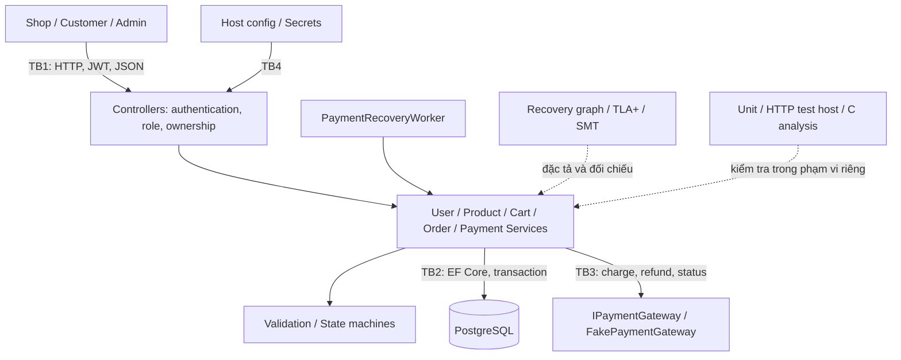
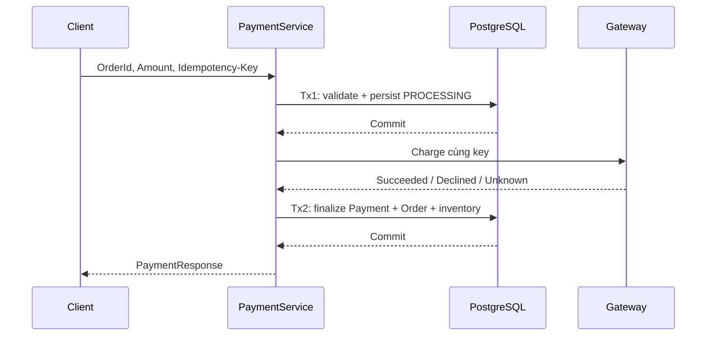

## 2. Mô tả chương trình mục tiêu và hợp đồng nghiệp vụ

### 2.1. Kiến trúc thực thi và kiến trúc kiểm chứng

Các cạnh nét liền mô tả tương tác runtime; nét đứt là hoạt động kiểm chứng ngoài
runtime. Z3, checker Kripke và sanitizer không phải thành phần mà API gọi để xử lý
mỗi request. State machine chỉ kiểm cặp trạng thái; service bổ sung điều kiện như
payment SUCCESS, amount equality và inventory RESERVED.

`Program.cs` đăng ký service scoped theo request, DbContext scoped, gateway mock
singleton và recovery worker. Khởi động yêu cầu connection string và JWT key dài
ít nhất 32 ký tự; `Data.DbInitializer` chạy migration và seed Product nếu chưa có.
Môi trường Development có OpenAPI và developer exception page; test host dùng
Testing. Các điều kiện này là cấu hình của source, không phải xác nhận môi trường
triển khai ngoài test đã được harden.

### 2.2. Mô hình dữ liệu và lớp bảo vệ

| Aggregate | Dữ liệu quan trọng | Ràng buộc hiện thực | Ý nghĩa và giới hạn |
| --- | --- | --- | --- |
| User | Email, PasswordHash, Role, IsActive | Email unique; hash password; JWT role | Role trong token đã phát hành không tự cập nhật khi database đổi |
| Product | Price, Stock, UpdatedAt, IsActive | CHECK Price>0/Stock≥0; UpdatedAt concurrency token | Application giới hạn giá; CHECK database không thay toàn bộ DTO validation |
| ShoppingCart/CartItem | UserId, Quantity, PriceAtAdd, SubTotal, TotalPrice | Ownership; CHECK Quantity>0; transaction khi add/update/remove | Cart không reserve; giá tại lúc thêm có thể khác giá lúc checkout |
| Order/OrderItem | CustomerId/UserId, TotalAmount, Status, InventoryStatus, Version | Giá server; tổng quantity theo ProductId; CHECK item quantity; Version token | Một request có thể có nhiều dòng trùng; kiểm kho dùng tổng nhưng giữ dòng riêng |
| Payment | OrderId, Amount, Status, key, refund key, AttemptCount, Version | Unique OrderId/key/refund key; exact amount; Version token | Một Order có một logical Payment record trong schema hiện tại |

Tiền lưu `numeric(19,2)`; runtime dùng `decimal`. Request Order vẫn mang UnitPrice
và TotalAmount để validation và kiểm mismatch, nhưng giá được ghi vào OrderItem
lấy từ Product. Request CustomerId bị Controller ghi đè bằng JWT subject. Vì vậy
một client truyền CustomerId khác không có quyền thay owner của đơn.

### 2.3. Tạo đơn và giữ tồn kho

`CreateOrderAsync` kiểm input, mở transaction Serializable, lấy các Product cần
thiết và tính tổng quantity bằng `long` theo ProductId. Service kiểm Product tồn
tại, active và stock đủ tổng lượng; tính serverTotal và kiểm chênh lệch với total
client không vượt 0,01. Chỉ sau các guard mới trừ kho, tạo OrderItem bằng giá server
và chuyển CREATED→VALIDATED→PAYMENT_PENDING trước khi lưu/commit.

CREATED và VALIDATED trong thao tác tạo mới thường là trạng thái trong bộ nhớ,
không phải hai bản ghi intermediate đã commit để endpoint đọc được. Khi bị reject
trước persist, không có Order durable tương ứng với PRE_PAYMENT_REJECTED của model.
Reservation được biểu diễn bằng InventoryStatus và việc giảm Product.Stock;
không có bảng reservation riêng. Đây là điều cần nêu rõ khi vẽ ERD hoặc mô tả rollback.

Ví dụ Product stock=10/price=25: hai dòng quantity=6 bị từ chối dù từng dòng đều
nhỏ hơn 10. Hai dòng quantity=5 được chấp nhận, stock về 0; cancel hợp lệ trả stock
về 10 và lần cancel thứ hai không hoàn thêm. Database CHECK là lớp cuối nếu một
đường code khác bỏ qua guard, nhưng không thay thế kiểm tổng lượng ở service.

### 2.4. Thanh toán và cửa sổ lỗi

| Vị trí lỗi | Dữ liệu durable có thể còn lại | Quy tắc xử lý |
| --- | --- | --- |
| Trước commit Tx1 | Chưa có payment mới | Rollback; chưa gọi charge |
| Sau Tx1, trước charge | Payment PROCESSING | Đối soát trước khi quyết định gọi lại cùng key |
| Gateway đã charge, Tx2 lỗi | Payment có thể vẫn PROCESSING; gateway đã thu | Không suy diễn FAILED; reconcile bằng key |
| Gateway timeout | Payment UNKNOWN nếu finalize lưu được | Giữ Order PAYMENT_PENDING và inventory RESERVED |
| Decline cuối cùng | Payment FAILED, Order FAILED | Release inventory trong transaction finalize |
| Success lưu thành công | Payment SUCCESS, Order PAID | Không cho cancel; fulfillment hoặc refund |

Idempotency ràng buộc request lặp vào cùng logical payment. Key cũ cùng amount trả
record cũ; key cũ nhưng amount khác bị conflict; Order đã có logical payment không
nhận record mới chỉ vì client tạo key khác. MaxChargeAttempts=2 gồm lần đầu và
một lần retry, không phải hai lần retry bổ sung. Hết budget vẫn UNKNOWN thì chỉ
reconcile; không được tự release reservation.

### 2.5. Hủy, fulfillment và compensation

Cancel cần state nguồn hợp lệ và không có Payment PROCESSING/UNKNOWN/SUCCESS/
REFUND_PENDING. Điều kiện service mạnh hơn bảng CanTransition: chỉ thấy Order
PAYMENT_PENDING chưa đủ để kết luận được hủy. PAID→CONFIRMED→COMPLETED yêu cầu
Admin và payment evidence; complete đổi reservation thành CONSUMED.

Refund được bắt đầu từ PAID/CONFIRMED, tạo REFUND_PENDING cho cả Order/Payment
trước lời gọi gateway. Refund thành công chuyển REFUNDED và release reservation.
Nếu refund bị decline hoặc unknown, source giữ REFUND_PENDING và lưu error;
không có một terminal “refund failed” làm mất nghĩa vụ bù trừ. Flow hiện không
hoàn tiền cho Order đã COMPLETED; không suy rộng sang chính sách trả hàng sau giao.

### 2.6. Recovery worker và giới hạn vận hành

Worker mặc định quét mỗi 30 giây, chọn payment cũ ít nhất 60 giây, batch 50; source
áp dụng mức tối thiểu 5 giây và giới hạn batch 1..500. Worker chỉ hỏi lại charge
hoặc refund, không tự phát charge retry. CancellationToken được dùng cho timer và
query; service gateway calls chưa truyền token/timeout policy của worker xuống
mọi lời gọi. Gateway treo vô hạn vì vậy chưa được chứng minh bị cắt timeout.

Integration fixture tắt worker để test HTTP xác định. Unit test reconciliation
xác minh lời gọi service trên aggregate đã lưu, không chứng minh scheduler worker,
process restart hay recovery qua một gateway bền vững. Mock memory mất dữ liệu khi
restart; cần phân biệt “có cơ chế reconcile” với “đã demo khôi phục toàn hệ thống”.

### 2.7. Input contract, attack surface và HTTP outcome

Quantity Order 1..10000; UnitPrice/amount theo guard 0,01..999999,99. Cart add nhận
1..10000; update nhận 0..10000, zero nghĩa là xóa. Registration yêu cầu email hợp
lệ, password 8..128 và tên; login vẫn cho mật khẩu legacy ngắn hợp lệ để tương
thích. Product create/update giới hạn price và stock; nullable update field nghĩa
là không thay đổi, không phải đã có chính sách xóa mọi field.

401 biểu thị thiếu identity hợp lệ; 403 biểu thị thiếu quyền; 400 là input sai;
409 là conflict nghiệp vụ hoặc persistence cạnh tranh được xử lý; 500 vẫn là lỗi
ngoài hợp đồng xử lý của endpoint. Việc source có catch DbUpdateException không
chứng minh mọi SQLSTATE/network exception đều thành 409.

Giới hạn numeric từng item chưa giới hạn số item trong collection; chưa có rate
limit riêng. API đọc danh sách chưa có pagination. Chi tiết endpoint và requirement
được giữ trong [Phụ lục A](PHU_LUC_A_G.md#phụ-lục-a--hệ-thống).

Nguồn: [Program](../../OrderPaymentMicroservice/Program.cs),
[OrderService](../../OrderPaymentMicroservice/Services/OrderService.cs),
[PaymentService](../../OrderPaymentMicroservice/Services/PaymentService.cs),
[DbContext](../../OrderPaymentMicroservice/Data/AppDbContext.cs),
[recovery worker](../../OrderPaymentMicroservice/Services/Payments/PaymentRecoveryWorker.cs).
